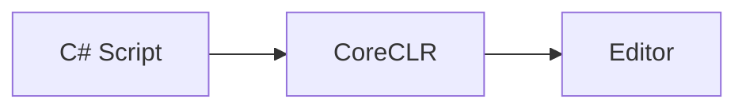

# ニュースファイルの雛形

`src/content/news/YYYY-MM-DD.md` として保存する。`items[].title` と `## N.` の見出しは完全に一致させる。front matter の文字列は `'` で囲み、文中の `'` は `''` と 2 つ重ねる（例: `'Anthropic''s Claude'`）。

````markdown
---
date: 2026-10-12
summary: '今日は〇〇と〇〇が特に面白いです。昨日まで扱った〇〇は除いています。'
items:
  - title: 'Unity 7 Alpha公開 — ついにMonoを廃止したCoreCLR Editorが動く'
    categories: [gamedev]
  - title: 'Claude Code 2.1.300 — 〇〇に対応'
    categories: [dev-tools, agents]
  # ... 約 10 本
---

今日は〇〇と〇〇が特に面白いです。昨日まで扱った〇〇は除いています。

---

## 1. Unity 7 Alpha公開 — ついにMonoを廃止したCoreCLR Editorが動く

何が発表されたかを 2〜4 段落で説明する。出典は文中に [サイト名](URL) で示す。



> [!WARNING]
> 図と囲みは必要なときだけ使う（AGENTS.md の「図・表・囲み」）。

**開発者目線:** 開発者にとってなぜ面白いか、何に使えそうかを書く。読者は不特定の開発者として、誰にでも当てはまる例を挙げる。

---

## 2. Claude Code 2.1.300 — 〇〇に対応

（同じ構成で続ける）

---

## 👀 今日ならこの3つ

### 🥇 〇〇

一言コメント。
````
