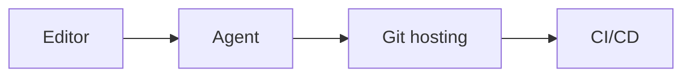
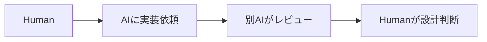

今日は **AI Agent の「モデル以外の部分」**が特に面白いです。Harness、Agent間通信、コードホスティングまで競争領域が広がっています。

---

## 1. DeepSeekが「DeepSeek Harness」をOSS化

[DeepSeek Harnessの報道](https://venturebeat.com/technology/deepseek-harness-launches-as-open-source-rival-to-claude-code-alongside-v4-pro-on-api-with-higher-prices)

DeepSeek が、AI Agentの実行基盤「DeepSeek Harness」をMITライセンスで公開。モデル、ツール、Agent loop、UIなどをプラグインとして差し替えられる設計です。最近はモデルそのものより、**「Model + Harness」でAgent性能が決まる**という考え方がかなり強くなっています。([MarkTechPost](https://www.marktechpost.com/2026/08/17/deepseek-ai-releases-deepseek-harness-in-developer-preview/))

**開発者目線:** Claude CodeやCodexのようなCoding Agentが「なぜ賢く動けるのか」を理解する教材としても面白そうです。

---

## 2. TrueForge：「AgentをSandboxに閉じ込めっぱなしにしない」設計

[TrueForgeの詳細](https://venturebeat.com/orchestration/truefoundrys-open-source-ai-agent-harness-trueforge-boasts-30-75-cheaper-task-completion-than-claude-managed-agents)

TrueFoundryのOSS Agent Harness「TrueForge」が少し話題です。特徴的なのは、Agent本体をSandbox内で常時動かさず、**ファイル操作やコード実行が必要な瞬間だけSandboxをToolとして起動する**こと。

同社は、この方式などによってClaude Managed Agents比でタスク完了コストを30〜75%下げられるとしています。設計思想は面白いです。([Venturebeat](https://venturebeat.com/orchestration/truefoundrys-open-source-ai-agent-harness-trueforge-boasts-30-75-cheaper-task-completion-than-claude-managed-agents))

> [!WARNING]
> コスト削減の数字はベンダー自身の評価なので、割り引いて見るべきです。

**開発者目線:** 自作Agentを作るなら「Agent Runtimeをどう構成するか」の参考になります。

---

## 3. A2AがAgentic AI Foundationへ

Google発の **Agent2Agent Protocol（A2A）** が、Agentic AI Foundationへ移ることが報じられました。([Axios](https://www.axios.com/2026/08/17/a2a-agentic-ai-foundation-open-ai-standards))

かなり乱暴に整理すると、

**MCP → Agent ↔ Tool / Data**
**A2A → Agent ↔ Agent**

という関係です。

**開発者目線:** MCPを追っているならA2Aもウォッチ対象。今後「Claude Agentが別会社のAgentへ仕事を委譲する」といった構成が普通になる可能性があります。

---

## 4. CursorがGitHub対抗「Origin」を開始

Cursor がコードホスティングサービス **Origin** をearly betaで展開しています。Repository、PR、コード閲覧・編集などを備え、GitHubとの同期にも対応。今後は「agent-native features」を増やす方針です。([IT Pro](https://www.itpro.com/software/development/vibe-coding-startup-cursor-just-launched-a-github-alternative-heres-what-users-can-expect))

**開発者目線:** AI Coding競争の範囲が、EditorからCI/CDまで広がってきました。

GitHubを単なるGit置き場ではなく「Agentの作業基盤」として再設計する競争になりそうです。

---

## 5. GitHub、約8時間の大規模障害について説明

[GitHub公式の障害振り返り](https://github.blog/news-insights/company-news/the-august-17-outage-and-the-work-ahead/)

8月17日に [GitHub](https://github.com/) が **7時間47分**にわたる大規模障害を起こし、GitHub.com、認証、Actions、API、PR、Issues、Copilotなど広範囲に影響しました。GitHub自身が8月20日に振り返りを公開しています。([The GitHub Blog](https://github.blog/news-insights/company-news/the-august-17-outage-and-the-work-ahead/))

**開発者目線:** GitHub Actionsまで依存しているチームではGitHub障害＝「コードを見る・レビューする・CIする・デプロイする」がまとめて止まり得ます。BCP的にも興味深い事例です。

---

## 6. ローカルAI Agentが再び面白くなってきた

NVIDIA が8月11日、ローカル環境でOpen ModelやAgentを動かすエコシステムについて紹介。クラウド一辺倒だったAgentが、ローカル実行へ広がっています。([NVIDIA Blog](https://blogs.nvidia.com/blog/local-ai-open-source-models-agents-nemotron/))

背景には **PrivacyだけでなくAgentのToken消費量**があります。Agentは長時間動作すると推論量が膨らむので、ローカルGPUの固定費モデルが意外と噛み合います。8月19日公開のローカルLLMツール比較でも、この「コスト構造」が主要な利点として挙げられています。([StorageReview.com](https://www.storagereview.com/best/local-llm-tools))

**開発者目線:** 「軽い作業はLocal Model、難しい作業だけClaude/GPT」というAgent構成は今後かなり現実的かもしれません。

---

## 7. AI AgentにもZero Trustを、Microsoftがガイドを更新

[Microsoft Zero Trust for AI](https://www.microsoft.com/en-us/security/blog/2026/08/04/advance-zero-trust-for-ai-new-tools-and-guidance-to-secure-ai-agents-and-devsecops/)

Microsoft が「Zero Trust for AI」を拡張し、Agent、コード、Memory、Identityなどを含むセキュリティ指針を公開しています。([Microsoft](https://www.microsoft.com/en-us/security/blog/2026/08/04/advance-zero-trust-for-ai-new-tools-and-guidance-to-secure-ai-agents-and-devsecops/))

これは地味ですが重要で、Coding Agentが

`GitHub → Shell → AWS → Slack → Jira`

のように大量の権限を持ち始めると、Agent自体が巨大な権限境界になります。

**開発者目線:** MCP Serverを増やすほど「便利だから全部許可」は危険になります。Agentごとの権限分離が普通になりそうです。

---

## 8. Web UIをAgentから操作する「WebMCP」という方向性

Progress SoftwareがTelerik/Kendo UIに、**WebMCP** と呼ぶAgent向けインターフェースを追加しました。AI Agentが画面を画像認識してクリックするのではなく、Webアプリ側から構造化された操作手段を提供する考え方です。([Express Computer](https://www.expresscomputer.in/news/progress-software-expands-telerik-and-kendo-ui-with-ai-capabilities-for-agent-ready-applications/137991/))

**開発者目線:** 個人的に今日の小ネタ枠ではかなり面白いです。

人間 → GUI
Agent → MCP/API

のように、**最初からAgent用UIを持つWebアプリ**が増える可能性があります。

---

## 9. AIコードレビューのCodeRabbitにBMWが投資

BMW i Venturesが8月12日、AIコードレビューサービス [CodeRabbit](https://www.coderabbit.ai/) への投資を発表しました。([BMW Group PressClub](https://www.press.bmwgroup.com/usa/article/detail/T0460064EN_US/bmw-i-ventures-invests-in-coderabbit-to-advance-independent-ai-review-in-software-development?language=en_US))

面白いのは単なる「コード生成AI」ではなく、**AIが書いたコードを別のAIがレビューする領域**にも資金が流れていること。

**開発者目線:** Coding Agent普及後は、次のような分業が普通になっていきそうです。

---

## 10. 脳型チップ向けSoftware StackまでOSS化

BrainChipがニューロモーフィックチップAKD1500向けSoftware StackをOSSとして公開。Spiking Neural Networkを各種マイコン環境で扱えるようにするものです。([Open Source For You](https://www.opensourceforu.com/2026/08/brainchip-software-stack-akd1500/))

**開発者目線:** すぐゲーム開発に使うものではありませんが、「LLM＝AI」以外の世界を見る小ネタとして面白いです。超低消費電力Edge AIではニューロモーフィック方式も引き続き研究・製品化されています。

---

## 🔎 今日の3つだけ読むなら

**DeepSeek Harness**は、Coding Agentの「モデル以外」の設計を理解する材料としてかなり面白そう。

**A2A**は、MCPの次にAgent開発で標準化する可能性があるので継続ウォッチ。

そして **WebMCP**。APIを後付けするのではなく、「人間用GUI + Agent用Interface」を最初からアプリ設計に組み込む考え方は、今後かなり広がるかもしれません。

今日はかなり **Agent Runtime / Agent Infrastructure寄りの日**でした。
