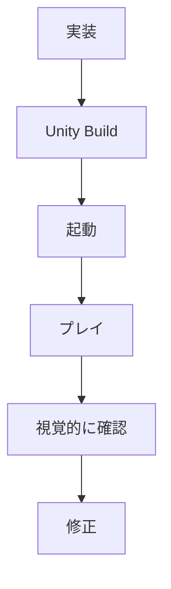

今朝は、昨日 **8月26日** に出た話を中心に拾いました。今日は「モデル性能」より、**Coding Agentを実際の開発環境へ組み込んだ後に何が起きるか**という話が多めです。

---

## 1. Meta「XR Operator」— AI AgentがVRゲームを“実際に遊んで”テスト

Meta が実験的な開発ツール **Meta XR Operator** を公開しました。Coding AgentがQuest向けゲームをビルドするだけでなく、ヘッドセット上で起動し、画面を見て操作し、問題を発見して修正するところまで自動化する狙いです。([Road to VR](https://roadtovr.com/meta-ai-vr-dev-tool-test-quest-games/))

ゲーム開発ではかなり面白い方向性で、次のような従来AIが苦手だったループに踏み込み始めています。

**ゲーム開発者目線:** Unity Test Runnerのようなコードレベルのテストとは別に、**「実際にゲームをプレイするAgent」**がCIに入ってくる未来が見えてきます。

---

## 2. GitHub Copilot、企業全体で「使ってよいモデル」を制御可能に

[GitHub公式：Global model policy GA](https://github.blog/changelog/2026-08-26-global-model-policy-generally-available/)

[GitHub](https://github.com/) が8月26日、Copilot Business / Enterprise向けの **Global Model Policy** をGAにしました。

管理者が「新しいモデルをデフォルトで許可する / 拒否する」を企業単位で決められ、個別モデルについて例外設定もできます。8月26日から段階的に適用され、9月1日までに展開予定です。([The GitHub Blog](https://github.blog/changelog/2026-08-26-global-model-policy-generally-available/))

**開発者目線:** Claude、GPT、Geminiなどモデル追加速度が上がった結果、企業側では「どれを使わせるか」という**モデルGovernance**が普通の管理対象になってきました。

---

## 3. OpenAI Assistants APIが終了。Responses APIへ

以前から告知されていましたが、**8月26日がAssistants APIの終了日**でした。([Tech Times](https://www.techtimes.com/articles/325345/20260824/openai-assistants-api-shuts-down-tuesday-no-automated-migration-threads-risk.htm))

> [!WARNING]
> 旧API依存のアプリはResponses API側への移行が必要です。

OpenAI のAPI設計も、

`Assistant / Thread / Run`

という比較的固定的な抽象化から、

`Model + Tool + Agent workflow`

を柔軟に組み立てる方向へ移っています。

**開発者目線:** AI APIは変化がかなり速いので、アプリのDomain Logicを特定ベンダーのAgent APIへ直接結合しない設計はますます重要です。

---

## 4. Google「Gemini 3.5 Transcribe」公開

[Google公式：Gemini 3.5 Transcribe](https://blog.google/innovation-and-ai/models-and-research/gemini-models/gemini-3-5-transcribe/)

Google が8月26日、新しいSpeech-to-Textモデル **Gemini 3.5 Transcribe** を発表しました。Googleは自社で最も高精度な音声認識モデルとしています。([blog.google](https://blog.google/innovation-and-ai/models-and-research/gemini-models/gemini-3-5-transcribe/))

単なる文字起こしではなく、音声Agentなど**リアルタイムVoice Interface**をかなり意識したモデルです。

**開発者目線:** LLMのUIが「Chat textbox」から音声へ広がるほど、STT → LLM → TTSを別々に扱うより、Agent Runtime側で一体化する設計が増えそうです。

---

## 5. Google、vLLMをCloud TPUで本格的に動かす仕組みを公開

[Google Developers Blog](https://developers.googleblog.com/enterprise-grade-precision-for-long-context-multimodal-embedding-inference-on-cloud-tpu/)

8月26日、Googleが **vLLM + TPU + GKE** を使った長文Embedding推論の実装を公開しました。

15K token超のQwen3-Embedding-8Bなどを対象に、JAX/XLAのcompile warm-up、chunked prefillなどTPU向けの最適化を実装しています。([developers.googleblog.com](https://developers.googleblog.com/enterprise-grade-precision-for-long-context-multimodal-embedding-inference-on-cloud-tpu/))

**開発者目線:** vLLMというとNVIDIA GPUの印象が強かったので、**Open ModelのServing LayerがGPUからTPUにも広がっている**のが面白いところです。

---

## 6. AI Coding Agent、「信用しているけど結局コードは人間が確認」が多数派

8月26日に公開された開発者調査では、Coding Agent利用がかなり一般化した一方、productionへ入れる前には依然として人間によるverificationを行う開発者が多いと報告されています。([Developer Tech News](https://www.developer-tech.com/news/developers-trust-ai-agents-still-verify-code-manually/))

これは最近の流れをかなりよく表していて、

**AIがコードを書く速度 → 急上昇**

なのに対して、

**人間がレビューできる速度 → ほぼ変わらない**

という新しいボトルネックが生まれています。

**開発者目線:** 今後重要になるのは生成能力だけでなく、Test・Static Analysis・AI Review・Architecture Constraintなど、**AIの出力を安く検証する仕組み**だと思います。

---

## 7. SandboxAQ「Switch」をOSS化 — Slackに複数Agentを呼び込む

SandboxAQ が **Switch** をOSSとして公開しました。

Slack、Teams、Discordなどの会話へ、異なるFrameworkで作られた複数のAI Agentを参加させるための仕組みです。([HPCwire](https://www.hpcwire.com/aiwire/2026/08/26/sandboxaq-open-sources-switch-to-bring-ai-agents-into-team-workspaces/))

イメージとしては、

`人間A + 人間B + Claude系Agent + 自社Agent + Review Agent`

が**同じチャットルームで会話する**感じ。

**開発者目線:** Agent専用UIを作るのではなく、既存のSlackを**Human-Agent Workspace**にする発想は実務導入しやすそうです。

---

## 8. Godot支援企業W4 Gamesが$18M調達、Tencentとも提携

W4 Games が **1,800万ドルを調達**し、Tencentと複数年の戦略提携を締結しました。目的の一つはアジアでのGodot ecosystem拡大です。([Game Developer](https://www.gamedeveloper.com/business/w4-games-raises-18m-to-expand-its-international-team))

**ゲーム開発者目線:** Unityの直接的な競合という意味でも少し気になります。

Godot本体はOSSですが、Console対応やEnterprise Supportなど**商用利用で必要になる周辺部分をW4が埋める**構造が成熟してきています。

---

## 9. ちょっと面白い：ゲームにQuantum Computingを組み込む実験

フィンランドのゲームスタジオMiTaleが、RPG **C.L.A.Y. – The Last Redemption** でQuantum Computingをゲーム開発へ応用する実験を進めています。([Quantum Insider](https://thequantuminsider.com/2026/08/25/finnish-game-studio-mitale-quantum-computing-game-development/))

量子回路を使ってゲーム世界やStory variationへ影響を与える研究的な取り組みで、もちろん「量子コンピュータでゲームが高速になる」という話ではありません。

**ゲーム開発者目線:** 実用性というより完全に**今日の変な技術枠**。Procedural Generationに量子的な確率モデルを持ち込む発想は面白いです。

---

## 10. 28,000件の公開 `.git` からCredential流出という調査

インターネット上で公開状態になっている `.git` repositoryを調査したところ、約28,000件からAWS、OpenAI、Stripe、GitHubなどのCredentialが発見されたというSecurity調査が報告されています。([GBHackersセキュリティ](https://gbhackers.com/28000-exposed-git-repositories/))

Coding Agent時代にはさらに注意が必要です。

AgentへRepository全体を読ませると、

`.env`
`.git/config`
SSH key
CI secret周辺ファイル

などへ到達できる可能性があります。

**開発者目線:** `.gitignore`だけではCredential管理になりません。Secret Scanning + 最小権限 + 短命Tokenを組み合わせる設計がより重要になります。

---

## 👀 今日ならこの3つ

一番面白いのは **Meta XR Operator** です。

Coding Agentの次の大きな壁は「コードを書ける」ではなく、**自分が作ったソフトウェアを実際に操作して良し悪しを判断できること**なので、ゲームをプレイして確認するAgentはかなり本質的です。

次は **Human Verification問題**。Coding Agentを増やすほど人間のレビュー待ちがボトルネックになるので、今後は「コード生成AI」より**検証を自動化する技術**が面白くなりそうです。

そして小ネタ枠なら **量子コンピュータ × ゲーム**。こういう「今すぐ役立つわけではないけれど妙に面白い技術」も見逃せません。
