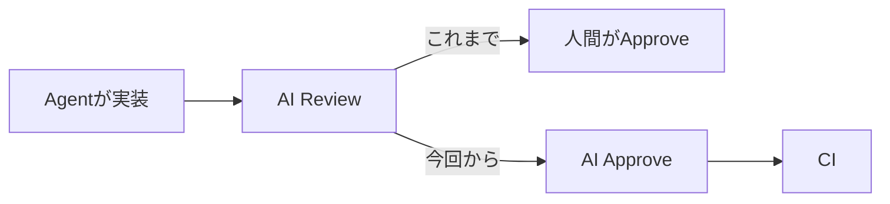
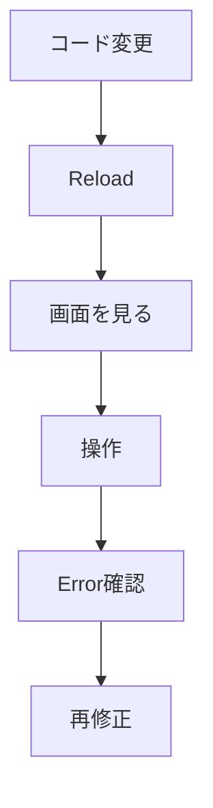

今朝は **「Coding Agentが書くだけでなく、自分で確認・レビュー・承認する」** 方向への進展が目立ちます。9月1日前後の新着を中心に、ここ数日扱った話はなるべく外しました。

---

## 1. GitHub Copilot、ついにPRを「Approve」可能に

[GitHub公式：Copilot code review can now approve pull requests](https://github.blog/changelog/2026-09-01-copilot-code-review-can-now-approve-pull-requests/)

[GitHub](https://github.com/) Copilot Code Reviewが、レビュー結果から「このPRはApproveしてよい」と判断し、管理者が許可していれば**実際にApproveまで行える**ようになりました。デフォルトではOFFで、Enterprise / Organization / Repository単位で制御できます。([The GitHub Blog](https://github.blog/changelog/2026-09-01-copilot-code-review-can-now-approve-pull-requests/))

> [!WARNING]
> 9月1日からPublic Previewです。

**開発者目線:** これは結構大きいです。これまでは人間がApproveしていたところを、AI ApproveからCIまで進められます。

当然、Branch Protectionや「AIだけでMergeさせるか」というGovernance設計が重要になります。

---

## 2. Compose Multiplatform、Coding Agentが自分のUIを操作して確認可能に

[JetBrains公式：Compose Multiplatform 1.12.0](https://blog.jetbrains.com/kotlin/2026/08/compose-multiplatform-1-12-0/)

JetBrains のCompose Multiplatform 1.12.0で、Compose Hot Reloadに**実験的MCP Server**が入りました。

Agentから、Hot Reload、Screenshot取得、Semantic Tree確認、Click、Text入力、Application Log取得までできます。つまりAgent自身が、次のループを回せます。([The JetBrains Blog](https://blog.jetbrains.com/kotlin/2026/08/compose-multiplatform-1-12-0/))

**開発者目線:** 個人的に今日一番面白いです。ゲーム開発で考えると、Unity Editor / Device Simulator / Play Modeにも同じようなAgent操作Interfaceが欲しくなります。

---

## 3. OpenClaw 2.0級の大型更新 — RuntimeからSecretsまで全面改修

[OpenClaw 2.0の詳細](https://www.infoworld.com/article/4216966/openclaw-rolls-out-system-wide-overhaul-updates-security-controls-across-agent-platform.html)

Agent PlatformのOpenClawが、プロジェクト自身が「史上最大」と呼ぶ **2026.8.1** Updateを公開しました。

Installation、Messaging、Memory、Skills、Models、Automation、Browser、Native App、Plugins、Securityなど、ほぼ全体が更新されています。特にSecret HandlingなどEnterprise運用を意識したSecurity Controlも強化されています。([InfoWorld](https://www.infoworld.com/article/4216966/openclaw-rolls-out-system-wide-overhaul-updates-security-controls-across-agent-platform.html))

**開発者目線:** Agent Frameworkが単なる、

`while (LLM → tool)`

では済まなくなっています。Memory / Permission / Secrets / Plugin / Browser / Observabilityまで含めた**Agent Runtimeそのものが巨大なSoftware Platform**になりつつあります。

---

## 4. Anthropic「Enterprise Frontier Safeguards」— ZDRと継続監視を両立

[Anthropic公式：Enterprise Frontier Safeguards](https://www.anthropic.com/news/enterprise-frontier-safeguards)

Anthropic がEnterprise向けの新しいSafety / Security Controlを発表しました。

興味深いのは、Zero Data Retention（ZDR）が必要な規制産業でも、**顧客自身のCloud Account内にActivity Dataを保持して継続的なSafety Monitoringを可能にする**設計です。AWS、Google Cloud、Microsoft Azure経由でも同等Controlを提供するとしています。([Anthropic](https://www.anthropic.com/news/enterprise-frontier-safeguards))

**開発者目線:** AI Governanceが「会話を保存する / しない」の二択から、**データのOwnershipとMonitoring場所を分離する**設計へ進んでいます。

---

## 5. DeepSeek初のV4系Visionモデル、Agent用途をかなり意識

[DeepSeek-V4-Flash-Vision-Exp](https://huggingface.co/deepseek-ai/DeepSeek-V4-Flash-Vision-Exp)

DeepSeek の **DeepSeek-V4-Flash-Vision-Exp** がOpen Weightで公開されています。305B parameters、MIT Licenseの実験モデルです。([Hugging Face](https://huggingface.co/deepseek-ai/DeepSeek-V4-Flash-Vision-Exp))

普通の画像理解モデルというより**Multimodal Agent**を強く意識しており、DeepSeek自身の評価ではApexBenchが従来Flashの26.2 → 36.5へ改善。Text Agent性能も維持したとしています。([Hugging Face](https://huggingface.co/deepseek-ai/DeepSeek-V4-Flash-Vision-Exp))

**開発者目線:** Coding AgentがScreenshotやGUIを扱い始めたことで、「Vision性能」がCoding Agent性能の一部になってきました。Compose MCPの話とも綺麗につながります。

---

## 6. Apache Fory 1.7 — Kotlin / Scalaで高速JSON Serialization

[Apache Fory 1.7の詳細](https://www.infoworld.com/article/4217112/apache-fory-serialization-framework-adds-json-support-for-kotlin-and-scala.html)

Apache Fory 1.7.0がリリースされ、Scala 2.13 / 3とKotlin向けのJSON Serializationが追加されました。Kotlin側はJVM、Android API 26+、GraalVM Native Imageをサポートします。([InfoWorld](https://www.infoworld.com/article/4217112/apache-fory-serialization-framework-adds-json-support-for-kotlin-and-scala.html))

Fory自体はJITやZero-copyを利用する高速Serialization Frameworkで、Java、Python、C++、Go、Rust、JS/TSなど12言語をサポート。今回、NDJSONなどのIncremental Stream Decodeも追加されています。([InfoWorld](https://www.infoworld.com/article/4217112/apache-fory-serialization-framework-adds-json-support-for-kotlin-and-scala.html))

**開発者目線:** 派手ではないですが、Backend / Tool開発ではこういう**高速Cross-language Serialization**は地味に面白い領域です。

---

## 7. Go 1.27、ついにGeneric Methods

Go 1.27で、Generic Methodsのサポートが入っています。([InfoWorld](https://www.infoworld.com/article/4214999/go-1-27-brings-support-for-generic-methods.html))

GoのGenericsは意図的にかなり保守的に導入されてきましたが、Method側でもType Parameterを扱えるようになり、Generic ContainerやFluent APIなどの設計自由度が上がります。

**開発者目線:** GoはAgent InfrastructureやCloud Backendでも非常によく使われるので、Library API設計への影響は大きめ。言語機能としては今週かなり注目してよい変更です。

---

## 8. npm Supply Chain Attack、週15万DownloadのPackageも侵害

週約15万Downloadされているnpm Packageが侵害され、Credentialを盗むMalicious Versionが配布されたと報告されています。([Cyber Security News](https://cybersecuritynews.com/popular-npm-package-2/))

Developer MachineだけでなくCI EnvironmentのTokenなども標的になります。

**開発者目線:** Coding Agentが自律的に、

`npm install <package>`

するようになるほど、この問題は悪化します。

Agent Permissionだけでなく、**Agentが追加してよいDependencyをPolicyで制御する**仕組みが必要になってきます。

---

## 9. Kobo電子書籍Reader向け「Cobalt」— 非公式Application Platform

今日の**変なDeveloper Tool枠**。

Rakuten Kobo の電子書籍Reader向けに、OSS Application Platform **Cobalt** が登場しています。Launcher、SDKなどを提供し、Kobo上で独自Applicationを動かせます。([Adafruit](https://blog.adafruit.com/2026/09/01/cobalt-apps-and-an-sdk-for-kobo-e-readers/))

**開発者目線:** E-Ink端末は低消費電力・常時表示という特徴があるので、

Dashboard
TODO
Home Automation Controller
AI Agent Display

など、普通のTabletとは違う自作Device用途が面白そうです。

---

## 10. PyEncode — 量子状態Encodingを簡単にするOSS Python Library

最後は研究寄り小ネタ。

University of Wisconsin–Madisonの研究チームが、Quantum State Preparationを簡単にするOSS Python Library **PyEncode** を公開しました。([Quantum Zeitgeist](https://quantumzeitgeist.com/wisconsin-madison-university-source-quantum/))

量子Algorithmでは古典DataをQuantum StateへEncodingする部分自体が難所になります。そこをAlgorithm選択やCircuit生成を含めて抽象化する狙いです。

**開発者目線:** 今すぐ一般開発で使うものではありませんが、量子Computingでも「低レベルCircuitを書く」から**Library / Compilerに任せる**方向へSoftware Stackが育っているのが面白いところです。

---

## 👀 今日ならこの3つ

今日は **Compose Multiplatform + MCP** が一番おすすめです。「AIがコードを書ける」の次に必要なのは、**自分の変更結果をAI自身が確認できること**。Screenshot・Semantic Tree・Click・LogまでAgentへ渡したComposeのアプローチはかなり本質的です。([The JetBrains Blog](https://blog.jetbrains.com/kotlin/2026/08/compose-multiplatform-1-12-0/))

次が **CopilotのPR Approve**。Agentが実装だけでなくReviewer側にも入ることで、人間が担うべき境界をチームごとに決める必要が出てきました。([The GitHub Blog](https://github.blog/changelog/2026-09-01-copilot-code-review-can-now-approve-pull-requests/))

そして小ネタなら **Kobo + Cobalt**。こういう「電子書籍端末をApplication Platformにしてしまう」系のHackは、毎日のブリーフィングにも引き続き混ぜていきます。
