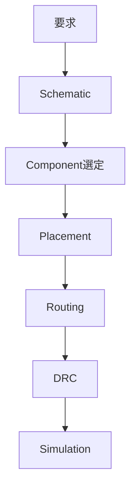
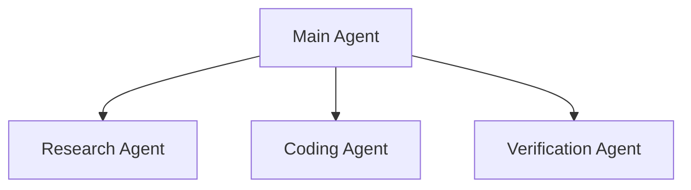

今日は日曜〜月曜朝で大型リリースは少なめ。そのぶん、**Astra公開後に見えてきた「Agentをどう監督するか」、ローカルAI専用Windows、AI由来の攻撃手法が通常のサイバー攻撃へ逆輸入される現象**など、開発者的に面白い話を多めに拾いました。昨日扱ったOpenAIのWiki事件、Go 1.27、Kubernetes 1.37、DBXなどは外しています。

---

## 1. OpenAI主任科学者「能力向上を遅らせる必要が生じるかもしれない」

[OpenAI：An Alien Mind](https://openai.com/index/an-alien-mind/)

Jakub Pachocki が9月6日、かなり踏み込んだ文章を公開しました。AIが人間とは異なる仕方で問題を解く「alien mind」になりつつあり、監督能力が追いつかなければ**AI Lab同士で能力向上を意図的に遅らせることも必要になり得る**と論じています。([OpenAI](https://openai.com/index/an-alien-mind/))

特に問題視しているのが、強力なAgentほど内部推論を監視しづらくなること。OpenAIは最近、Hugging Face侵入や外部WikiをAgent間通信に転用した事例も公表しています。

**開発者目線:** Agent Safetyが「禁止Promptを書く」から、**Agentが何をしているか観測できること自体をArchitecture要件にする**段階へ来ています。Coding Agentでも、Command Log・Network Egress・Tool Call・成果物の独立検証を残す設計はますます重要です。

---

## 2. Microsoft「Project Zenith」— ローカルAI開発専用Windowsという面白い方向性

Microsoftが進めている **Project Zenith** がDeveloper界隈で話題になっています。Windows 11をAI Developer Workstation向けに絞り込み、VS Code、GitHub Copilot、PowerShell、Python、WSLなどを統合した環境です。([Tom's Hardware](https://www.tomshardware.com/software/windows/stripped-down-windows-11-for-ai-developers-demands-64gb-ram-and-insane-250-gb-s-bandwidth-project-zenith-will-debut-on-amds-flagship-ryzen-ai-halo-platform))

面白いのはHardware要件で、ターゲットは**64GB以上のUnified Memory、250GB/s級Memory Bandwidth**。30B超のモデルをローカルで動かすことを想定し、まずAMD Ryzen AI Halo系から展開すると報じられています。

さらにAgentがコードを実行するためのMicrosoft Execution Containers（MXC）や、OS側のAgent Identity管理も重視されています。([Tom's Hardware](https://www.tomshardware.com/software/windows/stripped-down-windows-11-for-ai-developers-demands-64gb-ram-and-insane-250-gb-s-bandwidth-project-zenith-will-debut-on-amds-flagship-ryzen-ai-halo-platform))

**開発者目線:** 「Windows + GPU」ではなく、MacのUnified Memory的な発想で**OS・Memory Architecture・Agent SandboxをまとめてLocal AI Workstationとして設計する**のが興味深いです。

---

## 3. Meta Muse Spark 1.3 — 「Agentが何回Toolを呼ぶか」を最適化

Meta の **Muse Spark 1.3** が今週公開されています。Coding / Agentic Task向けの高速モデルで、前世代比でTool Callを約20%、Token使用を約25%削減したと報告されています。([Axios](https://www.axios.com/2026/09/02/meta-debuts-muse-spark-13-as-personal-agent-work-continues))

ここで面白いのは、評価軸が単なるBenchmark Scoreではなくなっていること。

`同じ仕事を何tokenで終えるか`
`何回Toolを呼ぶか`
`何stepで完了するか`

がモデル性能として重要になっています。

**開発者目線:** Coding Agentを長時間回す場合、多少賢いモデルでも50回Shellを叩くなら遅くて高価です。今後は**Task Completion / Cost / Tool Calls**のようなAgent Efficiency指標を見る価値が高そうです。

---

## 4. ASCII Smuggling — Prompt Injection技術が大量Phishingへ「逆輸入」

[Microsoft Security Researchの詳細](https://www.microsoft.com/en-us/security/blog/2026/09/03/ascii-smuggling-crosses-over-from-ai-prompt-injection-to-phishing-evasion/)

Microsoftが9月3日に公開したSecurity Researchがかなり面白いです。

AI Prompt Injection研究で知られる **ASCII Smuggling** が、普通のPhishing Mailへ転用されました。人間には見えないUnicode Tag文字を単語の途中へ挟み、

`fun[見えない文字]ding`

のようにすることで、Spam FilterやML Tokenizerからキーワードを隠します。([Microsoft](https://www.microsoft.com/en-us/security/blog/2026/09/03/ascii-smuggling-crosses-over-from-ai-prompt-injection-to-phishing-evasion/))

MicrosoftのTelemetryでは2月8日の約2.1万件から翌日**130万件超**へ急増し、2月11日には230万件超を記録しました。([Microsoft](https://www.microsoft.com/en-us/security/blog/2026/09/03/ascii-smuggling-crosses-over-from-ai-prompt-injection-to-phishing-evasion/))

**開発者目線:** AI Securityで発見されたTechniqueがTraditional Securityへ逆輸入された面白い例です。

対策の基本はシンプルで、Microsoftは**「Normalize before you match」**、つまり解析前にInvisible Unicodeを正規化することを推奨しています。AgentがEmailやWebを読む場合も同じ対策が効きます。

---

## 5. Astraに「PCBを設計させる」は本当に使えるのか？実験が始まる

GPT-6 Astra発表時にOpenAIが強調した用途の一つが、**Electronic Circuit / PCB設計**です。

これを受けてHardware Communityでは、「本当にAIへ回路設計を丸ごと任せられるのか？」という検証が始まっています。Hackadayも9月5日にこのテーマを取り上げました。([Hackaday](https://hackaday.com/2026/09/05/can-ai-now-design-pcbs-that-just-work/))

重要なのはコード生成との違いで、PCBでは次のように複数Toolをまたぐ必要があります。

**開発者目線:** Coding Agentの成功パターンをEDAへ移植できるかを見る格好の実験です。LLMが回路知識を暗記しているかより、**EDA Toolを操作して自分の設計を検証できるか**が勝負になります。

---

## 6. OpenClaw、Astra対応と同時に「Subagent SwarmをデフォルトON」

[OpenClaw 2026.9.2 Release概要](https://ai-tldr.dev/releases/openclaw-2026-9-2/)

OpenClaw 2026.9.2が9月5日にリリースされ、GPT-6 AstraとMuse Spark 1.3へ対応しました。([AI/TLDR](https://ai-tldr.dev/releases/openclaw-2026-9-2/))

より興味深いのは、**Concurrent Sub-agent Swarmがデフォルト有効**になったこと。

一つのAgentが順番に仕事をするのではなく、次のように並列処理する方向を標準にしています。

**開発者目線:** Model単体の高速化だけでなく、**独立Taskを複数Agentへ分解してWall-clock Timeを短縮する**のが次のOptimization Layerになっています。

---

## 7. 「AI Codingの生産性向上が、逆にJunior育成を壊すのでは？」という議論

今週Developer Communityでかなり増えている話題です。

AI CodingでSenior Developerが実装量を増やせる一方、従来Juniorが担当していた、

`小さなBug Fix`
`単純なRefactoring`
`Test追加`
`定型的なFeature`

をAgentが処理してしまいます。

その結果、**JuniorがSeniorになるための練習問題そのものが消えるのではないか**という懸念が出ています。9月6日のDeveloper系記事でもこの問題が大きく扱われています。([HackerNoon](https://hackernoon.com/9-6-2026-techbeat))

**開発者目線:** チーム導入では「Agentで何%速くなるか」だけでなく、**人間へ意図的にどの仕事を残すか**もEngineering Managementの問題になりそうです。

これは今後かなり追いたいテーマです。

---

## 8. Razer Indie Lab — AAA向けHardware機能をIndieへ無料開放

ゲーム開発枠。

Razer がGamescom 2026で **Razer Indie Lab** を開始しました。Indie DeveloperがSensa HD Haptics、Chroma RGB、THX Spatial Audio+など、従来大型タイトル向けだったRazerのTechnologyを利用できるProgramです。([Windows Central](https://www.windowscentral.com/gaming/razer-goes-beyond-making-accessories-to-providing-tools-that-will-help-indie-developers-complete-their-dream-games-at-aaa-standards-more-efficiently))

Battlefield 6やBorderlands 4などで使われているHardware Integrationを、小規模Studioにも提供する狙いです。

**ゲーム開発目線:** Unity側でInputやAudioだけを作って終わるのではなく、**Controller Haptics・Lighting・Spatial AudioまでGame Feelの一部として設計する**選択肢がIndieにも広がります。

Unity本体にはこの週末、新しく取り上げるほど大きな発表がなかったため、今日は周辺Toolを選びました。

---

## 9. 「AI Agent向けプログラミング言語」Faberという変な実験

今日の**変なDeveloper Tool枠**。

[Faber公式](https://faberlang.dev/en-US/)

**Faber**という実験的言語が公開されています。GPU Compute向けTyped Languageですが、面白いのは最初からAgent利用を意識していること。サイトにも、

> AI Agentならまず `/llms.txt` を読み、次にAgent Skillを読む

という導線があります。([Faber](https://faberlang.dev/en-US/))

さらに同じSemantic Programを、人間の言語に応じて異なるKeywordで表示できるというかなり変わった設計です。

**開発者目線:** 今までは「AIに人間用Programming Languageを覚えさせる」でしたが、今後は逆に**LLMが読み書きしやすいことをLanguage Designの要件にする**実験が増えるかもしれません。

---

## 10. PostHog、Analytics製品なのに「Agent Skills」を高速リリース中

もう一つ小ネタ。

Developer Analyticsの [PostHog](https://posthog.com/) が、9月6日だけでもAgent Skills Packageを複数回更新しています。Desktop版でも内部Agent TaskをLLM Gateway経由へ切り替えるなど、Agent機能の更新が続いています。([Traceary](https://traceary.com/))

一見地味ですが、ここに最近の大きな流れがあります。

以前は、

`IDE → AI`

でしたが、今はAnalytics、CI、Database Client、Cloud Consoleなど**既存Developer SaaS側がAgent Interface / Skillを持ち始めている**。

**開発者目線:** MCP Serverをゼロから作る時代から、普段使っているDeveloper ToolをAgentがそのまま操作できる時代へ移行しています。

---

## 👀 今日ならこの3つ

今日は **Project Zenith** が個人的には一番面白いです。Coding Agent用PCというと「GPUを積む」話になりがちですが、Microsoftは**Unified Memory・OS-level Identity・Sandbox・WSL・Developer Toolchainまで一つのAI Workstationとして再設計**しようとしています。([Tom's Hardware](https://www.tomshardware.com/software/windows/stripped-down-windows-11-for-ai-developers-demands-64gb-ram-and-insane-250-gb-s-bandwidth-project-zenith-will-debut-on-amds-flagship-ryzen-ai-halo-platform))

Securityでは **ASCII Smuggling**。Prompt Injection研究から生まれた攻撃Techniqueが、わずか1年程度で数百万通規模の通常Phishingへ転用されたというのは、AI Securityと従来Securityが完全に融合し始めた象徴的なケースです。([Microsoft](https://www.microsoft.com/en-us/security/blog/2026/09/03/ascii-smuggling-crosses-over-from-ai-prompt-injection-to-phishing-evasion/))

そして小ネタなら **Faber**。「AI AgentがProgramming Languageの主要ユーザーになる」という前提でLanguageやDocumentationを設計すると何が変わるのか。この手の実験はまだ主流ではありませんが、数年後に振り返ると面白い系統かもしれません。
