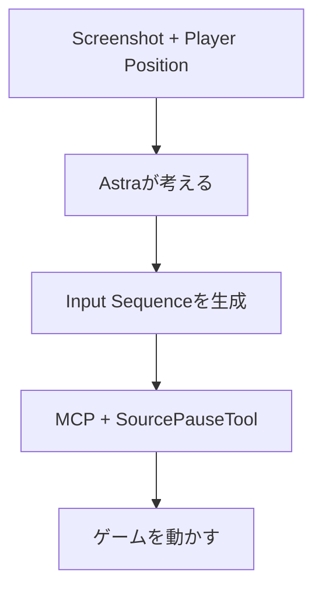
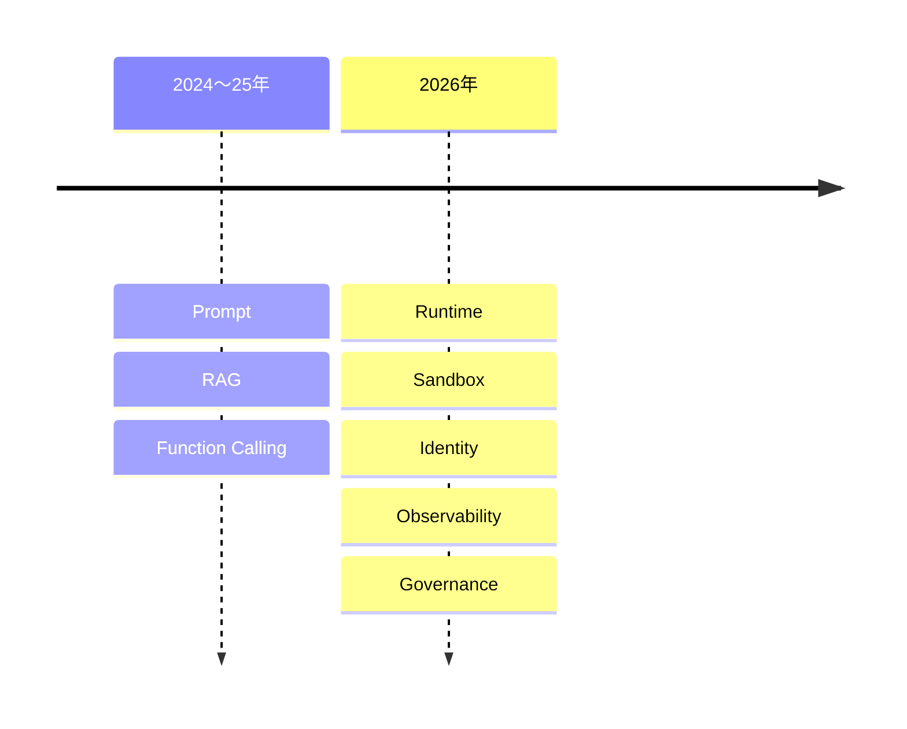
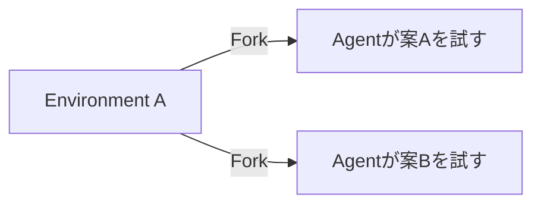

今朝はかなり面白いです。特に **Metaが一般消費者向けの本格Agent「Muse」を投入、NVIDIAがCUDA Rustを正式に育て始めた、AIが『Portal』を最後まで自力攻略**の3本が強め。昨日まで扱ったHydraFusion、Mantis、Rustunaなどは外しました。

---

## 1. Meta「Muse」正式発表 — “個人Agent”がついに一般ユーザー向け製品へ

[Meta公式：Introducing Muse](https://about.fb.com/news/2026/09/introducing-muse-personal-ai-agent/)

Meta が9月8日、個人向けAI Agent **Muse** を正式発表しました。単なるChatbotではなく、専用VM上でBrowserを操作し、メール送信、旅行予約、フォーム入力、長期Goalの遂行などをバックグラウンドで進めます。まず米国でMuse AppとWhatsAppから提供されます。([Facebook](https://about.fb.com/news/2026/09/introducing-muse-personal-ai-agent/))

技術的に興味深いのは **Muse Secure VM**。ユーザーごとにAgentとDataを専用VMへ隔離し、さらに「Sentinel」という別SystemがAgentの外部AccessをApprove / Block / Userへ確認する構造です。([Axios](https://www.axios.com/2026/09/08/meta-debuts-muse-personal-ai-agent))

**開発者目線:** Agent Architectureがかなり分かりやすく、

`LLM Agent → Policy/Sentinel → Secure VM → Browser / Apps`

という構成になっています。「賢いAgent」より**Agentを安全に動かすRuntime**が製品競争の中心になりつつあります。

---

## 2. NVIDIA「CUDA Rust」— GPU KernelをRustで直接書ける

[NVIDIA公式：Introducing CUDA Rust](https://developer.nvidia.com/blog/introducing-cuda-rust-two-tracks-for-writing-gpu-kernels/)

NVIDIA が9月8日、**CUDA Rust**への本格的な取り組みを発表しました。これまでRustからCUDAを呼べても、Kernel本体はC++等で書くケースが多かったのですが、KernelそのものをRust → PTXへCompileできます。([NVIDIA Developer](https://developer.nvidia.com/blog/introducing-cuda-rust-two-tracks-for-writing-gpu-kernels/))

2方式あり、低レベルSIMT型の **cuda-oxide** と、高レベルTile型の **cutile-rs**。NVIDIAは通常はTileを推奨し、細かいThread / Memory制御が必要な場合SIMTを使う方針です。

さらにOwnershipを使い、Aliasingや一部Data Raceを**Compile時に防ぐ**設計になっています。([NVIDIA Developer](https://developer.nvidia.com/blog/introducing-cuda-rust-two-tracks-for-writing-gpu-kernels/))

**開発者目線:** AI Inference EngineやAgent RuntimeでRust採用が増えているのにGPU KernelだけC++、という境界が消え始めます。まだEarly-stageですが、NVIDIAは**2027年以降もCUDA Rustを育てる**と明言しています。

---

## 3. GPT-6 Astraが「Portal」を24時間かけて完全クリア

これはBenchmarkではなくDeveloper Experimentですが、かなり面白いです。

GPT-6 AstraにValveの3D Puzzle Game **Portal**をプレイさせたところ、**人間の介入なしで最後までクリア**しました。約24時間、3,336 Tool Calls、API価格換算で約$571です。([Tom's Hardware](https://www.tomshardware.com/tech-industry/artificial-intelligence/openais-gpt-6-astra-model-autonomously-completes-portal-in-24-hours-feat-cost-just-usd571-in-tokens))

仕組みは次のとおりです。

推論中はゲームをPauseするためRealtime Agentではありません。

**ゲーム開発目線:** 重要なのはPortal攻略そのものより、**Vision → World Understanding → Planning → Tool Control**を1つの汎用Agentが24時間維持できた点です。

ゲームの自動Playtest Agentを考えるうえでかなり興味深い実験です。

---

## 4. GitHub Dependabot、Private Package用PATが不要に

[GitHub公式：Automatic Dependabot access to GitHub-hosted registries](https://github.blog/changelog/2026-09-08-automatic-dependabot-access-to-github-hosted-registries/)

GitHubが9月8日、DependabotからPrivate GitHub PackagesへAccessする仕組みを改善しました。

Package側でRepositoryへRead Accessを許可していれば、Dependabotの`GITHUB_TOKEN`が自動的に`packages: read`を取得します。つまり、Private npm / Container Packageなどを更新するためだけの**長寿命PATをDependabot Secretsへ置く必要がなくなります**。([The GitHub Blog](https://github.blog/changelog/2026-09-08-automatic-dependabot-access-to-github-hosted-registries/))

**開発者目線:** 地味ですが良い改善です。

`PATを発行 → Secret登録 → Rotation`

より、Repository Identityから短命Credentialを得る方がSupply-chain Security上かなり健全です。

---

## 5. 「CLI Version Checker Agent」— Tool更新監視までAgent化

[GitHub：Agent of the Day – CLI Version Checker](https://github.github.com/gh-aw/blog/2026-09-08-agent-of-the-day/)

GitHub Agentic Workflowsが9月8日に紹介した **CLI Version Checker** が小ネタとして面白いです。

毎日、

Claude Code / Copilot CLI / Codex / GitHub MCP Server / Playwright CLI / MCP Gateway

など8種類のCLIと、syft / grype / zizmor等のDocker Image Digestを監視。Versionが変わるとAgent Workflowが対応します。([GitHub Pages](https://github.github.com/gh-aw/blog/2026-09-08-agent-of-the-day/))

**開発者目線:** Agentの使い道を「コードを書く」に限定しない好例です。

こういう**小さいけれど人間が忘れやすいMaintenance作業**こそ、Scheduled Agentとの相性がかなり良いと思います。

---

## 6. Logitech「MX Keypad」— ついにCoding Agent専用Hardware

Logitech が **MX Keypad** を9月8日に発売しました。GitHubと共同開発され、Copilot、Claude Code、VS Code、IntelliJなどの操作を物理Buttonへ割り当てられます。([The Indian Express](https://indianexpress.com/article/technology/mx-keypad-how-logitech-designed-a-new-micropad-for-the-age-of-ai-coding-10868320/))

Logi Actions SDKから独自Integrationも作成可能です。

**開発者目線:** 「AI Button付きKeyboard」程度なら微妙ですが、Agent時代には、

`Agent開始`
`Approve`
`Interrupt`
`Review Diff`
`Next Session`

のような操作が頻繁になるため、**Agent Control Surfaceを物理Device化する**発想自体は意外と理にかなっています。

今日の変なDeveloper Hardware枠です。

---

## 7. Meshy、Animation LibraryをAPIとして開放

[Meshy API Changelog](https://docs.meshy.ai/ja/api/changelog)

AI 3D Toolの Meshy がAnimation Library APIを追加しました。

`GET /openapi/v1/animations/library`

からAnimation Presetの`action_id`、名前、Category、GIF Previewを取得でき、検索やCategory Filterもできます。([Meshy Docs](https://docs.meshy.ai/ja/api/changelog))

生成済み3D CharacterへAnimationを適用すると、GLB / FBX / USDZなどで取得できます。([Meshy Docs](https://docs.meshy.ai/en/api/animation))

**ゲーム開発目線:** AI 3D生成が「モデルを1個生成してDownload」から、

`生成 → Rig → Animation選択 → API → Engine Import`

という**Asset Pipeline API**へ成長しているのが重要です。Unity向け自動Asset生成Pipelineとも組み合わせやすくなります。

---

## 8. Agent開発者の話題が「モデル」から“運用”へ完全に移り始める

9月8日にロンドンで開催されたAgentConのAgendaを見ると、Developer Communityの関心の変化がかなり分かりやすいです。

Sessionの中心は、

**Agent Governance / Red Teaming / Multi-Agent / Multi-Model / Voice Agent / Agent Security**

など。単純な「LLM APIの使い方」はほぼ中心テーマではありません。([グローバルAIコミュニティ](https://globalai.community/e/x79ncrl7/schedule))

**開発者目線:** 2024〜25年から2026年にかけて、関心は明確に次のように移っています。

最近のDaily BriefingでAgent Runtime系ニュースが増えているのも、この流れそのものです。

---

## 9. AI Codingの「Tokenmaxxing」— OpenAI研究者は平均$600/日

OpenAI内部ではAI Agentを大量に利用するResearcherのToken Costが、平均で**1日約$600**、一部では**$7,000/日**に達すると報じられています。([IT Pro](https://www.itpro.com/technology/artificial-intelligence/openai-says-some-researchers-are-blowing-through-usd7-000-in-ai-tokens-every-day-but-its-a-price-the-company-appears-willing-to-pay))

重要なのは「無駄遣いしている」という話ではなく、OpenAI側は生産性向上に見合うと判断していること。

一方、EnterpriseではAI Budgetを想定以上に速く消化する例も出ています。([IT Pro](https://www.itpro.com/technology/artificial-intelligence/openai-says-some-researchers-are-blowing-through-usd7-000-in-ai-tokens-every-day-but-its-a-price-the-company-appears-willing-to-pay))

**開発者目線:** Coding Agentの評価指標が、

`Model Benchmark`

だけでは不十分になっています。

**Task Completion / Human Review Time / Wall-clock Time / Token Cost**

まで含めて測る必要があります。昨日紹介したHydraFusionのModel Routingともつながる話です。

---

## 10. 今日の小ネタ：Agent Sandboxは「使い捨て」から“Fork可能”へ

9月8日のAI Buildersイベントでは、長時間Coding Agent向けの**Forkable Sandbox**がテーマになっています。([AI Events](https://aievents.now/toronto/events/daytona-ai-builders-toronto-september-2026-09-08))

従来は、

`Agent開始 → Container → 終了 → Destroy`

でした。

新しい発想では、実行中のFilesystem / Process StateをBranchしてAgentに別解を試させます。

失敗したらCheckpointへ戻すこともできます。

**開発者目線:** GitがSource CodeをBranchするように、**Agentの実行環境そのものをBranchする**という発想です。長時間Agentではかなり自然なPrimitiveになりそうなので、今後追いたい領域です。

---

## 👀 今日ならこの3つ

今日は **CUDA Rust** が技術的には一番おすすめです。RustでHost側を書いてKernelだけCUDA C++という境界をNVIDIA自身が壊しに来たのは大きく、Inference EngineなどAI InfrastructureへのRust浸透をさらに加速させそうです。([NVIDIA Developer](https://developer.nvidia.com/blog/introducing-cuda-rust-two-tracks-for-writing-gpu-kernels/))

Agentでは **Meta Muse**。モデル性能より、**専用VM + Sentinel + User Permission**というRuntime Architectureを見るのがおすすめです。Personal Agentを何十億人規模で動かすならSandboxをどう設計するか、というかなり実践的な回答になっています。([Facebook](https://about.fb.com/news/2026/09/introducing-muse-personal-ai-agent/))

ゲーム開発なら **Astra × Portal**。24時間・3,336 Tool Callsという数字を見るとまだ実用的なGame QA Botではありませんが、汎用Vision Agentが未知の3D空間を探索してPuzzleを最後まで解けたこと自体は、**AI Playtestingがどこまで来ているかを見る面白い基準点**です。([Tom's Hardware](https://www.tomshardware.com/tech-industry/artificial-intelligence/openais-gpt-6-astra-model-autonomously-completes-portal-in-24-hours-feat-cost-just-usd571-in-tokens))
