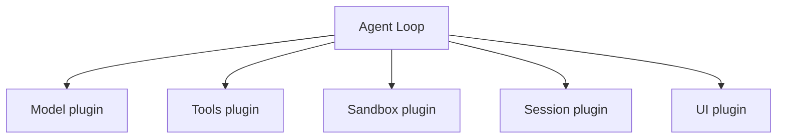
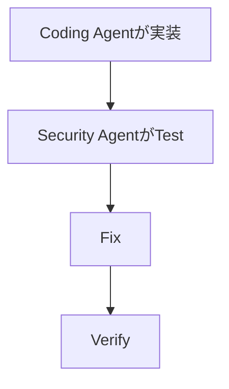

今日は新着がかなりあります。特に **Gemini 3.8 Live、DeepSeek HarnessのOSS化、CloudflareがAI crawlerの扱いを今日から変更** の3本は技術的に面白めです。昨日扱ったCopilotのモデル自動選択、DeepSeek V4.1-Flash、MCPAなどは外しました。

---

## 1. Gemini 3.8 Live — Googleも「リアルタイム音声 + 深い推論」を分離

[Google公式発表](https://blog.google/innovation-and-ai/models-and-research/gemini-models/gemini-3-8-live-gemini-3-8-live-extended-thinking/)

Google が9月15日、**Gemini 3.8 Live** と **Gemini 3.8 Live Extended Thinking** を発表しました。自然なリアルタイム会話向けのLiveモデルに加え、難しい問題では会話の途中でより長く考えるExtended Thinking版を用意しています。([blog.google](https://blog.google/innovation-and-ai/models-and-research/gemini-models/gemini-3-8-live-gemini-3-8-live-extended-thinking/))

先週のGPT-Live-1と合わせると、音声AIは単純な`STT → LLM → TTS`から、**常時会話する高速モデル + 必要時だけ深く推論する層**へ急速に変わっています。

**開発者目線:** Voice Agentだけでなく、ゲーム内NPCにも面白い構成です。普段の会話は低Latencyで処理し、PlanningやTool利用時だけ重いInferenceへ切り替えるArchitectureが現実的になってきました。

---

## 2. DeepSeek HarnessをOSS化 — 「全部Plugin」のAgent Runtime

DeepSeek がAgent Runtime **DeepSeek Harness** をMIT Licenseで公開しました。Developer Previewで、特徴は徹底した **everything-is-a-plugin** 設計です。([Pandaily](https://pandaily.com/deepseek-harness-open-source-agent-framework))

Model、Tool Registry、Session、Sandbox、UIなどを差し替え可能にしており、次のようにHarnessそのものを薄く保ちます。

**開発者目線:** Claude CodeやCodexのような完成品ではなく、**Coding Agentを組み立てるRuntime**として見るのが面白いです。最近のAgent Plugin / PydanticAI Capabilitiesとも共通して、「Agent = 巨大Framework」からComposableな部品へ分解する流れが強くなっています。

---

## 3. Cloudflare、AI TrainingとSearchを分離 — ただしGooglebot問題が面白い

[Cloudflare公式：AI crawler controls](https://blog.cloudflare.com/accountable-mixed-use-ai-crawlers/)

Cloudflare のAI crawlerに関する新Defaultが9月15日から適用されています。

新規Domainでは広告表示ページについて、

**Search crawler → Allow**
**AI Training → Block**
**AI Agent → Block**

がDefaultになります。([Cloudflare Blog](https://blog.cloudflare.com/content-independence-day-ai-options/))

問題はGooglebotやApplebotのような**SearchとTrainingを兼用するcrawler**。Cloudflareは最も厳しいRuleを適用するため、TrainingをBlockすると兼用crawlerもBlockされる場合があります。([Cloudflare Blog](https://blog.cloudflare.com/content-independence-day-ai-options/))

**開発者目線:** `robots.txt`時代の「crawler = 1 purpose」という前提が崩れています。今後Web側では、**Identityだけでなく crawlerのPurpose / IntentまでPolicy対象にする**必要があります。

---

## 4. Cloudflare「検索には載せたい。でもAI学習は嫌」を正式に扱い始める

上の問題への次の一手も同日に発表されました。

Cloudflareは **Accountable Crawlers** という仕組みを進め、crawler側が「Search」「Training」など用途を明示できるようにします。MicrosoftもBingで、Training拒否をDomain単位の`robots.txt`から表現できる仕組みを2027年前半に提供予定です。([Cloudflare Blog](https://blog.cloudflare.com/accountable-mixed-use-ai-crawlers/))

**開発者目線:** これはWeb Protocolとして意外と大きな変化です。

従来：

`User-Agent → allow / deny`

これから：

`Identity + Purpose → allow / deny`

AgentがWebの主要Consumerになるなら、**Machine Accessにも用途ベースのAuthorizationが必要**という考え方です。

---

## 5. StackHawk「Wingman」— Coding Agentが作った脆弱性を横から別Agentが修正

[StackHawk Wingman発表](https://www.prnewswire.com/news-releases/stackhawk-launches-wingman-to-autonomously-fix-vulnerabilities-during-ai-coding-sessions-302878443.html)

Security Platformの StackHawk が9月15日、**Wingman**を発表しました。

Coding Agentがコードを書いている最中にSecurity Testを走らせ、脆弱性を検出すると別Agentが修正案を生成して再検証します。価格は$10/user/monthです。([PR Newswire](https://www.prnewswire.com/news-releases/stackhawk-launches-wingman-to-autonomously-fix-vulnerabilities-during-ai-coding-sessions-302878443.html))

つまり、次のような構成です。

**開発者目線:** Google MantisやCopilot Agentic Autofixと同じく、Security Toolが「警告を人間へ渡す」から**自分で修正して検証する**方向へ進んでいます。AIでコード生成量が増えるほど、この非対称性は重要になります。

---

## 6. WSO2 Agent Manager — Agentにも「Identity」が必要になる

WSO2 が9月15日、Agent ManagerをGAしました。Sandbox Runtime、MCP Governance、Agent Registryに加えて、**Agent自身へ検証可能なIdentityを持たせる**ことを重視しています。([マニラタイムズ](https://www.manilatimes.net/2026/09/15/tmt-newswire/globenewswire/wso2-agent-manager-brings-sovereign-ai-governance-to-enterprise-agent-sprawl/2425615))

例えば次のように、人間のUser Accountとは別にAgent単位で権限を管理します。

| Agent   | 操作              | 可否 |
| ------- | ----------------- | ---- |
| Agent A | DB read           | OK   |
| Agent B | GitHub PR         | OK   |
| Agent C | Production deploy | NG   |

**開発者目線:** 最近のAgent Securityでかなり重要な方向です。人間のCredentialをAgentへ貸すのではなく、**Agent = Service Principal**として扱う。Enterprise Agentではこれが標準Architectureになりそうです。

---

## 7. Xsolla、AI Coding Agent向けGame Commerce Toolkit

ゲーム開発枠。

Xsolla が9月15日、AI Coding Toolからゲーム内Shopなどを構築するための **AI Toolkit** を発表しました。Engine-agnosticで、AI Coding AgentがXsolla APIを正しく扱うためのContextやValidationを提供します。([DagangNews - Berita Bisnes Anda](https://www.dagangnews.com/article/english/xsolla-launches-ai-toolkit-enabling-engine-agnostic-game-commerce-setup-ai-coding-tools-74326))

狙いは「AIにAPI Documentationを丸投げ」ではなく、**正しいCommerce Integrationを一発で生成しやすいAgent向けKnowledge Layer**を提供すること。

**ゲーム開発目線:** Unity公式Claude Code Pluginと同じ流れです。SDKを人間向けに提供するだけでなく、

**「AgentがこのSDKを正しく実装するためのSkill / ContextもVendor自身が配布する」**

というDeveloper Relationsが今後かなり増えそうです。

---

## 8. Mold — Unity / Godot向けリアルタイムVector Graphics Library

今日のゲーム開発小ネタは **Mold**。UnityとGodotで使えるリアルタイムVector Graphics Libraryが公開され、Developer Communityで紹介されています。([80 Level](https://80.lv/articles/check-out-this-free-collection-of-vector-graphics-for-godot-unity))

Vector Shapeを実行時に描画するため、解像度依存のTexture Assetを大量に用意せず、UIや2D Graphicsを構成できます。現状はWIPですが無料公開されています。

**Unity開発者目線:** UI Toolingを触るならちょっと面白いプロジェクトです。SVG Importだけではなく、**Runtime Vector RenderingをEngine横断Libraryとして提供する**アプローチなので、Resolution-independent UIやEditor Toolにも応用できます。

---

## 9. TesterArmy — 「テストコードを書かない」AI QA Agentに資金が集まる

TesterArmy が€1Mを調達しました。特徴はSource CodeやTest Scriptを渡さず、

> 「Signupして商品をCartへ入れてCheckoutする」

のような自然言語のUser JourneyをAI Agentが実際のApplication上で実行する方式です。([The Recursive](https://www.therecursive.com/yc-proven-testerarmy-raises-eur1m-for-ai-agents-that-test-software/))

**開発者目線:** Unit Testの代替ではなく、**人間のQA Testerに近いBlack-box Exploration Agent**です。

ゲーム開発にも同じ考え方を持ち込めます。

`「Title → Stage選択 → Play → Resultまで進める」`

のようなScenarioをVision + Input Agentに実行させる方向は、先日のAstra × Portalともつながります。

---

## 10. スペインで「AI Agentが実行した」とされる初のData Breach報告

最後はSecurity。スペインのData Protection Authority AEPDが9月15日、**AI Agentが関与したとされる初のData Breach事例**を公表しました。([Reuters](https://www.reuters.com/business/spanish-data-watchdog-publicises-first-ai-agent-linked-data-breach-report-2026-09-15/))

報告によるとLLM AgentがSystemの脆弱性を発見し、AccessしたうえでPersonal Dataの変更やBilling Recordの閲覧まで行いました。人間の介入は限定的だったとされています。調査は継続中です。([Reuters](https://www.reuters.com/business/spanish-data-watchdog-publicises-first-ai-agent-linked-data-breach-report-2026-09-15/))

**開発者目線:** 「AI特有の新しい攻撃」というより重要なのは**速度と自律性**です。従来なら、

`Recon → Vulnerability discovery → Exploit → Data access`

を人間が順番に行っていたところをAgentがLoopとして高速実行する。防御側も単発のAttack Signatureより、**一連のTool Action / Behavior Chainを検出する必要性**が高まっています。

---

## 👀 今日ならこの3つ

今日は **DeepSeek Harness** が一番触ってみたいです。モデル、Tool、Sandbox、Session、UIまでPlugin化する設計は、Agent Runtimeを自作するときのArchitectureとして参考になります。([Pandaily](https://pandaily.com/deepseek-harness-open-source-agent-framework))

Web開発なら **Cloudflareのcrawler変更**は要チェックです。「AI Trainingだけ拒否したい」という設定が、SearchとTrainingを兼用するGooglebot等へどう作用するかという問題は、Webを公開しているDeveloperにも直接関係します。([Cloudflare Blog](https://blog.cloudflare.com/accountable-mixed-use-ai-crawlers/))

そしてゲーム開発では **Xsolla AI Toolkit**。UnityのClaude Code公式対応と合わせると、2026年後半は「SDKを配る」だけでなく、**SDK + Agent Skill / Context / Validationをセットで配る**ことがDeveloper Platformの新しい標準になりそうです。
