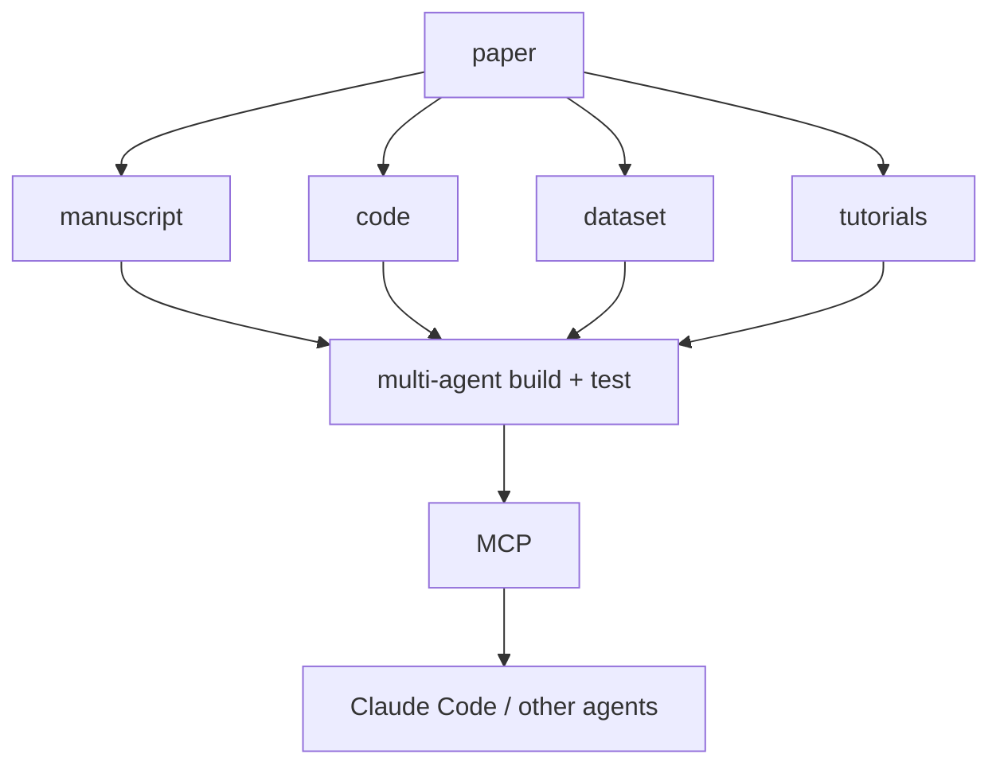
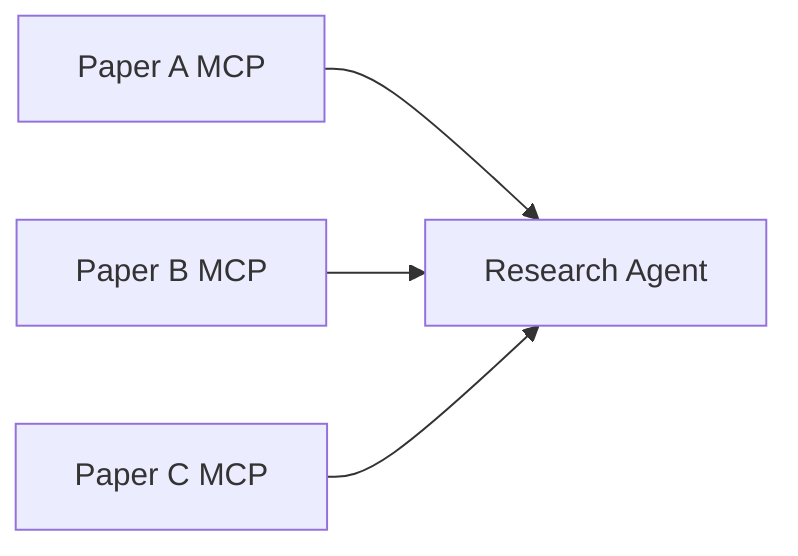

今日は強いニュースがあります。特に **OpenAIが「Navier–Stokesを解いた」とする未公開モデルを公表、論文そのものをMCP Agentへ変換するPaper2Agent、Unity Simulation Pro** が面白いです。昨日まで扱ったOpenClaw、CodeRabbit Triage、npm malwareなどは外しました。

---

## 1. OpenAI「新しい内部モデルがNavier–Stokes問題を解いた」

[OpenAI公式発表](https://openai.com/index/advisory-group-on-mathematics-and-ai/)

[OpenAI](https://openai.com/) が9月21日、かなり大きな発表をしました。

8月28日から学習している**未公開の内部モデル**が、Clay Mathematics InstituteのMillennium Prize Problemの一つであるNavier–Stokes問題を解決し、それ以外にも数学の長年の未解決問題を**100問以上解いた**とOpenAIは述べています。([OpenAI](https://openai.com/index/advisory-group-on-mathematics-and-ai/))

> [!WARNING]
> ただし、これは現時点ではOpenAI自身による発表です。数学界による独立検証が完了したという意味ではありません。OpenAI自身も結果の重要性の評価・公開方法について数学者と協議するため、独立したAdvisory Groupを設置しています。([OpenAI](https://openai.com/index/advisory-group-on-mathematics-and-ai/))

**開発者目線:** Benchmarkが、

`既知問題をどれだけ解けるか`

から、

**`未知の問題について新しい知識を生成できるか`**

へ移る可能性があります。

もし主張が検証されれば、LLM/Reasoning Modelの能力評価にとってかなり大きな転換点です。これは続報を追う価値があります。

---

## 2. Paper2Agent — 論文を「読む」のではなくMCP Serverへ変換する

[Nature：Paper2Agent論文](https://www.nature.com/articles/s41586-026-11044-y)

Natureに掲載された **Paper2Agent** が週末からかなり注目されています。

普通のPaper QAは、

`PDF → RAG → LLM`

ですが、Paper2Agentは違います。

論文本文、Supplement、Dataset、Code Repositoryを解析し、複数Agentが**論文の手法そのものを実行できるMCP Server**を自動生成します。さらにTest AgentがOriginal Paperの結果を再現できるか検証し、失敗したToolを修正します。([Nature](https://www.nature.com/articles/s41586-026-11044-y))

例えばAlphaGenome論文から作ったAgentは約45分・$14で生成されました。([Nature](https://www.nature.com/articles/d41586-026-02899-2))

**開発者目線:** 今日一番技術的に面白いかもしれません。



つまりDocumentationを**Agent-readableにするだけでなくExecutableにする**。

SDK Documentationにも同じ発想を応用できそうです。

---

## 3. Paper2Agent同士をつなぐと「論文同士が共同研究」できる

Paper2Agentでもう一つ面白い部分があります。

MCPなので複数のPaper Agentを一つのAgentへ同時接続できます。

研究チームは実際に複数のGenomics Paper Agentを組み合わせ、Psoriasisに関連するVariantについて原因候補となるGeneを探索しました。([Nature](https://www.nature.com/articles/s41586-026-11044-y))

つまり、次のような構成です。



**開発者目線:** これはAgent Architectureとして非常に面白い。

巨大Contextへすべての知識を押し込むのではなく、**専門知識をTool化した小さなAgent/MCPをCompositionする**。

Microservices的な発想がKnowledgeにも入り始めています。

---

## 4. Unity Simulation Pro — UnityがロボットSimulationを正式製品化

Unity が **Simulation Pro** のEarly Accessを開始しました。Unity 6.3以降 + Unity Industry向けです。([GameDev.net](https://gamedev.net/news/from-simulation-to-real-world-deployment-unity-simulation-pro-early-access-r5929/))

かなり実用寄りで、

**URDF Importer**
**LiDAR / Camera / IMU Sensor Simulation**
**ROS 2対応**
**Headless Linux Build**
**Hardware-in-the-loop Testing**

などを一つのPackageにまとめています。([GameDev.net](https://gamedev.net/news/from-simulation-to-real-world-deployment-unity-simulation-pro-early-access-r5929/))

**Unity開発者目線:** Unityの非Game領域で一番相性が良い用途の一つです。

特にHeadless Linux対応が重要で、

`Unity EditorでSimulationを作る → Linuxで大量並列実行 → Synthetic Data生成`

というRobot / Physical AI Pipelineを組めます。

NVIDIA Isaac Simとの競争も面白くなりそうです。

---

## 5. Androidゲーム、正式に「車」へPublish可能に

[Android Developers公式発表](https://android-developers.googleblog.com/2026/09/bring-android-game-to-car-screen.html)

Googleが9月21日、Android Auto / Android Automotive OSの**Games CategoryをBetaからGA**へ移行しました。

Developerは既存Android GameをGoogle PlayのOpen Testing / Production Trackへ公開できます。ゲームはもちろん**駐車中のみ**利用可能です。([Android Developers Blog](https://android-developers.googleblog.com/2026/09/bring-android-game-to-car-screen.html))

想定用途はEV充電待ち、送迎待ちなど。

**ゲーム開発目線:** 面白いのは新Platformというより、Android GameのDistribution Targetが、

`phone → tablet → TV → Chromebook → car`

まで広がっていること。

UnityなどAndroid Export可能なEngineにとっても、新しい小規模Distribution Channelになります。

---

## 6. Imagination「NSR」— Mobile GPUにもDLSS的AI Upscaling

[Imagination Technologies](https://www.imaginationtech.com/)

PowerVRで知られる Imagination Technologies が **Neural Super Resolution（NSR）** を公開しました。

考え方はDLSS / XeSSと同じで、

`540p render → neural upscaling → 1080p`

とします。

次世代E-Series GPUの1 core / 1 GHzで、540p→1080pを**2.3ms**で処理し、Memory Bandwidthも約半分にできるとしています。([Imagination](https://www.imaginationtech.com/))

**ゲーム開発目線:** Mobileでも、

> Native Resolutionで全部描画する

という前提が崩れていきそうです。

Dynamic Resolution + Neural Upscalingが標準になれば、Mobile GameでもShader / LightingへGPU Budgetを振りやすくなります。

---

## 7. GitHub CopilotにGrok 4.7 — 「Agentic Coding特化」を強調

[GitHub公式発表](https://github.blog/changelog/2026-09-21-grok-4-7-is-now-available-in-github-copilot/)

9月21日、[GitHub](https://github.com/) Copilotへ **Grok 4.7** が追加されました。

xAIの最新Reasoning Modelで、GitHubは特に**Agentic Coding / Tool Use / Repository-level Task**を強みとして挙げています。現在段階的にRollout中です。([The GitHub Blog](https://github.blog/changelog/2026-09-21-grok-4-7-is-now-available-in-github-copilot/))

**開発者目線:** モデル追加自体より、Copilotがますます**Model Marketplace + Router**化しているのが重要です。

GPT / Claude / Gemini / Grokを同じAgent Harnessで比較できるため、モデル評価もChat品質ではなく、

> **同じRepository Taskをどれだけ完遂できるか**

で行いやすくなっています。

---

## 8. GitHub Enterprise「会社にアクセスできるCredentialを全部Export」

[GitHub公式：Credential inventory exports](https://github.blog/changelog/2026-09-21-github-enterprise-adds-credential-inventory-exports/)

同じく9月21日、GitHub Enterpriseへ **Credential Inventory Export** が追加されました。

EnterpriseへAccess可能な、

**SSH Key / PAT / Deploy Key / GitHub App Credentialなど**

をまとめてInventoryとしてExportできます。([The GitHub Blog](https://github.blog/changelog/2026-09-21-github-enterprise-adds-credential-inventory-exports/))

**開発者目線:** Agent時代には特に重要です。

Coding AgentへCredentialを渡すケースが増えるほど、

> 「そもそも会社のGitHubへアクセスできるCredentialが何個存在する？」

を把握できなくなる。

Secret Rotation以前に、**Credential Inventory自体を管理する**という基本に戻る機能です。

---

## 9. Fastly「AI Firewall + Runtime Control」— AgentのAPIアクセスをEdgeで制御

[Fastly公式発表](https://investors.fastly.com/news-releases/news-release-details/fastly-launches-ai-firewall-and-ai-runtime-control-secure-and)

[Fastly](https://www.fastly.com/) が9月21日、**AI Runtime Control / AI Firewall / API Security**を発表しました。

AgentやAI ApplicationからModel/APIへのRequestをFastly Edge上で監視し、

**Model Access / Cost / Agent API Access / Security Policy**

をRuntimeで制御します。([Fastly](https://investors.fastly.com/news-releases/news-release-details/fastly-launches-ai-firewall-and-ai-runtime-control-secure-and))

**開発者目線:** API GatewayのAgent版と考えると分かりやすいです。

```text
Agent
   ↓
AI Gateway / Firewall
   ↓
Model / MCP / Enterprise API
```

最近Agent Securityでは「Promptで禁止するよりReachを制限する」という話を何度も取り上げていますが、それをInfrastructureとして実装する製品が増えてきました。

---

## 10. RatHat — Malwareまで「固定Script」からAI Agentへ

最後はSecurityですが、技術的にかなり興味深い事例です。

新しいAndroid Malware **RatHat** は、Accessibility TreeをXML化して生成AIへ送り、AIから、

`このButtonの座標`
`このTextは何か`
`SCROLL_DOWN`

などの判断を受け取って端末を操作します。([The Hacker News](https://thehackernews.com/2026/09/rathat-android-malware-abuses-adb-to.html))

さらにAccessibilityを悪用してDeveloper Options → Wireless Debuggingを有効化し、**自分自身でADB Pairing**。Native Go AgentをShell権限で残すため、元APKをUninstallしても再Installできます。([Malwarebytes](https://www.malwarebytes.com/blog/news/2026/09/new-android-malware-uses-ai-to-steal-bank-logins-and-pins))

**開発者目線:** かなり象徴的です。

従来：

`if screen == X → tap(320, 740)`

RatHat：

`screen tree → LLM → next action`

つまりUI変更で壊れやすかったMalware Automationにも**Agent Loop**が入っています。

これは逆にQA / UI Test Automationにも全く同じArchitectureを利用できることを示しています。

---

## 👀 今日ならこの3つ

今日は **OpenAIの数学モデル**が最大ニュースです。ただし「Navier–Stokes問題を解決した」は極めて大きな主張なので、現時点では**OpenAIによる主張**として扱うべきです。Proofと第三者数学者による検証が出てきた段階で改めて詳しく追う価値があります。([OpenAI](https://openai.com/index/advisory-group-on-mathematics-and-ai/))

Developerとして一番面白いのは **Paper2Agent**。単にPDFをRAGするのではなく、Repositoryを読み、Environmentを構築し、Functionを抽出し、Testして**「論文をMCP PackageへCompileする」**発想は、SDK Documentationや社内技術資料にも応用できそうです。([Nature](https://www.nature.com/articles/s41586-026-11044-y))

ゲーム開発では **Unity Simulation Pro + Mobile Neural Upscaling**。UnityがGame Engine技術をPhysical AIへ本格転用する一方、Mobile GPUではDLSS的手法が入り始めています。今日はゲームEngineそのものより、**Game Technologyが別領域へ広がる話**が面白い日でした。
