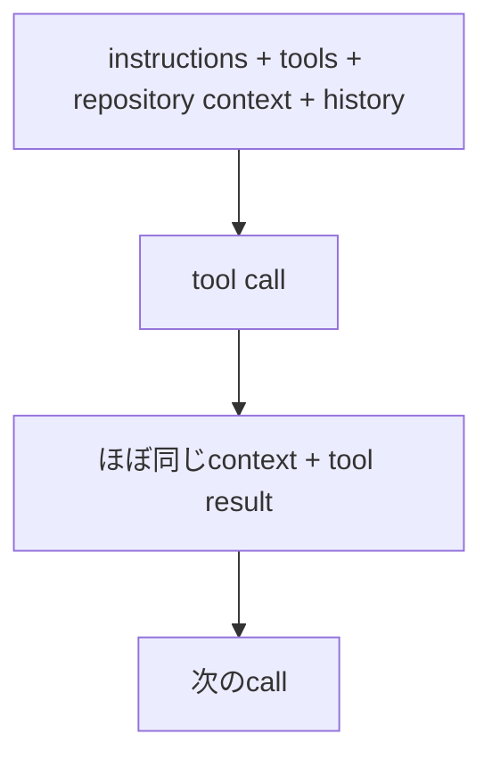

今日はかなり濃いです。最大ニュースは **GPT-6 Sol / Luna と Claude Opus 5.5 が同じ9月22日に登場**したこと。さらにUnity 6.6、JetBrains Air、GPT-6のAgent向けPrompt Cache改善など、Developerへ直接効く更新が多い日です。昨日扱ったNavier–Stokes、Paper2Agent、Unity Simulation Proなどは除外しました。

---

## 1. GPT-6 Sol / Luna — 「Astra級の知能をどこまで安くするか」へ

[OpenAI公式：Introducing GPT-6 Sol and Luna](https://openai.com/index/introducing-gpt-6-sol-and-luna/)

OpenAI が9月22日、**GPT-6 Sol / GPT-6 Luna**を発表しました。Astraが最高性能担当なのに対し、Solは高性能実務、Lunaは大量処理向けという位置付けです。

特に価格が大きく変わり、GPT-6 Solは **$2 input / $10 output per 1M tokens**、Lunaは **$0.10 / $0.50**。GPT-5.6世代からAPI価格を約50%下げています。([OpenAI](https://openai.com/index/introducing-gpt-6-sol-and-luna/))

CodingでもSolはDeepSWE v1.1で68.8%。Lunaも66.6%まで来ており、OpenAIによれば従来のOpus/Fable級に近いTaskを非常に低Costで処理できます。([OpenAI](https://openai.com/index/introducing-gpt-6-sol-and-luna/))

**開発者目線:** GPT-6世代の面白さはAstraの最高性能よりこちらかもしれません。

| Model | 任せるTask                        |
| ----- | --------------------------------- |
| Astra | 難問                              |
| Sol   | 普通のCoding Agent                |
| Luna  | Subagent / Search / Classification |

のように、**TaskごとにModel Tierを使い分けるAgent Architecture**が現実的になっています。

---

## 2. Claude Opus 5.5 — Agentic Coding首位を狙いつつ40%低コスト化

[Anthropic公式：Claude Opus 5.5](https://www.anthropic.com/claude-opus-5-5)

同じ9月22日、Anthropic も **Claude Opus 5.5** を投入しました。

Anthropicの測定ではTerminal-Bench 4.0が66.4%、FrontierCode 54.4%、CursorBench 57.8%。([Anthropic](https://www.anthropic.com/claude-opus-5-5))

> [!WARNING]
> ただAnthropic自身も「この性能帯ではBenchmarkの小さな差は実際の違いを表しにくくなった」と注意しています。([Anthropic](https://www.anthropic.com/claude-opus-5-5))

むしろ重要なのが効率。Opus 5比で通常TaskのCostを約40%削減、出力は30%以上高速化。API価格も$4 input / $20 output、Cache Readは$0.20/M tokensまで下がりました。([Anthropic](https://www.anthropic.com/claude-opus-5-5))

**開発者目線:** OpenAIとAnthropicが同日に示した方向がほぼ同じです。

2025年：
**「一番賢いModelはどれ？」**

2026年後半：
**「このTaskを完遂するのに何ドル・何秒かかる？」**

Coding Agent評価の主戦場が**Intelligence per Dollar**へ移っています。

---

## 3. GPT-6 Prompt Cache改善 — 長時間Agentでは90%割引も

[OpenAI公式：Better prompt caching for GPT-6](https://openai.com/index/better-prompt-caching-for-gpt-6/)

GPT-6ではPrompt CachingもAgent向けに強化されました。

Coding Agentは、次の流れを何十〜何百回も繰り返します。

OpenAIは共有Contextの計算結果を再利用することで、**Cached Input Tokenを最大90%割引**できるとしています。([OpenAI](https://openai.com/index/better-prompt-caching-for-gpt-6/))

**開発者目線:** 最近紹介したNVIDIAのAgent KV Cache最適化とも同じ方向です。

Agentでは「Modelが1回何ms速いか」以上に、**巨大Contextを毎Turn再計算しないこと**が効きます。Agent APIのCost設計ではCache Hit Rateが重要なMetricになりそうです。

---

## 4. Unity 6.6正式公開 — WebGPUがProduction-ready、Fast Enter Play ModeもDefaultへ

Unity **6.6** が9月21日に正式公開されました。Unity公式DiscussionでもSupported Releaseとして案内されています。([Unity Discussions](https://discussions.unity.com/c/unity-editor/204))

特に面白いのが **WebGPUのProduction-ready化**。URP、Compute Shader、Indirect Renderingまで対応しています。MobileではMetal / VulkanのOn-tile Post Processingも強化されています。([Unity](https://unity.com/blog/unite-seoul-keynote-2026-recap))

さらに6.6では **Fast Enter Play ModeがDefault**になる方針。Domain Reload依存を減らす取り組みがいよいよ標準Workflow側へ入ります。([Unity Discussions](https://discussions.unity.com/t/coreclr-scripting-and-ecs-status-update-march-2026/1711852))

**Unity開発者目線:** 今回はかなり重要なUpdate Releaseです。

特にWebGPUはブラウザゲームで、

`WebGL2`

だけでは難しかったCompute主体の処理を使えるようにするため、Unity Web Buildの設計自由度をかなり変えます。

---

## 5. Unity 6.7 Betaも開始 — Neural Graphicsが入ってくる

6.6正式版とほぼ同時に **Unity 6.7 Beta** も公開されています。([Unity Discussions](https://discussions.unity.com/c/unity-editor/204))

6.7世代で注目したいのが **Unity Neural**。

Neural Upscalerに加えて **Neural Texture Compression（NTC）** が入り、Unityのデモでは見た目をほぼ維持したままTexture Runtime Memoryを50%以上、Disk Sizeを約70%削減しています。InferenceはSentis経由でDevice上実行されます。([Unity](https://unity.com/blog/unite-seoul-keynote-2026-recap))

**Unity開発者目線:** DLSS的Upscalingだけでなく、

> **Asset CompressionそのものへNeural Networkを入れる**

のが面白いところ。

GPU Pipelineの一部にNeural Inferenceが普通に混ざる時代へ入り始めています。

---

## 6. JetBrains Air — JetBrains IDEも「IDE + Agent」からAgent Platformへ

[JetBrains公式：Introducing JetBrains Air](https://blog.jetbrains.com/blog/2026/09/22/introducing-jetbrains-air/)

[JetBrains](https://www.jetbrains.com/) が9月22日、Agent関連製品群を **JetBrains Air** へ統合しました。

構成は、

**Air in IDEs** → Agentを操作・検証
**Air Teams** → Developer + AgentのWorkflow Orchestration
**Air Governance** → Policy / Audit / Cost管理

です。Junieだけに閉じず、**Agent Client Protocol（ACP）経由で他社Agentも利用可能**にします。([The JetBrains Blog](https://blog.jetbrains.com/blog/2026/09/22/introducing-jetbrains-air/))

**開発者目線:** これはJetBrains IDEのユーザーにもかなり興味深い方向です。

JetBrainsの強みはModelそのものではなく、IDEが持つ**正確なSymbol / Type / Refactoring / Architecture情報**。

それをClaude / Codex / Junieなどへ共通Contextとして提供するなら、VS Code系とは違う強みになります。

---

## 7. Copilot CLI、巨大C++ Repoを丸ごとPersistent Index化

[GitHub公式：Whole codebase indexing](https://github.blog/changelog/2026-09-22-faster-c-code-intelligence-with-whole-codebase-indexing/)

[GitHub](https://github.com/) Copilot CLIのC++ Code Intelligenceに **Whole Codebase Indexing（WCI）** が追加されました。

Microsoft C++ Language ServerがCompilation情報を使い、開いていないFileも含めてSymbol / Type / Include / ReferenceをPersistent Index化します。初回だけCostがかかり、その後は差分更新です。([The GitHub Blog](https://github.blog/changelog/2026-09-22-faster-c-code-intelligence-with-whole-codebase-indexing/))

**開発者目線:** Coding AgentのRepository理解を、

`毎回grep / ripgrep`

だけで行うのではなく、

**Compiler / Language Serverが持つSemantic GraphをAgentへ渡す**

方向です。

Unity C#でもRoslynやIDEのコード解析情報をAgentがもっと直接使えるようになると、Repository-scale変更の精度がかなり上がるはずです。

---

## 8. NVIDIA Isaac ROS 5.0 — Roboticsにも「Agent Skill」

[NVIDIA公式：Isaac ROS 5.0](https://blogs.nvidia.com/blog/isaac-ros-5-0-agentic-open-source-robotics/)

NVIDIA が9月22日、**Isaac ROS 5.0**を公開しました。

GPU-accelerated ROS Package群にAgent Capabilityを持ち込み、Perception / Reasoning / Actionを組み合わせるPhysical AI開発を強化。JetsonへのDeploymentとOpen-source Libraryも拡張されています。([NVIDIA Blog](https://blogs.nvidia.com/blog/isaac-ros-5-0-agentic-open-source-robotics/))

**開発者目線:** 昨日のUnity Simulation Proともきれいにつながります。

`Simulation → Perception → Agent reasoning → Robot action`

というPhysical AI Stackが、研究用Prototypeではなく普通のDeveloper Toolchainになりつつあります。

ゲームEngine経験者がRobot Simulationへ入りやすくなる理由でもあります。

---

## 9. GitHub、SSHにPost-Quantum Key Exchangeを導入

[GitHub公式：SSH security improvements](https://github.blog/changelog/2026-09-22-security-improvements-for-ssh/)

GitHubがSSH Infrastructureを更新します。

10月14日から新規RSA Keyは**最低3072bit**。SHA-1を使う`ssh-rsa` Signatureや古いDiffie-Hellman方式も段階的に廃止します。([The GitHub Blog](https://github.blog/changelog/2026-09-22-security-improvements-for-ssh/))

そして面白いのが **`mlkem768x25519-sha256`** の追加。ML-KEM + X25519を組み合わせたPost-Quantum Key Exchangeです。([The GitHub Blog](https://github.blog/changelog/2026-09-22-security-improvements-for-ssh/))

**開発者目線:** 普通に最近のOpenSSH + Ed25519を使っているならほぼ何もしなくてよいです。

ただ古いCI Machine、JSch、TeamCity、Embedded Git Clientなどが残っている環境では、10〜12月のBrownout前に確認しておく価値があります。

---

## 10. Googlebook — AndroidアプリがそのままLaptopアプリになる

[Android Developers公式：Googlebook adaptive development](https://android-developers.googleblog.com/2026/09/adaptive-development-scale-app-googlebook.html)

Google が新しいLaptop Category **Googlebook** 向けのDeveloper Guidanceを9月22日に公開しました。

HP / Dell / Lenovo / Acer / AsusなどのHardware上でAndroidを共通Foundationとして使い、既存Android ApplicationをAdaptive UI対応させればLaptopへ展開できます。専用アプリを一から作る必要はありません。([Android Developers Blog](https://android-developers.googleblog.com/2026/09/adaptive-development-scale-app-googlebook.html))

Googleは特に、

**Window resizing / Multi-pane UI / Keyboard / Mouse / Trackpad / Multitasking**

への対応を推奨しています。最適化済みApplicationにはGoogle Play上で専用Badgeや露出強化も行われます。([Android Developers Blog](https://android-developers.googleblog.com/2026/09/adaptive-development-scale-app-googlebook.html))

**開発者目線:** AndroidのTargetが、

`Phone → Tablet → Foldable → TV → Car → Laptop`

まで一つのApplication Modelへ寄ってきました。

ゲームの場合もAndroid Buildを「スマホ画面固定」と仮定しない方がよくなってきています。

---

## 👀 今日ならこの3つ

**モデルならGPT-6 Sol / LunaとOpus 5.5をセットで見るのがおすすめです。** 両社が同日に「最高性能」だけでなく**TaskあたりCostの削減**を前面に出したのは象徴的です。特にLuna級を大量Subagentへ回し、本当に難しい部分だけAstra / OpusへEscalateする設計が面白くなってきました。([OpenAI](https://openai.com/index/introducing-gpt-6-sol-and-luna/))

**Unityなら6.6。** WebGPU Production-readyも大きいですが、Fast Enter Play ModeのDefault化は日々のUnity開発体験へ直接効きます。6.7のNeural Texture Compressionも含め、Unity 6後半はかなり技術的に面白いReleaseが続いています。([Unity Discussions](https://discussions.unity.com/c/unity-editor/204))

**Developer ToolならJetBrains Air。** JetBrains IDEを単なる「AI付きIDE」にせず、Developer・複数Agent・Team Workflow・Governanceまで一つのSystemとして扱い、なおかつACPで他社Agentを許容する設計は、Coding Agentが成熟した後のIDEが何になるのかを見るうえで注目したい動きです。([The JetBrains Blog](https://blog.jetbrains.com/blog/2026/09/22/introducing-jetbrains-air/))
