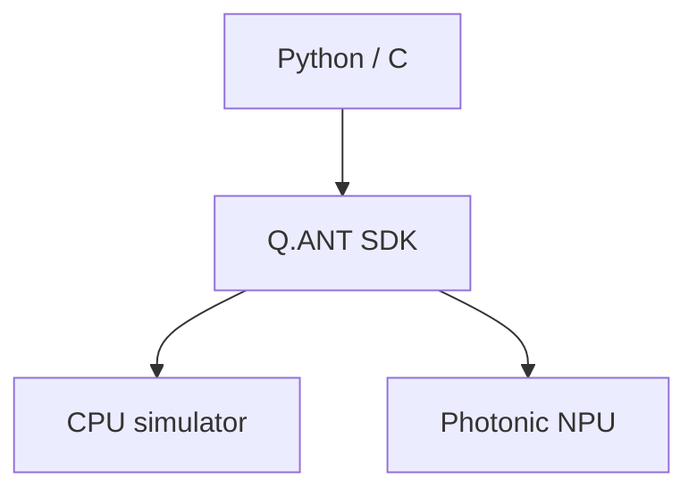

昨日の **GPT-6 Sol/Luna・Opus 5.5・Unity 6.6・JetBrains Air** は繰り返さず、その後に出てきた話を中心に拾いました。今日は特に、**Coding AgentをローカルPCで安全に動かす仕組み、Agent Observability、ZCodeのかなり怖いプライバシー事故**が実務的に重要です。

---

## 1. GitHub Copilot App、ローカルAgentに本格Sandbox

[GitHub公式：Local sandboxing](https://github.blog/changelog/2026-09-23-local-sandboxing-in-the-github-copilot-app/)

[GitHub](https://github.com/) が9月23日、Copilot Appの**Local Sandboxing**をPublic Previewで公開しました。

ProjectごとにAgentから見える範囲を、次のように個別に制限できます。

| 対象        | 設定できる範囲                |
| ----------- | ----------------------------- |
| Filesystem  | read/write / read-only / deny |
| Network     | Internet / LAN                |
| Credentials | Git / GitHub CLI              |

さらにOSが指定したSandbox Policyを実現できない場合は、保護なしで実行するのではなく**Session自体を失敗させる fail-closed 設計**です。([The GitHub Blog](https://github.blog/changelog/2026-09-23-local-sandboxing-in-the-github-copilot-app/))

**開発者目線:** かなり良い変更です。

Coding Agent Securityが、

> `.envを読まないで`

というPrompt依存から、

> **そもそも`.env`へOS Levelで到達できない**

というCapability Securityへ移っています。

ローカルCoding Agentを常用するなら、この方向が本命だと思います。

---

## 2. Copilot Agentの挙動をOpenTelemetryで丸ごとTrace可能に

[GitHub公式：OpenTelemetry in Copilot](https://github.blog/changelog/2026-09-22-opentelemetry-in-the-github-copilot-app/)

前日の更新ですが、昨日のBriefingでは拾わなかった重要項目です。

Copilot Appが **OpenTelemetry（OTel）** に正式対応しました。Agent Session内の次のような一連のSpanを、既存のObservability Platformへ送れます。


Prompt / Response本文はDefaultでは含まれません。([The GitHub Blog](https://github.blog/changelog/2026-09-22-opentelemetry-in-the-github-copilot-app/))

**開発者目線:** Agent Debuggingが普通のDistributed Systemに近づいています。

「Agentが変な変更をした」だけでなく、

> **どのModel判断 → どのTool → どの結果から壊れたか**

をTraceできる。

最近Agent Evalを何度も紹介していますが、次に必要なのはまさに**Agent Observability**です。

---

## 3. Z.ai ZCode、Repositoryを無断Uploadしていた問題で謝罪

Z.ai のCoding Assistant **ZCode**でかなり重大な問題が発覚しました。

Developerによる解析では、Codebase Indexing機能がWorkspaceをArchiveし、ある事例では**42,411 Files・313MB**をまとめ、Alibaba Cloud StorageへのUploadを564回試みていました。`.git`も対象で、Payloadの大部分がGit History / LFS Dataだったと報告されています。([MIXED Reality News](https://mixed-news.com/en/zai-zcode-packed-42411-files-564-upload-attempts/))

Z.aiは謝罪し、該当Workflowを削除した**v3.14.0**を公開。ZCode自体もOpen Source化し、外部Security Assessmentを実施するとしています。([TNW](https://thenextweb.com/news/zai-zcode-open-source-commit-history-security-assessment))

**開発者目線:** 今日一番警戒したいニュースです。

Coding Agentには、

`Source`
`.git history`
`credentials`
`internal docs`

が全部見えます。

つまり「AI ProviderへPromptを送ってよいか」だけでなく、**Agent Client自体がWorkspaceをどうIndexing / Uploadしているか**もSecurity Review対象にすべきです。

---

## 4. Cycode、PackageをDeveloper PCへ入る前に止める

[Cycode公式：Workstation Protection](https://cycode.com/blog/introducing-workstation-protection/)

Cycode が9月23日、**Workstation Protection**をEarly Access公開しました。

npm等のPackageをDeveloperやCoding AgentがInstallしようとした瞬間に、

**Known-maliciousか**
**公開されたばかりでまだ安全性を評価できないPackageか**

を確認し、危険ならWorkstation上でBlockします。後者には**Cooldown Policy**を使います。([Clarity Today](https://theclarity.today/story/cycode-extends-devsecops-reach-to-software-packages-developers-download-7c8559e8))

**開発者目線:** 最近Plugin4Shellやnpm Malwareを続けて紹介してきましたが、Agentは人間より遥かに速い速度で、

> 「必要そうだからPackageをInstall」

します。

そこでCIまで待たず、**Package ManagerとDeveloper Machineの境界で止める**のはかなり合理的です。

---

## 5. GitHub CopilotのRuntime、実は80万行超をRustへAgent移植していた

[GitHub Engineering：Migrating Copilot runtime to Rust](https://github.blog/ai-and-ml/generative-ai/migrating-the-github-copilot-runtime-to-rust-using-copilot/)

これは先週の記事ですが、9月23日に内容が更新され、公開された実測Dataがかなり面白いため今日の枠に入れます。

GitHubはCopilot CLI / App / SDKなどの共通Agent RuntimeをTypeScript / Node.jsから**832,378行のProduction Rust**へ移植しました。

AI Agentがコードの大部分を書き、128 PRとしてMainへ段階投入。移植期間中もMain Branchを止めず、各PRで旧TypeScript実装をRustへAtomicに置換しています。([The GitHub Blog](https://github.blog/ai-and-ml/generative-ai/migrating-the-github-copilot-runtime-to-rust-using-copilot/))

さらにAgent Session Logでは、

**Tool calls：1,857,409回**
**Context compaction：5,116回**
**Prompt cache read：96.22%**

というかなり珍しい大規模Agent運用Dataも公開されています。([The GitHub Blog](https://github.blog/ai-and-ml/generative-ai/migrating-the-github-copilot-runtime-to-rust-using-copilot/))

**開発者目線:** 「AIで80万行書けた」より、こちらが重要です。

> **巨大Migrationでも128個のReview可能なPRへ分割し、常にMainをShippableに保った。**

Agentへ巨大Taskを丸投げするのではなく、既存TestをOracleにして**Incremental Replacement**する設計が参考になります。

---

## 6. Copilot Code Review、Review Effortを個人・企業単位で設定

[GitHub公式：Copilot Code Review更新](https://github.blog/changelog/2026-09-23-copilot-code-review-more-ways-to-request-and-configure-reviews)

9月23日、Copilot Code Reviewの設定も拡張されました。

個人設定で、

**PR作成時に自動Review**
**Draft PRもReview**
**Pushごとに再Review**
**Lite / Balanced Effort**

を指定できます。Enterprise管理者はOrganization RepositoryのDefault Review Effortも設定可能です。([The GitHub Blog](https://github.blog/changelog/2026-09-23-copilot-code-review-more-ways-to-request-and-configure-reviews))

**開発者目線:** 面白いのはAgentにも**Compute Budgetの強弱**が普通に入り始めていることです。

小さいPR：

`Lite review`

Security / Architecture変更：

`Balanced / deeper review`

のように、すべてを最大Inferenceで見るより合理的です。

今後はCIのように「PathやRisk ScoreによってReview Effortを変える」ところまで行きそうです。

---

## 7. GitHub Actions、Node 20を完全終了

[GitHub公式：Node 20 retirement](https://github.blog/changelog/2026-09-23-node-20-is-no-longer-available-in-github-actions/)

9月23日からGitHub Actions Runnerで**Node 20が利用できなくなりました**。JavaScript ActionはNode 24へ移行しています。

一時的にNode 20を許可していた`ACTIONS_ALLOW_USE_UNSECURE_NODE_VERSION`も削除されました。([The GitHub Blog](https://github.blog/changelog/2026-09-23-node-20-is-no-longer-available-in-github-actions/))

自作Actionなら、

```yaml
runs:
  using: node24
```

への更新が必要です。

Node 24非対応の**macOS 13.4以前やARM32 Self-hosted Runnerも対象外**になります。([The GitHub Blog](https://github.blog/changelog/2026-09-23-node-20-is-no-longer-available-in-github-actions/))

**開発者目線:** GitHub Actionsを普通に使っているだけなら公式Actionの最新版へ上げれば済むことが多いですが、**社内Custom Actionを長期間固定しているRepository**は確認しておく価値があります。

---

## 8. Photonic ComputingをPythonから触れるOSS SDKが登場

[Q.ANT SDK発表](https://www.globenewswire.com/news-release/2026/09/23/3367409/0/en/q-ant-launches-world-first-open-source-sdk-for-photonic-computing.html)

Q.ANT が9月23日、Photonic Processor向けの**Open-source SDK**を公開しました。

C / Python APIに加え、実Hardwareを持っていなくても通常CPU上で動くSimulation Backendが付属します。次のような構成です。



Hardwareは今後IONOS Cloudからも利用可能になる予定です。([GlobeNewswire](https://www.globenewswire.com/news-release/2026/09/23/3367409/0/en/q-ant-launches-world-first-open-source-sdk-for-photonic-computing.html))

**開発者目線:** Photonic Computingはこれまで「研究論文では面白いがDeveloperが触れない」領域でした。

CUDAがGPUをProgramming Platformへ変えたように、**Hardwareより先に普通のDeveloperがSDKを触れる状態を作る**のは重要です。

今日の雑多枠では一番試してみたいものです。

---

## 9. モバイルゲーム、D2C課金への移行が加速

Omdiaが9月23日に公開した調査では、Mobile Game Publisherが**Direct-to-Consumer（D2C）Store**を採用する動きが加速しています。規制・Store Policy変更によって、Game内CurrencyやItemを外部Web Storeから直接販売しやすくなったことが背景です。([Omdia](https://omdia.tech.informa.com/pr/2026/sep/mobile-game-developers-accelerate-d2c-adoption-as-five-vendors-lead-a-closely-contested-market))

市場上位としてXsolla、Appcharge、Coda、FastSpring、Tebexを挙げています。

**ゲーム開発目線:** Client Engineerにも無関係ではありません。

D2Cが増えると、

`App Store purchase`
だけでなく
`Web purchase → Server entitlement → Client refresh`

という経路が増えるため、**課金状態の同期・Deep Link・Account Linking・Receipt/Entitlement設計**がより重要になります。

モバイルゲームでは今後かなり現実的な設計課題です。

---

## 10. Airbnb、Coding Agentを社内ToolではなくEngineering Infrastructureへ

[OpenAI × Airbnb発表](https://openai.com/index/airbnb-gpt-6-astra/)

9月23日、Airbnb がGPT-6 Astraを含むOpenAI Frontier Modelへの社内Accessを拡大しました。

Airbnb Engineerは既にCodexを使った**社内AI AssistantとRemote Coding Agent**を運用しており、GPT-5.6 Sol / Terra / LunaなどをTaskごとに利用しています。Airbnbは、Development Teamが1年前より約80%多くFeatureをShipしているとしています。([OpenAI](https://openai.com/index/airbnb-gpt-6-astra/))

> [!WARNING]
> ただしこれはAirbnb自身の数字で、AIだけによる因果効果を示すものではありません。

面白いのはCoding以外にも、Architecture検討・難しいBug探索・Fraud Detection・Support・Insurance Claimなどへ同じModel群を展開していることです。([OpenAI](https://openai.com/index/airbnb-gpt-6-astra/))

**開発者目線:** Coding Agentが、

> Engineer個人がIDEで使うTool

から、

> **会社共通のRemote Compute / Agent Infrastructure**

へ移っている好例です。

最近のAgent Runtime、Sandbox、OTel、Identity、Budgetのニュースが全部ここへつながります。

---

## 👀 今日ならこの3つ

**今すぐ試す価値が高いのはCopilot AppのLocal Sandboxです。** Filesystem・Network・CredentialをProject単位で制限し、実現できなければFail Closedという設計は、ローカルAgentを安全に常用するためのかなり良い方向です。([The GitHub Blog](https://github.blog/changelog/2026-09-23-local-sandboxing-in-the-github-copilot-app/))

**技術記事として一番おすすめなのはCopilot RuntimeのRust移植。** 80万行という数字より、128 PR、5,116回のContext Compaction、185万回のTool Call、96.22%のCache Readという**実際の長時間Coding Agent運用Data**が非常に珍しく、Agent Architectureを考える資料として価値があります。([The GitHub Blog](https://github.blog/ai-and-ml/generative-ai/migrating-the-github-copilot-runtime-to-rust-using-copilot/))

**SecurityではZCode。** Coding AgentにRepository Accessを渡すときは、Model Providerだけでなく**ClientがIndexingのために何を外部送信するか**まで確認する必要がある、というかなり分かりやすい事件になりました。([The Indian Express](https://indianexpress.com/article/technology/artificial-intelligence/chinas-z-ai-disables-ai-coding-assistant-features-after-security-issue-10888434/))
