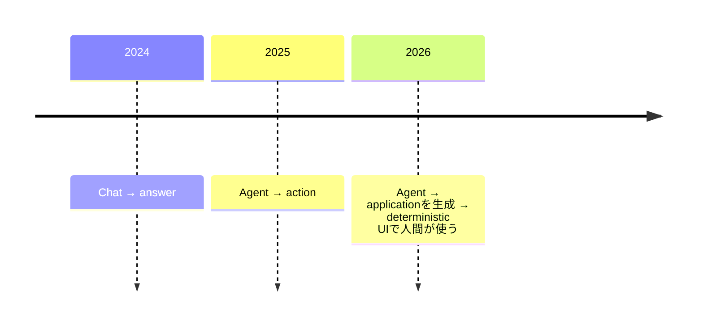

今朝は「新しい巨大LLM」より、**Agentを普通のSoftware Infrastructureへ落とし込む動き**がかなり強いです。特に **Stanford/NVIDIAのCLM-8B、DockerのAgent権限をOCI化するSandbox Kit、Microsoft Copilotの全面刷新** が面白いです。昨日まで扱ったGoogle CloudのREST→MCP、Meta Horizon Create、GitHub Fuzzing Agentなどは避けました。

---

## 1. CLM-8B — 「Toolを選ぶだけなら、そもそも文章を生成するな」

[CLM-8B GitHub](https://github.com/Contrastive-LM/CLM)

Stanford Hazy ResearchとNVIDIAの研究者らによる **CLM-8B（Contrastive Language Model）** が公開され、昨日からDeveloper界隈で注目されています。

普通のLLM Agentは、

`state + 50 tools → LLM → "use_tool_17"をtoken生成`

します。

CLMは違います。Stateと各ActionをEmbeddingに変換し、**最も近いActionを直接Scoreして選択**します。Action側EmbeddingはCacheできるので、同じTool群を使うAgentでは再計算も不要です。([Venturebeat](https://venturebeat.com/technology/stanford-and-nvidias-open-clm-8b-caches-reusable-agent-actions-and-runs-up-to-9x-faster-than-jev-in-tests))

Zero-shot評価では先日紹介したJevと近い成功率を出しつつ、条件によって**最大9倍低Latency**。BFCL v4ではJev 99.2%に対してCLM 95.2%なので、完全な上位互換ではありません。([Venturebeat](https://venturebeat.com/technology/stanford-and-nvidias-open-clm-8b-caches-reusable-agent-actions-and-runs-up-to-9x-faster-than-jev-in-tests))

**開発者目線:** 今日一番面白いです。

Agent Architectureが、

`Reasoning → Frontier LLM`

`Routing / ranking / validation → System-1 Model`

へ分離し始めています。

「すべてGPT/Claudeへ投げる」より、**生成が不要なDecisionからGenerative LLMを抜く**流れはかなり合理的です。

---

## 2. Docker Sandbox Kit — Agentの「権限」までOCI Imageにする

[Docker公式：Sandbox Kit Specification](https://www.docker.com/blog/docker-sandbox-kit-spec/)

[Docker公式：CNCFへの提案](https://www.docker.com/blog/docker-sandbox-kit-spec-cncf/)

[Docker](https://www.docker.com/) が **Sandbox Kit Specification v3** をApache 2.0で公開し、CNCFへ持ち込む方針を発表しました。

Kitは普通のOCI Imageに、

**Agent**
**Tools / MCP / Skills**
**Network Policy**
**Volumes**
**必要なCredentials**

をまとめます。例えば「GitHub APIは使えるがRepository DELETEは禁止」という権限までArtifact側へ記述できます。([Docker](https://www.docker.com/blog/docker-sandbox-kit-spec/))

重要なのはKit自身が権限を獲得するわけではなく、**対応Runtimeが宣言をEnforceする**点。現在Docker Sandboxesが最初のConforming Runtimeです。([Docker](https://www.docker.com/blog/docker-sandbox-kit-spec/))

**開発者目線:** かなり筋が良いです。

```text
agent code
tools
instructions
permissions
credentials requirements
      ↓
   OCI digest
```

まで一緒にPinできる。

Agentの権限変更を**Infrastructure-as-Code / Supply-chain DiffとしてReviewできる**ようになります。

MCPが「Agent ↔ Tool」のProtocolなら、Sandbox Kitは**AgentをどんなAuthorityで動かすか**の標準候補です。

---

## 3. Docker Cloud Sandboxes — Coding AgentをLaptopからCloudへそのまま移す

[Docker公式：Cloud Sandboxes](https://www.docker.com/blog/introducing-cloud-sandboxes-start-on-your-laptop-finish-in-the-cloud/)

Dockerは同時に **Cloud Sandboxes** も開始しました。

Coding AgentをmicroVM Sandbox内で動かし、

`local sandbox → cloud sandbox`

へ移動可能。Laptopを閉じても長時間Taskは継続します。Cloud側もLocalと同じKit / Permission Modelを利用します。([Docker](https://www.docker.com/press-release/cloud-sandboxes-extending-secure-ai-agent-isolation-beyond-the-laptop/))

さらにExperimentalながらTypeScript SDK / REST APIもあり、Sandbox作成、Command実行、File転送、Snapshot、Volume、Secret管理をApplicationから操作できます。([Docker Documentation](https://docs.docker.com/ai/sandboxes-api/))

**開発者目線:** Claude Code Cloud、Copilot Cloud AgentなどVendor固有のCloud Agentとは少し違います。

Dockerが提供しようとしているのは、

> **好きなCoding Agentを入れて動かす汎用Agent Compute**

です。

Claude Code / Codex / Antigravity / HermesなどのKitが既にCatalogにあります。([Docker Documentation](https://docs.docker.com/agentic-platform/kits/))

Agent版の「Container Runtime + Cloud Compute」という立ち位置を狙っているように見えます。

---

## 4. Microsoft Copilot全面刷新 — Home / Code / Autopilotの3層へ

[Microsoft公式発表](https://blogs.microsoft.com/blog/2026/09/25/introducing-the-new-copilot-with-home-code-and-autopilot/)

[Microsoft](https://www.microsoft.com/) が9月25日、Copilotをかなり大きく作り直しました。

新構成は次の3つです。

| 構成          | 内容                                 |
| ------------- | ------------------------------------ |
| **Home**      | Chat / Cowork / Word / Excel / PowerPoint |
| **Code**      | AIでApplicationやWorkflowを構築      |
| **Autopilot** | Backgroundで継続稼働するPersonal Agent |

Home / Codeは今後数週間でFrontier Programへ、Autopilotは月末にPrivate Preview拡大予定です。([The Official Microsoft Blog](https://blogs.microsoft.com/blog/2026/09/25/introducing-the-new-copilot-with-home-code-and-autopilot/))

特にCodeはGitHub Copilotと同じ基盤を利用します。

**開発者目線:** GitHubが昨日紹介したCanvasとも方向が一致しています。次のような流れです。



AI ProductのUIが「Chat Window一個」から抜け出し始めています。

---

## 5. Microsoft Autopilot — Agentが「依頼される前」に仕事する

Microsoft刷新でもう一つ分けて取り上げたいのが **Autopilot** です。

これは単なる長時間Taskではなく、Persistent AgentとしてBackgroundに残り、継続的にContextを見ながら仕事します。MicrosoftはFinOps for AIも同時発表しており、Agent Costの管理も製品側へ組み込みます。([The Official Microsoft Blog](https://blogs.microsoft.com/blog/2026/09/25/introducing-the-new-copilot-with-home-code-and-autopilot/))

**開発者目線:** AgentのUnitが、

`prompt → response`

から、

`goal + role + memory + permissions + budget → persistent process`

へ変わっています。

こうなるとSoftware設計上も、Agentを「API Call」ではなく**Stateful Service / Worker**として考える方が自然です。

---

## 6. GitHub Agentic Autofix、「Repository固有の直し方」を記憶

[GitHub公式：Agentic autofix + Copilot Memory](https://github.blog/changelog/2026-09-25-agentic-autofix-now-uses-copilot-memory)

[GitHub](https://github.com/) のAgentic Autofixが **Copilot Memory** を利用するようになりました。

Security Alertを修正するときに既存Memoryを参照し、修正に成功すると**そのFix Pattern自体を新しいMemoryとして保存**します。([The GitHub Blog](https://github.blog/changelog/2026-09-25-agentic-autofix-now-uses-copilot-memory))

そのMemoryは次のSecurity Fixだけでなく、Copilot Code ReviewやCloud Agentからも利用可能です。

**開発者目線:** Agent Memoryのかなり良い用途です。

単純に、

> 「過去の会話を覚える」

のではなく、

> **このRepositoryでは、この種類の問題をこう直す**

という**Project固有のEngineering Knowledgeを蓄積する**。

Coding Agent Memoryは最終的にこういう形が本命だと思います。

---

## 7. Copilot × Slack / Teams — 会話からIssue・実装へ直接つながる

[GitHub公式：Slack / Teams更新](https://github.blog/changelog/2026-09-25-updates-to-github-copilot-for-slack-and-microsoft-teams/)

GitHub CopilotのSlack / Microsoft Teams Integrationも9月25日に更新されました。

SlackのAttachmentやMessage Link、TeamsのImage・Forwarded Message・Thread HistoryをContextとして利用可能。

さらにIssueを作る際に類似Issueを確認し、

`conversation → GitHub work`

と、

`GitHub work → original conversation`

の**双方向Link**を残します。([The GitHub Blog](https://github.blog/changelog/2026-09-25-updates-to-github-copilot-for-slack-and-microsoft-teams/))

Conversation中にModelを変更することもできます。

**開発者目線:** 地味ですがSoftware Teamではかなり重要です。

仕様やBugのContextはIssue Trackerより先にSlackで生まれがちです。

Agentが、

`Slackで議論 → Issue → 実装 → PR`

までContextを落とさず運べるなら、**人間がIssueへ転記する作業**そのものをかなり減らせます。

---

## 8. GitHubがPRの「どこで時間を失ったか」を計測可能に

[GitHub公式：PR Review Stage Metrics](https://github.blog/changelog/2026-09-25-usage-metrics-api-adds-pull-request-review-stages)

GitHub Copilot Usage Metrics APIへ **Pull Request Review Stage** が追加されました。

単純な「PR作成→Merge時間」ではなく、次の3区間を分離し、それぞれMedianとp90を取得できます。([The GitHub Blog](https://github.blog/changelog/2026-09-25-usage-metrics-api-adds-pull-request-review-stages))


現時点ではHuman Reviewだけを計測し、Copilot ReviewなどBotは除外されます。

**開発者目線:** AI Coding Toolの効果測定として非常に良い方向です。

コード生成が2倍速くなっても、

`PR待ち時間 = 18時間`

ならDeliveryはほとんど速くなりません。

**Coding速度ではなくValue DeliveryのBottleneckを見る**ためのMetricになっています。

---

## 9. Brood War Bench — Coding AgentにStarCraftをリアルタイムで遊ばせる

今日の変わり種。

Software Engineer Ben Swerdlow氏が **Brood War Bench** を公開し、LLM Agent同士にStarCraft: Brood Warをリアルタイムでプレイさせています。

初期Tournamentでは全Agentとも人間ならBeginner程度ですが、**Codex Astraが18勝0敗**だったと報告されています。([GIGAZINE](https://gigazine.net/gsc_news/en/20260925-starcraft-brood-war-bench/))

**開発者目線:** 単なるゲームBenchmarkに見えて、実はAgent評価として面白いです。

Coding Benchmarkは、

`task → 数十分 → result`

ですがRTSでは、

`observe → decide → act → observe → adapt`

を秒単位で延々繰り返す必要があります。

つまり**長期Planning + Real-time Reaction + Tool Use + State Tracking**を同時評価できます。

Agent Benchmarkが「静的な問題集」からSimulation / Game Worldへ移る流れは追いたいです。

---

## 10. 小ネタ：Rust 1.100 Nightly開発ラインがスタート

Rust は9月25日から **1.100 Nightly** の開発ラインへ入りました。現在Stableは1.98、1.99は10月1日Stable予定、1.100は11月12日予定です。([Rust Forge](https://forge.rust-lang.org/))

1.100というVersion Number自体に特別なSemantic Changeがあるわけではありませんが、Rustがついに三桁Versionへ入る節目です。

**開発者目線:** 技術的重要性は小さめですが、Rust 1.0が2015年なので約11年で1.100。

最近はCodex CLI、GitHub Copilot Runtimeなど**Developer Tool / Agent Runtimeの実装言語としてRustがかなり増えている**ため、昔よりRust Releaseを追うDeveloper層が広がっています。

---

## 👀 今日ならこの3つ

**技術的に一番おすすめはCLM-8B。** 先週のJevに続き、「Toolを一つ選ぶだけなのに、なぜ巨大Generative LLMでTokenを生成しているのか？」という問いに別Architectureから回答しています。特にAction EmbeddingをCacheできる設計は、数十〜数百回DecisionするAgent Loopと非常に相性が良いです。([Venturebeat](https://venturebeat.com/technology/stanford-and-nvidias-open-clm-8b-caches-reusable-agent-actions-and-runs-up-to-9x-faster-than-jev-in-tests))

**Agent InfrastructureではDocker Sandbox Kit。** Agent本体だけでなく`network + credential + volumes + tools + permissions`までOCI Digestへまとめるのはかなり綺麗です。CNCFで標準化が進むなら、今後`Dockerfile`や`devcontainer.json`と同じようにRepositoryで普通に見るArtifactになる可能性があります。([Docker](https://www.docker.com/blog/docker-sandbox-kit-spec/))

**実務ならCopilot Memory × Agentic Autofix。** 「会話を覚えている」より、**Repositoryで過去に成功したSecurity Fixを学習し、Code Reviewや次の修正へ横展開する**方がCoding AgentのMemoryとして明確に価値があります。Agent Memoryが単なるChat HistoryからEngineering Knowledge Baseへ変わっていく動きとして注目です。([The GitHub Blog](https://github.blog/changelog/2026-09-25-agentic-autofix-now-uses-copilot-memory))
