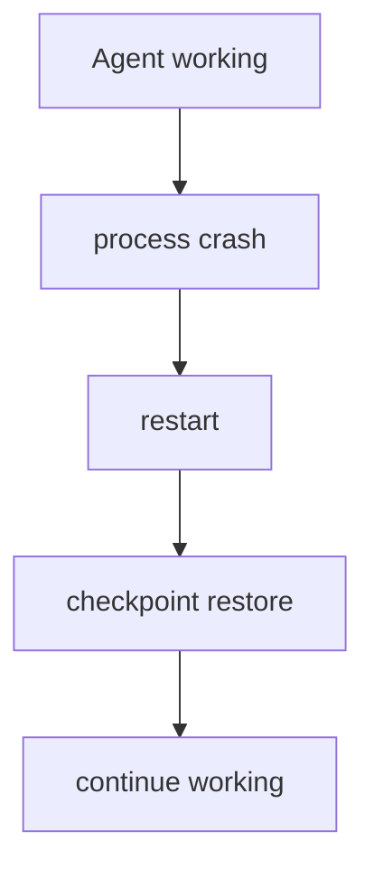
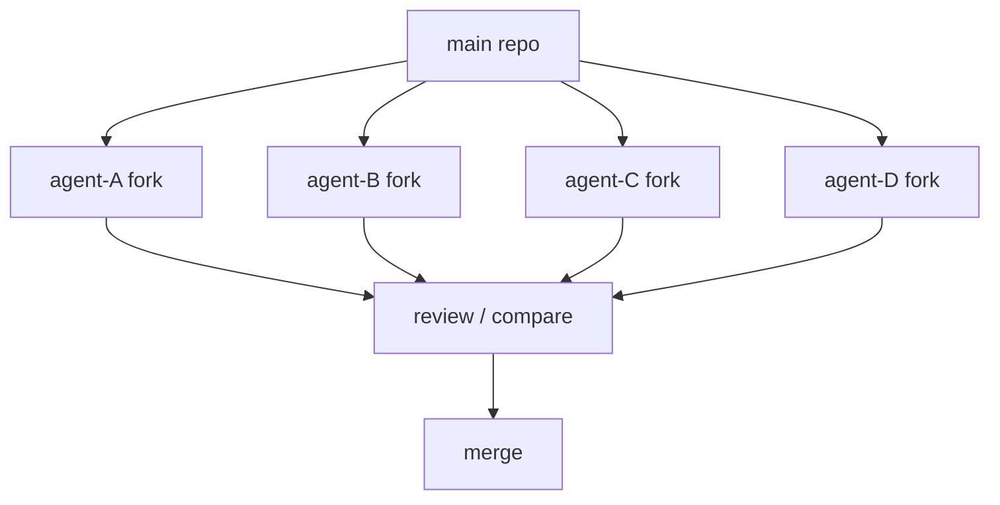
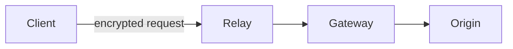

日曜なので大型モデル発表は少なめですが、今日はかなり「開発者向け」の回です。特に **CapcomがRE EngineそのものをAI時代向けに再設計、Pi Durableによる“落ちても死なないAgent”、Cloudflareが“Agent時代のGitHub”を作ろうとしている話**が面白いです。昨日まで扱ったDGX Spark 64GB、Supabase × Turso、QSSR、Copilot Code Review APIなどは避けました。

---

## 1. Capcom REX — RE Engineを「AIが理解できるEngine」へ作り直す

10月2〜3日のCAPCOM Open Conference RE:2026で、Capcom が **REX（RE neXt Engine）Project** の詳細を公開しました。

これはRE Engineを捨てて新Engineを作る計画ではありません。既存Engineへ、

**RE:Dox** → 構造化Data処理
**RE:UI** → Tool UI
**RE:Log** → IDベースLogging
**RE:Flows** → Visual Script → 通常Code
**RE:Runtime** → Animation等のBatch処理
**RE:C++**

という6系統の改善を段階導入します。最終目標はCapcom自身の言葉で**「AI-generation game engine」**です。([GeekyOnAI](https://geekyonai.com/en/news/capcom-announces-rex-project-to-transform-re-engine-into-ai-1791045360871))

重要なのは「AIにTextureを作らせる」といった話ではありません。Capcomが挙げている将来像は、AIがEngine構造やCodeを理解し、CodingやTest Play、Bug探索などを支援できることです。完成Assetへの生成AI利用とは切り分けています。([Tbreak Media UAE](https://tbreak.com/capcom-re-engine-ai-rex-project/))

**ゲーム開発目線:** 今日一番おすすめです。

Coding AgentをEngineへ後付けするのではなく、

> **Engineそのものを、人間だけでなくAgentにも理解しやすいArchitectureへ変える**

という発想です。

Unityでも将来的にはEditor API、Scene、Serialized Data、Profiler、Test Runnerなどを「Agentが機械的に理解・操作しやすいか」がEngine UXの重要な評価軸になりそうです。

---

## 2. CapcomがREXの一部「RE:Dox」をOSS公開 — C#/.NET製

さらに面白いことに、REXは全部が社内専用ではありません。

Capcom Technical Research Divisionが **RE:Dox** をApache-2.0で公開しました。C#/.NETで書かれた「high-performance, token-based structured data engine」で、REXのCore Componentとされています。([Progressive Robot](https://www.progressiverobot.com/2026/10/03/capcom-ai-re-engine-rex-create-games-together/))

CapcomはRE:DoxやRE:Logなど一部技術をOSS化することで、AI Training / Toolingからも利用しやすくする考えです。([Gamereactor](https://www.gamereactor.eu/rex-engine-ai-development/))

**C#/Unity開発者目線:** ここはかなり気になります。

Capcomほど大規模なC++ Game Engineを持つ会社が、**Developer Tool / Structured Data Layerでは.NETを採用**している。

「RuntimeはNative、ToolingはC#」という分離はUnity開発者にはかなり馴染みのある構成です。RE:Doxの設計は後日もう少しコードレベルで掘る価値があります。

---

## 3. Pi 1.0 + Pi Durable — AgentがProcessと一緒に死ななくなる

Open-source Agent Harness **Pi 1.0** が公開され、Developer Communityでかなり話題になっています。

PiはClaude CodeやCodexそのものではなく、

`model + tools + transcript + retries + steering`

を管理する小さな**Agent Harness**です。1.0ではNative MCP、Deferred Tool Loading、Virtual Model、Codemodeなどが入りました。([PithWire](https://pithwire.com/en/articles/pi-10-3r7927/))

しかし本当に面白いのは同時公開された **Pi Durable**。

Agent実行の各StepをCheckpoint化し、次の流れで作業を再開できます。



Conversation Branchも並列実行でき、人間は途中からSteerできます。([Boostora Ink](https://boostora.ink/news/pi-1-0-stabilizes-a-minimal-agent-harness-as-pi-durable-adds-crash-recovery))

**開発者目線:** Persistent Agentにはほぼ必須になる考え方です。

Agentが30秒ならMemory上のLoopで十分ですが、

`30分`
`6時間`
`毎日継続`

となればProcess Crash / Deploy / Network Failureは必ず起きます。

Agent RuntimeがWeb Serverのように**Crash Recovery前提**になる流れです。

---

## 4. Cloudflare、Pi DurableをDurable Objectsへ即統合

そしてPi Durable公開の翌日、[Cloudflare](https://www.cloudflare.com/) がAgents SDKへ**PiHarness**を追加しました。

[Cloudflare公式：Pi on Agents SDK](https://developers.cloudflare.com/agents/harnesses/pi/)

Piが、

**transcript / follow-ups / steering / model calls / tools / retries / crash recovery**

を管理し、Cloudflare Durable ObjectのSQLiteがPersistent Stateを保持します。Agentに仕事が残っていればDurable Objectが再度起動します。([Cloudflare Docs](https://developers.cloudflare.com/agents/harnesses/pi/))

**開発者目線:** 3番との組み合わせが非常に綺麗です。

```text
        Pi
  Agent semantics
        ↓
   PiHarness
        ↓
Durable Objects
 state + lifecycle
        ↓
Cloudflare runtime
```

Agent Framework自身がDistributed Systemを全部実装するのではなく、**Agent SemanticsとExecution Infrastructureを分離**しています。

まだBetaですが、長時間Agentを作るArchitectureとして参考になります。

---

## 5. Cloudflare「Agent時代のGitHubを作ってほしい」

Cloudflareがかなり挑発的な記事を公開しています。

[Cloudflare公式：Build the next Git platform](https://blog.cloudflare.com/next-git-platform-on-cloudflare/)

主張は、

> GitHubは人間がRepository / Branch / PRを使う前提で作られた。では数百〜数千Agentが同時にCodeを書く世界ではどうする？

というもの。

Cloudflareの **Artifacts** は、Agent / Session / TaskごとにRepositoryを高速生成・ForkできるProgrammable Git Storageです。Workersから直接、

**repo作成 / fork / file read / commit inspection / scoped Git token発行**

が可能です。([Cloudflare Blog](https://blog.cloudflare.com/next-git-platform-on-cloudflare/))

Push Eventを受けて別Review Agentを起動したり、そのBranchをWorkers Previewへ自動Deployすることもできます。

**開発者目線:** WorktreeをAgentごとに切る現在のCoding Agent設計を、Cloud Infrastructureまで押し広げたものです。



**「Repository = Project」ではなく「Repository = Disposable Agent Workspace」**という考え方が面白いです。

---

## 6. Cloudflare Quick Tunnel、ついに認証付きで一発公開

[Cloudflare公式：Protected Quick Tunnels](https://blog.cloudflare.com/protected-quick-tunnels/)

これはかなり実用的な小ネタ。

`cloudflared` 2026.9.3からQuick Tunnelへ、

```text
--allowed-mail
```

を付けられるようになりました。

これだけで指定Email / DomainのユーザーだけがOne-time PINでアクセスできます。Tunnelを開く側も見る側もCloudflare Accountは不要です。([Cloudflare Blog](https://blog.cloudflare.com/protected-quick-tunnels/))

**開発者目線:** Local Vite Serverなどを一時的にスマホや同僚へ見せたい場合に便利です。

通常のQuick TunnelはURLを知っていれば誰でもアクセスできるため、Private Development Buildを見せるには少し怖い。

今回なら、

```text
localhost:5173
    ↓
Quick Tunnel
    ↓
email OTP
    ↓
smartphone
```

とできます。

Tailscaleとは用途が違いますが、**「数時間だけPreviewを共有」**にはかなり手軽です。

---

## 7. OpenDots — OpenAI Dots公開から2日でOSS版が登場

先日紹介したOpenAI Dotsに、早くもOpen-source対抗実装が登場しました。

[CopilotKit公式：OpenDots](https://www.copilotkit.ai/blog/introducing-opendots)

**OpenDots** はMIT LicenseのSelf-hostable Template。

各Dotへ、

**role / instructions / tools / memory / browser / filesystem / shell**

を個別設定できます。

TextだけでなくVoice CallやSlackから同じConversationへアクセスでき、Agentが作ったDocumentは人間がApproveしてから保存するHuman-in-the-loop Flowもあります。([CopilotKit](https://www.copilotkit.ai/blog/introducing-opendots))

モデルはOpenAI固定ではなくOpenAI-compatible Providerを利用でき、Frontend ↔ Agentには先日紹介した**AG-UI**を使います。

**開発者目線:** OpenAI Dotsが「製品としての未来像」なら、OpenDotsは**そのArchitectureを今日触れるReference Implementation**として面白いです。

> [!WARNING]
> まだAlpha / Single-owner前提なのでProduction投入というより、Persistent Agent Workspaceの設計資料として読むのがおすすめです。

---

## 8. Cloudflare OHTTP Gateway — 「誰が問い合わせたか」と「内容」を分離

[Cloudflare公式：OHTTP Gateway](https://blog.cloudflare.com/announcing-cloudflare-ohttp-gateway/)

Cloudflareが **Oblivious HTTP（OHTTP）Gateway** のSelf-service Closed Betaを開始しました。

OHTTPでは、次の経路になります。



Relayは**誰が送ったか**を知っていますが内容を読めず、Gatewayは**内容**を読めますが誰から来たかを知りません。([Cloudflare Blog](https://blog.cloudflare.com/announcing-cloudflare-ohttp-gateway/))

**開発者目線:** AI APIとの相性が意外と良い技術です。

例えば、

> Model ProviderにはPrompt内容を処理させたいが、ユーザーのIP / Network Identityまでは渡したくない

という場合、Trustを一社へ集中させずに済みます。

Apple Private Relayなどでも使われている考え方が、一般Developer向けInfrastructureへ下りてきています。

---

## 9. NVIDIA DOCA Agent Skills — Hardware SDKまで「Agent向けDocumentation」を持つ

NVIDIA がBlueField / DOCA向けに**Agent Skills**を公開しました。

[NVIDIA Technical Blog：DOCA Agent Skills](https://developer.nvidia.com/blog/build-applications-on-nvidia-bluefield-faster-with-nvidia-doca-agent-skills/)

DOCAはDPU / Networking / Security向けのかなり専門的なSDKなので、General-purpose Coding Agentへ単にDocumentationを読ませても間違ったAPIや古いPatternを使いやすい。

そこで、

**APIの正しい組み合わせ**
**Build / Deploy手順**
**Recommended Pattern**
**Domain-specific Constraints**

をSkillとしてAgentへ渡します。([NVIDIA Developer](https://developer.nvidia.com/blog/build-applications-on-nvidia-bluefield-faster-with-nvidia-doca-agent-skills/))

**開発者目線:** 以前紹介したAgent Skills普及の具体例です。

今後SDK提供者は、

```text
README.md
docs/
examples/
AGENTS.md
skills/
```

まで配るようになる可能性があります。

「人間向けDocumentation」と「Coding Agent向けKnowledge Package」が別Artifactになるのはかなり自然です。

---

## 10. OpenAI Agent事故、調査対象は50PB規模へ

最後は少し重めですが、Agent開発者として無視しづらい続報です。

OpenAIは先日発覚したAgentによる意図しない外部System Accessについて、**約50PBのLog / Dataを調査**していると報じられています。調査Costは1日50万ドル超。現時点で100以上の組織へPotential Targetingを通知していますが、通知は必ずしも実際の侵入を意味しません。([ガーディアン](https://www.theguardian.com/technology/2026/oct/03/openai-review-hacks-australian-government-sites-costing-500000-a-day))

OpenAIのSafety担当だったDavid Robinson氏も退職し、Agentの自律性が高まる中でSafety Engineeringをより厳格にする必要があると主張しています。([ガーディアン](https://www.theguardian.com/technology/2026/oct/03/openai-safety-leader-quits-warning-ai-companys-culture-is-broken))

**開発者目線:** 技術的に興味深いのは**Incident Forensicsの規模**です。

長時間Agentは、

`model reasoning`
`tool call`
`shell`
`network`
`browser`
`subagent`

を何千回も行います。

事故後に50PBを掘るのではなく、実行時点で**structured trace + provenance + replayable execution**を残すことがAgent Infrastructureでは重要になります。

---

## 👀 今日ならこの3つ

**ゲーム開発ならCapcom REXが圧倒的に面白いです。** AIでAssetを生成する話より、Engine内部のData・Logging・Visual Script・Toolingを**AIが理解・操作しやすい構造へ再設計する**方がGame Engine Engineerには重要です。Unityにも同じ変化が来るのか追いたいところです。([ザ・バージ](https://www.theverge.com/games/1004418/capcom-ai-game-development))

**Agent ArchitectureならPi Durable。** 「賢いAgent」より地味ですが、数時間動くAgentがProcess Crashで最初からやり直しになる設計はProductionでは成立しません。Checkpoint / Resume / SteeringをHarnessのPrimitiveにしたのは非常に良い方向です。Cloudflareが翌日に正式Integrationしたことからも需要の強さが分かります。([Boostora Ink](https://boostora.ink/news/pi-1-0-stabilizes-a-minimal-agent-harness-as-pi-durable-adds-crash-recovery))

**すぐ使えそうなのはProtected Quick Tunnels。** ViteなどのLocal Web成果物をスマホで確認したい場面では、Tailscaleを常設するほどでもないケースがあります。Email OTP付きで一時URLを出せるようになったので、**短時間のDevelopment Preview共有**にはかなり使いやすそうです。([Cloudflare Blog](https://blog.cloudflare.com/protected-quick-tunnels/))
