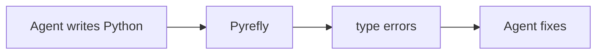
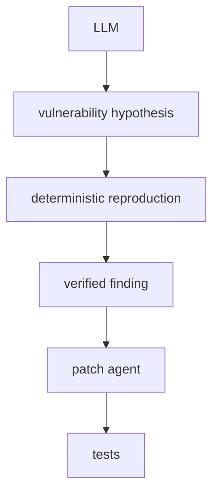
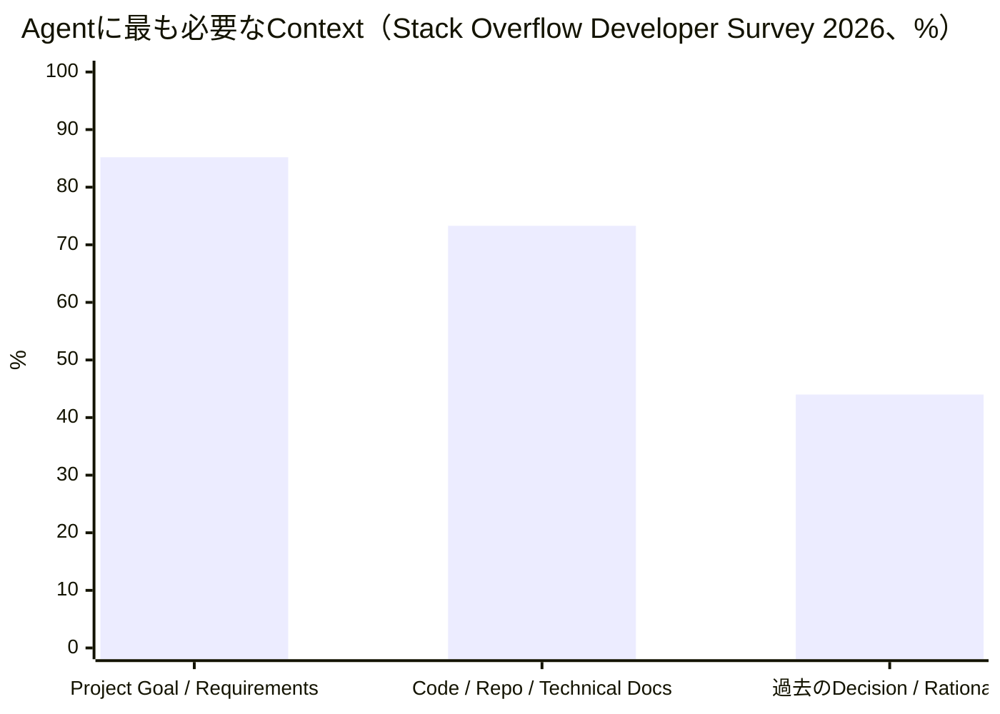

今日は昨日までより「新モデルそのもの」は少なめですが、**開発へAIを組み込んだ後に出てくる問題**がかなり面白い日です。特に、GoogleがPython型チェッカーをPyreflyへ移行、EmbeddingGemma 2のオンデバイス・マルチモーダル検索、AnthropicのCyber Access階層化、Stack Overflowの3万人規模Developer Surveyは要チェックです。昨日扱ったBeam、ReviewBench、PageBreak、UnityのAgent Pluginなどは繰り返していません。

---

## 1. Google、Python型チェッカーをPyreflyへ — 大規模導入開始

[Google Open Source Blog：Adopting Pyrefly](https://opensource.googleblog.com/2026/10/adopting-pyrefly-as-the-python-type-checker-at-google.html)

Google が10月6日、社内Python環境の型チェック基盤として **Pyrefly** を採用すると発表しました。

PyreflyはMetaがRustで開発している高速なPython Type Checker / Language Server。GoogleはMetaと協力しながら、大規模Python Codebaseへ適用するためのCompatibilityやPerformance改善にも参加します。Pyrefly自身は大規模環境で**毎秒185万行超**をチェックできるとしています。([Google Open Source Blog](https://opensource.googleblog.com/2026/10/adopting-pyrefly-as-the-python-type-checker-at-google.html))

**開発者目線:** Python型チェッカーは長らくmypy / Pyrightが中心でしたが、ここへかなり強い第三勢力が入りました。

特にAI Codingとの相性が良いです。



生成コードでは「動かして初めて分かるミス」を減らせるため、**高速なStatic AnalysisをAgent LoopのOracleとして使う**価値が上がっています。Pyrefly自身もAI生成Pythonの検証を明確な用途として掲げています。([Pyrefly](https://pyrefly.org/))

---

## 2. EmbeddingGemma 2 — 567MBで画像・動画・音声・コードを全部同じ空間へ

[Google公式：EmbeddingGemma 2](https://blog.google/innovation-and-ai/technology/developers-tools/embeddinggemma-2/)

Google DeepMindが10月6日、**EmbeddingGemma 2**をApache 2.0で公開しました。

740M Parametersですが、構成はModularです。

**Text / Code：270M**
**Vision：+170M**
**Audio：+300M**

全部使っても、量子化時のPixel 11 ProでのActive RAMは約**567MB**。Textだけなら約191MBです。([blog.google](https://blog.google/innovation-and-ai/technology/developers-tools/embeddinggemma-2/))

最大の特徴は、

`text / code / image / video / audio`

をすべて**同じ768次元Vector Space**へMappingすること。

さらにMatryoshka Representation Learningにより768 → 512 → 256 → 128 dimensionsへ縮められ、Vector Storageを最大約6分の1にできます。([blog.google](https://blog.google/innovation-and-ai/technology/developers-tools/embeddinggemma-2/))

**開発者目線:** 今日一番「触ってみたい」ものです。

例えばローカルで、

> 「このスクリーンショットに似たSceneを探して」
> 「この音に似たAudio Assetを探して」
> 「このコードと意味的に近い実装を探して」

を**同じEmbedding Model + Vector DB**で処理できます。

Unity ProjectのAsset / Code / Screenshot / Audioを横断検索するLocal Developer Toolにもかなり面白そうです。

---

## 3. EmbeddingGemma 2、実はDecision Modelとしても使える

上と同じモデルですが、このBriefingで追ってきた**Decision Model**の流れにも関係するので分けて紹介します。

Google AI Edge TeamはEmbeddingGemma 2について、TrainingやFine-tuningなしで、

```text
input
 ↓ embedding

candidate A ─ similarity 0.92
candidate B ─ similarity 0.31
candidate C ─ similarity 0.12
```

のようにLabel / Descriptionと直接照合することで、**millisecond級のZero-shot Intent Routing**にも使えると説明しています。([Google Developers Blog](https://developers.googleblog.com/en/google-ai-edge-with-embeddinggemma-2/))

**開発者目線:** Jev / Clef / Strands Deciderとは方式が違いますが、用途は一部重なります。

例えばゲームなら、

`Player text/voice → attack / shop / quest / chat`

のような分類をFrontier LLMへ投げる必要がない。

Embedding Modelなら**候補追加もEmbeddingを一つ作るだけ**なので、固定CategoryのRoutingにはかなり扱いやすいです。

「Generative LLMを使わないAI処理」の選択肢が急速に増えています。

---

## 4. Anthropic、Cyber向けClaudeを3段階Accessへ — SafetyをIdentityと用途で変える

[Anthropic公式：Cyber Verification Program](https://www.anthropic.com/news/cyber-verification-program)

[Anthropic](https://www.anthropic.com/) が10月6日、Cyber Verification Programを大幅拡張しました。

ClaudeのCyber Capabilityを一律にBlockするのではなく、

**Defense Access** → Incident Response / Malware解析 / Vulnerability検証
**Red Team Access** → 許可されたPenetration Test
**Specialized Access** → 電力・航空・金融などCritical Infrastructure

の3段階へ分けます。([Anthropic](https://www.anthropic.com/news/cyber-verification-program))

興味深いBenchmarkも公開されています。

Claude Opus 5.5で50回のCyber Taskを試したところ、

**Defense Access → 46/50を途中Block**
**Red Team Access → Block 0、34/50成功**

でした。後者はSafeguardなしとほぼ同等です。([Anthropic](https://www.anthropic.com/news/cyber-verification-program))

**開発者目線:** 先週紹介した「正常なEngineering作業までSafety Filterに止められる」問題への具体的な回答です。

Safetyを、

`promptだけから危険判定`

するのではなく、

**identity + organization + authorization + capability**

まで含めて決める。

AgentのPermission Modelも同じ方向へ進みそうです。

---

## 5. Claude、半年で少なくとも13万件超の実在Vulnerability発見に関与

同じAnthropic発表ですが数字がかなり大きいです。

Project Glasswing参加組織は4〜7月にClaude Mythosを利用して**少なくとも129,000件のVerified Vulnerability**を発見。Anthropic自身のOSS Scanでも4〜10月に追加で**5,500件**を確認しています。うち33,000件超がCritical / High Severityでした。([Anthropic](https://www.anthropic.com/news/cyber-verification-program))

Anthropic自身も「一部Partnerしか報告していないため下限値」としています。

**開発者目線:** Security AgentがDemoを越えています。

昨日紹介したGoogle PageBreakも500+ XSSを見つけていました。

2026年後半は、次のPipelineがかなり現実的になっています。



Coding Agentの次に本格的に普及するAgent Categoryとして、**Security Agent**はかなり有力に見えます。

---

## 6. Gears of War: E-Day — RTX Mega Geometryがついに実ゲームへ

[NVIDIA公式：Gears of War E-Day RTX technology](https://www.nvidia.com/en-in/geforce/news/gears-of-war-e-day-dlss-4-5-ray-tracing-rtx-mega-geometry/)

10月6日、Gears of War: E-Day が正式リリースされ、以前紹介した**RTX Mega Geometry**が実際の製品へ入りました。

The Coalition はUnreal Engine 5のNaniteとRay Tracingを組み合わせています。

従来Nanite GeometryをRay Tracingすると、Acceleration Structure構築Costの問題から**低DetailなProxy Mesh**へ置き換える必要がありました。

Mega GeometryではNaniteの高密度Geometryをより直接Ray Tracingへ利用できます。([NVIDIA](https://www.nvidia.com/en-in/geforce/news/gears-of-war-e-day-dlss-4-5-ray-tracing-rtx-mega-geometry/))

DLSS 4.5、Ray-traced Lighting、Reflexなども搭載されています。

**ゲーム開発目線:** 研究Demoではなく**Shipping AAA Gameでの実証**になったことが重要です。

NaniteのVirtualized GeometryとRay Tracingの間にあった大きなArchitecture上の溝が縮まりました。

今後UE以外のEngineでも、**GeometryをRaster用 / RT用に別管理するCostをどう減らすか**は注目テーマになりそうです。

---

## 7. Aembit — 「人間のAgent」と「人間本人」を別Identityとして扱う

Personal Agentが企業へ入り始めた結果、IAM側にも新しい設計が出ています。

[Aembit](https://aembit.io/) が10月6日、OpenAI DotsやMeta MuseなどPersonal Agent向けのEnterprise Access Controlを発表しました。([GlobeNewswire](https://www.globenewswire.com/fr/news-release/2026/10/06/3375648/0/en/aembit-extends-access-controls-to-personal-ai-agents.html))

面白いのは**Blended Identity**。

```text
employee: Alice
       +
agent: Alice's Dot
       ↓
temporary scoped credential
```

として扱います。

そのためSecurity Teamは、

> Alice自身はGitHubへアクセス可能
> しかしAliceのDotはProduction Repositoryへアクセス不可

のようなPolicyを作れます。

AgentだけをRevokeしても、人間本人のCredentialはそのままです。([GlobeNewswire](https://www.globenewswire.com/fr/news-release/2026/10/06/3375648/0/en/aembit-extends-access-controls-to-personal-ai-agents.html))

**開発者目線:** これはかなり筋が良いです。

Agentを「ユーザーのTokenを持った単なるClient」にするとAudit Log上では人間との区別がつきません。

今後Enterprise Agentでは、

**human identity ≠ agent identity ≠ workload identity**

を分けるのが標準になりそうです。

---

## 8. GitHub AI Scan、企業全体で「どのRepoが有効か」見えるように

[GitHub公式：AI Scan coverage](https://github.blog/changelog/2026-10-06-code-scanning-ai-scan-enablement-status-in-security-overview/)

[GitHub](https://github.com/) は10月6日、Security Overviewに**AI Scan for Pull Requests**のCoverage表示を追加しました。

Organization / Enterprise単位で、

`enabled repositories`
`not enabled repositories`

を確認・Filterでき、CSV Exportにも状態が入ります。([The GitHub Blog](https://github.blog/changelog/2026-10-06-code-scanning-ai-scan-enablement-status-in-security-overview/))

**開発者目線:** 機能そのものより、この変更が示す段階が面白いです。

AI Security Scanが、

> 数人が試す新機能

から、

> **数千RepositoryへDeployしてCoverageを管理するSecurity Control**

へ変わっています。

Agent導入後に必ず出てくる「ちゃんと全Repositoryで有効なのか？」というGovernance問題へProduct側が対応し始めています。

---

## 9. GitHub Secret Scanning、Supabase / Pydantic AI / Lovableまで検出

もう一つGitHubの小さいけれど実用的な更新。

10月5日からSecret Scanningが、

**`lovable_api_key`**
**`logfire_token`**
**`pydantic_ai_gateway_api_key`**
**`supabase_oauth_access_token`**
**`supabase_scoped_personal_access_token`**

を検出します。([SiteProxy](https://siteproxy.ruqli.workers.dev/https/github.blog/changelog/2026-10-05-secret-scanning-adds-detectors-for-lovable-supabase-and-more/))

LovableはSecret Scanning Partnerにも加わったため、Public RepositoryでKeyが見つかった場合はGitHubからProviderへ通知され、Credentialを失効・Rotationできます。

**開発者目線:** Agent開発でSecretの種類が急増しています。

昔なら、

`AWS_KEY / GITHUB_TOKEN`

程度だったのが、

```text
model provider
MCP
database
observability
AI gateway
agent platform
```

それぞれCredentialを持つ。

Coding Agent自身が`.env`やConfigを編集するケースも増えたので、**Secret ScanningをCIの保険として入れる価値は以前より高い**です。

---

## 10. Stack Overflow 2026 Survey — Coding Agentはもう「一部の人のTool」ではない

[Stack Overflow Developer Survey 2026](https://survey.stackoverflow.co/2026)

10月6日に2026年版Developer Surveyが公開されました。**30,903人・169か国**の回答です。([Stack Overflow Developer Survey](https://survey.stackoverflow.co/2026))

AI周辺の数字がかなり変わっています。

**66%** → Coding Assistant / Agentを利用
**73%** → AIを毎日利用
**31%** → Daily Userのうち4時間以上利用
**26.2%** → Automated Agent Workflowも利用

一方でAIを避ける理由では、**自分のSkillを失う懸念17.1%、Privacy / Security 13%**などが挙がっています。([Stack Overflow Developer Survey](https://survey.stackoverflow.co/2026/ai))

さらにAgentへ最も必要なContextとして、**Project Goal / Requirements（85.2%）**、**Code / Repo / Technical Docs（73.3%）**、**過去のDecision / Rationale（44%）**が上位でした。([Stack Overflow Developer Survey](https://survey.stackoverflow.co/2026))



**開発者目線:** 最後の数字が特に重要です。

Agent性能を上げるために次のFrontier Modelを待つより、

```text
requirements
architecture decisions
repository
technical docs
issue history
```

を**機械が取得可能な形で整理する**方がTeamによっては効果が大きい。

昨日まで紹介してきたSkills / MCP / Agent-oriented Documentationが増えている理由とも綺麗につながります。

---

## 👀 今日ならこの3つ

**個人的に一番試したいのはEmbeddingGemma 2です。** 740MでText / Code / Image / Video / Audioを同じVector Spaceへ置けて、フル構成でもMobileで約567MB。Unity Projectなら「このScreenshotに写っているPrefab」「この効果音に似たAudioClip」「このコードに近い実装」を**同じLocal Search Indexから探すDeveloper Tool**を作れそうです。Apache 2.0なのも扱いやすいです。([blog.google](https://blog.google/innovation-and-ai/technology/developers-tools/embeddinggemma-2/))

**Architectureとして重要なのはAembitのBlended Identity。** Personal AgentがEmployee Credentialをそのまま借りる方式では、AuditもRevokeも非常に扱いづらい。**「誰の代理か」と「どのAgentか」を別Identityとして保持する**考え方は、Enterprise Agentでかなり一般化しそうです。([GlobeNewswire](https://www.globenewswire.com/fr/news-release/2026/10/06/3375648/0/en/aembit-extends-access-controls-to-personal-ai-agents.html))

**そしてGoogleのPyrefly採用。** Coding Agentが大量のCodeを書くほど、LLM自身に「正しい？」と聞くよりCompiler / Type Checker / Linter / Testへ判定させる方が強い。昨日のPageBreakと同じく、2026年のAgent Engineeringでは**Probabilistic Generator + Deterministic Validator**という組み合わせがかなり重要な設計パターンになっています。([Google Open Source Blog](https://opensource.googleblog.com/2026/10/adopting-pyrefly-as-the-python-type-checker-at-google.html))
