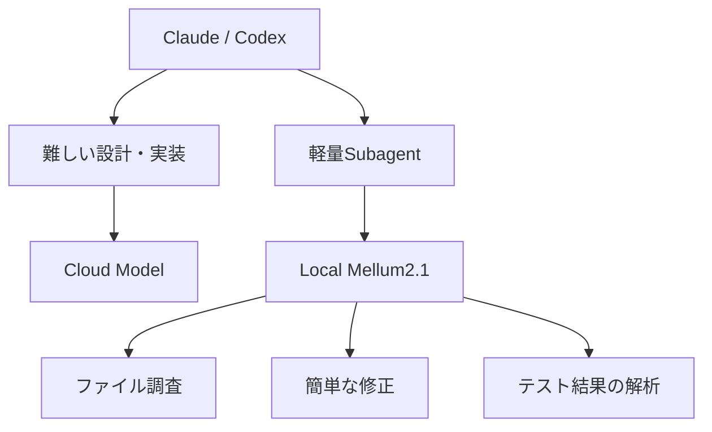
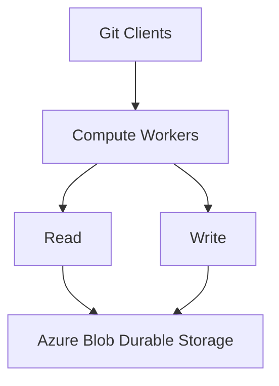

今日は**Coding Agent向けの新しいローカルLLM、Googleの常駐型Gemini Agent、Unity対応の3D生成AI、GitHubの大規模アーキテクチャ刷新**など、開発者にとって面白い発表が揃っています。

特に注目したいのは次の3つです。

- **JetBrains Mellum2.1**：12Bの小型MoEモデルが、強化学習によって本格的なCoding Agentに進化。
- **Liquid AI d1-3B**：わずか3Bで、画像を含む意思決定を数十msで実行。ゲームへの組み込みも面白そう。
- **Thrixel**：AIが生成した3Dモデルを、部品単位で編集・操作できる。UnityとClaude Codeにも対応。

昨日紹介したClaude Haiku 5.5、Google Playground / Unity Spark、Microsoft MXCなどは繰り返さず、**10月8日の発表を中心に、一部10月6〜7日の見逃せない技術記事**も取り上げます。

---

## 1. Google Gemini Agent — AIに専用メールアドレスとカレンダーを与える

**10月8日｜AI Agent・Google Cloud**

Google が、企業向けの新しい **Gemini Agent** を発表しました。

今回の特徴は、AIが単にチャットから仕事を受けるだけでなく、**独立した社員のような存在として活動できる**ことです。

例えばチーム専用Agentを作ると、そのAgentには専用のメールアドレス、カレンダー、Driveストレージ、社内ディレクトリ上のIdentityが与えられます。

さらに、次のような仕組みを備えています。

**Persistent Execution**：PCを閉じても数時間〜数日間の仕事を継続。

**Multi-agent Orchestration**：仕事に応じてSubagentを生成し、並列作業。

**Model Routing**：GeminiだけでなくClaudeも利用し、Taskに適したモデルを選択。

**Agent Identity**：人間とは別のIdentityとPermissionで操作を記録。

現在は企業向けPrivate Previewです。([Google Cloud](https://cloud.google.com/blog/products/ai-machine-learning/welcome-to-gemini-at-work-2026))

**開発者目線：**

OpenAI Dotsとかなり近い方向ですが、Googleは既存のWorkspaceやCloud IAMとの統合が強みです。

特に興味深いのは、Agent自身が独立したIdentityを持つ点。

```text
Developer
   │
   ├── Coding Agent
   │      └── Repository Aへの書込権限
   │
   ├── Review Agent
   │      └── Repository Aの読取権限
   │
   └── Release Agent
          └── CI/CD実行権限
```

Agentが増えても、人間のCredentialを共有する必要がありません。

[Google Cloud公式：Gemini at Work 2026](https://cloud.google.com/blog/products/ai-machine-learning/welcome-to-gemini-at-work-2026)

---

## 2. JetBrains Mellum2.1 — 12BのローカルCoding Agentモデルが大幅進化

**10月8日｜LLM・Coding Agent・Open Source**

JetBrains が **Mellum2.1** をApache 2.0で公開しました。

かなり面白いモデルです。

| 項目 | Mellum2.1 |
|---|---|
| 総パラメータ | 12B |
| Active Parameters | 2.5B |
| アーキテクチャ | MoE |
| Context | 約131K tokens |
| ライセンス | Apache 2.0 |
| 用途 | Coding Agent、Subagent、ローカル推論 |

特に重要なのは、前モデルMellum2から**アーキテクチャを変更していない**ことです。

代わりに、数百万回のSandbox実行を使った強化学習を実施。

その結果、Repositoryを探索し、ファイルを変更し、テストで結果を確認する能力が大きく改善しました。

JetBrainsの評価では、SWE-bench Verifiedが**2.0%から47.0%**へ向上しています。ただしQwen3.5-9Bの50.0%には届いておらず、すべての能力で優位というわけではありません。

また、H200での高負荷テストではQwen3.5-9Bの約2倍のToken Throughputを報告しています。([The JetBrains Blog](https://blog.jetbrains.com/ai/2026/10/mellum2-1-gets-to-work-a-fast-open-model-for-coding-agents/))

**開発者目線：**

ローカルCoding Agentを検討しているなら、かなり注目です。

Unified Memoryが数十GB程度のMacでも、量子化モデルなら実行を検討しやすいサイズです。

例えば、次のような構成が考えられます。



なお、公式記事ではGGUF版やOllama向けの配布を今後の予定としています。モデル本体はすでにHugging Faceで公開されています。

[JetBrains公式：Mellum2.1](https://blog.jetbrains.com/ai/2026/10/mellum2-1-gets-to-work-a-fast-open-model-for-coding-agents/)

---

## 3. Liquid AI d1-3B — 画像を見て8msで判断するDecision Model

**10月7日｜Decision Model・Local AI**

Liquid AI が、Decision Modelの小型Open-weight版を公開しました。

今回のモデルは2種類です。

| モデル | サイズ | 入力 |
|---|---:|---|
| d1-3B | 3B | Text・Image |
| d1-omni-600M | 600M | Text＋Image、Text＋Audio |

通常のLLMと異なり、文章をToken単位で生成しません。

入力と候補を渡すと、**1回のForward Passで判断結果を返します。**

d1-3Bの公称Latencyは次のとおりです。

| Hardware | 単一の判断 |
|---|---:|
| RTX 4090 | 8ms |
| Apple M5 Pro | 30ms |
| Jetson AGX Thor | 16ms |
| Jetson AGX Orin | 26ms |
| Jetson Orin Nano | 50ms |

> [!WARNING]
> これは短い入力に対する測定です。約3,400 Tokenの状態を与えると、M5 Proでは640msまで増加します。([Liquid AI](https://www.liquid.ai/blog/d1-open))

**ゲーム開発目線：**

今回かなり興味深いのは、Liquid AIが**ゲームを使ったリアルタイムデモ**を用意していることです。

Pac-Man、Tetris、Doom、Flappy Birdなどの環境で、Decision Modelを利用しています。

例えば敵AIに、

```text
現在の状態:
  HP: 20%
  Player Distance: 5m
  Enemy Count: 3

候補:
  Attack
  Retreat
  Heal
  Defend
```

を渡し、状況に応じて行動を選ばせる使い方が考えられます。

**LLMに自然言語を生成させる必要がないゲームAI**として、実験する価値がありそうです。

もちろん従来のBehavior TreeやUtility AIより優れているとは限りません。特に推論時間がフレーム予算を超える場合は、非同期実行などが必要です。

[Liquid AI公式：Open d1](https://www.liquid.ai/blog/d1-open)

[d1のゲームデモ](https://d1.liquid.ai/)

---

## 4. AWS Strands Box — Agentの「過去の行動」まで考慮するSandbox

**10月7日｜AI Agent・Security・Open Source**

Amazon Web Services が **Strands Box** をDeveloper Previewとして公開しました。

昨日紹介したMicrosoft MXCと似た用途ですが、**設計思想に面白い違い**があります。

MXCがOSレベルの隔離を重視しているのに対し、Strands BoxはOS隔離に加え、**Agentがこれまでに何をしたかを考慮して操作を許可・拒否できる**仕組みを提供します。

ポリシー記述にはDogwoodという言語を利用します。

例えば、

> Slackへの投稿は許可する。ただし10分間に3回まで。

というルールを、Agent自身では変更できない場所で強制できます。

さらにShell、Python、HTTP、MCP Toolそれぞれに対して操作を制限できます。([Amazon Web Services, Inc.](https://aws.amazon.com/blogs/opensource/introducing-strands-box-ai-agent-sandboxes-powered-by-dogwood/))

**開発者目線：**

従来のPermissionは、

`この操作を許可するか？`

という単発の判断が中心でした。

Strands Boxでは、

`このAgentが今まで何をしてきたか？`

まで判断材料になります。

長時間動作するAgentでは、非常に重要な考え方です。

例えば本番障害を調査するAgentに、CloudWatchの読み取りは許可しつつ、インフラ変更は禁止できます。

> [!WARNING]
> まだDeveloper Previewなので、本番利用には検証が必要です。

[AWS公式：Introducing Strands Box](https://aws.amazon.com/blogs/opensource/introducing-strands-box-ai-agent-sandboxes-powered-by-dogwood/)

---

## 5. Thrixel — AIが「部品構造を理解できる3Dモデル」を生成

**10月8日｜Unity・3D・AI Agent**

今日はゲーム開発関連でもう一つ面白い発表があります。

3D生成プラットフォームの [Thrixel](https://thrixel.com/) が、Agent向け3D制作基盤の展開を発表しました。

Thrixel自体は以前からベータ提供されていましたが、今回、**Coding Agentが3D Assetを生成・編集・配置するWorkflow**を前面に出しています。

特徴は、生成される3Dモデルが単なる一体化したMeshではないことです。

例えば車を生成すると、

```text
Car
 ├── Body
 ├── Wheel_FL
 ├── Wheel_FR
 ├── Wheel_RL
 ├── Wheel_RR
 └── Door
```

のように、名前付きの部品構造を持たせられます。

そのためAgentが、

> 右前のタイヤだけ大きくして。

> ドアを開閉できるようにして。

といった指示を処理しやすくなります。

さらに、Unity、Unreal Engine、Three.js、Robloxに対応した**Build World**というWorkflowも提供しています。([ACCESS Newswire](https://www.accessnewswire.com/newsroom/en/computers-technology-and-internet/uchicago-ai-researcher-rana-hanocka-launches-thrixel-a-3d-generat-1233742))

**Unity開発者目線：**

個人的にはGoogle Playgroundより、こちらの方が技術的に興味深い部分があります。

理由は、AIにとって扱いやすい**構造化されたAsset**を生成していることです。

生成されたモデルをFBXとしてUnityへ取り込み、Coding AgentがC#やSceneを構築できます。

さらにMCP経由でモデルの部品を検査・編集できるため、ゲームをPlaytestした後の修正にも利用できます。

ただし、実際のTopology、UV、Rig、LOD、Draw Callなどが本格的なゲーム制作に十分な品質かは別途評価が必要です。

[Thrixel公式：Unity連携](https://www.thrixel.com/unity)

[Thrixel MCPドキュメント](https://thrixel.com/mcp)

---

## 6. GitHub、Agent時代に向けてGit Storageを根本から作り直す

**10月6日公開・7日更新｜Software Architecture**

[GitHub Engineering：Building Git Infrastructure for Agent-scale Development](https://github.blog/engineering/architecture-optimization/building-git-infrastructure-for-agent-scale-development/)

GitHub が、Git Storageの大規模な再設計について詳しい技術記事を公開しました。

理由は、Coding AgentによってGitの利用パターンが急激に変化しているためです。

GitHubが公開した実績値はかなり大きなものです。

| 指標 | 数値 |
|---|---:|
| 2026年9月のCommit数 | 73.8億 |
| Commit数の前年比 | 5倍以上 |
| Push数の前年比 | 約4.9倍 |
| GitHub Actions実行数 | 9月に32.6億回 |

従来は人間が数分〜数時間単位でCommitすることを想定していました。

しかしAgentは、ほぼ毎操作後にCheckpointやCommitを作ることがあります。

その結果、**ReadよりWriteがボトルネックになり始めている**とのことです。

GitHubは新Architectureで、Repositoryの永続ストレージと処理を分離します。



これによりRead Workerを増やしてもWriteの負担が増えない構成を目指します。

内部Benchmarkでは、**最大35倍のWrite Throughput**を記録したとしています。([The GitHub Blog](https://github.blog/engineering/architecture-optimization/building-git-infrastructure-for-agent-scale-development/))

**開発者目線：**

この話は、先日紹介したCloudflare Artifactsとも関連しています。

Agentが大量のBranchやCommitを生成する時代には、Git Hosting自体の設計が変わる必要があります。

特に興味深いのは、GitHubが単にサーバーを増強するのではなく、**分散システムとしての整合性維持とWrite性能を両立する方向へ再設計している**ことです。

---

## 7. Chrome 155、JPEG XLを正式サポート — Rust製Decoderを採用

**10月6日発表｜Web・Rust・画像処理**

Google Chrome 155で、**JPEG XL（.jxl）** のDecodeに正式対応しました。

JPEG XLは従来のJPEGより高い圧縮効率を持ち、Lossless Compression、HDR、Progressive Decodingなどに対応する画像形式です。

Googleの説明では、一般的なJPEGに対して**30〜50%程度の圧縮改善**が期待できます。ただし画像の内容やエンコード設定によって結果は変わります。

今回面白いのは、Googleが以前JPEG XLの採用を見送っていたことです。

復活の理由にはDeveloper Communityからの要望に加え、**Rust製Decoder「jxl-rs」によってメモリ安全性を高められたこと**があります。([Chrome for Developers](https://developer.chrome.com/blog/jpeg-xl-in-chrome))

**Web開発者目線：**

画像形式の選択肢が増えたことはもちろん、Rustの採用事例としても興味深いです。

Web向け画像配信なら、JPEG XLとAVIFを実際の画像で比較する価値があります。

ただし既存Browserとの互換性が必要なので、JPEG/WebP/AVIFなどのFallbackは当面必要です。

[Chrome Developers公式：Shipping JPEG XL](https://developer.chrome.com/blog/jpeg-xl-in-chrome)

---

## 8. Spotify Technology — 音楽会社が開発ツール企業として本格展開

**10月8日｜Developer Tools・Platform Engineering**

Spotify が **Spotify Technology** を発表しました。

これはSpotifyが社内で利用してきた開発基盤を、外部企業向けにまとめて提供する取り組みです。

中心となるのは次の製品です。

**Portal**：Architectureや社内ルールを共有するDeveloper Portal。

**Xirp**：複数のCoding Agentを管理するための開発基盤。

**Confidence**：Feature Flagや実験結果を使ったProduct Analytics。

**Backstage**：OSSのDeveloper Portal Framework。

Spotifyはこれらを独立したツールとしてではなく、共通のContext LayerとAgent Runtimeを持つ一つのシステムとして位置付けています。([Spotify Engineering](https://engineering.atspotify.com/2026/10/introducing-spotify-technology-proven-at-spotify-now-yours))

**開発者目線：**

特に面白いのはXirpです。

Coding Agentを大量に動かす場合、単にCodeを生成するだけではなく、

`Agentの状態管理 → 開発環境 → Code Review → Deploy → 効果測定`

という全体の仕組みが必要になります。

Spotifyはこれを**R&D Operating System**という方向へ発展させようとしています。

Spotifyのような大規模プロダクト企業が、自社のPlatform Engineeringを外部向け製品にする動きは注目したいところです。

[Spotify Engineering公式発表](https://engineering.atspotify.com/2026/10/introducing-spotify-technology-proven-at-spotify-now-yours)

---

## 9. GitLab、Agentが作る大量のコードを安全にProductionへ届ける仕組み

**10月6日｜DevOps・AI Agent**

GitLab が **Governed Software Factory** 構想を発表しました。

背景にあるのは、Coding AgentによってCodeの生成量が増えても、その後のReview、Security、Deploymentが追いつかない問題です。

今回の発表には、次のような機能が含まれています。

**Dependency Firewall**：危険なDependencyをBuildへ取り込む前にBlock。

**Artifact Central**：PackageやContainerを統一的に管理。

**Secrets Manager**：CI JobごとにCredentialの利用範囲を制限。

**Duo Agent Platform**：Issueから実装・検証までの複数段階を自動化。

さらにImpact Analyticsでは、Agentにかかった費用と開発成果を紐づけて分析できます。

GitLabの説明によると、社内ContextをAgentへ渡すGitLab Orbitは、特定の評価でRetryを最大45分の1、Token消費を最大4.5分の1に削減したとしています。([GitLab](https://about.gitlab.com/press/releases/2026-10-06-gitlab-announces-the-foundation-for-the-governed-software-factory/))

**開発者目線：**

Coding Agentの導入が進むほど、次のボトルネックはCode Generationではなくなります。

**Review、Security、Testing、Deploymentの処理能力**が重要になります。

特に大規模Unity Projectでは、Asset変更やNative Plugin更新など、通常のSource Code Reviewだけでは検証しきれない部分があります。

Agentが作った変更をどのように検証し、Productionへ届けるかという設計は、今後さらに重要になりそうです。

[GitLab公式発表](https://about.gitlab.com/press/releases/2026-10-06-gitlab-announces-the-foundation-for-the-governed-software-factory/)

---

## 10. 英国ICO、AI AgentのPrivacy問題について調査を開始

**10月8日｜AI Security・Privacy**

最後は少し重めの話題です。

英国の個人情報保護当局 Information Commissioner's Office（ICO）が、**AI Agentのデータ保護リスクについて正式に意見募集と調査を開始**しました。

背景には、最近報告されているAgentの意図しない外部通信や、許可されていないシステムへのアクセスなどがあります。

ICOはOpenAI、Anthropic、Metaなどに対して、AgentのTestingやDeploymentに関する確認を進めています。

さらにAmazon、Apple、Google、Microsoftなどを含む10社のFoundation Model開発企業が、透明性や個人情報保護に関する改善を実施、または実施を約束したことも発表しました。([アイコ](https://ico.org.uk/about-the-ico/media-centre/news-and-blogs/2026/10/ico-secures-changes-from-leading-ai-developers-as-scrutiny-extends-to-ai-agents/))

**開発者目線：**

これまでAgent Securityは、

> Prompt Injectionを防ぐには？

という技術的な話が中心でした。

しかし今後は、

> Agentが個人情報を外部へ送った場合、誰が責任を持つのか？

という法的・運用的な問題も重要になります。

特にAgentが複数の外部ToolやSubagentを使う場合、**どの情報が、いつ、どこへ渡ったかを追跡できる設計**が必要です。

[ICO公式発表](https://ico.org.uk/about-the-ico/media-centre/news-and-blogs/2026/10/ico-secures-changes-from-leading-ai-developers-as-scrutiny-extends-to-ai-agents/)

---

## 👀 今日ならこの3つ

### 🥇 1位：Mellum2.1 — ローカルCoding Agentの新しい有力候補

今回のモデルは、単なる小型LLMではありません。

**Repositoryを操作する能力そのものを強化学習で改善している**ところが重要です。

12B・2.5B Activeというサイズなら、ローカル環境でSubagentとして使う構成を試したくなります。

特にClaude CodeやCodexで複数Agentを動かしている場合、簡単なTaskをローカルへ逃がせるかが気になります。

### 🥈 2位：Liquid AI d1-3B — ゲームAIとして試してみたい

最近Decision Modelを継続して追っていますが、今回のd1-3Bはかなり実用的な方向です。

**画像入力ができ、ローカル実行が可能で、推論が非常に高速**。

ゲーム内の敵AIやNPCだけでなく、プレイヤーの行動に応じて演出を選択する仕組みなどにも応用できそうです。

Liquid AI自身がゲームのデモを用意している点も良いですね。

### 🥉 3位：Thrixel — Coding Agentが3D Assetを直接操作する未来

Google PlaygroundやUnity Sparkがゲーム制作環境全体をAI化する方向なのに対し、Thrixelは**既存のCoding Agentに3D Asset操作能力を与える**方向です。

特に、生成モデルが名前付きの部品構造を持つという設計は、UnityでのPrefabやHierarchyを扱う感覚に近いものがあります。

品質や運用コストは確認が必要ですが、3DゲームのPrototype制作には面白い選択肢です。

---

## 📊 今朝の技術トレンド

今朝のニュースで特に目立ったのは、**AIが使いやすい形にソフトウェアやデータの構造そのものを変えていく動き**です。

GitHubはAgentが大量にCommitする前提でStorageを再設計し、ThrixelはAgentが部品を理解できる3D Assetを生成し、SpotifyはAgentが社内Contextを共有できる開発基盤を整えています。

そしてMellum2.1のように、Agentが実際の開発環境で作業する能力を強化学習で高めるモデルも登場しました。

**「AIに既存のツールを使わせる」から「AIと人間の両方が使いやすいようにツールを設計する」へ。**

この変化は、ゲームエンジンや開発ツールの設計にも大きく影響していきそうです。
