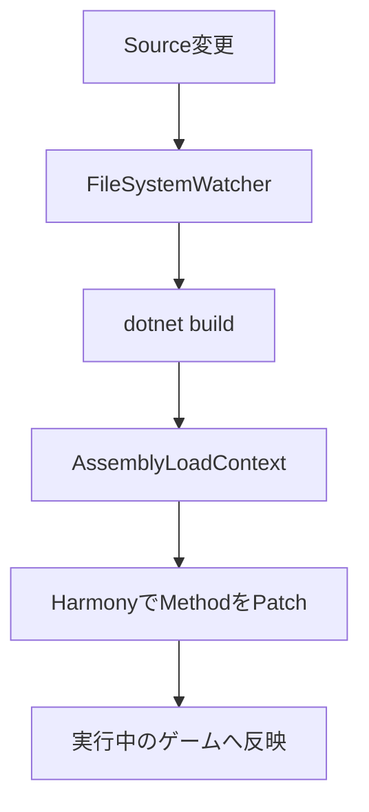
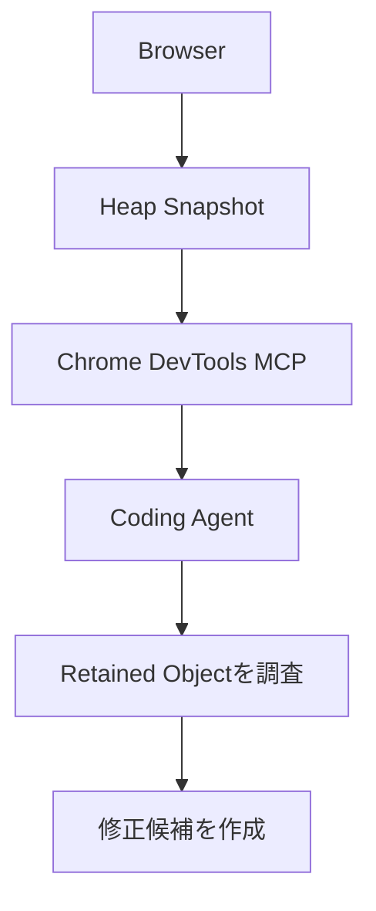

今日は週末らしく、大型モデルの発表よりも**開発者が実際に使えるツールや、興味深い技術研究**を中心に10本集めました。

特におすすめなのは、**Robloxが公開したゲーム開発Agentの性能研究、WebGPUの新しいHDR描画機能、GodotのC# Hot Reloadを実現する小さなOSS**です。

昨日まで紹介したUnity 7、Unity CLI、Claude Code 2.1.296、Stacked PRなどは除外しています。

---

## 1. GitHub Copilot for JetBrains — MCPの自動起動を制御できるように

**10月10日｜Coding Agent・IDE**

[GitHub公式：Copilot for JetBrains更新](https://github.blog/changelog/2026-10-10-new-controls-and-chat-improvements-in-copilot-for-jetbrains)

[GitHub](https://github.com/) が、JetBrains IDE向けCopilot Pluginの更新を発表しました。

今回の注目点は、**CopilotやClaudeでMCP Serverの自動起動を無効化できる**ようになったことです。

ほかにも、診断エラーから直接Agentへ修正を依頼する機能や、企業管理者によるDefault Model設定が追加されています。

**開発者目線：**

MCP Serverは便利ですが、設定したServerがすべて自動起動する構成は、起動時間やリソース消費、権限管理の面で問題があります。

今回の変更は小さいものの、**MCPを常時起動するものではなく、必要に応じて有効化するものとして扱う**方向です。

> [!WARNING]
> JetBrains IDE 2025.1のサポートが終了し、2025.2以降が必要になりました。古いバージョンのIDEを使っている場合は確認しておきたい変更です。([The GitHub Blog](https://github.blog/changelog/2026-10-10-new-controls-and-chat-improvements-in-copilot-for-jetbrains))

---

## 2. VS Code 1.141 — 複数Agentを並べて比較、Worktreeも整理

**10月9日｜VS Code・Coding Agent**

[GitHub公式：Copilot Weekly Releases](https://github.blog/changelog/2026-10-09-github-copilot-weekly-releases-october-5)

VS Code向けCopilotに、複数Agentを扱いやすくする改善が入りました。

特に面白いのが、**Agents Windowで複数SessionをGrid状に並べられる**ことです。

例えば、同じ機能をClaudeとCodexに実装させて、結果を並べながら比較する使い方ができます。

さらに、使われなくなったWorktreeが消費しているディスク容量を確認し、不要なものを削除できるようになりました。

**開発者目線：**

Coding Agentを並列実行すると、Worktreeが大量に残りがちです。

```text
Repository
 ├─ agent-feature-a
 ├─ agent-feature-b
 ├─ agent-review
 └─ agent-experiment
```

Agentが作業する環境そのものを、IDEが管理する方向へ進んでいます。

これは単なるUI改善ではなく、**IDEがAgent Session Managerとして進化している**と考えると面白いです。([The GitHub Blog](https://github.blog/changelog/2026-10-09-github-copilot-weekly-releases-october-5))

---

## 3. Roblox OpenGameEval — ゲーム開発Agentは、まだ半分程度しか成功しない

**10月2日論文公開・10月6日研究紹介｜ゲーム開発・AI研究**

[OpenGameEval研究論文](https://arxiv.org/abs/2610.02563)

Roblox の研究チームが、**AI Agentにゲームエンジンを操作させる能力**を詳しく分析した論文を公開しました。

この研究では、Roblox Studio上で84種類のゲーム開発Taskを用意し、13種類のFrontier Modelを比較しています。

結果がかなり興味深いです。

| 指標 | 結果 |
|---|---:|
| 最高モデルの1回あたり成功率 | 51.7% |
| 5回連続で成功する割合 | 39.4% |
| どのモデルも成功できなかったTask | 6種類 |

さらに重要な発見があります。

**編集する前に、関係するScene Objectをきちんと調査したAgentほど成功率が高かった**のです。

Scene変更のみのTaskでは、必要なObjectをすべて事前調査した場合、調査しなかった場合より成功率が13.4ポイント高くなりました。([arXiv](https://arxiv.org/abs/2610.02563))

### ゲーム開発者目線

これはかなり重要な研究です。

ゲーム開発では、コードだけ読んでも正しい変更ができるとは限りません。

```text
Scene Hierarchy
      ↓
Component / Script
      ↓
Serialized Properties
      ↓
Runtime State
      ↓
Gameplay Result
```

これらを理解する必要があります。

**「Agentに何を操作させるか」より、「操作前に何を観察させるか」が重要**という結果です。

Unity向けMCPを設計する場合も、SceneやPrefabの調査機能を充実させる価値がありそうです。

[OpenGameEval公式Repository](https://github.com/Roblox/open-game-eval)

---

## 4. Chrome 155〜156 — WebGPUでHDR・広色域・Early-Z最適化が進化

**10月7日｜WebGPU・Graphics**

[Chrome Developers：What's New in WebGPU](https://developer.chrome.com/blog/new-in-webgpu-155-156)

Chrome 155〜156に向けたWebGPUの更新内容が公開されました。

今回はゲームやグラフィックス開発者にとって興味深い変更が多いです。

**① HDR・広色域への対応強化**

`srgb-linear`と`display-p3-linear`が追加されます。

これにより、WebGPUのCanvasへ広色域のLinear Color Spaceで直接描画できます。

**② Fragment Depthの最適化**

新しいWGSL拡張`fragment_depth`では、Fragment Shaderが出力するDepthの関係を明示できます。

従来はCustom Depthを書き込むとEarly-Z最適化が無効になりやすかったのですが、条件によって最適化を維持できるようになります。

**③ 圧縮Textureのサイズ制約緩和**

BC、ETC2、ASTCなどの圧縮Textureで、Block Sizeの倍数ではないサイズも扱える機能が追加されます。([Chrome for Developers](https://developer.chrome.com/blog/new-in-webgpu-155-156))

### Webゲーム開発者目線

特に面白いのはHDRです。

WebGPUでゲームを作る場合、

- 発光するエフェクト
- Bloom
- 加算合成
- 色鮮やかなパーティクル

などの表現を、より広い色域で扱える可能性があります。

ただし、**広色域で描画できることと、HDRの明るさを実際に表示できることは別問題**です。Display、Browser、Canvas設定などの対応状況を確認する必要があります。

---

## 5. Godot Hot Reload Live — C#を変更してもゲームを再起動しない

**10月9日コミュニティ公開｜C#・ゲーム開発・OSS**

[Godot Forum：Hot Reload Live](https://forum.godotengine.org/t/released-hot-reload-live-free-open-source-c-hot-reload-for-godot-4-net/145180)

今回の小規模OSS枠では、これがかなり面白いです。

**Hot Reload Live** は、Godot 4.7以降の.NET版で動くC# Hot Reload Toolです。

ゲーム実行中にC#コードを書き換えると、再起動せずに変更が反映されます。

内部では次の技術を使っています。



Static Method、Instance Method、Generic Methodに加えて、asyncやIteratorにも対応しています。

一方、新しいFieldの追加やMethod Signatureの変更など、構造的な変更は対象外です。([Godot Asset Store](https://store.godotengine.org/asset/gutian2000/hot-reload-live/))

### C#エンジニア目線

**AssemblyLoadContextを使って新しいAssemblyを読み込み、既存オブジェクトのMethodだけを差し替える**という設計が面白いです。

Unity 7のCoreCLR移行とも技術的に近い部分があります。

> [!WARNING]
> 実装はまだ実験的な段階で、互換性や安定性の検証が必要です。

MIT Licenseなので、Hot Reloadの実装をコードレベルで学ぶ教材としても良さそうです。

[Hot Reload Live公式GitHub](https://github.com/gutian2000/hot-reload-live-godot)

---

## 6. Godot向けMCP「Beckett」— AIがゲームを実際に観察・テスト

**10月7日コミュニティで再注目｜AI Agent・ゲーム開発**

[Beckett公式Repository](https://github.com/beckettlab/beckett-godot-mcp)

もう一つ、ゲーム開発向けの小規模プロジェクトです。

**Beckett** はGodot Editor内部で動作するMCP Serverです。

特徴は、Node.jsやPythonなどの別Processを必要とせず、**GodotのEditorPlugin自体がMCP Serverになる**ことです。

無料のLite版では、AI Agentが以下の操作を実行できます。

- Scene TreeやNode Propertyの調査
- GDScript / C#の編集
- ゲーム実行
- Screenshot取得
- Runtime Stateの確認
- Performance MonitorやLogの取得

有料版ではさらに、Agentが入力操作を行い、画面やNodeの状態を検証するPlaytest機能が提供されます。([GitHub](https://github.com/beckettlab/beckett-godot-mcp))

### 開発者目線

先ほどのOpenGameEvalと合わせて考えると、かなり興味深いです。

Agentにゲームを操作させる場合、

**Observation APIとMutation APIを明確に分ける**

という設計が有効そうです。

また、BeckettはReflectionを活用して汎用的な操作Toolを提供しています。

Scene Objectごとに大量の専用MCP Toolを実装するのではなく、**少数の汎用Toolで幅広いObjectを操作する**という方向です。

これはUnityやWebの複雑なエディタをAI対応させる場合にも参考になります。

---

## 7. Nous Research、9000万ドル調達 — OSSのHermes Agentを企業向けへ

**10月7〜8日｜AI Agent・Open Source**

[Nous Research公式](https://nousresearch.com/) が、9000万ドルのSeries B資金調達を発表しました。

企業評価額は約15億ドルです。

同社が開発する**Hermes Agent**は、MIT Licenseで公開されている常駐型AI Agentです。

特徴は、Agentが過去の作業から知識を蓄積し、Skillsを生成・改善していく仕組みです。

さらに、特定のLLM Providerに依存せず、OpenAI、OpenRouter、ローカルモデルなどを切り替えて利用できます。

Nous Researchは今後、企業向け機能やモバイルアプリの開発を進める方針です。([The Wall Street Journal](https://www.wsj.com/pro/venture-capital/nous-research-scores-90-million-to-bring-open-source-ai-assistant-to-enterprises-516f9208))

### 開発者目線

最近はOpenAI Dots、OpenDotsなど、常駐型Agentが急速に増えています。

Hermesの面白さは、**Agent Harness自体をOSSとして所有・改造できる**ことです。

```text
Agent Harness
 ├─ Model Provider
 ├─ Memory
 ├─ Skills
 ├─ Tools
 ├─ Sandbox
 └─ Scheduler
```

このような構成を、自分のInfrastructure上で管理できます。

企業向けに展開する場合、Model性能よりもMemory、権限、Audit、運用管理などが重要になってくるため、今後の開発に注目したいプロジェクトです。

[Hermes Agent公式GitHub](https://github.com/NousResearch/hermes-agent)

---

## 8. ARTEX — セキュリティAgentの悪用を受け、開発者が公開を停止

**10月9日｜AI Security・OSS**

[Reuters：ARTEXの公開停止について](https://www.reuters.com/world/china/chinese-developer-makes-artex-ai-agent-closed-source-after-korean-bank-hack-2026-10-09/)

中国の開発者が公開していたSecurity Agent **ARTEX** が、悪用の報告を受けて非公開になりました。

ARTEXはもともと、LLMを利用して組織のセキュリティリスクを評価するためのOSSでした。

しかし、韓国の銀行を標的としたサイバー攻撃に利用されたと報じられ、開発者はRepositoryを非公開にし、今後の更新やサポートも停止すると発表しました。

少なくとも9行の銀行が影響を受けたと報じられていますが、個々の攻撃への関与や責任については調査が続いています。([Reuters](https://www.reuters.com/world/china/chinese-developer-makes-artex-ai-agent-closed-source-after-korean-bank-hack-2026-10-09/))

### 開発者目線

ここで重要なのは、**OSSを非公開にすることが悪用防止の十分な対策になるとは限らない**ことです。

一度配布されたコードは複製できます。

そのため、Security Agentの設計では、

- 認証された利用者
- 実行可能な操作の範囲
- Network Access
- 実行履歴
- 承認が必要な操作

といった仕組みを、Agentの能力とは別に考える必要があります。

これはCoding Agentやブラウザ操作Agentにも共通する課題です。

---

## 9. GitHub Copilot Code Review — 個人の利用枠と組織の費用を分離

**10月8日｜GitHub・開発プロセス**

[GitHub公式：Code Review Billing Controls](https://github.blog/changelog/2026-10-08-copilot-code-review-new-organization-billing-options-and-controls/)

GitHubがCopilot Code Reviewの課金管理を改善しました。

これまでは、組織Repositoryのレビューでも、レビューを依頼した開発者個人のCopilot利用枠が消費される場合がありました。

今回から組織管理者は、**レビュー費用を組織側へ請求する設定**を選べます。

また、個人契約のCopilotを持つ外部ユーザーが、組織RepositoryでCode Reviewを実行できるかも制御できます。([The GitHub Blog](https://github.blog/changelog/2026-10-08-copilot-code-review-new-organization-billing-options-and-controls/))

### 開発者目線

一見すると単なる課金設定ですが、実際には重要です。

AI Code ReviewをCIに組み込む場合、レビュー費用は個人ではなく**プロジェクトの開発コスト**として管理する方が自然です。

特にAgentが大量のPRを作成する環境では、

```text
AgentがPR作成
      ↓
Automatic Code Review
      ↓
Security Scan
      ↓
Human Approval
```

というWorkflow全体のコスト管理が必要になります。

AIレビューが個人向け便利機能から、組織の開発Infrastructureへ移っていることを示す更新です。

---

## 10. Chrome DevTools MCP — JavaScript実行制限とHeap解析を強化

**9月22日技術記事公開・今週の見逃し枠｜Web開発・AI Agent**

[Chrome Developers：New in DevTools October 2026](https://developer.chrome.com/blog/new-in-devtools-october-2026/)

最後は少し前の更新ですが、実用性が高いので紹介します。

Chrome DevTools MCPに、Agent向けの新しい制御機能が追加されています。

特に面白いのは、**JavaScriptの実行を禁止した状態でWebページを調査できる**ことです。

`--no-javascript-evaluation`などの設定を利用することで、Agentがページを調査する際の実行能力を制限できます。

ほかにも、

**Heap Snapshot解析**：保持サイズやProperty名を使ってObjectを検索。

**Source Mapの遅延読み込み**：巨大なWeb Applicationでのメモリ消費を抑制。

**PWA操作**：インストールやLifecycleの自動テスト。

**Console Stack Trace**：Console Messageから詳細なCall Stackを取得。

といった機能が追加されています。([Chrome for Developers](https://developer.chrome.com/blog/new-in-devtools-october-2026/))

### Web開発者目線

個人的にはHeap Snapshot解析がかなり面白いです。

例えばPixiJSやThree.jsを使ったWebゲームで、

> Sceneを切り替えてもTextureやObjectが解放されない。

という問題が発生した場合、AgentにHeap Snapshotを調査させられます。



従来は人間がDevToolsのMemory Panelを操作して調査する必要がありました。

**ブラウザの内部状態を構造化されたToolとしてAgentへ渡す**方向は、Webゲーム開発でも非常に有用です。

[Chrome DevTools MCP公式GitHub](https://github.com/ChromeDevTools/chrome-devtools-mcp)

---

## 👀 今日ならこの3つ

### 🥇 OpenGameEval — ゲーム開発Agentの設計に直接役立つ

今日一番おすすめしたいのはこれです。

特に、**Agentが編集前にSceneやObjectを十分に調査すると成功率が上がる**という結果が重要です。

ゲーム開発用MCPを作るなら、操作APIを大量に用意するより先に、Hierarchy、Component、Property、Runtime Stateを調査できる仕組みを整備した方がよい可能性があります。

### 🥈 WebGPU — ブラウザゲームの表現力が着実に向上

今回のHDR・広色域対応は、特に視覚演出を重視するゲームで気になる変更です。

WebGPUは単にWebGLより高速なAPIというだけでなく、**新しいGraphics機能を段階的に取り込むプラットフォーム**になっています。

ブラウザゲームでも、将来的にRendering BackendをWebGPUへ移行する価値がさらに高まりそうです。

### 🥉 Hot Reload Live — 小さなOSSから学べるC#の実装技術

Hot Reload Liveは規模の大きいプロジェクトではありませんが、実装技術として面白いです。

AssemblyLoadContext、Harmony、DynamicMethodを組み合わせ、既存Objectを維持したままMethodを更新する設計は、C#のRuntimeを深く理解する題材になります。

UnityのCoreCLR移行を考えるうえでも、関連技術を学ぶ良い入口になりそうです。

---

## 📊 今日の技術トレンド

今日の10本を横断して、特に興味深かったのは**Agentに「操作させる」ことから「正しく観察・検証させる」ことへ関心が移っている**点です。

OpenGameEvalは、事前の環境調査が成功率に関係することを示しました。Beckettは、実行中のゲームをAgentが観察・検証できる仕組みを提供しています。Chrome DevTools MCPは、HeapやRuntime StateをAgentが調査できるようにしています。

今後のCoding Agent向けTool設計では、単に`create`、`update`、`delete`を提供するだけでなく、**`inspect`、`observe`、`validate`をどれだけ充実させるか**が重要になりそうです。
