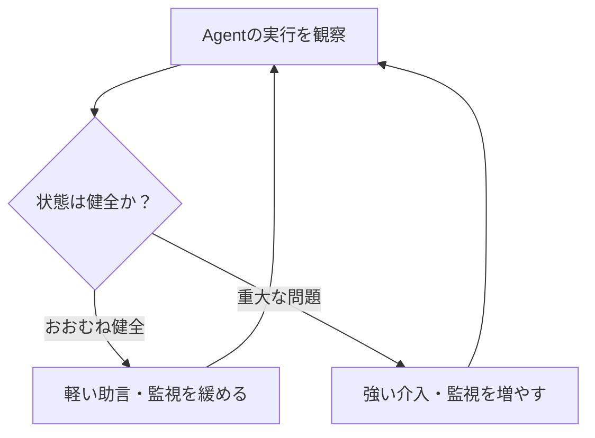

今日は**MCP公式Server群のv1.0.0、Bunの組み込みTypeScript型チェック、PlaywrightのWebMCP対応**が注目です。Agentを便利にするだけでなく、**Toolの検証・Skillの衝突防止・実行中の監視**をどう設計するかという研究も集まりました。

週末の発表に加え、直近数日の見逃しと、移行期限が近いUnity関連の話題を混ぜています。前日までに扱ったUnity 7やClaude CodeのSubagent更新などは再掲していません。

---

## 1. MCP公式サンプルServer群がv1.0.0へ — FilesystemやMemoryをまとめて更新

**10月11日｜MCP・OSS**

[MCP公式Server集のv1.0.0リリース](https://github.com/modelcontextprotocol/servers/releases/tag/v1.0.0)で、TypeScript製のFilesystem、Memory、Sequential Thinking、Everythingの各Serverが`1.0.0`になりました。Python製のFetch、Git、Timeも`2026.10.10`として同時に公開されています。これは**MCPプロトコル自体のバージョン1.0発表ではなく、参照Server群のリリース**です。

特にFilesystem Serverでは、Unicode表記が異なるパスの扱い、許可されたルートディレクトリの更新、改行・インデントを保ったファイル編集などを改善。Everything ServerもSession終了時の後片付けやHTTP接続の扱いを修正しています。

> [!WARNING]
> v1.0.0という番号だけで、既存の全MCP Clientとの互換性が保証されるわけではありません。導入前に個別Serverの変更履歴を確認してください。

**開発者目線:** MCPを試す際の「まず動かすServer」が安定してくるのは歓迎です。一方、ファイル編集やSession管理の細部はAgentの安全性に直結します。参照実装でどの境界条件をテストしているかも、独自Serverを作る際の参考になります。

---

## 2. Bun 1.4.3 — 組み込みTypeScript型チェッカー「bun check」を追加

**10月10日｜JavaScript・TypeScript**

[Bun 1.4.3の公式発表](https://bun.sh/blog/bun-v1.4.3)では、`bun check`というTypeScript型チェッカーが追加されました。Bunによる測定ではTypeScript 7.0.2の適合テストをすべて通過し、複数の実プロジェクトで`tsc`の**約3〜6.4倍**の速度を示しています。

このほか、待機中のServerのCPU消費を67〜89%削減したという改善や、TLS・Proxy・Connection Poolをリクエスト群ごとに分離する`Bun.FetchSession`、TLS検証の強化も含まれます。

| 変更 | 開発時の用途 |
| --- | --- |
| `bun check` | CIやローカルでの型チェック |
| `Bun.FetchSession` | 接続先ごとにTLS・Proxy設定を分離 |
| 待機時CPU削減 | 常駐する開発ServerやToolの負荷低減 |

> [!WARNING]
> 速度とCPU削減率はBun側の測定値です。TypeScriptのPluginや周辺Toolを含めた互換性は、実際のProjectで確認する必要があります。

**開発者目線:** TypeScriptの型チェックは頻繁に実行するため、短縮効果が大きい領域です。特にCoding Agentが編集のたびに型チェックするWorkflowでは、検証の待ち時間を減らせる可能性があります。

---

## 3. uv 0.13.0 — Python 3.15を既定に、Windows ARM64はNative版を優先

**10月9日｜Python・環境構築**

[uv 0.13.0のRelease Notes](https://github.com/astral-sh/uv/releases/tag/0.13.0)で、Pythonを明示しない場合の既定の安定版が**3.14から3.15**に変わりました。`uv python install`や、Pythonの自動取得が必要な環境に影響します。すでにある互換Interpreterは引き続き利用されるため、すべての仮想環境が即座に3.15へ変わるわけではありません。

また、Windows ARM64ではEmulation下のx64版よりNative ARM64 Interpreterを優先。Constraint File内の`--require-hashes`も正しく適用され、これまで見逃されていたHash不足がエラーになる場合があります。

`uv`のCache形式も一部変わるため、更新直後は依存パッケージの再ダウンロードや再Buildが発生する可能性があります。

**開発者目線:** 開発者のPCとCIでPythonの選択が変わると、依存関係やNative ExtensionのBuild結果も変わり得ます。再現性が必要なProjectでは`.python-version`などで明示的に固定し、uv更新とPython更新を別々に検証するのが安全です。

---

## 4. Playwright 1.64 — WebMCPをテストコードから直接呼べる

**10月7日公開・今週の見逃し｜WebMCP・ブラウザテスト**

[Playwright 1.64のRelease Notes](https://github.com/microsoft/playwright/releases/tag/v1.64.0)に、実験的な**WebMCP**のサポートが追加されました。Webページが登録したToolを`page.webmcp.tools()`で列挙し、`page.webmcp.callTool()`で呼び出せます。Playwright MCPやCLIからもページ定義のToolを利用可能です。

`--enable-features=WebMCP`を付けてChromiumを起動する例が公式に示されています。つまり、AI向けに公開した操作APIを、人間のE2Eテストと同じように検証できます。

ほかにも動画のFPS指定、テスト順序をランダム化する`--shuffle`、`locator.within()`などが追加されています。

> [!WARNING]
> WebMCPは実験的なブラウザ機能です。一般のブラウザで常に有効とは限らず、対応状況とFeature Flagを確認する必要があります。

**開発者目線:** エディタや管理画面にAI操作APIを用意するなら、DOMのクリック試験だけでなく**ToolのContract Test**も書けます。Agent連携機能をCIで回帰テストできるのが大きな利点です。

---

## 5. 研究：似たAgent Skillsを入れすぎると、成功してもルールが失われる

**10月8日｜Coding Agent・研究**

論文[One Skill Too Many](https://arxiv.org/abs/2610.11647)は、複数の`SKILL.md`を同時に導入したときの衝突を調べています。20,947のRepository Snapshotから候補を集め、312組の競合するSkill Pairを3モデルで実行。合計6,368回の実験を行いました。

興味深いのは、**タスク自体は成功しても、本来使うべきSkillの重要なルールが守られない**ケースがあることです。似たSkillが別のSkillを置き換えて実行される割合は約5回に1回。たとえば「Gitに触れない」といった制約が抜ける可能性があります。

研究では、最初にどのSkillを読むかが結果を大きく左右し、その前段階で介入すると改善することも報告しています。

**開発者目線:** Skillを大量に追加すればAgentが賢くなるとは限りません。用途が重なるSkillを整理し、重要な禁止事項はSkillの説明文だけでなくHookやOS権限でも強制する設計が必要です。評価も「タスク完了」だけでなく「守るべき制約を守ったか」を見るべきでしょう。

---

## 6. 研究：Cadence — Coding Agentの監視頻度を状況に応じて変える

**10月8日｜AI Agent・研究**

論文[Cadence: Strategic Guidance for Coding Agents](https://arxiv.org/abs/2610.12269)は、Agentの実行途中に入れる「監督役」を改善する研究です。従来の一定間隔の監視では、問題がないときにも余計な確認が入り、深刻な失敗を見逃すことがあります。

Cadenceは実行状態に応じて、軽い助言と強い修正介入を使い分け、監視間隔も調整します。

研究者らの300件のSWE-bench Lite評価では、比較した通常Agentより、mini-swe-agentで**76件**、Moatlessで**47件**多く解決したと報告しています。実験環境での結果であり、すべてのCoding Agentで同じ改善が得られるわけではありません。

**開発者目線:** Agentの各操作を毎回Reviewすると遅くなりますが、放任すると誤りが連鎖します。**リスクが高い局面だけ監視を厚くする**設計は、長時間実行するAgentや複数Agentの管理に応用できそうです。

---

## 7. WebdriverIO MCP 4.0 — BrowserとMobile Appを型付きSessionで操作

**10月8日｜E2Eテスト・MCP**

[WebdriverIO MCP v4.0.0](https://github.com/webdriverio/mcp/releases/tag/v4.0.0)が公開されました。目玉は、BrowserやApplicationを**Typed Session Agent**経由で操作する仕組みです。Sessionの状態に合わせて操作Toolを提示し、使わないToolの一覧を小さくする改善も入っています。

[公式README](https://github.com/webdriverio/mcp)によれば、WebブラウザだけでなくAppiumを使うiOS・AndroidのNative App、既存のWebDriver Endpoint、Desktop Webviewにも対応します。現在のChrome WindowにRemote Debugging Port経由で接続する方法も記載されています。

PlaywrightのWebMCPが「ページ自身が公開するAPIの検証」に向いているのに対し、こちらは**Browser・Mobile App・Webviewを横断して操作する**方向が特徴です。

**開発者目線:** 複数の実行環境を持つProductでは、Agentの操作インターフェースを揃えられる可能性があります。ただしRemote Debugging Portは強い操作権限につながるため、公開Networkへ不用意に開放しないことが重要です。

---

## 8. Unity公式External Dependency Manager — Google EDM4Uの移行期限が近づく

**9月29日発表・10月26日の移行に向けた見逃し｜Unity・Mobile**

[Unity公式Blog](https://unity.com/blog/external-dependency-manager)は、Android・iOSのNative Plugin依存関係を管理する**External Dependency Manager（EDM）**をUnity Package Managerから提供すると発表しました。Google製EDM4UのForkを基にしており、既存のXML依存関係定義を引き続き読めます。

Googleは従来のEDM4Uを**10月26日に非推奨化・Repository Archive予定**と案内しています。Unityの新EDMはUnity 2022.3以降を対象とし、Gradle、CocoaPods、Swift Package Managerとの連携を担います。

移行の流れは、UPMでEDMを導入し、使用するDependency Managerを切り替え、SDK側の対応を確認したうえで旧EDM4Uを外すというもの。SDKにEDM4Uが同梱されている場合、先に削除しないよう公式が注意しています。

> [!WARNING]
> 旧EDM4Uが即座に動作不能になるという意味ではありません。複数SDKを組み合わせたProjectでは、実際のAndroid/iOS Buildで移行を検証してください。

**開発者目線:** 広告・Analytics・認証SDKなどを使うMobile GameではNative依存の衝突が頻発します。Engine側が公式に管理することで、長期的な互換性や問題報告の窓口が明確になるのが利点です。

---

## 9. PixiJS公式Agent Skills — WebGL/WebGPU描画の知識をSkillとして配布

**10月1日にv8.22対応へ更新・今週のOSS見逃し｜PixiJS**

[PixiJS公式のpixijs-skills](https://github.com/pixijs/pixijs-skills)は、Coding Agent向けにPixiJS v8の実装知識を提供するRepositoryです。10月1日のCommitでPixiJS 8.22.0に合わせて内容が同期されました。Claude Code、Codex、Cursorなど、Agent Skills形式を扱うToolで利用できます。

Application初期化、Asset Loading、Scene Graph、Shader、Filter、Particle、Performance、Accessibility、v7からの移行など、**描画の責務ごとにSkillが分かれている**のが特徴です。

導入例は`npx skills add https://github.com/pixijs/pixijs-skills`。単にAPI名を教えるだけでなく、`Application.init()`などv8の正しい使い方や、リソース解放の注意点をAgentに参照させる狙いがあります。

**開発者目線:** WebゲームやCanvasを使う複雑なUIでは、Agentが古いAPIで実装してしまう問題が起きがちです。ライブラリ作者が保守するSkillなら、公式Documentationと実装方針を同期しやすくなります。ただし生成コードのPerformanceやResource Leakは別途測定が必要です。

---

## 10. Zed 1.23.2 — JSONLを表として表示、Agent Threadの保持数も制御

**10月7日公開・今週の小ネタ｜Editor・Agent UX**

[Zed 1.23.2](https://github.com/zed-industries/zed/releases/tag/v1.23.2)では、JSONL/NDJSONをEditor内で**表としてプレビュー**できるようになりました。JSONLは「1行が1つのJSON Record」という形式で、LLMの推論ログやAgentの実行履歴、Event Logなどによく使われます。

さらに`agent.max_idle_retained_threads`が追加され、使っていないAgent Threadをどれだけメモリ上に保持するか調整できます。ACP AgentのPlan表示や、MCP ToolのOptional Field処理に関する修正も含まれます。

**開発者目線:** Agentのログをテキストのまま追うのは大変ですが、表で見るとTool名・処理時間・結果などを比較しやすくなります。IDEがコード編集だけでなく、Agentの観察・調査環境にもなっていることを示す小さく実用的な更新です。

---

## 👀 今日ならこの3つ

### 🥇 Playwright 1.64 — WebMCPを普通のテスト対象に

WebアプリがAgentへ公開するToolを、E2Eテストから直接呼べるようになりました。AI操作APIを「作って終わり」にせず、**入出力と副作用を継続的に検証する**ための重要な一歩です。

### 🥈 Bun 1.4.3 — 型チェックの待ち時間を減らせるか

`bun check`は開発中に何度も実行する処理を高速化する可能性があります。公称Benchmarkだけで判断せず、既存のTypeScript Projectで互換性と速度を比較したい機能です。

### 🥉 One Skill Too Many — Skillを増やせばよいとは限らない

似たSkillが競合すると、タスクは成功しても重要な制約が守られないという研究です。Skillの管理・重複排除・Hookによる強制を考えるきっかけになります。

---

## 📊 今日の技術トレンド

**Agentの「実行能力」から「制御と検証」へ。** PlaywrightとWebdriverIOは操作可能なToolをテスト・管理しやすくし、MCP公式Serverは境界条件の処理を改善しています。Skill衝突とCadenceの研究は、Agentが正しく動いているかを継続的に確かめる仕組みの重要性を示しています。
