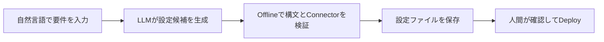
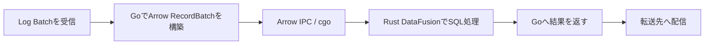

今日は**GitHubのCommitにPush実行者を紐づける仕組み、Conduitの自然言語Pipeline生成、CloudflareのClef-omni**が特に面白い話題です。開発の自動化が進む一方で、誰が変更したか、生成された設定が正しいか、AIの判断をどう検証するかという「信頼性の設計」が重要になっています。

10月12日の発表を中心に、週末のリリースと直近1週間の見逃しを補いました。直近の記事で扱ったBun 1.4.3、uv 0.13.0、Playwright 1.64などは再掲していません。

---

## 1. GitHubがCommitのPush実行者を記録 — Author偽装への新しい防御

**10月12日｜GitHub・Supply Chain Security**

[GitHub公式Changelog](https://github.blog/changelog/2026-10-12-push-attribution-public-preview/)で、CommitのAuthor・Committerとは別に、**実際にPushを認証したユーザー**を永続的に記録する機能が発表されました。AuthorとCommitterはGitクライアントが書き込む文字列なので、名前やメールアドレスだけでは誰がPushしたか証明できません。

新しいRuleset条件「Committer must match pusher」は、CommitterのメールアドレスがPush実行者の確認済みアドレスと一致しないPushを拒否します。監査で「誰の名前が書いてあるか」と「誰の認証で持ち込まれたか」を区別できる点が重要です。

| 情報 | 何を示すか | 信頼性 |
| --- | --- | --- |
| Author | 変更を書いたと申告する人物 | Gitメタデータとして任意設定可能 |
| Committer | Commitを作ったと申告する人物 | 同上 |
| Pusher | GitHubにPushした認証済みユーザー | GitHub側で記録 |

> [!WARNING]
> 2026年10月12日時点では**GitHub Enterprise向けの限定Public Preview**です。すべてのRepositoryで使える一般提供ではありません。

**開発者目線:** Agentや自動化がCommitを量産する環境では、表示名だけに依存した監査は危険です。署名・Branch Protection・レビューに加えて、Pushの認証主体を追跡できるのはSupply Chain防御の一歩です。

---

## 2. Conduit 0.20.0 — 文章からData Pipeline設定を生成、適用前に検証

**10月13日未明（日本時間）｜Data Integration・AI**

[Conduit 0.20.0のRelease Notes](https://github.com/ConduitIO/conduit/releases/tag/v0.20.0)が公開されました。Go製のData Streaming基盤に、自然言語からPipelineの設定ファイルを作る**`conduit generate`（Preview）**が追加されています。Anthropic、OpenAI、ローカルOllamaをProviderとして選べます。

特徴は、LLMの出力をそのまま実行しないことです。生成候補はConnectorの存在などをOfflineで検証し、Configとして保存しますが、**Deployは別操作**です。PostgreSQLからpgvectorへ流すRAG向けTemplateも追加されました。ただし、そのTemplateはPreviewのPipeline Engine（arch-v2）が必要です。

同時に、0.19.0でPostgreSQLの初期SnapshotからCDC（変更データの追跡）へ移る際に処理が無言で止まる重大不具合も修正。Stopped状態の扱いも変更されるため、監視条件の見直しが必要です。

> [!WARNING]
> `conduit generate`はPreviewです。開発元の小規模な評価でも、検証に通った設定が必ずしも依頼意図を満たすわけではありません。生成後の内容確認は必須です。

**開発者目線:** 「AIが設定を書く」「機械が静的に検証する」「人間が適用を決める」を分けた構成は、IaCやCI設定を生成するAgentにも応用できます。

---

## 3. Cloudflare Clef-omni — 音声・動画・画像を一度に判定するOpen-weight Model

**10月9日｜Decision Model・マルチモーダルAI**

[Cloudflare公式発表](https://blog.cloudflare.com/clef-faster-cheaper-multimodal/)で、文章を長く生成する代わりに、入力を見て選択肢や構造化項目を判定する**Clef-omni**が登場しました。テキスト・画像に加えて音声（WAV/MP3）と動画（MP4/WebM）を直接入力でき、[Model Weightも公開](https://huggingface.co/cloudflare)されています。

Qwen3-Omni-30B-A3B-Instructの理解部分を基盤に、音声生成部分を省き、LoRAと確信度の調整を用いてSchemaに沿った判定を学習させています。従来の「音声を文字起こし→動画をFrame抽出→別のModelで判定」という多段構成を、単一の呼び出しにまとめる狙いです。

| Model | 主な用途 | Cloudflare公表の入力価格（100万Token） |
| --- | --- | ---: |
| Clef-flash | 低コストの高速判定 | $0.038 |
| Clef | より大きな文脈での判定 | $0.24 |
| Clef-omni | 音声・動画を含む判定 | $0.15 |

Clef-flashは価格引き下げと引き換えに、Cloudflareが提供するHosted版のContext Windowが64kから24kへ縮小しました。公表LatencyはClef-omniのテキストのみで中央値約130ms、21秒の音声付き動画で約1.5秒です。

> [!WARNING]
> LatencyやBenchmarkはCloudflareの公称値で、実行環境・入力長・評価条件に依存します。Open-weightであることと、Hosted APIの料金・制限は別です。

**開発者目線:** Agentに「長い説明」ではなく「次にどのToolを呼ぶか」「この音に異常があるか」を素早く返させたい場面で有望です。とくに音と映像を組み合わせた検査や、リアルタイムUIの判断処理で試す価値があります。

---

## 4. Cloudflare Logpush Transformers — GoとRustをArrowでつなぐ実装を公開

**10月12日｜Observability・Data Pipeline**

[Cloudflareの技術解説](https://blog.cloudflare.com/transformers-on-logpush/)は、Logを外部へ転送する前にSQLでFilter・整形・秘匿化する**Transformers**の内部構造を紹介しています。機能自体は9月30日にGAとなっており、今回は**実装の深掘り記事**です。

Log配信ServiceはGo製ですが、SQL実行にはRust製のApache DataFusionを採用。Apache ArrowのColumnarなRecordBatchをArrow IPCで受け渡し、cgo経由で呼び出します。元々検討した「外部WorkersでWASMを実行する」方式はNetwork Hopが増えるため採用せず、配信処理と同じProcess内で実行する設計です。

CloudflareのSynthetic Benchmarkでは5,000行の変換が約3ms。これは**同社の測定条件での結果**であり、すべてのLog転送で同じ性能を保証する数字ではありません。

**開発者目線:** 複数言語を混ぜる場合、1件ずつJSONを変換するより、型付きBatchを境界にする方が高速化しやすいことが分かります。個人情報のMaskを「保存先に到達する前」に行う設計も、監査Log基盤の参考になります。

---

## 5. Cloudflare Workers、本番環境でCPU・MemoryのFlamegraphを取得可能に

**10月9日｜Profiling・Serverless**

[Cloudflare公式Blog](https://blog.cloudflare.com/workers-on-demand-profiling/)によると、稼働中のWorkersとDurable Objectsに対して、DashboardまたはCLIから**On-demand CPU/Memory Profiling**を実行できるようになりました。取得した結果はFlamegraphで表示し、`pprof`形式でも保存できます。

ローカルで再現できない本番特有の高負荷を調べられる点が大きな変化です。Cloudflare内部では、JSONを再帰的に処理する無駄を発見して対象関数を2.7倍高速化し、別のWorkerでは不要なPrometheus計測処理を除去してP999 Memoryを133MBから118MBに下げた事例を公開しています。

> [!NOTE]
> 対象のWorkerが実際に稼働している必要があります。低TrafficだとProfileを取得しにくく、Memory Profileは取得期間中のAllocationしか見えません。Continuous Profilingは今後の計画です。

**開発者目線:** Aggregate Metricでは「遅い」「Memoryが多い」までしか分かりません。Function単位のProfileが本番で取れれば、推測で最適化する代わりに、実際に時間やMemoryを消費する処理へ集中できます。

---

## 6. Blender 10月12日の開発週報 — Geometry Nodes高速化と動画編集機能が前進

**10月12日の週報｜3D制作・Graphics**

[Blender開発者ForumのWeekly Update](https://devtalk.blender.org/t/12-october-2026/45891)には、Blender 5.3 Beta／5.4 Alphaに向けた直近の実装がまとまっています。**Geometry NodesのRealize Instances並列化・自動Vectorization**、CompositorのFast Gaussian Blur高速化、GPU Glare Streaksの不要なTexture Copy削減など、処理性能に関する変更が目立ちます。

また、Video Sequence EditorではRipple Editing、OpenTimelineIOのImport/Export、Blade Tool 2.0が進展。3D Texture PaintにはMask Brush、Geometry Nodesには`Construct Curves` Nodeなども加わっています。

| 領域 | 今週の主な変更 | 期待できる効果 |
| --- | --- | --- |
| Geometry Nodes | Instance実体化の並列化・Vector化 | 大量Object処理の高速化 |
| Compositor | BlurやGlareの最適化 | Image処理の待ち時間削減 |
| VSE | Ripple Editing・OpenTimelineIO | 動画編集の操作性と相互運用性 |

> [!WARNING]
> これは開発週報であり、列挙した変更がすべて現行Stable版で使えるという意味ではありません。対象VersionとBuildを確認してください。

**開発者目線:** 3D Toolの性能改善は「GPUを速くする」だけではなく、Data配置、不要なCopy、並列化の粒度を見直す積み重ねです。Geometry Nodesの改善はProcedural Asset制作にも効いてきそうです。

---

## 7. OpenCode 1.19.0 — v2へのUpgrade経路と自動更新の扱いを変更

**10月11日｜Coding Agent・CLI**

[OpenCode 1.19.0のRelease Notes](https://github.com/anomalyco/opencode/releases/tag/v1.19.0)では、`opencode upgrade --major`で**OpenCode 2へ移行する経路**が案内されました。TUIでは`/update`で更新やv2へのUpgradeを行う方式となり、**自動更新は行われなくなった**と説明されています。

同時に、PTY接続のOriginとTicketの検証順序を修正し、OpenAIの`ultrafast` Service Tierを許容する変更も入りました。v1系を使っている場合、意図せずMajor Versionが上がる心配を減らし、移行タイミングを自分で選べる方向です。

**開発者目線:** Coding AgentはCLIそのものが作業環境の一部です。Major Updateで挙動が変わると、PermissionやPluginの設定が影響を受けます。Upgradeを明示操作にした点は、再現性を重視するTeam運用にとって重要です。

---

## 8. Ruff 0.17.0 — 配布Binaryに署名、Python既定Versionにも変更

**10月9日｜Python・Toolchain**

[Ruff 0.17.0のRelease Notes](https://github.com/astral-sh/ruff/releases/tag/0.17.0)で、macOSとWindows向けの配布実行ファイルやWheelにCode Signingが導入されました。macOSはApple Developer IDとNotarization、WindowsはAuthenticode署名を利用します。Binaryの発行元確認や、企業環境でのAllowlist運用がしやすくなります。

互換性面では、`target-version`や`requires-python`を指定していない場合の**Lint対象Python既定Versionが3.10から3.11へ**変わります。また、Version未指定のSyntax CheckではPython 3.15が既定になり、Timezone関連の一部RuleがDefault Rule Setから外れました。

**開発者目線:** LinterのUpgradeで警告数が変わるとき、コード品質が変わったのではなく「既定RuleとVersion」が変わった可能性があります。CIで使うPython Versionを明示し、Release Notesと差分を確認してから更新するのが安全です。

---

## 9. Vite 8.3.4 — HMRのExport単位更新とCSS Preloadの不具合を修正

**10月8日｜Frontend・Build Tool**

[Vite 8.3.4のRelease Notes](https://github.com/vitejs/vite/releases/tag/v8.3.4)では、Bundled Development Modeに`import.meta.hot.acceptExports`のSupportが追加されました。HMR（Hot Module Replacement）は、開発中にPage全体を再読込せず、変更したModuleだけを差し替える仕組みです。

また、Chunk Import Mapを使った非Root BaseでのPreload先修正、StyleSheetのLoad待機、Development Server再起動要求の取りこぼし修正など、開発・配布時の境界条件も改善されています。

**開発者目線:** Web Appの規模が大きくなると、Hot Reloadの失敗やCSSの読み込み順序の違いが開発効率に直結します。特にBase Path付きでDeployするサイトでは、Root Pathだけの動作確認では見落とす不具合を修正した点が実用的です。

---

## 10. OpenAIが数学研究の成果を公開 — GitHubで論文と形式化を検証可能に

**10月6日｜AI Research・Formal Verification**

[OpenAIの研究発表](https://openai.com/ja-JP/index/sharing-ai-progress-in-mathematics/)では、社内のFrontier Modelを使って得た数学の新しい成果を公開しました。重要なのは結果の宣伝だけでなく、**GitHubで研究資料を公開し、論文のRevisionとCitationの手続きを定める**という共有方法です。LeanによるProof Formalizationも紹介されています。

数学では「AIが正しいと言った」だけでは成果になりません。人間が論証を確認し、必要なら形式的なProof Assistantで手順を検査できる状態にすることが重要です。公開と独立した数学者による検証・受容は別の段階であり、今回の公開がすべての結果の正しさを保証するわけではありません。

**開発者目線:** AIが生成した成果物に、検証可能なArtifactとRevision履歴を付ける考え方はSoftware Engineeringにも通じます。Agentの実装提案に対してTest、型チェック、再現手順を添える設計の研究版ともいえます。

---

## 👀 今日ならこの3つ

### 🥇 GitHubのPush実行者追跡

Gitの表示上の著者と実際のPush主体を分ける考え方は、Agent時代のSupply Chain Securityに直結します。限定Previewですが、監査設計の先取りとして注目です。

### 🥈 Conduitの自然言語Pipeline生成

生成・検証・適用を別々の工程に分ける設計が秀逸です。AIを既存の運用Toolへ組み込む際の安全な境界の引き方を学べます。

### 🥉 Clef-omniのマルチモーダル判定

文章を生成するのではなく、動画や音声を含む入力を高速に判定する方向性が面白いです。Agentの次の行動選択やリアルタイムな検査処理に応用の余地があります。
