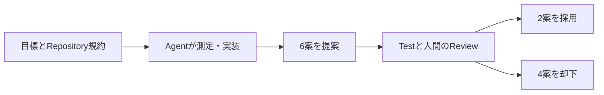
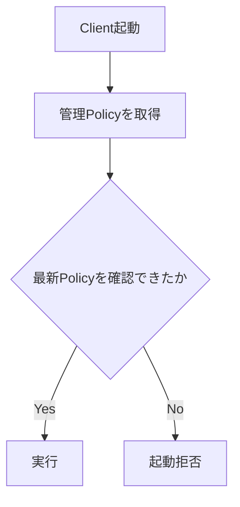

今日は**Gemini 4 Argonの一般提供、Google ADKでの一晩のCoding Agent実験、AWS Lambda Web Functions**が注目の話題です。10月13日の一次情報を中心に、今週の見逃しとしてStride 4.4も補いました。過去7日分と重なるニュースは再掲せず、AI Scanは新しい運用指標が加わった続報として扱います。

---

## 1. Gemini 4 Argonが一般提供 — Codingと長時間Agent作業を強化

**10月13日｜Google DeepMind**

Googleは[Gemini 4 Argon](https://blog.google/intl/en-in/products/introducing-gemini-4-argon/)をAPIとAI Studioなどで一般提供しました。[Model Card](https://deepmind.google/models/model-cards/gemini-4-argon/)によると、Text・Image・Audio・Video入力に対応し、入出力合計のContext Windowは最大100万Token。Model IDは`gemini-4-argon`です。

API導入価格は100万Tokenあたり入力2ドル、出力10ドル。**11月30日以降は入力4ドル、出力20ドル**となる予定です。Coding BenchmarkのGoogle公表値では、DeepSWE v1.1が77.9%、FrontierSWE v2が55.0%、Terminal-bench 4.0が57.4%。後二者では競合モデルが上回るため、万能の首位とは言えません。

> [!WARNING]
> 性能値はGoogle公表の評価であり、独立検証ではありません。料金は導入期間限定です。

**開発者目線:** 実務では総合ランキングより、Repository改修・Terminal操作・長時間作業といった**作業別の評価**が重要です。

---

## 2. Google ADKをCoding Agentが11時間最適化 — 6案から2案を採用

**10月13日｜Google Developers**

[Googleの技術解説](https://developers.googleblog.com/optimizing-a-200000-line-python-codebase-overnight-with-gemini-4-argon/)は、約20.5万行のOSS「Agent Development Kit」をGemini 4 Argonが一晩かけて最適化した実験を公開しました。11時間の作業で16,892件のUnit Testを実行し、32ファイルにまたがる6案を提案しています。

人間のReviewで採用したのは2案だけ。Session履歴をFilterしてからCopyする改善で長時間Sessionの準備処理が約40%短縮し、遅延ImportでCold Importが21%短縮しました。残る4案は不安定なCacheや内部APIへの依存などを理由に却下されました。数字はGoogleの測定条件での結果です。

**開発者目線:** AgentへRepositoryの規約を`.agents/skills`で渡し、**Testと人間のReviewを最後のGateにする**運用が参考になります。

---

## 3. AWS Lambda Web Functions — Node.js ServerをAdapterなしで実行

**10月13日｜AWS**

[AWS公式解説](https://aws.amazon.com/blogs/compute/exploring-aws-lambda-web-functions-for-building-web-applications/)で、新しいLambda Web Functionsが紹介されました。従来のEvent Handlerではなく普通のHTTP Serverを起動する方式で、Express・Fastify・HonoなどがAdapterなしで動きます。Server-Sent Events（SSE）の長時間接続にも対応します。

提供開始時のRuntimeは**Node.js 24／Arm64／2 vCPU／2GB Memory**。1環境で複数Requestを処理でき、同時Request上限は初期値64、最大128です。Request・Memory・実CPU時間を基準に課金し、外部APIの待ち時間にはCPUをあまり消費しない設計です。

| 項目 | Event Function | Web Function |
| --- | --- | --- |
| 入口 | Event Handler | HTTP Server |
| 同時処理 | 1環境で原則1件 | 1環境で複数件 |
| 主な用途 | Queue・Event | Web・API・SSE |

> [!WARNING]
> 公式Sampleは認証なしの公開Endpointです。本番では認証・公開範囲・料金条件を確認してください。

**開発者目線:** Web Frameworkを変えずにServerlessへ移行できるのが魅力です。

---

## 4. Stride 4.4 — Vulkan刷新とCLI追加でC# Game Engineが進化

**10月9日公開・今週の見逃し｜Game Engine**

C#／.NET製OSS Game Engineの[Stride 4.4](https://www.stride3d.net/blog/announcing-stride-4-4/)が公開されました。VulkanとDirect3D 12の描画Backendを刷新し、SDSL Shader Compilerは**SPIR-V中心のPipeline**へ変更。OpenGL／OpenGLES Backendは削除されています。

新しい`stride` CLIではSDK管理・Project作成・Editor起動が可能です。Asset Pathを型付きの`Assets` Classとして生成する機能も加わり、文字列Pathの間違いをCompile時に検出しやすくなりました。Linux・macOSでのBuildも改善しましたが、**NativeなCross-platform Editorはまだ開発中**で、LinuxではProton経由の起動を案内しています。

**開発者目線:** Rendererの性能だけでなく、CLI・型安全なAsset参照・Build再現性をまとめて改善した点が、CIやCoding Agentとの連携にも役立ちます。

---

## 5. Kiroが企業向けSign-in制御を追加 — 個人Accountの利用を制限

**10月13日｜AWS・Coding Agent**

[AWS公式記事](https://aws.amazon.com/jp/blogs/news/sign-in-controls/)によると、Kiro IDE／CLIで管理者が認証方法を制限できるようになりました。従来は企業のIAM Identity Centerを使う環境でも、個人のGoogle・GitHub・Builder IDでSign-inできる余地がありました。

管理者が保護する`managed-settings.json`で`signin_method`を制御し、Identity Center以外を拒否できます。許可されない選択肢を隠すだけでなく認証そのものを拒否し、Start URL・Regionの事前入力やDevice Code Flowの制御も可能です。対象は**Kiro IDE 1.2／CLI 2.29.0以降**で、対応Regionの制限があります。

**開発者目線:** Coding Agentの安全性にはTool権限だけでなく、**誰のIdentityでRepositoryを扱うか**の統制も必要です。

---

## 6. GitHub Copilot、管理Policyを起動時に再取得するFail-closed設定

**10月13日｜GitHub**

[GitHub Changelog](https://github.blog/changelog/2026-10-13-enterprise-managed-settings-enforcement-updates/)で、`forceRemoteSettingsRefresh`が追加されました。設定を有効にするとCopilot Clientは起動時に最新の管理Policyを取得し、**取得できなければ古いCacheで動かず起動を拒否**します。

Copilot CLI・VS Code・Copilot Appが対象です。また`sandbox`の管理設定には最低Client Versionの強制が追加され、古いClientによるPolicy回避を防ぎます。設定を有効にしない場合は従来のCache動作を維持します。

> [!WARNING]
> Policy取得障害時に利用できなくなる可能性があります。Securityと可用性のTrade-offを考慮してください。

**開発者目線:** Agentに強い権限を与えるほど、**確認できないPolicyでは動かさない**設計が重要になります。

---

## 7. GitHub Secret Scanning、AnthropicのKeyをPush時に標準Block

**10月13日｜GitHub**

[GitHub公式Changelog](https://github.blog/changelog/2026-10-13-secret-scanning-blocks-anthropic-keys-by-default-adds-salesforce/)で、`anthropic_service_api_key`と`anthropic_user_api_key`が新たな検出対象となり、**Push Protectionの標準Block対象**に追加されました。Secret Scanningが有効なRepositoryでは、無料のPublic Repositoryも対象です。

CloudsmithのAPI Key検出も追加され、SalesforceはSecret Scanning Partnerへ参加しました。Public Repositoryで対象Tokenが見つかった場合、発行元へ通知して失効・Rotationを促せます。

**開発者目線:** AI開発で増え続けるModel ProviderのCredentialは、Reviewで気づくよりも**Pushの時点で止める**方が安全です。

---

## 8. GitHub AI Scan、検出数だけでなく修正率とAutofix採用を可視化

**10月13日｜GitHub**

[GitHub Changelog](https://github.blog/changelog/2026-10-13-code-scanning-ai-scan-metrics-in-security-overview/)によると、Security Overviewで**AI Scan for Pull Requestsの運用効果**を確認できるようになりました。検出件数・解決件数・修正率・Repository別の傾向・Autofix提案の採用頻度が分かります。

「Code scanning on pull requests」画面にはCodeQLとAI Scanの別Tabを用意。先週の「どのRepositoryで有効か」というCoverage表示から、**実際に修正へつながったか**を測る段階へ進んだ続報です。

> [!WARNING]
> 2026年10月13日時点でPublic Preview。GitHub Code SecurityまたはAdvanced Securityの対象Customer向けで、GitHub Enterprise Serverは対象外です。

**開発者目線:** Security Toolの価値はAlertの多さではなく、**開発者が問題を修正できたか**で評価するべきです。

---

## 9. Dependabotの撤回Alertを410 Goneで判別 — Webhookにもwithdrawn追加

**10月13日｜GitHub**

[GitHub公式発表](https://github.blog/changelog/2026-10-13-improved-detection-for-withdrawn-dependabot-alerts/)で、根拠となるAdvisoryが無効になって撤回されたDependabot Alertを、Automationから識別できるようになりました。REST APIでは**撤回済みAlertを`410 Gone`**で返し、存在しないAlertの`404 Not Found`と区別します。

`dependabot_alert` Webhookには`withdrawn` Actionが追加され、撤回前のAlert番号・GHSA/CVE ID・Package・Manifest Pathを受け取れます。GitHub.comの全Repositoryで利用でき、GitHub Enterprise Server 3.24にも搭載予定です。

**開発者目線:** Issue Trackerへ自動起票しているTeamでは、撤回済みの脆弱性Ticketを整理し、無駄な対応を減らせます。

---

## 10. AWSがML-DSA耐量子署名の実装Guide公開 — BinaryとSBOMを保護

**10月12日原文・13日日本語版｜AWS**

[AWS公式の技術Guide](https://aws.amazon.com/jp/blogs/news/quantum-resistant-signing-on-aws-part-1-build-a-software-supply-chain-with-ml-dsa/)が、NIST FIPS 204で標準化された**ML-DSA署名**をSoftware Supply Chainへ組み込む方法を解説しました。暗号方式そのものの新発表ではなく、既存のKMS・Private CA・IAM Roles Anywhereなどを組み合わせた実装手順です。

Build AgentのIdentityを証明書で確認し、BinaryやContainer Imageに署名。依存Package一覧のSBOMも`in-toto Statement`にして署名し、Deploy時に改ざんを検証します。記事ではRoot CAにML-DSA-87、商用のCode SigningにML-DSA-65を使う例を紹介しています。ただしCNSA 2.0対象のNSSではML-DSA-87が必要など、要件は用途により異なります。

**開発者目線:** 将来の量子Computerへの備えだけでなく、**誰がBuildし、何を配布し、どの依存関係を含むか**を一貫して検証する設計例として有用です。

---

## 👀 今日ならこの3つ

### 🥇 Gemini 4 Argon

Coding Agentの実務にどこまで使えるかを、複数のBenchmarkと実際のAPI料金から比較したい新モデルです。

### 🥈 Google ADKの11時間最適化

Agentの6案から2案だけ採用した事例が示すのは、**Repository規約・Test・人間のReview**を組み合わせる重要性です。

### 🥉 Lambda Web Functions

通常のHTTP ServerをAdapterなしでServerlessへ移せる点は、Web AppのDeployment設計を変える可能性があります。
