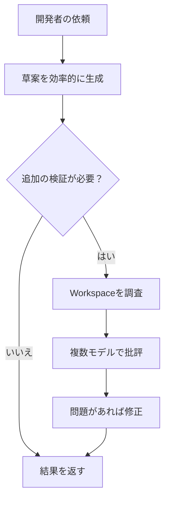
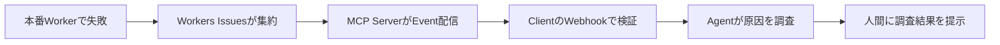

今日は**GitHub Actionsの依存Lockfile、複数モデルを組み合わせるHydraFusion Max、CloudflareのMCP Events**が特に面白い更新です。AI Agentを「動かす」だけでなく、**実行する依存コードを固定する、出力を別のモデルで検証する、障害発生を安全に伝える**という、運用と信頼性の話題が集まりました。

10月13〜14日の一次情報を中心に、過去7日間で扱ったニュースとの重複を避けています。各項目では新機能だけでなく、従来の方法との違い、利用条件、実務で試すときの注意点も整理します。

---

## 1. GitHub Actionsの依存LockfileがPublic Preview

**10月14日｜CI/CD・Supply Chain Security**

[GitHub公式Changelog](https://github.blog/changelog/2026-10-14-github-actions-workflow-lockfiles-in-public-preview/)で、GitHub Actionsの**Workflow Dependency Lockfile**がPublic Previewになりました。GitHub Enterprise Cloud、Team、FreeなどのPlanが対象です。従来のWorkflowは`actions/checkout@v4`のようにTagを指定することが多く、見た目は同じ`v4`でも参照先のCommitが後で変わる可能性がありました。

今回の仕組みでは、Workflowの読みやすいTag指定を保ちながら、**実際に実行する依存Actionを特定のCommitへ固定**できます。GitHub CLIの`gh actions-lock`拡張機能で`.github/workflows/actions.lock`を生成し、直接利用するActionだけでなく、その推移的な依存や再利用可能Workflowも記録します。Lockfileを導入したWorkflowでは、必要な依存がLockfileに揃っていることが実行時に求められます。

DependabotがActionの更新PRを作る場合は、対応するLockfileの内容も同じPRで更新できます。さらに、管理者向けの「Lockfile必須」PolicyもPreviewとして用意されました。**更新の判断と実行されるコードの変更を、PR Reviewの中で確認しやすくなる**わけです。

| 方法 | Workflowの読みやすさ | 実行Commitの固定 | 更新時の確認 |
| --- | --- | --- | --- |
| Tag参照だけ | 高い | Tag移動の影響を受ける | Tagの変更を見落とし得る |
| Commit SHAを直接記述 | 低め | できる | SHA差分をReview |
| Workflow Lockfile | Tagを維持 | Lockfileで固定 | WorkflowとLockfileをReview |

> [!WARNING]
> Lockfileは「後から違うコードが実行される」問題を抑える仕組みであり、**最初に固定した依存自体が安全だと保証するものではありません**。Public Previewのため、導入前にPlan・Policy・運用上の制限を確認してください。

**開発者目線:** CIはBuildやReleaseに使うSecretへ触れることがあり、通常のApplication依存以上に攻撃時の影響が大きくなります。今まで「Tagは読みやすいが安全性が心配」「SHAは安全だが管理が面倒」と悩んでいたTeamには、Dependabotとの組み合わせが有力です。まず小さなWorkflowで生成と更新PRのDiffを確認すると導入判断がしやすいでしょう。

---

## 2. Copilot HydraFusion MaxがResearch Preview

**10月14日｜AI Agent・複数モデル協調**

[GitHub公式発表](https://github.blog/changelog/2026-10-14-hydrafusion-updates-and-new-max-option/)で、GitHub Copilotの**HydraFusion**が更新され、難しい作業向けの**HydraFusion Max**が追加されました。どちらもResearch Previewで、VS Code、GitHub Copilot App、Copilot CLIから利用できます。利用対象はCopilot Pro、Pro+、Business、Enterpriseで、Preview機能の有効化や組織のModel Policyが条件です。

HydraFusionの考え方は、ユーザーが毎回ひとつのLLMを選ぶ代わりに、**複数モデルを組み合わせて一つの結果を作る**ことです。今回のModel PoolにはClaude Opus 5.5、GPT-6 Astra、GPT-6.1 Sol、GPT-6 Lunaが含まれます。ただし、毎回すべてのモデルを同時に実行するという意味ではなく、選ぶモデルはWorkflowによって変わります。

推論の強さも工程別になりました。最初の草案はMediumで作り、ReviewはHighで深く考える設計です。`Cascade`では必要に応じて判定工程を挟み、修正が必要なときだけ追加処理を実施。`Critique`では単なる文章の要約ではなく、**実際のWorkspaceをToolで調べ、複数の批評モデルが並列に確認**できるようになりました。

Maxは同じ構成を基に、より深い推論や徹底した分析へ比重を置く選択肢です。ただしGitHubは今回の発表で、あらゆる作業でMaxが高速・低コスト・高精度になると保証しているわけではありません。

**開発者目線:** 面白いのは「最強モデルに全部任せる」ではなく、**作る仕事と疑う仕事を分け、それぞれに適した計算量を割り当てる**点です。Coding Agentを自作する場合も、安価な草案生成、差分の静的検査、重点的な批評という段階構成が参考になります。導入評価では完成品質に加え、処理時間や利用量も比較したいところです。

---

## 3. GPT-4o・GPT-4.1系APIの終了予定を発表

**10月14日告知｜OpenAI API・移行計画**

[OpenAI APIのDeprecations一覧](https://developers.openai.com/api/docs/deprecations)によると、指定されたGPT-4o・GPT-4.1系モデルのAPI提供が**2027年1月14日に終了予定**です。これは2026年10月14日に対象の開発者へ通知されたもので、すべての「GPT-4」という名前のAPIを同日に一斉終了する発表ではありません。

対象は主に以下のSnapshotで、Fine-tuningした派生モデルにも同じ終了日が適用されます。公式が案内する推奨移行先はいずれも`gpt-6-luna`です。

| 対象モデル | Snapshot | API終了予定 |
| --- | --- | --- |
| GPT-4o | `gpt-4o-2024-08-06`、`gpt-4o-2024-11-20` | 2027/1/14 |
| GPT-4o mini | `gpt-4o-mini-2024-07-18` | 2027/1/14 |
| GPT-4.1 | `gpt-4.1-2025-04-14` | 2027/1/14 |
| GPT-4.1 mini | `gpt-4.1-mini-2025-04-14` | 2027/1/14 |

Model IDを置き換えるだけで移行完了とは限りません。異なるモデルでは指示追従や出力の粒度、Tool Calling、JSONの構造化出力などの振る舞いが変わる可能性があります。特に既存のPromptを暗黙の前提にした処理や、生成文を文字列で判定する処理は影響を受けやすい部分です。

> [!WARNING]
> **Deprecated（廃止予定）とShutdown（実際の利用終了）は別の状態**です。今すぐすべてのRequestが失敗するわけではありませんが、終了日までに移行と回帰テストが必要です。

**開発者目線:** まずAPIの利用ログや設定ファイルから対象のModel IDを洗い出し、Prompt・Tool・SchemaごとにTest Caseを用意するとよさそうです。回答品質だけでなくLatencyと料金を計測し、既存モデルとの違いを記録することが重要です。実運用の移行では、古いモデルへのRollbackに頼れる期限にも注意が必要です。

---

## 4. Cloudflare MCP Eventsで本番障害を通知

**10月13日｜MCP・Observability・Agent運用**

[Cloudflare公式Changelog](https://developers.cloudflare.com/changelog/post/2026-10-13-cloudflare-mcp-events/)で、Cloudflare APIのMCP Serverが**MCP Events**による通知を始めました。最初に対応したイベントはWorkers Issuesです。Workers Issuesは本番環境の失敗を検出して関連する問題をまとめる機能で、アプリケーションへ専用SDKを組み込まずに使えます。

通常、Agentに新しい問題を調べさせるには、一定間隔で状態を問い合わせるPollingが必要です。新方式ではMCP Clientが`events/list`でイベントを発見し、`events/subscribe`で購読します。新しい問題や再発が検出されると、MCP Serverが署名付きEventを登録されたWebhookへ送ります。Account全体か特定のWorkerに対象を絞ることもできます。

利用にはWorkers Issuesの有効化に加え、`https://mcp.cloudflare.com/mcp`への接続、Notifications WriteとWorkers Observability Writeの権限、**MCP EventsのWebhookに対応するClient**が必要です。MCPを話せるClientなら何でもそのまま受信できる、という段階ではありません。

**開発者目線:** Alertから調査へ進むまでの待ち時間を縮められるのが利点です。運用に組み込むなら、通知の署名検証・重複処理・同時発生時のRate Limitを先に設計したいところです。AgentにLogや設定を調べさせる一方、本番環境の修正やDeployは承認を通すなど、**調査の自動化と変更の自動化は分ける**のが安全です。

---

## 5. Agents SDKに状態を保持するBrowser Tool

**10月13日｜Cloudflare Agents・Browser Automation**

[Cloudflare公式発表](https://developers.cloudflare.com/changelog/post/2026-10-13-persistent-browser/)で、Agents SDK **v0.28.0以降**に`browserTool`が追加されました。Agentがブラウザを開いてWebページを調べ、次の会話Turnでも**Tab・Cookie・Login Sessionを保持した状態で再開**できるのが特徴です。

従来の「操作が終わるたびに新しいブラウザを立ち上げる」方式では、毎回Loginやページ遷移をやり直すことがあります。今回のToolはCloudflare Browser Runを使い、モデルがChrome DevTools Protocol（CDP）を通じてBrowserを操作するCodeを書きます。Screenshotは画像としてモデルやUI側で扱えます。Pi Durableと組み合わせる公式実装例があり、AI SDKやTanStack AIなどへの接続方法も示されています。

設計上のポイントは、**会話ごとに既定のActive Tabを分けつつ、同じBrowser内ではCookieやLoginを共有する**ことです。Durable ObjectがHibernationしてもBrowserが維持される一方、既定のIdle Timeoutは10分。期限切れやCrash後は新しいBrowserが作られ、`restarted: true`が返ります。以前のTabやLogin状態は残りません。

> [!WARNING]
> 「永続」は無期限の保証ではありません。Session失効時の再Login・やり直しを実装し、Cookieや認証情報がConversation間で共有される範囲も確認してください。

**開発者目線:** 管理画面を複数ページにわたって確認するAgentや、Login済み画面の回帰テストを支援するAgentに向いています。ただし同じ操作の再実行で二重登録が起きることもあります。状態復旧と冪等性を考え、重要操作の直前には現在の画面と対象を再確認する設計が必要です。

---

## 6. GitHub AppsのRepository管理を最小権限に

**10月13日｜GitHub API・権限設計**

[GitHub公式Changelog](https://github.blog/changelog/2026-10-13-github-app-improvements-for-least-privilege-and-management/)で、GitHub AppsとFine-grained PAT向けの権限が細分化されました。新しい`repository_creation:write`はRepositoryの作成専用、`installation_repositories:write`はGitHub AppのInstallationにRepositoryを追加・削除するための権限です。

これまでRepository作成に必要だった`repository_administration:write`は、削除やTransferといった広い管理操作も含みます。作成しか行わないBotへ過大な権限を渡してしまう問題がありました。新権限ではその用途を分離できます。また、組織Ownerが承認済みのAppであれば、Repository管理者が既存のInstallationへ自分のRepositoryを追加できるようになりました。なおRepository作成権限など一部の機密性の高い権限には、引き続きOwner側の承認条件があります。

このほか`offline_access`を使った短期・ローテーションTokenへの段階移行、関連する非公開App情報の参照、Credential管理画面の整理も含まれます。GitHub Enterprise Serverでは機能ごとに導入Versionが異なり、`offline_access`はGHES 3.23、その他の今回の改善はGHES 3.24予定とされています。

**開発者目線:** 複数Repositoryを扱う管理BotやCoding Agentで、管理者PATを丸ごと渡す必要が減る方向です。権限の洗い出しでは「何を読みたいか」だけでなく、**何を作成・更新・削除できてしまうか**を整理し、App単位で権限を分離すると被害範囲を小さくできます。

---

## 7. WinUI Gallery 3.0で実験的なUIを試せる

**10月13日｜Windows・UI Framework**

[Microsoft公式Blog](https://devblogs.microsoft.com/ifdef-windows/winui-gallery-3-0-is-here-tableview-charts-inkcanvas-and-more/)で**WinUI Gallery 3.0**が公開されました。WinUI GalleryはWindows向けのUI Componentを動かしながら、XAMLやC#のSample Codeを確認できるアプリです。3.0では初めて、Experimental ChannelのWindows App SDK（記事時点で`2.5.4-experimental`）を使用する構成になりました。

従来は安定版SDKに入った後でGalleryにSampleが揃うことが多く、API仕様に意見を出せる余地が限られていました。今後は**実験段階のControlを早く試し、Feedbackを返せる**ようになります。Experimental APIは後で変更・削除され得るため、Gallery内でも区別されています。

| Control | 何を試せるか | 役立つ場面 |
| --- | --- | --- |
| TableView | Sort・Filter・Edit・固定列・1,000行のVirtualization | Data Gridや管理Tool |
| Charts | 折れ線・棒Graph・複数系列・軸設定・動的更新 | Dashboardや計測画面 |
| InkCanvas / InkToolbar | Pen・Touch・Mouse・筆跡の保存と復元 | 手書き注釈・描画UI |
| WrapPanel / LayoutPanel | Wrapや独自Layoutの配置 | 可変Sizeの要素配置 |
| Window API | WindowのSize・最小/最大Size | Desktop画面の設計 |

既存機能にも、Search Tag、Keyboard操作やAccessibilityの改善、ListViewのScroll位置復元Sampleなどの更新が入っています。UIの実装コードだけでなく、Accessibilityや大量データの扱いも実際に観察できる点が便利です。

> [!WARNING]
> **Experimental Controlは本番採用を推奨されていません**。現時点ではAPIや挙動の確認、Feedback、将来の設計検討に使うのが適切です。

**開発者目線:** 大きな一覧や編集可能な表は、見た目以上にFocus移動・Keyboard操作・Virtualization・Scroll維持の設計が難しい領域です。こうした実例を公式が提供することで、仕様が固まる前にUXを評価できるのが面白い更新です。

---

## 8. CLionとTRACE32が実機Debugで連携

**10月14日｜C/C++・Embedded Development**

[JetBrainsとLauterbachの発表](https://blog.jetbrains.com/clion/2026/10/lauterbach-trace32-integration-in-clion/)で、CLionから**TRACE32を使った実機Debug**が可能になりました。TRACE32はEmbedded SystemでTarget Hardware上の実行やTraceを調べるためのToolです。今回の統合により、Source Code編集・Navigation・Break Point操作・変数調査をCLionから進められます。

接続にはDebug Adapter Protocol（DAP）を使用します。DAPはIDEとDebuggerをつなぐ共通の通信方法で、実際のHardwareとの通信はTRACE32側が担当します。CLionから新たにTRACE32 PowerView Sessionを起動する方法と、すでに動作しているSessionへAttachする方法の**2種類のWorkflow**が用意されました。

利用条件は**CLion 2026.2.4以降、TRACE32 PowerView 09.2026（またはBuild 195402）、TRACE32 Debug Adapter 0.1.2以降**です。対応EnvironmentとConfiguration Scriptが必要なので、単にCLionを更新するだけで実機接続が完成するわけではありません。

**開発者目線:** Embedded開発ではPC上のUnit Testでは再現しないTimingやPeripheralの問題があり、実機の実行状態を見る必要があります。IDEとDebug Toolの境界をDAPで分離することで、専用Hardwareへの接続を保ちながら普段のCode Navigationや編集を使えるのが利点です。DAPのようなProtocolを介したTool連携の実例としても参考になります。

---

## 9. Cloudflare Workers Buildsの既定Version更新

**10月14日｜CI/CD・Build再現性**

[Cloudflare公式Changelog](https://developers.cloudflare.com/changelog/post/2026-10-14-workers-builds-default-tooling/)で、**Workers Buildsが使用する既定のRuntime・Package Manager Version**が更新されました。これはCloudflare Workersで動く本番RuntimeそのもののVersionが、すべてのProjectで一斉に切り替わるという話ではなく、主にBuild環境のToolchainに関する変更です。

主な変更は以下の通りです。

| Tool | 従来の既定 | 新しい既定 |
| --- | --- | --- |
| Node.js | 24.18.0 | 24.21.0 |
| Bun | 1.2.15 | 1.4.3 |
| Python | 3.13.3 | 3.14.8 |
| Go | 1.24.3 | 1.27.2 |
| Yarn | 4.9.1 | 4.18.1 |
| uv | 0.7.13 | 0.12.10 |

Bun 1.4.3ではv1とv2のLockfileを扱えるようになっています。Cloudflareによると、**Versionを明示しているProjectはその指定が引き続き優先**されます。そのため影響が大きいのは、Toolの選択をPlatform既定値に任せているProjectです。

例えばLocalではPython 3.13を使っているのに、Build Serverが指定なしで3.14に変わると、依存PackageやNative Extensionの対応状況が異なる可能性があります。対策には`NODE_VERSION`や`PYTHON_VERSION`などのEnvironment Variable、`.node-version`や`.python-version`などのVersion Fileが使えます。

**開発者目線:** Platformの既定値が更新されるのは自然ですが、**「昨日通ったBuildが今日から失敗する」原因**にもなります。原因切り分けを簡単にするため、Buildに使うRuntime・Package ManagerのVersionとLockfileをRepository内で管理し、更新は意図的に行うのが基本です。

---

## 10. AWS Security Hubが資産重要度を優先順位に反映

**10月14日｜Cloud Security・Risk Management**

[AWS公式発表](https://aws.amazon.com/about-aws/whats-new/2026/10/security-hub-resource-criticality/)で、AWS Security Hubが**Resource Criticality（資産の重要度）**をExposureの優先順位に反映できるようになりました。セキュリティ上の問題を「技術的に危険か」だけでなく、**その問題がどれほど重要な業務資産に関係するか**でも整理するための機能です。

例えば同じ種類の設定不備が見つかっても、検証用の一時的なServerと、決済や認証を担う本番Serverでは対応の緊急度が異なります。今回の更新ではAutomation Ruleを使って特定AccountのCompute Resourceを`Very High`に設定するなど、組織の事情を反映できます。既存のInventoryだけでなく、新たに発見されたResourceにもRuleが適用されます。

また、ResourceのTagや名前から重要度を推定し、**どの情報を根拠に重要度が決まったか**も保持します。Resources画面でのSort・Filter・Group化や、Exposure FindingのImpact Assessmentで確認できます。Security Hub Essentialsに含まれ、追加料金なしで自動的に有効となる機能です。

**開発者目線:** Security ToolのAlertは件数が多いと、すべてを同じ優先度で扱えません。Business Impactを含めた優先順位は合理的ですが、名前やTagが不正確なら優先順位も誤り得ます。導入時にはEnvironment・Owner・Data SensitivityなどのTag設計と、例外的に重要な資産を明示するRuleを併せて見直すと効果的です。

---

## 👀 今日ならこの3つ

### 🥇 GitHub ActionsのLockfile — CIの「実際に動くコード」をReviewする

読みやすいTag指定とCommit固定を両立し、DependabotのPRで差分確認できるのが実用的です。新機能の導入だけでなく、既存のCIが抱えるSupply Chain Riskを見直すきっかけになります。

### 🥈 Cloudflare MCP Events — Agentを障害発生から動かす

AgentのTool利用が「質問されたら動く」から「外部Eventを契機に調査する」へ広がる具体例です。署名検証・重複対策・承認Gateまで考えると、実運用の設計が見えてきます。

### 🥉 HydraFusion Max — 複数モデルを使い分ける理由が明確に

難しい工程だけ推論を厚くし、Workspaceの実物を複数モデルで批評する設計は興味深いものです。単一モデルのBenchmark比較から一歩進み、**Agent System全体の品質とCostをどう最適化するか**を考える材料になります。

---

## 📊 今日の技術トレンド

**開発を速くする仕組みと、その結果を信頼できる仕組みがセットになってきた日**でした。HydraFusionは生成後の検証に計算量を振り分け、GitHub ActionsのLockfileは実行依存を固定し、Cloudflare MCP Eventsは本番障害を安全に次の処理へ伝えようとしています。どれも「自動化したから安心」ではなく、自動化が増えた分だけ**どの境界で何を検証するか**を設計する動きとして読むと面白いニュースです。
