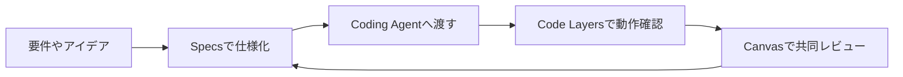
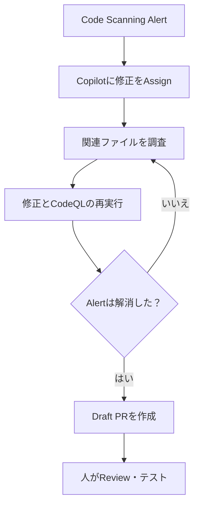
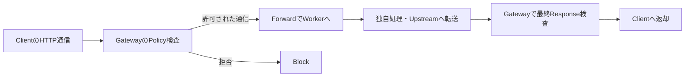

今日は**FigmaのCode Layers・Specs、GitHub AI ScanとAgentic Autofix、リアルタイム会話向けPhoneLLM Mini**が中心です。デザイン・仕様・コードを往復する作業と、AIが提案したコードを安全に受け入れる作業が、それぞれ具体的な製品機能へ進みました。

10月15日に公開された一次情報を優先しつつ、10月12〜14日のゲームエンジン・言語・Linuxデスクトップの更新も取り上げます。ニュースを一文で紹介するのではなく、**何が変わったか、従来と何が違うか、導入時にどこを検証すべきか**をまとめました。

---

## 1. Figma Code LayersとSpecsがOpen Beta

**10月15日｜UI設計・AI Agent・開発Workflow**

[Figmaの公式発表](https://www.figma.com/blog/build-by-design/)では、コードが実際に動く試作品をFigmaのCanvasで扱う**Code Layers**と、Markdownで記述した仕様を共同作業の中心に置く**Figma Specs**がOpen Betaになりました。AIで試作品を素早く作れる一方、デザイン担当者にはコードが読みにくく、開発者にはCanvas上の検討経緯が見えにくい、という断絶を埋める狙いです。

Code Layersは既存のデザインからコードを作るだけの一方向変換ではありません。ローカルフォルダ、GitHub、MCP経由のコード付きPrototype、稼働中のWebサイトをChrome拡張経由で取り込み、**コードに裏付けられたUIをCanvasの上で動かしながら検討**できます。まずは比較的コンパクトな試作品が中心で、複雑なコードベースの直接編集は今後拡張する構想です。Code LayersのOpen Betaは全Planが対象です。

SpecsはMarkdownの内容とCanvasのデザイン・図・Code Layersを結び付ける仕組みです。たとえば粗い要件から仕様書を育て、Figma MCP Server経由でCoding Agentに渡し、実装結果を再びCanvasで議論できます。SpecsはWeb・Desktop・Mobileに段階的に展開され、**有料Planで利用可能**と案内されています。さらにDesign SystemのGuidelineはOpen Beta、GitHubやnpmからCode Sourceを取り込む機能はClosed Betaで、同じ公開状態ではない点に注意が必要です。

作業の関係を単純化すると、次のようになります。重要なのは、どの工程にも人が内容を確認する場所が残っていることです。

**開発者目線:** Figma→HTMLの一方向変換よりも、**仕様を変えたときにコードや見た目へどう反映するか**が評価点になります。既存Componentと異なるコードが大量に生まれないか、Design Tokenを引き継げるか、仕様の更新履歴が残るかを実際の開発フローで試したい機能です。Code LayersとSpecsでは提供PlanとRolloutが異なるため、導入前の確認も必要です。

---

## 2. GitHub AI Scanが一般提供

**10月15日｜Application Security・Pull Request**

[GitHub公式Changelog](https://github.blog/changelog/2026-10-15-ai-scan-for-pull-requests-generally-available/)で、Pull Request向け**AI Scan**が一般提供（GA）になりました。これは既存の静的解析ツール**CodeQLを置き換えるものではなく、補完する仕組み**です。CodeQLの対応範囲だけでは検出しづらいPHP、Shell/Bash、TerraformのHCL、Dockerfile、JSP、Blazorなどの変更をAIで調べます。

Code ScanningとRepositoryのAI Scan設定が有効なら、対象PRの差分を自動的に解析し、結果をConversationやFiles changedのTabに表示します。AIによるFindingには識別用の表示が付くため、CodeQLの結果と見分けられます。問題の説明だけでなく、修正案が提示されることもあります。ただし**AI Scanの結果は助言扱い**で、Code ScanningのCheckを失敗にしたり、RulesetでMergeを直接Blockしたりすることはできません。

対象範囲も確認が必要です。公開Repositoryは個人・組織のどちらでも利用できますが、非公開・Internal Repositoryは組織所有でGitHub Code SecurityまたはGitHub Advanced Securityが必要です。CopilotのLicenseは必須ではありません。また、**ForkからのPRとDependabotが作成したPRでは実行されない**制限があります。利用量はCode Security AI Creditsとして課金されるため、利用前にBudgetを設定できます。

| 観点 | CodeQL | AI Scan |
| --- | --- | --- |
| 主な方式 | コードの静的解析 | AIによるPR変更の検討 |
| 得意分野 | 対応言語の既知の問題パターン | CodeQL未対応の言語・構成ファイルも補完 |
| PR Merge制御 | CheckやRulesetを組み合わせ可能 | Findingは助言扱い、直接のBlock不可 |
| 位置づけ | 基礎となる解析 | 追加のReview Signal |

**開発者目線:** Infrastructure as CodeやDockerfileまで、PR Reviewの目が届きやすくなるのは魅力です。一方で「AI Scanで警告が出なければ安全」とは言えません。CodeQL、依存脆弱性検査、Secret Scanning、権限Reviewと併用する設計が適切です。**Fork PRが対象外**という条件も、外部Contributionの多いOSSでは運用判断に直結します。

---

## 3. GitHub Agentic Autofixが一般提供

**10月15日｜Coding Agent・脆弱性修正**

[GitHubの公式発表](https://github.blog/changelog/2026-10-15-agentic-autofix-for-code-scanning-alerts-general-availability/)で、Code Scanning AlertをCopilotへ割り当てて修正する**Agentic Autofix**がGAになりました。従来の「この行をこう直す」という単発の修正提案よりも、Repository内の関係するファイルを探索して修正し、**CodeQLを再実行してAlertが解消されたか確認**する工程が特徴です。

実際の流れは、AlertをCopilotにAssignし、Agentが関連コードを調査して差分を作り、CodeQLで検証し、必要に応じて修正を繰り返した後にDraft Pull Requestを作成する、というものです。PRには何を修正したか、なぜAlertが解消したと考えられるか、どの検証を行ったかが残ります。作成されたPRにコメントして追加変更を依頼することも可能です。複数Alertを選んで**最大25件を一つのPRにまとめて依頼**でき、REST APIからのAssignにも対応しています。

対象はGitHub Enterprise CloudのCode Security・Advanced Security契約者で、Enterprise管理者のPolicy許可に加え、組織またはRepository管理者の有効化が必要です。CopilotのBilling Methodも必要で、**Code SecurityのAI CreditsとGitHub Actions実行時間を消費**します。対応するのはRepositoryのDefault Branchに存在するAlertで、PRだけ・他BranchだけのAlertはAssign対象外です。

> [!WARNING]
> CodeQLでAlertが解消しても、**修正が業務要件を壊していないことまで証明したわけではありません**。回帰テストと人によるReviewは引き続き必要です。

**開発者目線:** 「AIが修正する」より「**AIが修正を試し、検証結果をPRとして人へ引き渡す**」という境界の切り方が実務的です。Security Alertの処理待ちを減らす可能性がありますが、テストが不十分なRepositoryでは誤修正も見逃します。既存のCIとReview Policyを維持して試すのが筋でしょう。

---

## 4. PhoneLLM MiniがWorkers AIに登場

**10月15日｜音声Agent・リアルタイムLLM**

[CloudflareのChangelog](https://developers.cloudflare.com/changelog/post/2026-10-15-phonellm-mini-workers-ai/)で、DailyのPipecatチームによる**PhoneLLM Mini**がWorkers AIへ追加されました。Model IDは`@cf/daily-co/phonellm-mini-alpha-2`。通常のChatbot向け総合性能ではなく、電話対応やRealtime音声Agentで重要な**短い応答時間、指示への追従、正確なTool Calling**を狙ったモデルです。

音声Agentは、音声認識（STT）が発話を文字にし、LLMが応答や必要なToolを選び、音声合成（TTS）が声に戻す構成が一般的です。LLMだけが遅いと、発話の区切りごとに会話が止まります。そこでPipecatはNVIDIA Nemotron 3 Nano 30Bを、電話とCustomer Supportの会話に合わせて追加学習しました。Cloudflareの説明では、**Reasoning Modeを使わずにTool Callingや指示追従を改善する**設計です。

利用方法はWorkers AI Bindingの`env.AI.run()`またはREST APIの`/ai/run`。Pipecat側の推奨設定は`temperature: 0`と`chat_template_kwargs: { enable_thinking: false }`です。オープンソースの音声Agent FrameworkであるPipecatは、Python Workers、Durable Objects、WebRTCのRealtime SFUを使う構成例も示しています。ただし公開Exampleの既定モデルは別のモデルなので、PhoneLLMへ切り替えて比較する必要があります。

> [!WARNING]
> **低遅延やTool精度の優位性はこの発表だけでは独立検証できません**。実際の回線、STT/TTS、Tool実行時間も含めて測定する必要があります。

**開発者目線:** 比較ではModel単体のToken生成速度だけでなく、「話し終えてから返答が始まるまで」「間違ったToolを呼ばないか」「割り込みに自然に対応できるか」を測りたいところです。リアルタイム対話では、長い推論を使わない**専用モデルを小さな処理の連続へ組み込む**設計に価値があります。

---

## 5. Defold 1.14.0が公開

**10月12日｜ゲームエンジン・Graphics・Editor**

軽量なGame Engineである[Defold 1.14.0が公開](https://defold.com/2026/10/12/Defold-1-14-0/)されました。今回の大きな追加は、**CubemapへのRender Target描画**、macOSにおける**Metalの既定化**、Game Object Handleの世代管理、Editorの性能改善です。Microsoft Xbox対応も追加されましたが、承認済みの開発者向けであり、通常の公開SDKだけでConsole Buildができるわけではありません。

Cubemapは一つの位置から見た上下左右前後の6方向をTextureとして保持する仕組みです。従来の通常の2D Render Targetとは違い、周囲の環境を立方体の6面に描画し、Reflection・Environment Capture・Point Light Shadowなどに使えます。DefoldではRender Scriptや`.render_target` ResourceからCubemapを用意でき、描画先のFaceを指定できます。Shaderでは`samplerCube`から読み出します。ただし**面は正方形・同Sizeである必要があり、この初期実装はMultisampling非対応**です。

Game Objectの内部Handleは世代番号を持つ方式に改められ、Collection内で扱えるObject数の上限も**1,048,576**へ拡大されました。世代付きHandleは、削除されたObjectの番号が再利用されたときに古い参照を誤って使う問題を抑える設計です。EditorでもTabが多い場面などの無駄なCPU処理を削減。Defoldの測定ではJavaFXのResize時CPU負荷を約34%、特定のGUI Idle Workloadで全Process CPUを約25%低減しています。数値は測定条件に依存します。

加えてMaterial Editorの配置を整理し、Native Extension向けにはShader Storage Buffer関連の機能が追加されました。iOSでは新しいDeviceに向けてLifecycleやSafe Area、Rotation処理も改善しています。

**開発者目線:** Cubemapを使った反射表現の自由度だけでなく、**Game Objectの参照管理やEditor Idle時の負荷低減**に注目です。独自RendererやNative ExtensionがあるProjectでは、Render Target・Metalの既定動作・Shader APIを重点的に回帰テストしたい更新です。

---

## 6. GitHub Copilot旧モデルの廃止予定

**10月15日告知｜開発ツール・モデル移行**

[GitHub公式Changelog](https://github.blog/changelog/2026-10-15-upcoming-deprecation-of-selected-github-copilot-models-in-mid-november/)で、Copilotが提供する一部のModelを**2026年11月16日に廃止する予定**と発表されました。対象はCopilot ChatやInline Editだけではなく、Ask Mode・Agent Mode・Code Completionなど、GitHub Copilotの各利用形態に及びます。

対象と推奨される移行先は次の通りです。

| 終了予定のModel | 11月16日の扱い | GitHub推奨の代替 |
| --- | --- | --- |
| Claude Opus 4.8 | 原則廃止 | Claude Opus 5.5 |
| Claude Opus 5 | 廃止 | Claude Opus 5.5 |
| GPT-5.6 Terra | 廃止 | GPT-6.1 Sol / GPT-6 Luna |

**例外が一つあります。** Claude Opus 4.8は個人向けCopilotの年間契約者に対して引き続き提供されます。全利用者・全契約形態で一律に同じ終了条件ではありません。また、Enterprise・Businessで推奨代替Modelが自動的に有効になるのは、標準のModel有効化設定が保たれている場合です。管理者がGlobal DefaultをOffにしていたり、対象Modelを明示的に無効化していたりする場合はPolicy変更が必要です。

Modelの廃止は単なる選択メニューの入れ替えではありません。Agent Modeで使うModelが変わると、修正範囲の選び方、Tool Calling、応答速度、Code Reviewの傾向などが変化する可能性があります。特定Modelを前提に評価しているTeamは、移行後の動作確認が必要です。なお、これは**GitHub Copilot上のモデル提供終了**であり、同名モデルのすべての外部APIが同日に終了するという意味ではありません。

**開発者目線:** 組織導入では、Policyに残った利用不可Modelが「突然選べなくなった」と見える原因になります。管理画面の設定、社内PromptやAgent手順に埋め込んだModel ID、重要Workflowの結果を点検してから切り替えると安全です。

---

## 7. Crystal 1.22が公開

**10月12日｜プログラミング言語・Runtime**

[Crystal 1.22.0の公式Release Notes](https://crystal-lang.org/2026/10/12/1.22.0-released/)が公開されました。CrystalはRubyに似た読みやすい文法を持ちながらNative CodeへCompileする言語です。今回は251件の変更が入り、**Native Event Loopの対応拡大、DWARFの解析効率改善、LLVM 23・24への対応**などRuntime寄りの改善が目立ちます。

Event LoopはSocketやTimerなど多数の入出力を待ちながら、仕事があるものだけ処理する仕組みです。今回から全TargetでOSのSelectorを直接利用するNative Event Loopが既定となりました。`libevent`もFallbackとして残っていますが、Opt-inの扱いになり、将来廃止する意向が示されています。I/Oが多いServerやToolでは、この変更による負荷や挙動の差を確認する価値があります。

DWARFはNative BinaryのDebug情報形式です。Stack TraceやSource Locationを調べるときに役立ちます。今回のParserは必要なSectionを遅延的に読み、索引を一度作成し、Decode済みBacktraceをLRU Cacheへ保持するようになりました。**Debug情報の解析を必要な分だけ行う**方向の改善で、DWARF 5の追加Formにも対応しています。

互換性面では`Process.fork`が削除され、Pipeの受け手が閉じられた場合の`EPIPE`でSTDOUT/STDERRへの書き込みを行ったProcessが即終了する動作に変わりました。必要なら`STDOUT.exit_on_broken_pipe = false`で従来に近い振る舞いへ調整できます。Linux AArch64のTier 1昇格やWindows ARM64のBuild提供も進んでいます。

**開発者目線:** 利用LibraryのAPI追加だけでなく、**Runtimeの既定動作が変わるRelease**です。CLIならPipe、ServerならI/O待機、障害解析ToolならStack Traceを確認したいところ。既存コードがBuildできたとしても、Process終了時の動作まで同じとは限りません。

---

## 8. KDE Plasma 6.8が公開

**10月14日｜Linux Desktop・Wayland**

[KDE Plasma 6.8の公式発表](https://kde.org/announcements/plasma/6/6.8.0/)では、KDEの30周年を迎えたDesktop Environmentに多数の改良が入りました。開発者にとって影響が大きいのは、**PlasmaとしてX11 Sessionの起動サポートを終了し、Waylandを標準の方向へ一本化**したことです。ただし、すべてのX11アプリが実行不能になったわけではなく、互換Layerである**XWayland**を介した動作は引き続き可能です。KDE Application自体のX11対応もすぐには終わりません。

Waylandは画面の描画・Input・Captureに関する権限の扱いがX11と異なります。昔ながらのX11 ApplicationがWindowの座標取得や入力を自由に行っていた仕組みは、そのまま移植できないことがあります。特にScreen Capture、Overlay、Global Hotkey、Remote操作を提供するToolは、PortalなどWaylandに適したAPIの利用状況を点検する必要があります。

実用面ではRemote Desktop Serverが遅いNetworkへの適応を改善し、画面サイズに合わせたVirtual Screen、双方向Clipboardを追加。Screen CaptureではSystem AudioとMicrophoneを同時に録音できるようになり、Virtual Screen共有の解像度も指定できます。これらには対応するClientが必要な機能もあります。Union Theme SystemはBeta段階に進み、Qt QuickだけでなくQt Widgetsの外観統一へ近づきました。

Performance面ではKWinのNVIDIA GPUにTriple Bufferingを既定適用し、HDRやHLGの扱いも改善。`kscreenctl`というDisplay設定のCLIも加わりました。DistributionによってPackageの提供時期が異なるため、公開日と実際にOSで更新できる日付は一致しない場合があります。

> [!WARNING]
> **PlasmaのX11 Session終了とX11 Application全面廃止は別物**です。Remote DesktopやCapture Toolを使う場合は、OS・Compositor・Clientの組み合わせで動作確認してください。

**開発者目線:** GUI Automationや録画Toolを作るとき、WaylandのPermission Modelを避けて通れなくなっています。Linux Desktopが映像・入力・Remote制御の安全な境界を整える流れとして、KDE以外の開発者にも重要な更新です。

---

## 9. Cloudflare GatewayとWorkersが連携

**10月15日｜Zero Trust・Network Policy・Serverless**

[Cloudflareの公式Changelog](https://developers.cloudflare.com/changelog/post/2026-10-15-gateway-workers-public-beta/)で、**Cloudflare GatewayとWorkersの連携**が全Zero Trust Planを対象とするPublic Betaになりました。GatewayのHTTP Policyに新しい`Forward` Actionを設定すると、条件に一致し、かつ許可された通信をWorkerへ渡せます。専用Proxyを独自運用しなくても、社内NetworkのHTTP通信に処理を差し込める仕組みです。

WorkerはHTTP Requestを変更したり、Responseを書き換えたり、注意を促すページを返したり、Slackへの通知やR2への保存などのBackground処理を行えます。Gatewayからは接続Metadata、Userの識別情報、取得できる場合はDevice PostureなどのContextが渡されます。たとえば特定のApplication向け通信に、ユーザーや端末の条件を見た追加処理を組み込めます。

重要なのは、GatewayがTLSの復号や通信先へのRouting、通常のPolicyの判定を引き受ける点です。**HTTP Request Policyが先に評価され、Block対象の通信はWorkerより前に拒否**されます。また、Gatewayは元のRequest BodyをWorkerへ渡す前に検査し、最終的なResponseについても返却前に検査します。Workerを追加したから既存のGatewayのPolicyを迂回できる、という設計ではありません。

> [!WARNING]
> **Public Beta**です。WorkerがUser情報や通信本文にアクセスし得るため、Logging・保存先・Secretの扱い・実行権限を設計してから試す必要があります。

**開発者目線:** 「Network管理者のPolicy」と「開発者のCustom Logic」を別の役割として組み合わせられるのが面白い点です。独自の認可や監査が必要な組織では有力ですが、単に自由度が高いからと全通信へWorkerを挟むのではなく、Latencyや障害時のFallbackを測定したいところです。

---

## 10. Cloudflare PagesのGitHub連携改善

**10月15日｜Build・GitHub連携・権限管理**

[Cloudflareの個別Changelog](https://developers.cloudflare.com/changelog/post/2026-10-15-user-scoped-github-repositories/)で、Workers BuildsやPagesをGitHub Repositoryに接続する際の**Repository Picker**が改善されました。従来はGitHub App側のInstallation状態と、実際に設定を進めるUser本人の参照権限が一致せず、選べるRepositoryが分かりにくくなる場合がありました。

今後は接続時にGitHubへの認証または再認証が求められることがあり、Pickerには**そのGitHub UserがアクセスできるOrganizationとRepositoryだけ**が表示されます。これはGitHub App Installationが持つ権限と、操作しているUserの権限を区別するための変更です。画面にRepositoryが出てこない場合は、まずUser本人のGitHubアクセスと再認証の状態を確認するのが合理的です。

既存のRepository接続はそのまま維持され、**現在動いているBuildがこの変更を理由に再認証必須になったり停止したりするわけではありません**。対象は新しく接続する場面や接続設定の操作であり、既存Build Pipeline全体の仕様変更ではない点を区別しておきたいところです。

この変更は地味ですが、Repository連携のトラブルには「Appには権限があるのに自分にはない」「自分はRepositoryを読めるのにInstallationの対象外」といった複数の原因があります。どのIdentityとAccess Scopeが使われるかが明確になることで、接続時の混乱を減らせます。

**開発者目線:** CI/CDの権限トラブルを調べるときは、**User、GitHub App Installation、Repository、Branch、Deploy Token**を分けて考えることが大切です。今回の変更は、その境界をUIでも示す方向の改善です。運用手順書にも「再認証時のUser権限確認」を加える価値があります。

---

## 👀 今日ならこの3つ

### 🥇 Figma Code LayersとSpecs — 仕様と実装の往復が変わるか

AIで作った試作品をCanvasへ戻し、仕様をMarkdownで共有し、さらにCoding Agentへ渡せる仕組みです。デザインから実装への一方通行を超えられるか、実際のComponentやDesign Systemとの整合性を試したい更新です。

### 🥈 GitHub Agentic Autofix — Agentの修正を検証付きPRにする

AgentがAlertを調べ、修正し、CodeQLを再実行してDraft PRへ渡すWorkflowです。単なる生成機能ではなく、**検証と人間の承認を組み込んだ自動化**として今後の標準になり得ます。

### 🥉 Defold 1.14.0 — 小さなEngineにも大きな内部改良

Cubemapによる表現力の拡大と、世代付きHandleやEditorの負荷低減が同時に進んでいます。ゲーム開発では目立つ描画機能と、見えにくいRuntime・開発環境の品質向上をセットで見たいところです。

---

## 📊 今日の技術トレンド

今日は、**AIが生成する工程と、その結果を人やToolが検証する工程をどう接続するか**が共通テーマでした。Figmaは仕様・UI・コードを同じ文脈で扱い、GitHubはAI Scanの警告とAgentic Autofixの修正・再検証をつなげました。Cloudflareは音声Agentの応答性能だけでなく、Network PolicyやBuild連携の権限境界も整えています。導入判断では機能の有無に加えて、**権限・Preview制限・失敗時の復旧・既存CIとの関係**まで確かめることが重要です。
