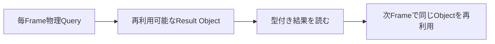
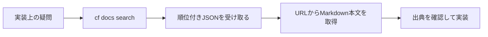
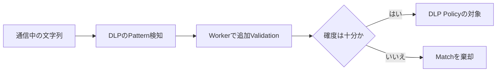

今日は**GitHubのOSSライセンス検査GA、Godot 4.8 beta 1、Ubuntu 26.10、Cloudflare AI Searchの日本語対応**を軸に、10月15〜16日の開発者向けニュースを10本紹介します。重要な発表と小さな実務改善を混ぜ、機能の紹介だけでなく実装・移行で確認すべきポイントも整理しました。

10月10〜16日の既存記事と重複する話題は避け、公式のRelease NotesやChangelogを出典にしています。**BetaとGA、製品の公称値と実際の保証範囲**を分けて読み解きます。

---

## 1. GitHubのOSSライセンスComplianceがGA — 依存追加をEnterprise Policyで判定

**10月16日｜Supply Chain Security・依存管理**

[GitHub公式Changelog](https://github.blog/changelog/2026-10-16-open-source-license-compliance-generally-available/)は、**Open Source License Compliance**の一般提供（GA）を発表しました。対象はGitHub Code Securityを有効化したRepositoryを持つGitHub Enterprise Cloudで、Data Residency版も含みます。OSSの依存関係を追加するときに、セキュリティ脆弱性だけでなく**使用許諾条件が組織のPolicyを満たすか**をPull Request段階で判断できる機能です。

例えば依存ライブラリの更新は、Licenseの条件が変わる可能性があります。単純に「MITならOK、GPLならNG」と分類しても、実際には例外許可が必要なPackageや社内の配布形態による判断が残ります。今回の仕組みではEnterprise全体でLicense Policyを定義し、対象Repositoryに`Require license compliance results before merging`というRuleset条件を適用します。PRが依存関係を追加・変更すると、自動的にPolicy違反を検出し、対象Packageを注釈します。

Policy違反があれば、依存の削除・差し替え、組織Policyの更新、特定Packageの例外申請から対応します。新設された`Enterprise Open-Source License Manager`というRoleを使い、承認担当者を開発者から分離できます。監査LogにはPolicy変更も記録されます。Public Previewからの進展として、Data Residency顧客のDependency Graph・SBOM ExportにもLicense情報が加わりました。

注目は**Packageの準拠可否を調べるAPI**です。Coding Agentが便利そうな依存を提案した時点で照会すれば、PRを作ってから不適合と判明する手戻りを減らせます。ただしLicenseの検出結果が法的な適合性を自動的に完全保証するわけではなく、利用形態に関する人間の判断が必要なこともあります。

**開発者目線:** Security Scannerが「脆弱なものを入れない」役割なら、License Complianceは「利用条件に合わないものを入れない」役割です。AgentにPackage選定を任せる際、**提案前の事前照会・PR時の自動検査・例外承認**という3段階のGateを作れる点が実務的です。

---

## 2. Godot 4.8 beta 1 — Physicsの非Allocation APIと描画表現を拡張

**10月15日｜ゲームエンジン・GDScript**

[Godot公式の4.8 beta 1発表](https://godotengine.org/article/dev-snapshot-godot-4-8-beta-1/)で、Godot 4.8がFeature Freezeに入り、Beta段階へ進みました。今回のBetaでDev 7から新機能が追加されたわけではなく、これまでの変更をまとめて**互換性や不具合の検証へ集中する段階**になったことが大きなニュースです。Windows・macOS・Linuxなど向けの[公式Build](https://godotengine.org/download/archive/4.8-beta1/)が公開されています。

ゲーム内で頻繁に呼び出す処理では、Garbage Collectionの負荷をどう下げるかが重要です。Godot 4.8は`PhysicsDirectSpaceState2D`と`PhysicsDirectSpaceState3D`に、結果を再利用できる**非Allocation型のQuery API**を追加。従来はRaycastの結果としてDictionaryを受け取っていましたが、`PhysicsIntersectRayResult3D`など強い型のResult Objectを用意して、`intersect_ray_into`で内容を更新できます。毎Frame DictionaryやArrayを作る場合と比べ、割り当てと型変換を減らす設計です。

描画では**Multi-bounce Ambient Occlusionの近似**が入り、従来のAOで失われやすかった間接反射を近似して、陰影が過度に暗くなる問題を改善します。Directional LightmapにSpecular成分を取り込む変更もあり、静的な照明を使うSceneでの見た目に影響します。Editorには実験的なSymbol Rename、GDScriptの警告箇所だけを下線表示する改善、入力周りには高Polling Rate Mouse対策などが含まれます。

> [!WARNING]
> 4.8 beta 1は**正式版ではありません**。新しいPhysics APIの性能改善は使い方やQuery数で変わるため、実ProjectでProfilerと回帰テストを併用してください。

**開発者目線:** 最大の関心は新しいRendererの見た目だけでなく、**高頻度な処理のAllocation削減と型安全性を同時に改善するAPI設計**です。移行評価では、GC Alloc・物理演算の結果・Lightmapの再現性を分けて測ると効果が判断しやすくなります。

---

## 3. Ubuntu 26.10リリース — Rust製Coreutilsと耐量子署名を前進

**10月15日｜Linux・開発環境**

Canonicalは[Ubuntu 26.10「Stonking Stingray」の正式リリース](https://canonical.com/blog/canonical-releases-ubuntu-26-10-stonking-stingray)を発表しました。LTSではなく**通常のInterim Release**で、[公式Release Notes](https://documentation.ubuntu.com/release-notes/26.10/)によればSupport期間は**9か月、2027年7月まで**です。長期稼働のServerでは26.04 LTSとの役割の違いを考えて採用する必要があります。

技術的に大きいのは、Rustで実装した**uutils coreutilsの採用を進めたこと**と、Package署名で耐量子暗号へ対応する取り組みです。従来のUnix Commandと互換性を保ちながら実装基盤を変更する試みは、単純な言語置換ではありません。`cp`、`sort`など多くのCommandの境界条件やScriptで期待される挙動の違いを洗い出す必要があります。UbuntuはRustベースのSequoia PGPもMain Archiveに導入し、従来の`gpg`・`gpgv`も引き続き提供しています。

ToolchainはGo 1.27、LLVM 22、Python 3.14、OpenJDK 25などが提供され、OpenJDK 27もPackageとして利用できます。DesktopはGNOME 51に更新され、**MynaというOpt-inのローカル音声認識**を導入。Systemに組み込まれた機能でも、CloudへAudioを送る前提とは限らない、というプライバシー重視の方向性が示されています。またKernel 7.3系のRelease Candidate由来のBuildを搭載するため、最新Hardwareの対応と同時にKernel由来の不具合リスクも見極めたいところです。

| 選択 | 重視すること | 注意する点 |
| --- | --- | --- |
| Ubuntu 26.04 LTS | 長期運用・安定更新 | 最新機能の導入は比較的ゆっくり |
| Ubuntu 26.10 | 新しいToolchain・OS機能を先行評価 | Supportは2027年7月まで |

> [!WARNING]
> ServerやCI Imageで移行する際は、Coreutils・OpenSSL・SSH構成、Native ModuleのBuild互換性を確認してください。**新Versionがリリースされたから即時移行が最適とは限りません**。

**開発者目線:** Rustへの置換や耐量子署名は「下層の実装変更を既存の開発体験にどう透明に載せるか」というテーマです。開発用VMで差分を試し、重要なShell ScriptとPackage管理を確認する場として26.10が役立ちます。

---

## 4. Cloudflare AI Searchが日本語・中国語・韓国語のKeyword検索に対応

**10月16日｜AI Search・多言語検索**

[Cloudflare公式Changelog](https://developers.cloudflare.com/changelog/post/2026-10-16-cjk-keyword-search/)で、AI SearchのKeyword Searchが**日本語・中国語・韓国語のQueryを扱えるようになった**と発表されました。従来はスペースで単語を分割する前提が強く、例えば`経費精算の締め日はいつですか？`という日本語の文章がひとつの長いPhraseとして扱われ、部分一致に失敗しやすい問題がありました。

改善の中心は`keyword_tokenizer`の`trigram`です。Trigramは文字列を**連続する3文字単位へ分割**してIndexに登録する方式です。英語のように単語間に空白がある言語と異なり、日本語には明確な空白区切りがありません。文章を細かい文字列へ切り出すことで、Documentの一部とQueryの重なりを探しやすくします。従来の`porter`は主に英語などの語形変化を扱うTokenizerで、CJK文書には適しません。

AI SearchのようなRAG系の検索では、EmbeddingによるSemantic Searchと、正確な語の一致を狙うKeyword Searchは役割が異なります。例えば「更新日について説明した文書」を意味で探すのはEmbeddingが得意でも、エラーコードや固有の型名、契約番号などを厳密に探すにはKeywordの一致も重要です。CJK言語でKeyword側のRecallが上がることは、**Hybrid Searchの土台が整う**という意味があります。

| Tokenizer | 主な考え方 | CJK文書との相性 |
| --- | --- | --- |
| `porter` | 単語と語形を処理する | 単語境界を空白に頼りやすい |
| `trigram` | 連続する3文字でIndex化 | 空白なしの文章にも適用可能 |

> [!WARNING]
> Tokenizer設定を変えると**全文再Indexが発生**します。既存Indexで検索がどう変わるか、PrecisionとRecallを試した上で切り替える必要があります。

**開発者目線:** 社内文書・マニュアル・日本語のゲーム内テキストをAgentに検索させるなら、モデルの性能だけでなく**検索前処理の言語適合**が重要です。検索品質が低いときにEmbeddingモデルだけを替える前に、TokenizerとIndexの作り方を確認したい更新です。

---

## 5. Cloudflare CLI beta.16にdocs search — Coding Agentから公式資料を検索

**10月16日｜CLI・Coding Agent・Docs検索**

[Cloudflare公式の更新](https://developers.cloudflare.com/changelog/post/2026-10-16-docs-search/)で、Cloudflare CLI `1.0.0-beta.16`に`cf docs search`が加わりました。TerminalからCloudflareの最新Documentationを検索し、Guide・Tutorial・Sampleを探せるようになっています。Coding Agentが環境構築でAPI名を推測して誤る問題を抑えるために、**実際のDocumentationへその場でアクセスする**導線として使えます。

例えば`cf docs search "schedule a worker"`や`cf docs search "rate limit requests with WAF"`で検索すると、**最大5件の順位付きJSON**が返ります。各結果にはTitle・Description・Documentation URLが含まれます。URLを得たら、そのページへ`Accept: text/markdown` Headerを付けてGETし、Markdownの本文を読むWorkflowが公式に紹介されています。JSONを返すので人間がTerminalで確認する用途に加え、Agentが必要なページを選ぶ処理にも向きます。

同時にCLIが生成するCommand名の表記も**kebab-case**へ統一されました。例えば`cf accounts billing getCredits`に相当するCommandが`get-credits`へ変更されるため、CLIのBeta版に依存したScriptはRelease Notesと照らし合わせる必要があります。またDocumentation SearchはLive検索であり、オフラインでは使えません。

**開発者目線:** Agentに大量のDocumentationを最初から渡すより、**検索→候補選択→本文を読む**工程を分離した方がContext量を抑えやすくなります。ただし一次資料を取得できても内容が古い場合はあります。対象Version・公開日・CLIの実行結果を組み合わせると安全です。

---

## 6. Xcode 27用GitHub Actions Runner Imageが一般提供

**10月15日｜CI/CD・Apple開発**

[GitHub公式Changelog](https://github.blog/changelog/2026-10-15-xcode-27-runner-image-generally-available/)によると、GitHub-hosted Runnerの**Xcode 27 ImageがGA**になりました。Public Preview段階を終え、macOS 27上でXcode 27 ToolchainとApple SDKを使ったBuild・Testを構成できます。iOS・macOS向けApplicationのCIをGitHub Actionsで回す際の基本環境となります。

使い方はWorkflowの`runs-on`に`xcode-27`または`xcode-27-xlarge`を指定します。重要な条件は**Apple Silicon（arm64）Runner専用**という点で、Intel Mac向けRunner Imageでは利用できません。Apple SiliconとIntelではNative DependencyやSimulatorの対応が異なり得るため、既存のCIがIntel Runner前提だったProjectは単純なLabel置換で済まない場合があります。

GitHubは今回のImageについて、**macOS VersionそのものではなくXcodeのMajor Versionを選ぶ**形に整理したと説明しています。XcodeのVersionが大きく変わるとSwift Compiler、SDK、Code SigningやSimulatorの仕様も変化します。Runner Imageを明示することで、Host OSのVersionだけを指定するより「どのCompilerでBuildしたか」を追跡しやすくなります。

| Runner label | 用途 | 制約 |
| --- | --- | --- |
| `xcode-27` | Xcode 27で通常のBuild・Test | Apple Silicon専用 |
| `xcode-27-xlarge` | より大きいRunnerが必要なJob | Apple Silicon専用 |
| 旧Image | 現行Applicationの互換維持 | Xcode 27前提の機能は使えない場合あり |

**開発者目線:** CIの更新は新OSへの追随だけではありません。DependencyのArchitecture、Code Signing、Simulator Test、Native Pluginといった**Build Environmentの再現性**を考える機会です。既存Runnerと新RunnerをMatrixで並列に回し、Compiler変更とEnvironment変更の影響を分離するのが堅実です。

---

## 7. Cloudflare StreamのWebRTCライブ配信がGA — WHIPとWHEPを利用

**10月15日｜Realtime配信・WebRTC**

[Cloudflare公式Changelog](https://developers.cloudflare.com/changelog/post/2026-10-15-stream-live-webrtc-ga/)で、Cloudflare Streamの**WebRTC Live Streaming**が一般提供（GA）に到達しました。Web Browserの標準APIと既存のプロトコルを使い、配信ソフトウェアを必ずしも必要とせずに、Videoの送出と再生を構築できる仕組みです。提供は一対多数の放送向けであり、多対多のリアルタイム通信を自由に組み立てるCloudflare Realtimeとは責務が異なります。

Browserからの送信側には**WHIP**、受信側には**WHEP**を使用します。WHIPはWebRTCによる配信の入口をHTTPで扱う規格、WHEPは受信PlayerがSessionを確立するための規格です。StreamのLive InputをCLIやAPIで作成すると、両方のEndpoint URLを取得できます。Browserの`RTCPeerConnection`からSDP Offerを作り、WHEP URLにPOSTし、返却されたSDP Answerを適用して再生する基本手順が公式Sampleとして公開されました。

Beta期間中にCloudflare Realtimeの構成要素を利用する形へ再設計され、**Trickle ICE、Offer Mode、Counter-offer**などの標準対応も改良されました。これらはNAT越えや異なるBrowser・Client実装間で通信経路を成立させるための仕組みです。またStreamのAnalyticsや課金利用量の画面にもWebRTC配信が反映されるようになりました。

> [!WARNING]
> 10月15日からWebRTC利用の**従量課金**が始まっています。応答時間はネットワーク・Player・Codec・配信距離に左右されるため、極小Latencyを無条件に保証するものではありません。

**開発者目線:** 動画配信を作る際、「低Latencyな映像転送」と「多数Viewer向けの配信管理」を別実装にしなくて済む可能性が魅力です。Interactiveな配信やRemote Previewでは、実際の端末で遅延・Packet Loss・Audio同期を測り、従来のHLS方式と比較したい更新です。

---

## 8. Cloudflare TunnelのRoute上限が5万件に — 複数環境接続を拡張

**10月16日｜Network・Zero Trust**

[Cloudflare公式の更新](https://developers.cloudflare.com/changelog/post/2026-10-16-tunnels-for-platforms-and-50k-routes/)で、Cloudflare TunnelとCloudflare Meshを使う際、AccountあたりのDefault Route上限が**1,000から50,000へ増加**しました。対象はCIDR RouteとHostname Routeで、既存のAccountにも自動適用されます。別途申請せず大量のPrivate Resourceを登録しやすくなりました。

ここでいうRouteは、Private Networkや内部Hostnameをどの経路で接続するかを定義するものです。Web公開に使う**Public Hostname（Published Application）は今回のRoute上限には含まれません**。またTunnelひとつに公開できるApplication数はConfiguration Sizeに依存し、概ね5,000〜10,000という別の制限があります。同じCloudflare Tunnelという名前でも、Route、Tunnel、Published Applicationの上限を混同しないことが重要です。

もう一つの更新は**Tunnels for Platforms**です。Cloudflare Accountには標準で1,000 Tunnelが含まれますが、開発環境・Device・Customerごとに1本ずつ用意するような場合、1,000本を超えるTunnelの追加購入が可能になります。Cloudflareが示す料金は**追加Tunnelあたり月額4.50ドル**。Enterpriseでは別の契約条件も利用できます。

大量のTunnelを扱う場合、接続数の上限を緩めるだけでは十分ではありません。Routeの命名、使用者や所有者の追跡、不要になった環境の自動削除、Access Policyの適用を揃える必要があります。特に開発用Previewを大量生成するWorkflowでは、孤立したTunnelが残るリスクがあります。

**開発者目線:** 一時的なPreview EnvironmentやRemote開発環境をCustomerごとに分ける設計が取りやすくなります。運用では**プロビジョニングと破棄の両方をAutomation**し、Tunnel単位のCostと権限範囲を計測したいところです。

---

## 9. GitHub CopilotがSlack・Teamsで複数Repository横断の調査に対応

**10月15日｜Coding Agent・Team Collaboration**

[GitHub公式Changelog](https://github.blog/changelog/2026-10-15-copilot-in-slack-and-teams-adds-model-and-repository-updates/)で、SlackとMicrosoft TeamsのGitHub Copilotが、**一つのConversationから複数Repositoryを扱えるようになった**と案内されました。開発Teamの作業はFrontend・Backend・Infrastructureなど複数Repositoryにまたがるため、Repositoryごとに会話を切り替えていた従来のWorkflowを簡略化できます。

例えば「自分の全RepositoryのOpen PRから対応が必要なものを挙げて」「今週MergeされたPRを横断してまとめて」「FrontendとBackendにまたがるIssueを調べて」と依頼できます。対象の範囲を一つのRepositoryへ固定せず、会話のContextを引き継いで質問を続けられる点が特徴です。Slackの場合はConversation内で共有されたMessageやThreadをContextとして利用する改善も入りました。

細かいUXも変わっています。`@GitHub`へのMentionはMessageの先頭に限定されず、途中に置けるようになりました。Repository間の切り替えを滑らかにし、Task開始時のErrorや中断からのRecoveryも改良したとGitHubは説明しています。ただし、対象Repositoryへのアクセス権限や所属組織の利用設定は引き続き前提となり、**横断検索が新しい権限を与える機能ではありません**。

エージェントを仕事の入口で使う場合、Contextには二つの性質があります。一つはGitHubのIssue・PR・Commitという**検証可能な記録**、もう一つはSlackなどで語られた決定理由や優先順位です。両方を参照できれば、変更履歴だけからは分からない作業の背景を説明しやすくなります。

**開発者目線:** マルチRepo構成では、一件の変更の影響範囲を見積もる際の情報探索が面倒です。Copilotに探索を任せても、**最終的な判断には該当PR・Issue・Commitの原文を確認**することが重要。まとめの便利さと根拠追跡のしやすさをセットで評価したい機能です。

---

## 10. CloudflareのDLP Pattern検知をWorkersで追加検証できるように

**10月15日｜Data Loss Prevention・Custom Validation**

[Cloudflareの公式Changelog](https://developers.cloudflare.com/changelog/post/2026-10-15-dlp-custom-validation-workers/)で、Data Loss Prevention（DLP）の**Custom Pattern Entry**に対し、Cloudflare Workersを用いた追加Validationが可能になりました。DLPは機密情報らしい文字列が通信中に現れたときに検出・制御する仕組みですが、単純な正規表現やKeywordでは「似た文字列」を誤検知することがあります。

たとえば社内の顧客管理番号が`ABC-12345`の形式だとしても、同じ形式を持つ一般的な文字列が存在するかもしれません。Patternが一致したという情報だけでBlockすると、関係ない通信まで止まる可能性があります。新しい方式ではDLPが見つけた候補に対し、**自分のAccountに配置したWorkerで組織固有の判定Logic**を実行できます。

WorkerはMatchの**Confidenceを調整**したり、当該Matchを**棄却**したりできます。つまりPatternを一次Filterとして使い、その後に内部ルールによる二次判定を追加する設計です。単純な文字列ルールの上に、Checksumの検証、番号体系の判別、明らかなSample Valueの排除などを組み合わせる用途が考えられます。ただしこれらは活用例であり、Cloudflareがすべての判定器を組み込みで提供するという意味ではありません。

> [!WARNING]
> Workerで検知対象情報を処理するため、**Logに機密文字列を残さないこと**、Timeout時の動作、Responseの形式を事前に検証する必要があります。詳細なIntegration Contractは[公式Documentation](https://developers.cloudflare.com/cloudflare-one/policies/data-loss-prevention/validate-matches-with-workers/)で確認してください。

**開発者目線:** Security Ruleを厳しくすればよいとは限りません。**高い検知率と低い誤検知率を両立するための段階的な判定**は、Spam DetectionやFraud Detectionでも共通する設計です。Workerを追加する場合はDecisionの再現可能性とLatencyを計測して導入を判断したいところです。

---

## 👀 今日ならこの3つ

### 🥇 Godot 4.8 beta 1 — 高頻度Queryの非Allocation化

毎FrameのPhysics Queryを型付きResult Objectへ受け取る変更は、ゲーム内LoopのGC抑制と実装しやすさを両立する具体的な改善です。描画変更と合わせ、正式版までにProjectのProfiler結果を比較したい更新です。

### 🥈 GitHub OSS License Compliance — Coding Agent時代の依存管理

Dependencyを追加する前後にPolicyを検証できる仕組みです。Agentが提案したPackageでも、社内のLicense Ruleに合っているかをAPIで確認する設計が興味深い点です。

### 🥉 Cloudflare AI SearchのCJK Keyword対応 — RAGの基礎を見直す

日本語の検索品質はLLMの賢さだけでは決まりません。Tokenizerの言語対応と再Indexの運用という、地味でも実務への影響が大きい部分を改善したニュースです。

---

## 📊 今日の技術トレンド

**高速な機能追加だけでなく、その下の互換性と検証を整える動き**が目立ちました。GodotはAllocationを減らし、Ubuntuは基盤実装を更新し、GitHubはLicense Policyを自動化しました。CloudflareはAI SearchやCLIで「正しい情報を取り出す」工程を支えています。新機能の魅力と同時に、どの条件で正しく動くかを確認する姿勢が重要です。
