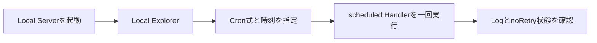
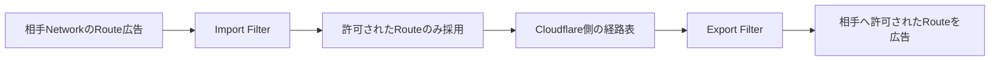

今日は**C#製ゲーム基盤BRUTALのソース公開、OpenAIのPrompt-to-voiceとGPT-LiveのDecisions連携、CloudflareのCron Trigger手動テスト**が注目です。週末のため10月17日の更新に加え、10月13〜16日の一次情報から見逃しやすい実装・運用改善を集めました。

直近の記事で扱ったGodot 4.8 beta 1、Ubuntu 26.10、Cloudflare AI Searchの日本語対応、GitHub OSS License Complianceなどは再掲していません。**正式提供と研究段階の区別、使える条件、導入時に何を検証すべきか**を重視しています。

---

## 1. BRUTAL公開 — C#で独自ゲームエンジンを組み立てる低レベル基盤

**10月15日発表｜ゲームエンジン・C#・Vulkan**

AhwooとRocketWerkzが、ゲーム制作向けのC# Framework「BRUTAL」のソースを公開しました。[開発元の発表](https://forums.ahwoo.com/forums/brutal/news/brutal-goes-open-source-ahwoo-and-rocketwerkz-release-their-game-dev-framework.1391/)と[一次Repository](https://github.com/ahwootech/BRUTAL)によると、これはUnityやGodotのようにScene Editorまで一式を提供するEngineではありません。**Interop・Memory・Job・Math・Native API Bindingを土台として提供し、上位のゲーム構造は利用者が設計する**Frameworkです。Kitten Space Agencyでは直接利用され、RimWorldの独自Engine「Waylith」の基盤にも採用されています。

主要な部品には、C#からNative Libraryを呼ぶ独自Interop、Allocationを抑えたCollection、Unmanaged Memory管理、Vulkan、OpenGL、SDL、GLFW、Jolt、Box2D、FMODなどのBindingが並びます。利用者は必要なNuGet Packageを選び、RendererやScene Graph、Editorを自分で構築します。これは「完成したEngineを使う」ことの逆で、ゲーム固有の性能要件に合わせて抽象化の境界を自分で決められる一方、Toolingと保守の負担も引き受ける設計です。

**ライセンスには注意が必要です。** READMEはMITを基にした独自Licenseと説明していますが、Credit表記、起動時Logo表示、NOTICE同梱などの追加条件があり、2026年10月時点ではOSIの承認を受けていません。単純なMIT Licenseと同一視できず、「ソースを閲覧・改変できる」ことと「OSI定義のOpen Sourceである」ことは分けて扱うべきです。また、公式の導入要件は.NET 10 SDKとWindowsまたはLinuxで、描画にはVulkan 1.3対応GPUを求めています。

> [!WARNING]
> 開発元が示すRimWorld移行後の性能改善「2〜4倍」は特定Projectの測定です。BRUTAL採用だけで同等の改善が出る保証ではありません。独自Licenseの条件も採用前に必ず確認してください。

**開発者目線:** FrameworkとEngineの責務分割を考える教材として興味深い公開です。RendererやScene SystemまでをFrameworkが決めないことで、Game Loop、Data Layout、並列化の自由度が上がります。反面、一般的な中小規模の開発では完成済みEngineのEditor・Asset Pipeline・Platform対応の価値も大きく、**低レベル制御の利益が保守Costを上回るか**を最初に評価したいところです。

---

## 2. OpenAI Prompt-to-voiceがGA — 文章で音声を設計しGPT-Liveで再利用

**10月16日｜音声AI・API**

[OpenAI公式Release Notes](https://openai.com/products/release-notes/)で、説明文から独自の話し声を作る**Prompt-to-voiceが全API顧客向けに一般提供**されました。[Custom Voicesの公式Guide](https://developers.openai.com/api/docs/guides/custom-voices)では、Accent・Pitch・Timbre・話す速さ・声の質感などを自然言語で指定し、生成されたVoice IDを保存して別のGPT-Live Sessionでも再利用する方法が示されています。日本語向けにはHaremaとShidaという新しい標準Voiceも追加されました。

作成は`POST /v1/audio/voices`へ`type: "prompt"`、`name`、`prompt`などを送ります。発行されたIDをGPT-Liveの`session.audio.output.voice.id`へ設定すれば、Sessionごとに同じ音声設計を指定できます。`script_hint`として最大2,000文字のSample Scriptを与えることも可能で、実際の発話内容を使って音色を調整できます。作成自体は無料ですが、**音声生成には通常のGPT-Live Session料金**がかかります。組織ごとに保存できるPrompt生成Voiceは最大100個です。

| 作成方式 | 入力 | 主な利用先 |
| --- | --- | --- |
| Prompt-to-voice | 声質を説明する文章 | GPT-Live |
| Recording-based | 同意録音と参照音声 | GPT-Live、TTS、Realtimeなど |

この区別は重要です。**Prompt生成Voiceは従来のText to Speech APIやRealtime API、Audio付きChat Completionsでは利用できません。** また実在人物の声真似や子どもの声の作成は認められず、AI生成音声であることを利用者に伝える必要があります。Voice作成EndpointはZero Data Retentionに非対応というデータ保持上の制約もあります。

**開発者目線:** ゲーム内の案内役、語学学習、音声Agentなどで、毎回録音を用意せず**声の方向性を仕様として管理**できるのが利点です。Voice IDだけでなく元のPromptと比較用SampleをVersion管理し、同じ文章を読ませてAccent・明瞭さ・Latencyを評価すると再現性が上がります。音声の独自性が保証されるわけではない点もDesign上の前提です。

---

## 3. GPT-LiveがDecisionsと直接連携 — 会話途中で操作を判定

**10月15日｜リアルタイム音声・Agent制御**

[OpenAI公式Release Notes](https://openai.com/products/release-notes/)は、GPT-Liveから**Decisions APIへNative Delegationできる機能**を一般提供したと発表しました。[実装Guide](https://developers.openai.com/api/docs/guides/decisions-voice)では、ユーザーの発話が完了する前に小さな判断を開始する構成が説明されています。従来の「音声を文字起こし→アプリが内容を見て別APIを呼ぶ」往復を一部省けるのが技術的な変化です。

設定では`session.delegation`に`type: "decisions"`を指定し、質問と選択肢を定義します。例えば車内Assistantなら「温度を上げる・下げる・変更しない」「曇り取りをON・OFF・変更しない」といった独立したChoiceを一回のDecisionで判定できます。単純な操作はアプリ側で実行し、より複雑な経路案内や検索はResponses APIへ委譲する構成も可能です。Decisionの出力は**操作実行そのものではなく、アプリが検証して実行するための判断結果**です。

もう一つの入口は`session.triggers`です。ユーザーの入力やGPT-Liveの出力Transcriptが差分で届くタイミングに応じ、Decisionを起動できます。発話途中の暫定情報を扱うため、確定前の誤判定や言い直しへの対策が欠かせません。Native DelegationはApplicationを経由するCustom Delegationとは違い、Liveが直接Decisionsを呼ぶ方式です。Session中に質問の定義を更新できますが、Delegation Type自体はSession開始時に固定されます。

**開発者目線:** 低Latencyな音声UIでは、回答の速さだけでなく**意図を確定するタイミング**がUXを左右します。音声途中の「ちょっと待って、やっぱり…」で操作が二重実行されないよう、Decision ID・Idempotency・取消可能な操作を設計したい機能です。権限が必要な操作は音声モデルの判断だけで確定しないことも重要です。

---

## 4. Cloudflare Local ExplorerでCron Triggerを手動テスト可能に

**10月17日｜Workers・Local開発**

[Cloudflare公式Changelog](https://developers.cloudflare.com/changelog/post/2026-10-17-local-explorer-cron-triggers/)で、Local ExplorerからWorkersの`scheduled()` Handlerを**一回だけ手動起動**できる機能が追加されました。これまでLocal環境でCron処理を確かめるには、特殊なURLやHTTP Requestを自分で構築することがありました。今回の更新は、開発Serverに付属するBrowser UIからCron式を選び、実行結果を見られるようにしたものです。

`cf dev`、`wrangler dev`、Cloudflare Vite PluginでLocal Serverを起動し、`/cdn-cgi/local/explorer`を開きます。設定済みCron式の実行だけでなく、その場で作ったCron式や再利用可能な予定時刻も指定できます。実行結果と`noRetry()`の状態を確認でき、Observabilityが有効な場合はLogやTraceも参照できます。予定時刻のPresetはBrowser内に保存され、Projectの設定ファイルやDeploy済みTriggerを変更しません。

さらにHTTP APIからも同じ処理を呼び出せます。`/cdn-cgi/local/explorer/api/local/scheduled?worker=...`へCron式と必要に応じて`scheduled_time`を送る形なので、AI Coding AgentやE2E Testからも制御できます。ただし**LocalでCron Scheduleが自動実行されるようになったわけではありません**。これは実行タイミングを手動で再現するためのTest機能です。

**開発者目線:** 毎日実行するBatchは、通常のHTTP APIと違い「実行時刻まで待たないと確認しにくい」問題があります。**時計を進めるように指定時刻を注入し、Handlerの振る舞いを即座に検証する**ことで、Timezone・再試行・月末処理などの回帰Testを組みやすくなります。Local実行と本番Schedulerの挙動差は別途検証が必要です。

---

## 5. Rust 1.99.1 — FFIのbool誤コンパイルなど3件の回帰を修正

**10月15日｜Rust・Compiler・ABI**

[Rust公式Blog](https://blog.rust-lang.org/2026/10/15/Rust-1.99.1/)は、安定版のPatch Release **Rust 1.99.1**を公開しました。大型機能の追加ではなく、既存Versionで発生した三つの回帰を修正する更新です。特に重要なのは、x86_64環境で**FFIを通じて返す`bool`がABI上の期待を満たさない場合があった**というCompilerの問題です。

FFIはRustとCなど異なる言語間で関数を呼ぶ境界です。x86_64のABIでは、`bool`を返すRegisterの特定Bitをゼロ拡張する必要がありますが、問題のあったCompilerは上位Bitを未定義のまま残すことがあり、呼び出し側から`0`や`1`以外の生値が観測される可能性がありました。修正版は必要なZero Extensionを復元しています。型の表面上はBooleanでも、**言語をまたぐ瞬間にMachine Levelの契約が必要**だと分かる事例です。

二つ目は一部Targetで`wcslen` Symbolが欠け、Link Errorになる問題です。LLVMの`loop-idiom-wcslen`最適化が呼び出しを生成しても、Target側のLibraryに関数がないことがありました。UEFI Targetでは標準Libraryを使うProjectにも影響しており、今回Compiler BuiltinsへFallbackを追加しました。三つ目はmacOSで`rust-lld`が`libLLVM.dylib`を発見できない問題で、Linkerに適切な`rpath`を含めて修正しています。

| 修正対象 | 起きていたこと | 影響の確認方法 |
| --- | --- | --- |
| FFI bool | x86_64の返値ABI違反 | Native境界のTest |
| wcslen | 一部TargetのLink Error | Cross Compile |
| rust-lld | macOSでLibrary探索失敗 | Linker実行経路 |

**開発者目線:** Patch Releaseであっても、**Compilerが生成するBinaryの意味が変わる**修正は重要です。FFI、Cross Compile、UEFIなどを使う場合は`rustup update stable`後に既存のUnit Testだけでなく、Native連携を含むIntegration Testを走らせたいところです。

---

## 6. 研究：Coding Agentの性能はScaffolding次第 — 道具が同じでも差が出る

**10月15日投稿｜Agent研究・Benchmark**

[arXivの論文「Improving Environment-Agnostic Coding Agents: The Role of Scaffolding」](https://arxiv.org/abs/2610.22289)は、同じCoding Agentに同じ一般的なToolを与えても、**作業をどう整理し、いつControlを戻すかという手順設計**で成果が変わることを検証しました。著者はSergey Rodionov。対象はCodexベースのAgentで、ARC-AGI-3、AGI Maze、Terminal-Benchという性質の異なる環境を使っています。2026年10月15日投稿の研究であり、製品の正式機能追加ではありません。

比較したのは、Environmentごとの専用Toolを作り込むのではなく、**ほぼ同一のPromptと汎用Toolのまま指示を少し変更する**方法です。困難な状況を報告し、Controlを返して自動継続できるよう促すだけで、ARC-AGI-3とAGI Mazeの平均Scoreが改善しました。一方Terminal-Benchでは変化が小さく、結果は混在しています。つまり単一のPrompt改善がどの作業にも万能という結論ではありません。

さらに、Agentが既に知っているReset判断の手順を、外部のScript Controllerへ移すと、専用Agentとの差の一部が縮まりました。Agentへ「正しい情報と道具を渡す」だけでは不十分で、**どの場面でどの操作を使うかを制御する外部Scaffold**が効く可能性を示しています。別の実験ではTutorial経験を増やしても性能が下がる場合があり、情報量を増やすことが常に良いとは限らない点も興味深い結果です。

> [!NOTE]
> これは著者の実験条件での結果です。Token Costが増えた条件もあり、改善をそのまま「効率化」とは呼べません。環境をまたぐ一般化能力と、特定Taskに最適化したAgentの差も残っています。

**開発者目線:** Coding Agentを強くする方法はModel交換だけではありません。**Plan、観測、失敗時の報告、Reset、再試行、外部Controller**を分けて設計し、同じTask群で成功率とCostを比較する価値があります。特に長時間の自律作業では、Agentが失敗に気付く仕組みをどこへ置くかが設計の焦点になります。

---

## 7. Cloudflare GatewayのApplication Libraryが独自Application定義に対応

**10月15日｜Zero Trust・Policy管理**

[Cloudflare公式Changelog](https://developers.cloudflare.com/changelog/post/2026-10-15-app-library-custom-applications/)で、Application Libraryに**Custom Application**を登録し、GatewayのDNS・Network・HTTP Policyから参照できるようになりました。これまでの既知Application分類に依存せず、組織固有の内部Systemや自社Serviceを「ひとつのApplication」として扱いやすくなる変更です。

Custom Applicationは**Hostname、IP Subnet、または両方**で定義できます。さらにTCP・UDPのPortやPort Rangeを任意で指定し、HTTP・Network Policyで一致する範囲を絞れます。例えば`api.example.internal`と特定のPrivate Network Segmentを同じ業務Applicationとして登録し、Gateway Policyの対象にできます。DNS Policyは名前の情報を使いますが、Portの判定はNetwork・HTTP側の文脈で意味を持つため、Policyの評価層を混同しないことが大切です。

今回の更新ではApplication Libraryの検索・絞り込みや、ApplicationのData・Metricを確認するUI、Gateway Policy Builderの選択操作も改善されました。Custom Applicationを共通の参照対象にすることで、個別PolicyにHostnameやIPを何度も手入力するより**Ruleの意味を人間が追いやすい**構成になります。ただし、Applicationを定義しただけでアクセスが許可・拒否されるわけではなく、実際のGateway Policyが必要です。

具体的には「開発環境のAPI」「社内CI」「外部委託先の管理System」などをApplicationとして命名し、Access条件やMonitoringを分ける使い方が考えられます。一方、IPやHostnameの変更が頻繁な環境では、定義が実態からずれていないか定期的な検証も必要です。

**開発者目線:** Network Securityを「IP Addressの羅列」から「**Applicationの責務単位**」へ近づける機能です。Microserviceや一時環境を管理する際、Policyの対象が何を意味するか明確にできるのが魅力です。Ruleの重複や誤設定を防ぐため、定義とPolicyをコード化し、変更Reviewで確認する運用と組み合わせたいところです。

---

## 8. GitHub Code QualityのLicense利用状況をCSVで取得可能に

**10月15日｜開発品質・組織運用**

[GitHub公式Changelog](https://github.blog/changelog/2026-10-15-download-github-code-quality-license-usage-as-a-csv/)で、**GitHub Code QualityのLicense利用状況をCSVとして取得**できるようになりました。対象はGitHub TeamとGitHub Enterprise Cloudです。Code Qualityを複数Repositoryで使う組織では、どの開発者がLicense数に算入されているのかを把握し、課金状況と実際の利用を照合しやすくなります。

CSVには、Licenseを消費するActive Committer、**過去90日間にそのCommitterのCommitを受け取ったRepository**、そのCommitterが特定のRepositoryまたはOrganizationに固有かどうか、という情報が含まれます。単なる「利用者数」だけでなく、どのRepositoryを有効にしているためにLicenseが必要になったかを調べる手掛かりです。OrganizationまたはEnterpriseの`Billing and licensing`から`Licensing`を開き、Code Quality CardでCSVを取得します。

ここで重要なのは、Code Qualityの有効化を外したら**その場で当月の請求額が必ず減るわけではない**ことです。公式説明では、Unique Committerの情報を使い、どこを無効化すれば**次のBilling Period**にLicenseを解放できるかを判断するとしています。例えば一つのRepositoryだけで利用しているCommitterと、複数Repositoryで利用しているCommitterでは、無効化の影響が異なります。

また、Costだけを理由に品質検査を停止すると、BugやMaintainability上の問題を見逃す可能性があります。CSVは単純な削減リストではなく、**検査の価値とLicense配分を一緒に評価する材料**です。Repositoryごとの重要度、変更頻度、既存CIでの代替検査を並べて判断したいところです。

**開発者目線:** 組織横断の開発Toolでは、導入率だけでなく**実際にどのRepositoryが費用を発生させているか**の可視化が重要です。CSVをSpreadsheetやBIへ取り込み、Repository単位の利用・費用・品質改善指標を比較することで、感覚的なLicense管理から実測に基づく管理へ移れます。

---

## 9. Cloudflare WANがBGP RouteのImport・Export Filterを追加

**10月15日｜Network・Routing**

[Cloudflare公式Changelog](https://developers.cloudflare.com/changelog/post/2026-10-15-bgp-filter-profiles/)で、Cloudflare WANとMagic TransitのIPsec・GRE Tunnelに**BGP Route Import / Export Filtering**が追加されました。BGPはNetwork同士が「この宛先の通信は自分の経路へ送れる」とRoute情報を交換するProtocolです。交換されるRouteが多すぎたり、意図しないPrefixが混ざったりすると、通信の行き先が変わる原因になります。

新機能では、CIDRの一覧と`allow`・`deny`を組み合わせた**再利用可能なFilter Profile**を定義します。CIDRのMatch方法にはExact、より細かなPrefix、Prefix Length条件を指定でき、TunnelごとにImport用とExport用を一つずつ割り当てられます。例えば「特定のPrivate Prefixだけを受け入れる」「社内Networkの一部を相手側へ広告しない」といった境界をProfileで表現できます。

Dashboard・API・TerraformからProfileの作成と割当が可能です。特に運用面で重要なのは、**Filter Profileの変更時にBGP SessionをResetしなくてよい**こと。従来、経路制御の変更に伴うSession断が通信影響を広げることがありましたが、Profile変更をより小さな操作として扱えるようになります。ただし、Filterの結果として必要なRouteまで落とせば通信断は起きるため、無停止の変更が無影響を意味するわけではありません。

**開発者目線:** Routing PolicyもApplicationの設定と同様に、**再利用できる定義・Review・自動適用**へ寄せる流れです。Terraformで差分を管理し、許可するCIDRと拒否するCIDRをTest Caseとして用意すれば、変更による意図しない到達性の変化を減らせます。実際のBGP Sessionと経路表を適用前後で確認する運用が欠かせません。

---

## 10. GitHub Code Qualityの指摘Dismiss・Reopenが監査Logに残る

**10月13日発表｜Code Review・Audit**

[GitHub公式Changelog](https://github.blog/changelog/2026-10-13-audit-github-code-quality-finding-dismissals-and-reopenings/)で、Code Qualityの指摘を手動で**DismissまたはReopenした操作がOrganization / Enterprise Audit Logに記録**されるようになりました。Code QualityのFindingはDefault BranchのBacklogやPull Requestに表示されますが、「なぜこの指摘を無視したか」を後から調べるには操作履歴が重要です。自動検査が正しくても、手動で例外にした判断が追えなければ運用品質は担保しにくくなります。

新しいEvent名は`repo.code_quality_findings_dismissed`と`repo.code_quality_findings_reopened`です。操作した人物、日時、Repository、Rule、対象Findingの識別子と件数が含まれます。Code Qualityが有効なRepositoryなら追加設定は不要で、Audit LogのEvent名でFilterして確認できます。GitHub Enterprise CloudではAudit Log APIからも取得できます。

提供範囲は**GitHub TeamとGitHub Enterprise Cloud（Data Residencyを含む）でGA**。GitHub Enterprise Serverは対象外です。すべてのFindingについて詳細な判断理由を自動生成する機能ではなく、まずは誰がいつ状態を変えたかを追跡できるという改善です。必要な理由の記録はPull RequestやIssueと関連付けるなど、Team側の運用が引き続き必要です。

| 操作 | 新しいAudit Event | 主な用途 |
| --- | --- | --- |
| 指摘をDismiss | `repo.code_quality_findings_dismissed` | 例外承認の追跡 |
| 指摘をReopen | `repo.code_quality_findings_reopened` | 再評価や差戻しの追跡 |

**開発者目線:** Static AnalysisをCIへ組み込むと「指摘を消したか」だけに注目しがちですが、**なぜ例外を認めたか**を後から説明できる仕組みも重要です。大量Dismiss、特定Ruleだけの例外集中、Review後の再OpenなどをAudit Logから集計し、検査Ruleの改善やReview Processの見直しにつなげられます。

---

## 👀 今日ならこの3つ

### 🥇 BRUTAL — FrameworkとEngineの責務境界を考える

UnityやGodotとは反対に、低レベル部品を提供して上位設計を利用者に委ねる構成が興味深い公開です。独自Licenseと保守Costに注意しながら、Engine依存の設計を見直す教材としても価値があります。

### 🥈 GPT-LiveとDecisions — 音声途中で判断を開始

音声Agentが「話し終わってから考える」方式だけでなくなります。Latency削減と誤操作防止を両立するため、構造化された判断と実際の操作を分離する設計が重要です。

### 🥉 Cloudflare CronのLocal Test — 時間依存の不具合を再現

Cron Handlerを任意の時刻で一回起動できるため、定期Batchの動作確認がしやすくなります。Timezone、再試行、月末処理など、待つだけではTestしにくい条件を検証する入口です。
