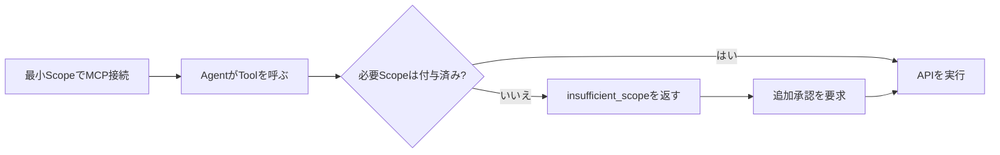
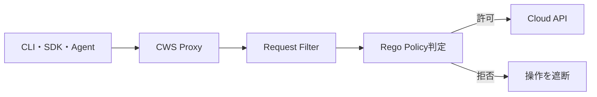
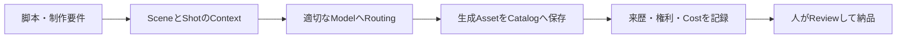

今日は**Clairicの型付きAI抽出、Cloudflare MCPの段階的な権限承認、Cloud Workload SecurityのBeta、CodeQLとXcode 27の互換性問題**が特に注目の話題です。AI Agentを安全に動かすための「出力の型」「操作権限」「実行前Policy」が、具体的な製品機能として整ってきました。

主に**10月19日に公開された一次情報**を取り上げています。AWSの制作Studio Guideは日本語版の公開が10月19日で、原文は8月公開です。以前の記事と同じ内容の繰り返しを避け、変更点・設計判断・導入時の注意点を掘り下げました。

---

## 1. Cloudflare ClairicがPreview公開 — 文章生成せず型付きの値を抽出するAI

**10月19日｜AIモデル・構造化データ**

[Cloudflareの公式発表](https://developers.cloudflare.com/changelog/post/2026-10-19-clairic-workers-ai/)で、Workers AIに抽出専用モデル **Clairic**（モデルID `@cf/cloudflare/clairic`）がPreviewとして追加されました。普通のLLMに「JSONで返して」と指示するのではなく、入力テキストと型付きのフィールド定義を渡し、**文章を生成せず値を直接返す**ことを狙ったモデルです。公式は「System One」の最初のExtraction Modelと位置づけ、Open Weightsでの公開は今後の予定としています。現時点で公開済みのOpen-weightモデルと混同しないようにしたいところです。

対応する型には、原文の位置情報付き `text`、小数桁を指定できる `number`、`date`・`time`・`datetime`、`duration`、複数候補を拾う `list`、範囲内の確率分布を返す `estimate`、最大64ステップの `forecast` があります。入力には最大4枚の画像も追加可能です。請求書から発行日を取り出し、支払条件から期限を計算するような処理では、型に合わない文章が混じらず、値が判断できない場合は `null` を返す仕組みが便利です。各Scalar値には `p_null` とConfidenceが付くため、後段の自動処理へ回すか人間の確認へ送るかを分けられます。

| 手法 | 主な出力 | 実装時に考えること |
| --- | --- | --- |
| 通常のLLM＋JSON指示 | 生成された構造化テキスト | Schema検証と値の妥当性確認 |
| Clairic | 型制約付きの値と確信度 | 抽出可能性、欠損値、計算の限界 |
| 規則ベース抽出 | Patternに一致した値 | 表記揺れや例外の保守 |

> [!WARNING]
> **Preview段階**です。Cloudflare自身が、長い多段計算や複雑な集計、長期予測、未知のデータに対する確信度の過信を避けるよう説明しています。価格は公表時点で入力100万Tokenあたり0.10ドル、出力Token課金はありません。金額計算などは値を抽出してから通常のコードで検算するのが堅実です。

**開発者目線:** AIに自由な文章を書かせる必要がない場面を見極める好例です。データ入力補助やログの属性抽出では、**型、欠損、信頼度をAPI契約に組み込めるか**が運用の鍵になります。モデルの公称精度だけでなく、正解がない入力を安全に棄却できるかを評価したい技術です。

---

## 2. Cloudflare API MCP Serverが段階的な権限承認に対応

**10月19日｜MCP・OAuth・最小権限**

[Cloudflareの公式Changelog](https://developers.cloudflare.com/changelog/post/2026-10-19-cloudflare-mcp-step-up/)によると、Cloudflare API MCP Serverが**Step-up Authorization**に対応しました。MCPはAI Agentが外部ツールを呼ぶための共通インターフェースですが、接続時に大量の操作権限をまとめて与えると、Agentが想定外のAPIを呼んだ場合の影響が大きくなります。今回の更新は、**最初は必要最小限の権限だけを与え、追加が必要になった時点で承認する**設計です。

実際には、接続時のConsent画面で「Minimal」を選びます。Agentが未許可のScopeを必要とするToolを呼ぶと、Serverが必要なScope名を含む `insufficient_scope` Challengeを返し、対応するMCP Clientがユーザーに追加承認を求めます。すでに付与されたScopeは維持されるため、最初からすべての権限を要求したり、追加のたびに接続を作り直したりする必要はありません。公開済みの[Step-up Authorization仕様](https://modelcontextprotocol.io/)に沿う仕組みです。

権限の増え方を簡略化すると次のとおりです。重要なのは、**Toolの説明に権限が書かれているだけで承認済みとは扱わない**ことです。

> [!WARNING]
> 利用できるのは**Step-up Authorizationに対応するMCP Client**です。ClientがChallengeを適切に扱えない場合は、従来の認可方式を確認する必要があります。承認された操作が必ず安全になるわけではなく、実行対象の確認やAudit Logも引き続き重要です。

**開発者目線:** Agentを実用化するうえで、Tool Callの精度だけでなく**権限をいつ、どの粒度で与えるか**が重要になっています。読み取りだけの探索から設定変更へ移る瞬間に承認を挟めるなら、日常的な調査作業の利便性と高リスク操作の統制を両立しやすくなります。

---

## 3. Cloudflare Cloud Workload SecurityがBeta — Cloud APIの実行前にPolicyを検査

**10月19日｜Cloud Security・Policy as Code**

[Cloudflare公式発表](https://developers.cloudflare.com/changelog/post/2026-10-19-cloud-workload-security-beta/)で、**Cloud Workload Security（CWS）**がBetaとして利用可能になりました。狙いは、Cloud ProviderへAPI Requestが届く前にPolicyを適用することです。従来の監査Logは操作後の発見に強い一方、誤った操作そのものを防ぐには別の仕組みが必要です。CWSはRequestの経路にProxyを置き、危険な変更を事前に止める方向を取ります。

PolicyはRequest Filterと**Rego**によるCheckで定義できます。RegoはOpen Policy Agentでも使われる宣言的なPolicy言語で、許可・拒否の条件をコードとして管理する用途に向きます。Cloudflareが示す例は、R2 BucketをPublicに変更しようとするAPI RequestをBlockするものです。管理画面でWorkloadとPolicy Setを構成し、対象環境内でCWS Proxyを動かしてClient Requestを経由させます。CloudflareのNetwork全体に勝手に適用される機能ではなく、**対象の呼び出しをProxy経由にする設計**が必要です。

従来のIAM権限とCWSは競合するというより役割が異なります。IAMが「誰に何を許すか」を中心に定義するのに対し、CWSでは「そのRequestの具体的な変更内容は妥当か」を追加で判断できます。例えば広い管理権限を持つAutomationであっても、Public公開への変更だけを別のGuardrailで防ぐ構成が考えられます。

> [!WARNING]
> **Beta**であり、利用にはCloudflare Zero Trustの契約が必要です。公式はFree Planでも要件を満たすと説明しています。実運用ではProxy障害時の挙動、Policyのテスト、Cloud APIごとの対応範囲を確認してください。

**開発者目線:** Coding AgentやIaC AutomationがInfrastructureを変更する機会が増えるほど、**実行主体の権限だけでなく、Request単位の安全性**が重要になります。PolicyをコードでReviewし、危険な変更を本番反映前に拒否する設計は、Agent運用の防波堤として実用性があります。

---

## 4. GitHub CodeQLがXcode 27のTraced Scanを非対応に — CI設定の固定が必要

**10月19日｜静的解析・Apple Toolchain**

[GitHub公式Changelog](https://github.blog/changelog/2026-10-19-codeql-changes-for-macos-27-xcode-27-and-swift-6-4/)は、**macOS 27・Xcode 27・Swift 6.4におけるCodeQLの対応制限**を明らかにしました。Xcode 27とmacOS 27では、CodeQLがBuild Traceに使うSystem BinaryやLibraryの一部にIntel（x86_64）コードが含まれなくなったため、従来方式のTraced Extractionが利用できません。これは「CodeQLの全機能が停止した」という意味ではなく、対象の言語と抽出方式を区別する必要があります。

具体的には、**Xcode 27が入った環境**ではC/C++、C#、Go、Java、Kotlin、SwiftのTraced Extractionが使えません。macOS 27でも同じ言語で利用できない可能性があります。さらに**Swift 6.4はPlatformを問わずCodeQL非対応**です。Intel Macに対するCodeQLのSupportも2026年12月中旬に廃止予定とされました。先日Xcode 27 Runner ImageがGAになったニュースとは別に、Security ScanのToolchain互換性を検証する必要があります。

対策としてGitHubは、Swiftを解析する場合やTraced Buildが必要な場合に**macOS 26以前・Xcode 26以前へ固定**することを推奨しています。GitHub ActionsならRunner ImageとXcodeの両方を明示的に指定し、`latest` 依存を避けます。一方、C/C++・C#・JavaではBuildをTraceしない `build-mode: none` への切り替えが選択肢です。Buildが不要になる代わりに、Project固有の生成コードや条件付きコンパイルをどう扱うかは検証が必要です。

| 対象 | 公式の制約 | 代表的な対策 |
| --- | --- | --- |
| Xcode 27 | 対象言語のTraced Extraction不可 | Xcode 26以前に固定 |
| macOS 27 | 同方式が使えない場合あり | Runner Imageを固定 |
| Swift 6.4 | CodeQLで非対応 | 解析用Toolchainを分離 |
| C/C++・C#・Java | Build Trace依存を回避可能 | `build-mode: none` を検討 |

**開発者目線:** 新しいSDKでApplicationがBuildできても、**Security Gateまで動くとは限りません**。Compile、Unit Test、Static Analysisを独立したCI Jobに分け、各Toolchainを明示的に固定しておくと、OS更新の影響を切り分けやすくなります。

---

## 5. GitHub CopilotのModel PolicyをREST APIから管理可能に

**10月19日｜Coding Agent・Enterprise管理**

[GitHub公式Changelog](https://github.blog/changelog/2026-10-19-copilot-model-policy-api-for-enterprise-orgs-and-teams/)で、GitHub Copilotの**Model Policyを取得・更新するREST API**が一般提供（GA）されました。Coding Agentが選べるモデルは頻繁に増減するため、Enterpriseの管理者がWeb UIで手作業で設定を合わせるだけでは、組織やTeamごとの運用差が大きくなりがちです。今回のAPIは、Modelの利用可否を構成管理の対象にできる点が重要です。

GETとPATCHが使える対象は、Enterprise、Enterprise Team、Enterprise App、Organizationの4階層です。代表的なPathは `/enterprises/{enterprise}/copilot/model-policies`、`/enterprises/{enterprise}/teams/{team_slug}/copilot/model-policies`、`/enterprises/{enterprise}/copilot/apps/model-policies`、`/orgs/{org}/copilot/model-policies` です。上位のEnterprise PolicyからOrganizationへ管理を委譲するModeと、TeamやAppへ委譲するModeがあり、**どの階層で決定権を持つか**が設計上の焦点になります。

例えば新モデルの評価を一部Teamだけで始め、品質・費用・Securityの確認後に対象を広げる運用が考えられます。Policyを定期的にGETして設定差分を検出し、承認された変更だけPATCHするWorkflowにすれば、複数組織の設定を追跡できます。ただし、APIで利用を許可しても、個々の利用者のPlanやClientがそのModelを利用可能かは別問題です。**Model Policyの許可と実際の利用可否を同一視しない**ことが大切です。

Policyの自動化では、現在値の取得、期待値との差分、変更承認、PATCH、再取得による確認という段階を分けると、誤操作を減らせます。Tokenの権限を最小化し、管理者が操作した履歴も残したいところです。

**開発者目線:** Model選択を単なる個人の好みではなく、**Team単位で再現可能な開発環境の設定**として扱えるようになります。Coding Agentの評価実験でも、誰がどのモデルを選べたかを把握できるため、品質差やCost差の解釈がしやすくなります。

---

## 6. AWSが非同期分析Agent「Dotta」の実装事例を公開 — 長時間処理を分離

**10月19日｜Amazon Bedrock AgentCore・Data Analytics**

[AWSと開発元による共同技術記事](https://aws.amazon.com/jp/blogs/news/cotegg/)で、自然言語の質問からData取得・可視化・Report生成までを行う分析Platform **Dotta** の構成が紹介されました。これは新しいAWS Serviceの発表ではなく、**既存のAmazon Bedrock AgentCoreを使った実装事例**です。利用者が「先月の売上を地域別に」と質問すると、Data Sourceへのアクセス、集計、Chartの選択、Report出力までをAgentが進めます。CSVやMySQL・PostgreSQL、Amazon Redshiftなど複数のSourceを扱う設計です。

重要なのは、分析が数秒で終わるChatbotとは異なり、**数分かかる長時間処理**を想定していることです。記事ではAgentCoreを非同期Agent実行の中核に置き、Sessionごとに分離された実行環境を利用する理由を説明しています。周辺ではDynamoDB、Lambda、SQS、RedshiftなどのManaged Serviceを組み合わせています。Requestを受けたHTTP Handlerが最後まで待つのではなく、処理の進捗や結果の受け取りを分離する発想は、分析以外のAgentにも応用できます。

また、生成AIが正しいSQLを作れても、参照可能なTableやDataの権限が適切でなければ危険です。Data Sourceへの接続権限、生成されたQueryの制限、計算結果の再検証、Reportの出典を一体で設計する必要があります。自然言語で依頼できることと、データの意味を誤解せずに分析できることは同じではありません。

> [!NOTE]
> 公式記事にある「従来240分の作業を10分に」という数字は、**一定の仮定に基づく試算**です。独立したBenchmarkや、あらゆる分析で保証される処理時間ではありません。

**開発者目線:** 長時間のAgent Taskでは、モデルの賢さ以上に**Job管理、再試行、進捗表示、Session分離、Data Access**が品質を左右します。小さなDemoから本番に進める際、Agent RuntimeとUI Requestの寿命を切り離す設計が参考になります。

---

## 7. AWSがAI制作Studioの設計Guideを日本語公開 — 生成物の来歴と一貫性を管理

**10月19日｜制作Pipeline・生成AI・アセット管理**

[AWSの日本語技術Guide](https://aws.amazon.com/jp/blogs/news/ai-powered-studio-whitepaper/)で、画像・映像・音声・3D Assetを複数の生成AI Modelで作る「AI-Powered Studio」のReference Architectureが解説されました。**日本語版は10月19日公開、英語原文は2026年8月4日公開**です。したがって10月19日に新Serviceが登場したニュースではなく、既存の設計資料が日本語で読めるようになった話題として取り上げます。

資料は、制作現場で必要な5つの観点を**Consistency（一貫性）、Context（文脈）、Control（制御）、Compliance（適合性）、Cost（費用）**として整理しています。たとえばキャラクターの見た目を複数Sceneで揃えるには、毎回Promptを工夫するだけでは不十分です。LoRAによるModel適応とReference Imageによる条件付けを使い分け、どのScene・Shot・Character・Propに属する素材かを構造化したContextとして管理します。

もう一つの核心は**Asset CatalogとProvenance（来歴）**です。元の映像素材とAI生成物を同じCatalogから参照し、どの入力・Model・設定で派生物を作ったかを追跡します。これは、後から修正が入ったときに該当Assetだけを再生成したり、権利上利用できない素材を配布前に検出したりするための基盤になります。単発の画像生成Toolを組み合わせるだけでは、ここまでの一貫性を維持しにくい点が問題提起されています。

AWSの提案ではAPI Gateway・Lambda・DynamoDBなどを使ったServerless Orchestrationが中心です。ただし、これは**Reference Architecture**であり、記載された全Serviceが必須という意味ではありません。Modelを後から差し替えられる疎結合な境界の作り方に価値があります。

**開発者目線:** 生成AIを本番のAsset Pipelineに組み込むとき、**Modelの出力品質と制作工程の再現性は別の課題**です。Source Asset、Prompt、Model Version、承認状態を追跡可能なData Modelにしておくと、生成物の修正や監査に対応しやすくなります。

---

## 8. GitHubがPublic RepositoryのHTTPS Cloneに一時認証を要求する場合を告知

**10月19日｜Git運用・CI/CD**

[GitHub公式Changelog](https://github.blog/changelog/2026-10-19-some-git-over-https-may-temporarily-require-authentication/)で、**Public RepositoryであってもHTTPS経由のCloneやFetchに一時的な認証を要求する場合がある**と説明されました。これはPublic Repositoryを全面的に非公開化する変更ではありません。GitHubが異常なTrafficを検出した期間に、可用性を守るため一部のUnauthenticated Git Requestを制限する仕組みです。

影響を受けた操作は、認証が必要であることを示すErrorで失敗します。GitHubは、**認証して再試行するか、一時的な保護が解除されるまで待つ**よう案内しています。正規のTrafficと異常なTrafficが同じSignalを共有することがあるため、普通の開発者の無認証Fetchも巻き込まれる可能性があります。一方、認証済みHTTPS Git、SSH、Push、関係のないWebやAPI Trafficは影響対象外です。

| 操作 | 今回の一時制限 |
| --- | --- |
| Public Repoの無認証HTTPS Clone・Fetch | 影響する場合あり |
| 認証済みHTTPS Git | 影響なし |
| SSHによるGit操作 | 影響なし |
| Git Push | 影響なし |
| 通常のWeb閲覧やGitHub API | 影響なし |

GitHub ActionsではBuilt-inの `GITHUB_TOKEN`、その他のCIではGitHub App Installation Tokenが推奨されています。個人のPATを共有Runnerへ長期間置くより、必要な権限と期限を持つTokenを利用する方が安全です。認証を実装できない公開Mirrorの取得処理では、**一時的なErrorを即座に「Repository削除」と判断しない**ことも重要です。

**開発者目線:** CIの依存取得で「公開RepoだからCredentialは不要」という前提が崩れる場合があります。**Retry・Error分類・認証の有無・Tokenの権限管理**を設計しておくと、外部Serviceの保護機構が働いた際にも原因を素早く特定できます。

---

## 9. Cloudflare PrecursorにMonitor Mode — Bot対策を判定へ反映せず評価可能

**10月19日｜Bot対策・段階的Rollout**

[Cloudflare公式Changelog](https://developers.cloudflare.com/changelog/post/2026-10-19-precursor-monitor-mode/)で、Bot対策機能**Precursor**にMonitor Modeが追加されました。Security機能を本番で有効にするときは、「悪いTrafficを検出できるか」だけでなく、「正常なUserを誤ってBlockしないか」を評価する必要があります。Monitor Modeは、Precursorの検出結果を**Bot ScoreやChallenge Clearanceへ反映せずに試す**ための選択肢です。

管理画面のSecurity > Settingsでは、Precursor Statusを**Off・Monitor・Arm**から選べます。Armは検出結果がBot ScoreやChallenge Clearanceへ影響する状態、Monitorはその影響を与えない状態です。さらにPrecursor Interstitial（途中で表示する確認画面）の設定がModeから分離されました。Site全体で表示するかを「Show Interstitial」で設定し、特定のRequestにだけ適用するInterstitial Rulesも利用できます。

例えばCheckoutのように不正Access対策が重要なPathでは追加の確認画面を出し、他のPageでは表示しない運用が考えられます。全体のModeをArmへ変更する前にMonitorで検出傾向を把握すれば、Trafficの種類ごとの誤検知を評価しやすくなります。ただしMonitorで影響がないのは**Precursorの検出結果がBot ScoreやChallenge Clearanceへ与える影響**であり、他のSecurity Ruleが無効になるわけではありません。

> [!NOTE]
> Monitorは本番Trafficで判定を観察するためのModeです。誤検知率を正しく判断するには、実際の正常な利用行動と疑わしいTrafficを区別できる評価Dataが必要です。単にBlock件数が少ないことを安全性の証明とみなさないようにします。

**開発者目線:** Securityの新機能は一度にBlockを有効化するより、**Observe → Compare → Enforce**の段階を踏む方が事故を抑えやすくなります。Feature FlagやRate Limitの導入でも同じ考え方が使え、誤検知が事業に与える影響を測ることが重要です。

---

## 10. GitHub CopilotでGPT-5.5など6モデルが10月19日に廃止

**10月19日｜Model Lifecycle・Coding Agent**

[GitHub公式Changelog](https://github.blog/changelog/2026-10-19-github-copilot-models-deprecated-on-october-19-2026/)によると、**GitHub Copilotの主要な利用画面で6つの旧モデルが10月19日付で廃止**されました。対象はCopilot Chat、Inline Edit、Ask Mode、Agent Mode、Code Completionなどです。廃止自体は9月18日に予告されており、今回のニュースは**予定日を迎えて実際に提供が終了した**ことです。10月15日に予告された11月中旬の別モデル廃止予定とも区別する必要があります。

廃止対象とGitHubが示した移行先は次のとおりです。推奨先は利用可能性の目安であり、旧モデルと出力やCostが完全に同じという意味ではありません。

| 廃止モデル | GitHub推奨の移行先 |
| --- | --- |
| Gemini 3.7 Flash | Gemini 3.8 Flash |
| GPT-5.5 / GPT-5.4 | GPT-6.1 Sol |
| GPT-5.4 mini / GPT-5 mini | GPT-6 Luna |
| Grok 4.5 | Grok 4.7 |

利用者側で旧モデルを削除する操作は不要ですが、Model名を固定したWorkflowやIntegrationは更新が必要です。Copilot Enterpriseの管理者は、代替モデルのPolicyを許可していないと、開発者のModel Selectorに移行先が表示されない可能性があります。設定を確認する際は、個人のCopilot Settingsと組織のModel Policyを分けて見る必要があります。同日GAになったModel Policy REST APIは、この種の変更を複数組織で管理する助けになります。

特にAgentを継続的に運用している場合、Model変更は単なる名前の置き換えではありません。Tool Callの選択、Promptへの追従、Code生成の傾向、Response Latency、Costを比較する必要があります。旧モデルを前提にしたEvaluationを保存しておけば、新モデルの振る舞いを定量的に見比べられます。

**開発者目線:** Modelの供給側が変化することを前提に、**Model IDをConfigurationで管理し、重要なTaskを回帰テストできる仕組み**が必要です。移行日に初めて問題に気づくのではなく、廃止予告を検出して事前に代替モデルを評価する運用が有効です。

---

## 👀 今日ならこの3つ

### 🥇 Clairic — 値を直接返すExtraction Model

LLMにJSONを生成させる以外の選択肢が増えました。型、欠損値、確信度を含むAPI設計は、実務のData Extractionを作る際に参考になります。Previewなので、実データでの精度と失敗時の扱いを検証したい技術です。

### 🥈 Cloudflare MCP Step-up Authorization — Agentの権限を必要なときだけ増やす

Agentに最初から強い権限を渡す必要がなくなる方向性です。Tool Callの途中で追加Scopeを承認する仕組みは、AIと人間が共同でInfrastructureを操作する場面に適しています。

### 🥉 CodeQLとXcode 27 — 新しいBuild環境と静的解析は別々に検証

新しいSDKに移行してもSecurity Scanが動くとは限りません。OS・Toolchain・解析方式を分けて管理する、実務に直結する注意点です。
