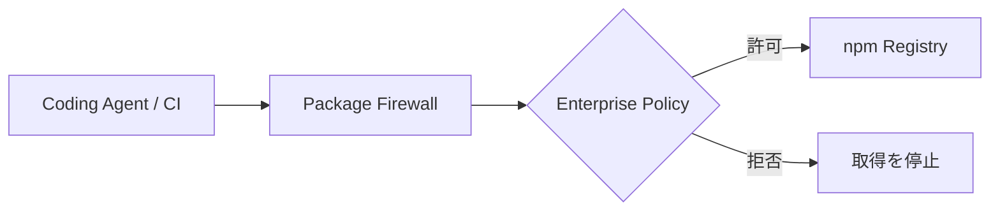
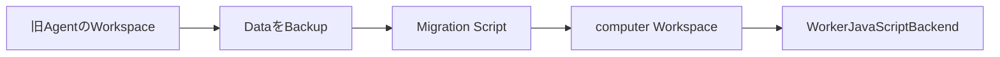
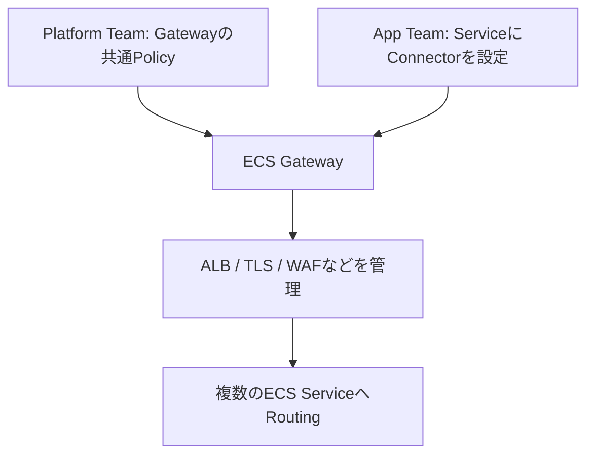

今日は**GitHub Package FirewallのPublic Preview、TorchNeuronのPyTorch統合、Construct 3 r507の3D衝突判定**を中心に、AI・ゲーム開発・Developer Tools・Securityの新情報を10本まとめます。

10月20日に公開された一次情報を優先し、直近の記事と重なる発表は避けました。**公開状態、互換性、実装時に検証すべき点**を区別し、単なる機能一覧ではなく「何が変わり、なぜ重要か」を説明します。

---

## 1. GitHub Package FirewallがPublic Preview — npmのインストール経路で悪意あるPackageを遮断

**10月20日｜サプライチェーン防御・CI・Coding Agent**

[GitHubの公式発表](https://github.blog/changelog/2026-10-20-github-package-firewall-in-public-preview/)で、**Package FirewallのPublic Preview**が始まりました。依存ライブラリの脆弱性を後から見つけるだけでなく、Packageを取得する**インストール時点の通信経路**へ検査を挟む機能です。悪意あるPackageのInstall ScriptがCI Runnerや開発端末のCredentialを抜き取る攻撃では、Applicationを起動する前に被害が発生するため、この段階で止める意味があります。

管理者はEnterprise単位でPolicyを設定します。選べる項目には、公開直後のPackageを一定期間待つ**Cooldown**、GitHub Advisory DatabaseのMalware・Vulnerability情報の照合、署名・Attestationが以前より弱くなっていないかのSupply Chain Checkがあります。AgentやCIは通常のRegistryへ直接アクセスする代わりにFirewallを経由するよう設定し、Metadataの照会とPackageのDownloadの双方を検査します。誤判定時には例外を申請するWorkflowも用意されます。

この機能は現時点で**npm Packageのみ**が対象で、GitHub Enterprise Cloud（Data Residencyを含む）向けです。Preview中は無料ですが、GA後はActionsと同様に利用量に基づく課金を予定しています。Node.js系以外のRegistryまで防げるわけではなく、Registryへ直接出られるNetwork経路が残っていれば回避できる点にも注意が必要です。

> [!WARNING]
> **Public Previewかつnpm限定**です。導入前に対象Endpointと例外申請の運用を確認してください。

**開発者目線:** 依存追加をAgentに任せる環境では「コードをReviewする前にInstall Scriptが動く」という時間差がリスクです。Firewall、Lockfile固定、CI Secretの最小権限、Build Environmentの隔離を組み合わせ、**依存取得を信頼境界として扱う**設計が重要になります。

---

## 2. TorchNeuronがPublic Beta — PyTorchをTrainiumの標準Deviceとして扱う

**10月19日発表・20日公開｜AI Accelerator・PyTorch**

[PyTorch公式Blog](https://pytorch.org/blog/introducing-torchneuron-native-pytorch-backend-for-aws-trainium/)と[AWSの発表](https://www.aboutamazon.com/news/innovation-at-amazon/torchneuron-pytorch-aws-trainium-chips-ai)によると、**TorchNeuron**が10月20日にPublic Betaとして公開されました。AWS独自のAI AcceleratorであるTrainium2・Trainium3を、PyTorchの通常のDeviceと同じ感覚で扱うためのBackendです。Open SourceのLicenseはApache 2.0です。

PyTorchには、Hardware固有の処理を外部から登録する`PrivateUse1`という拡張点があります。TorchNeuronはこれを利用し、Modelを`model.to('neuron')`で配置できるようにします。即時にOperationを実行してDebugしやすい**Eager Mode**と、Graphをまとめて最適化する`torch.compile(model, backend="neuron")`の両方に対応。`torch.nn`や`torch.distributed`など標準APIとの整合性を重視しています。

Compiler経路ではTorchDynamoで取得したGraphをTorch-MLIR・StableHLOなどを経てNeuron向けの実行形式に変換します。大規模学習ではFSDP2、Tensor Parallelism、Pipeline Parallelism、DeviceMeshといった分散処理の仕組みを利用可能です。`torch.profiler`とNeuron Explorerで、Python側の呼び出しからHardware実行まで追える点も実務上大きな変更です。

| 実行方法 | 特徴 | 主な用途 |
| --- | --- | --- |
| Eager | 逐次実行・Breakpointを使いやすい | 研究・Debug |
| Adaptive Eager | 実験的に実行効率を改善 | 試行錯誤 |
| torch.compile | Graphを最適化して実行 | 安定したTraining・Serving |

> [!WARNING]
> **Public Beta**です。対応Operator・精度・Compile時間・Memory使用量はModelによって異なり、GPU向けのCodeが無条件で同じ性能になることは保証されません。

**開発者目線:** 新しいAI Chipを試すための「Modelを全面的に書き直す費用」を下げる更新です。比較ではToken当たりCostだけでなく、Compile時間、Operatorの互換性、Profilerの使いやすさ、Distributed Trainingの障害時復旧まで評価したいところです。

---

## 3. Construct 3 r507 Beta — Z軸を考慮した3D衝突判定とOPFS保存

**10月20日｜ゲームエンジン・Web Platform**

[Construct 3公式Release Notes](https://www.construct.net/en/make-games/releases/beta/r507)で、**r507 Beta**が公開されました。従来のConstructは3D表示を利用していても、`On collision`や`Is overlapping`の判定が実質2Dで、Z軸を無視していました。今回、**Z軸を含めた3D衝突判定**に初めて対応し、上下に重なった物体を別の高さとして扱えるようになりました。

ただし現段階の3D Modelは厳密なMesh同士の衝突ではなく、**3D Bounding Box**での判定です。3D回転、3D Shapeの形状設定、2D SpriteのCollision Polygonも考慮されます。従来のGameが急に挙動を変えないよう、Projectの`Collision mode`でOpt-inする設計になっています。新規Projectでは3D Collisionが既定で有効になり、First Person PlatformerのSampleも新しい判定方式へ変更されました。

もう一つ興味深いのは、File System ObjectがBrowserで**Origin Private File System（OPFS）**を使えるようになった点です。`current-app-data`というPicker Tagを指定すると、OSのFile Pickerを利用できないBrowserでも、Originに紐付いた内部領域へFileを保存できます。Desktop版にExportしたときはApplication専用Data Directoryへ保存するため、同じ抽象APIを複数Platformで使えます。

3D ModelにはMorph Target AnimationやImport改善が入り、WebGPUで3D LightingとEffectを併用したときの画面表示不具合も修正されました。`Is supported`がOPFS対応Browserで新たに真になるため、File Pickerの有無を知りたい場合は`Pickers supported`を使う必要があります。

> [!WARNING]
> **Beta版**です。3D Collisionは既存の2D Collisionと判定結果が異なるため、移行時はJump、Trigger、接触Eventを回帰確認してください。

**開発者目線:** 3D Collisionを後付けしながら互換Modeを設ける設計は、Game Engineの破壊的変更を小さく導入する参考例です。OPFS対応も「OSごとにFile APIを作る」負担を減らす方向で、Browser GameのEditorやSave Dataに応用できます。

---

## 4. Cloudflare Thinkがcomputer Workspaceへ移行 — Agent実行環境を統一

**10月20日｜Agent Framework・Execution Sandbox**

[Cloudflare公式Changelog](https://developers.cloudflare.com/changelog/post/2026-10-20-think-computer-workspace/)で、**ThinkとAgent Skillsが`@cloudflare/computer`のWorkspaceを利用する方式**へ移行したと発表されました。AgentがFileを読み書きし、Codeを実行する際の環境をまとめて扱うための変更です。JavaScriptの実行は`WorkerJavaScriptBackend`をWorkspaceへ登録する方式になりました。

以前は`@cloudflare/shell`やThinkの`createExecuteTool`が使われていましたが、これらは**Deprecated**となり、今後の開発・Supportを終了します。単なるImport名の変更ではなく、Agentの持つWorkspaceを新しいBackendで構成する必要があります。例えば`Workspace`にStorageとBackendを渡し、JavaScript実行用のLoaderを結び付けることで、Think側からFile SystemとExecution環境を利用できます。

重要なのは**保存Dataの互換性がない**ことです。`@cloudflare/computer`は`@cloudflare/shell`とは異なるDatabase TableへFileを保存します。自動Migrationは行われないため、そのまま更新すると新しいAgentからはWorkspaceが空に見えます。旧Data自体は残っていますが、継続して使うには[公式Migration Script](https://github.com/cloudflare/agents/blob/main/packages/think/scripts/migrate-shell-to-computer.ts)などの手順を確認し、移す必要があります。

> [!WARNING]
> **Breaking Change**です。Migration前に保存DataのBackupと復旧手順を準備し、Scriptの参照先や実行条件は公式Repositoryで再確認してください。

**開発者目線:** AgentのContextは会話だけでなく、File、作業途中のArtifact、実行状態も含みます。Agent Frameworkの更新ではAPI互換性に加えて**永続WorkspaceのSchema Migration**を独立したTest項目として扱うべきだと分かる変更です。

---

## 5. Wrangler 4.150.0でSource Mapが既定Upload — WorkersのStack Traceを原文に戻す

**10月20日｜Cloud Debugging・TypeScript**

[Cloudflare公式Changelog](https://developers.cloudflare.com/changelog/post/2026-10-20-source-maps-on-by-default/)によると、**Wrangler 4.150.0**から`wrangler deploy`、`wrangler versions upload`、`wrangler preview`でSource Mapの生成・Uploadが既定で有効になりました。`cf deploy`も既定Uploadへ変更され、Cloudflare Vite Plugin 1.64.0以降ではWorker BuildのSource Map生成も標準になります。

TypeScriptやBundle後のJavaScriptは、実行時のFile名・行番号が元のSourceと異なることがあります。Source Mapは生成Codeの位置と元Codeの位置を結び付けるMetadataで、ErrorのStack Traceを**元のTypeScriptの行番号へ対応付ける**ために使われます。Workers Logs、Realtime Logs、Tail Workers、Workers Issuesで変換後のStack Traceが表示されます。

変換はWorker実行後のLog処理で行われるため、Cloudflareは**CPU時間、Bundle Size、Cold Startには影響しない**と説明しています。一方でUpload対象のArtifactが増えるため、Source Codeの扱いに関する組織Policyは確認が必要です。独自Buildで生成した外部Source Mapも探索しますが、Inlineの`data:` URLなど解決できないものは既定でSkipされます。厳格に失敗させたい場合は`upload_source_maps: true`、無効化したい場合は`false`を指定します。

| 設定 | 動作 | 向いている状況 |
| --- | --- | --- |
| 既定 | Source Mapを生成・Upload | 普通の開発・運用 |
| true | 解決できないMapがあると失敗 | Artifactの完全性を重視 |
| false | Uploadを無効化 | 制限の厳しいEnvironment |

**開発者目線:** Source Mapの手動設定を省けることで、障害時の調査開始までの時間が短くなります。ただし便利なDebug情報も運用上はArtifactです。Build PipelineでSource Mapの生成場所、保持期間、閲覧権限を明確にしておくと安心です。

---

## 6. Amazon ECS Gateway登場 — ALBと証明書の管理をService単位から分離

**10月20日｜Container・Ingress・Platform Engineering**

[AWS公式Blog](https://aws.amazon.com/blogs/aws/introducing-amazon-ecs-gateway-a-fully-managed-ingress-solution-for-ecs-services/)が**Amazon ECS Gateway**を発表しました。ECSでWeb Serviceを公開するには、従来Application Load Balancer（ALB）、TLS Certificate、Security Group、DNS、必要に応じてWAFなどをServiceごとに調整する必要がありました。Gatewayはそれらを**Account Levelの入口設定**としてまとめ、Service側の構成を簡素化します。

Platform TeamはGatewayを作り、Subnet、Security Group、TLS、Listener、WAFなどの標準を設定し、ECS Clusterへ関連付けます。Application TeamはService作成・更新時に**Gateway Connector**を指定するだけで、必要なCertificate、固有Hostname、Listener Rule、Target Group、Service Security GroupをECSに作成させられます。ResourceはユーザーのAWS Account内に作られるため、管理責任がすべて消えるわけではありません。

1つのALBは**最大25 Service**で共有でき、最初のService接続時にALBを作成し、Capacityが足りなくなれば追加、不要になれば削除するLifecycle管理を行います。Gatewayは最大10,000 Clusterへ関連付けられ、1つのClusterには最大5 Gatewayを関連付けられます。PublicとVPC内部向けを分ける設計も可能です。ただしGateway作成後はVPC、Subnet、Listener ProtocolやPortなど一部設定を変更できません。

**開発者目線:** Application TeamがIngressの専門知識を毎回必要としない**Platform APIの設計**として興味深い発表です。導入時は便利さだけでなく、共有ALBの障害影響、Cost Allocation、IAM境界、変更不可設定の運用を評価したいところです。

---

## 7. Dependabot Alert APIにversion_requirement — 影響を受けた依存Versionを直接取得

**10月20日｜Dependency Security・REST API**

[GitHub公式Changelog](https://github.blog/changelog/2026-10-20-dependabot-alerts-rest-api-now-includes-dependency-versions/)で、Dependabot AlertのREST APIに**`dependency.version_requirement`**が追加されました。これまでもAdvisoryが示す「脆弱なVersion範囲」は返されましたが、Repository側で**実際にどのVersionを参照しているか**は別途Lockfileを解析するか、GraphQLの`vulnerableRequirements`を取得する必要がありました。

新しいFieldは検出経路によって意味が変わります。Lockfileから検出した場合は**解決済みのVersion**、LockfileのないManifestなら**宣言されたVersionまたは範囲**、Dependency Submission APIからなら**Build Toolが報告した解決済みVersion**です。単純なStringとして扱うだけでは、固定VersionなのかVersion Rangeなのかを見誤る可能性があります。

`version_requirement`はAlert単体の取得、Repository・Organization・Enterpriseの一覧、`dependabot_alert` Webhook Payloadで利用できます。ただし不明な場合は`null`になり、一つのAlertが複数Versionを対象とする場合は**記録された値の一つだけ**を返すことがあります。長いConstraintは省略される場合もあるため、Inventoryの唯一の正解と決めつけるのは危険です。

| 検出元 | 返る値 | 使い方の注意 |
| --- | --- | --- |
| Lockfile | 解決済みVersion | 現在の依存状態の把握 |
| Manifestのみ | 宣言されたVersion/範囲 | 実際のInstall結果とは異なる可能性 |
| Dependency Submission | Toolが報告したVersion | Submissionの更新時点に依存 |

**開発者目線:** 脆弱性Alertを独自DashboardやTicketへ同期する実装が簡単になります。とはいえ`null`やRangeを扱えるSchemaにし、Alertの更新時刻・Lockfileとの照合結果も保持しておくと、古い状態のまま誤った修正案を出すことを防げます。

---

## 8. GitHubがBranch ProtectionをRulesetへ一括移行できるように

**10月20日｜Repository Governance・Branch Policy**

[GitHub公式発表](https://github.blog/changelog/2026-10-20-bulk-migrate-branch-protections-to-rulesets-for-a-repository/)で、Repositoryの既存Branch Protection Ruleを**まとめてRulesetへ変換**できるようになりました。以前からRule単位の変換は可能でしたが、複数のRuleを抱えるRepositoryでは、移行後の組み合わせを一つずつ確認する必要がありました。今回の変更はその移行作業をまとめて進められるものです。

Repositoryの`Settings → Rulesets`から`Import branch protection rules`を選ぶと、作成されるRulesetを事前にPreviewできます。すでに存在するRulesetで覆われているRuleや、一つの旧Ruleが複数のRulesetへ分かれるCaseも表示されます。`Active`、`Evaluate`、`Disabled`のEnforcement Statusを選び、移行後に元のBranch Protection Ruleを残すか削除するかも指定できます。

RulesetはBranch名のPattern Matching、複数Ruleの重ね合わせ、Organization・Enterprise単位の共通Policy、User・Team・GitHub Appごとの細かいBypass Permissionなどを扱えます。つまり単なる画面移動ではなく、**Branchを保護するPolicyをどの単位で管理するか**という責務の見直しにもつながります。対象はRulesetが利用可能なRepositoryです。

移行を一度に実施すると、意図しないMerge BlockやBotのPush失敗が起きる可能性があります。まず`Evaluate`でRuleの判定結果を見て、CI Bot・Release Branch・緊急修正の例外を確認してから`Active`へ切り替える進め方が安全です。

**開発者目線:** 「ルールの数を減らすこと」よりも**意図が説明できるPolicyに統合すること**が重要です。移行前後でPRのMerge条件、Force Push禁止、Required Check、Bypass権限を表にして差分を確認すると、運用事故を避けやすくなります。

---

## 9. Dependabotがnpm 12・pnpm 11/12・Bun 1.4のLockfile更新に対応

**10月20日｜Package Manager・自動Dependency更新**

[GitHub公式Changelog](https://github.blog/changelog/2026-10-20-dependabot-now-supports-npm-12-pnpm-11-and-12-and-bun-1-4/)で、Dependabotが**npm 12、pnpm 11・12、Bun 1.4**のPackage Managerに対応したと発表されました。これらを採用したRepositoryでも、DependabotによるDependencyのUpdate PRを継続して受け取れるようになります。

Package Managerを更新すると、単にCLIのVersionが変わるだけでなく、**Lockfileの形式や解決アルゴリズム**も変わることがあります。Dependabotがその形式を理解していないと、古いLockfileを生成したり、更新PRを作れなくなったりする可能性があります。今回の対応は最新のToolchainと自動更新を両立させるための追従です。特にpnpmのMajor Versionを上げる場合、WorkspaceやPeer Dependencyの解決結果がどう変わるかが重要になります。

公式発表はSupportの追加を告知するもので、すべてのProjectでLockfileの差分が完全にゼロになるという意味ではありません。`packageManager` Field、CIで実際に使うVersion、Dependabotの更新設定を揃え、**同じLockfileを複数VersionのCLIが交互に書き換えない**ようにする必要があります。

安全な移行手順としては、まずToolchain Versionを固定し、Lockfileを更新してBuild・Testを通し、その後DependabotのPRで不要な大量差分が出ないか確認します。複数のWorkspaceを持つMonorepoでは、DependencyのUpdate GroupingとCI Cache Keyも合わせて点検すると効果的です。

**開発者目線:** Dependencyの更新自動化は、一度設定すれば永久に動くものではありません。**Package ManagerとDependabotの対応Versionを同時に管理**することが、Security Patchを継続して取り込むための地味ながら重要な条件です。

---

## 10. GitHub Secret Scanning更新 — Base64化Token失効と監査Logの仕様変更

**10月20日｜Secret管理・監査・Webhook**

[GitHub公式Changelog](https://github.blog/changelog/2026-10-20-updates-to-github-secret-scanning/)で、Secret Scanningに複数の改善と仕様変更が案内されました。特に重要なのは、**Base64でEncodeされたGitHub Tokenの自動失効対応**が拡張されたことと、**11月12日にAudit LogのField形式が変更される**という予告です。

Private・Internal RepositoryでSecret Scanningを有効にしている場合、Public Preview中のToken Revocation機能が、EncodeされたClassic PAT、Fine-grained PAT、OAuth Access Token、GitHub App User Access Tokenを扱えるようになりました。単純なPlain Text一致だけでは見つけにくいTokenもDecodeして処理します。ただし「Base64なら必ず検知する」「全種類のSecretを失効させる」という意味ではありません。

11月12日からは、`secret_scanning_alert.*`と`secret_scanning_push_protection.bypass`のAudit Log Eventにある`business` Fieldが、Enterpriseの表示名ではなく**Slug**を返すようになります。表示名でFilterしているIntegrationは、移行期間に両形式を受け入れるか、変化しない`business_id`へ切り替える必要があります。Event名や数値の`business_id`は変更されません。

ほかにCustom Patternを変更した後の再ScanでOpen Alertを不用意にClose・Reopenしない修正、Dismissal RequestのWebhookへ`exemption_request.number`を追加する変更、Invalid Argument時のError Codeを`500`から`422`へ正す改善が含まれます。運用自動化の観点では、小さなResponse差分でもMonitorやAudit集計に影響します。

> [!WARNING]
> **11月12日のField変更は将来予定**です。現時点で切り替わったと決めつけず、Event Payloadの互換性を先に確認してください。

**開発者目線:** Secret漏えい対策は検出精度だけでなく、**WebhookとAudit Logを使う周辺Automationの継続性**も重要です。Fieldの表示名に依存せず安定したIDで照合し、Error Codeの変化をTestに反映することで、セキュリティ機能の改善を安全に取り込めます。

---

## 👀 今日ならこの3つ

### 🥇 GitHub Package Firewall — Install前に依存を止める

Coding AgentやCIがPackageをDownloadする時点でPolicyを適用できるのが重要です。従来の「脆弱性を発見してから修正」とは別の防御層で、Supply Chain攻撃への現実的な対策になります。

### 🥈 TorchNeuron — AI Chipを替えるときの移植Costを下げる

PyTorchの標準APIを維持しつつ、TrainiumでEager・Compile・Distributed Trainingを扱う設計が面白いところです。性能比較だけでなく開発体験の移植性にも注目したい発表です。

### 🥉 Construct 3 r507 — 3D Collisionと互換性を両立

既存の2D Collisionを壊さずにZ軸を導入するCompatibility Settingと、Browser・Desktopで同じ保存APIを扱うOPFS対応が、Engine設計の参考になります。

---

## 📊 今日の技術トレンド

**共通するのは「既存の開発フローを変えずに、安全性と移植性を高める」方向**です。GitHubは依存取得と監査、CloudflareはAgentのWorkspaceとDebug、AWSはAI AcceleratorとContainer公開の複雑さを抽象化しました。一方、BetaやPreviewには互換性の制約があるため、導入前の小さな検証は引き続き欠かせません。
