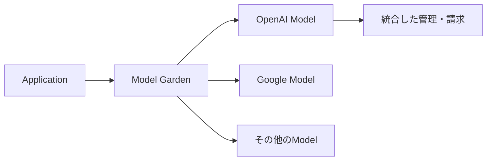
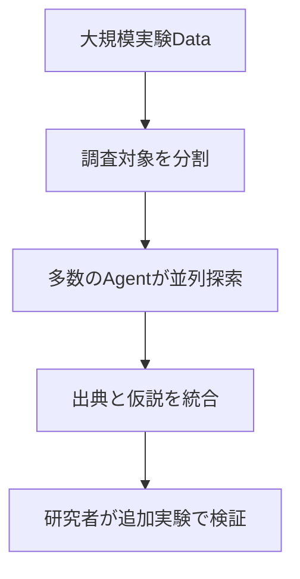

今日は**PHPのSecurity Update、OpenAIモデルのGoogle Cloud展開、数千Agentによる研究、Node.jsの修正版**など、10月19〜21日の一次情報を中心に10本紹介します。大きな発表だけでなく、日々の開発と運用で役立つ小さな更新も取り上げました。

過去7日間のニュースとの重複を避け、研究と製品、PreviewとGA、公称結果と実運用での確認事項を区別して説明します。

---

## 1. PHPの重大Security Update — 8.2〜8.5系列に修正版

**10月21日｜Web開発・Security**

[PHP公式の発表](https://www.php.net/archive/2026.php#2026-10-21-5)によると、複数のサポート対象系列に重大なSecurity Updateが公開されました。修正版はPHP 8.5.12、8.4.27、8.3.36、8.2.35です。これは機能を増やすための更新ではなく、既存のWeb Applicationを安全に動かすための重要な修正です。利用しているPHPの系列と、実際に稼働しているBinaryのVersionを確認する必要があります。

PHPの更新はApplicationが依存するLibraryの更新とは別の問題です。たとえばContainerを使っている場合、Composerの依存関係だけを更新しても、Base ImageのPHPが古いまま残ることがあります。Package Managerが新しいVersionを取得していても、Web ServerやProcessを再起動しなければ旧Versionが動き続ける構成もあります。**「更新したつもり」と「本番のProcessが修正済み」は違う**という点が重要です。

[Cloudflareの公式解説](https://blog.cloudflare.com/php-vulnerabilities-waf-protection)では、関連する脆弱性へのWAFによる防御について説明しています。ただしWAFはRuntime自体を更新する仕組みではありません。複数の環境で同じApplicationを動かしている場合は、開発環境、検証環境、本番環境のそれぞれで修正版の適用状況を追跡してください。古いPHP系列の運用を継続する場合は、今後のSupport期限も考慮する必要があります。

| 系列 | 修正版 | 確認対象 |
| --- | --- | --- |
| PHP 8.5 | 8.5.12 | Runtime・Image |
| PHP 8.4 | 8.4.27 | Package・Server |
| PHP 8.3 | 8.3.36 | Deploy先の実行環境 |
| PHP 8.2 | 8.2.35 | 更新とSupport計画 |

**開発者目線:** Security Updateを確実に届けるには、Source Codeだけでなく**実行環境のVersionを一覧化し、Buildから本番まで追跡する**仕組みが重要です。CIでRuntimeのVersionを記録し、Deploy後の稼働Versionを確認できる運用が役立ちます。

---

## 2. OpenAIのFrontier ModelがGoogle Cloudへ — 提供は段階的

**10月21日｜AI Model・Cloud Platform**

[OpenAI](https://openai.com/index/openai-models-google-cloud/)と[Google Cloud](https://cloud.google.com/blog/products/ai-machine-learning/google-cloud-brings-openai-models-to-customers)は、OpenAIのModelとCodex WorkflowをGoogle CloudのModel Gardenから利用できるようにする提携を発表しました。企業がすでに使っているCloudの管理基盤を維持しながら、異なるVendorのAI Modelを選択するための経路が増えることになります。

Google側の発表ではGPT-6 Astra、GPT-6.1 Sol、GPT-6 Lunaを対象に挙げています。**10月21日時点では選ばれた企業向けのPrivate Preview**で、一般提供は今後数週間を予定しています。発表を読んで、すべてのGoogle Cloud利用者が今日から利用できると判断しないことが重要です。Google AntigravityやGemini Agentへの統合も、今後の展開として説明されています。

企業向けの意義はModelの選択肢だけではありません。Google Cloud Marketplaceを通じた購入、既存のCloud支出Commitmentの活用、IdentityとAuditの統合など、調達とGovernanceを一本化しやすくなる点があります。一方で、Data RetentionやRegion、料金、利用制限は契約と提供段階によって異なるため、OpenAIの既存APIと同じだと推測すべきではありません。

> [!WARNING]
> **Private PreviewとGAは異なります。** 契約条件やModelの利用可能性を、正式な利用案内で確認してください。

**開発者目線:** AI Applicationを設計する際、Modelの性能だけでなく**請求・権限・監査・差し替え可能性**を評価する重要性が高まります。Providerを抽象化しつつ、実際のLatencyと出力品質をModelごとに測る構成が有用です。

---

## 3. 数千のAI Agentが脳細胞の研究データを32分で解析

**10月21日｜AI研究・Multi-Agent**

[OpenAIの研究報告](https://openai.com/index/scaling-ai-research-for-complex-biological-data/)は、PerturbAI、Scripps Researchとの共同研究で、数千のAI Agentを並列に動かし、数百万のマウス脳細胞に関する実験データを**32分で解析した**と紹介しています。GPT-Rosalindを使うAgentが遺伝子操作の影響を調べ、既存の研究文献との関係を探して、研究者が次に検証すべき仮説をまとめました。

研究の対象はCRISPRによる遺伝子操作と細胞の反応を記録した大規模なAtlasです。一人の研究者や一つのAgentがすべての変化を順番に調べると、見落としが増えたり探索範囲が狭くなったりします。今回の方式では**遺伝子操作単位に仕事を分割**し、各Agentが文献探索と解釈を担当します。個別のReportを統合して、実験結果、文献、考えられる生物学的な仕組みを結び付けました。

研究チームの比較では、大きなWorkloadにおいて単一Agentの引用文献が11件だったのに対し、分散Agent群は700件超を引用したと報告しています。Blind評価では専門家が分散方式のReportを選んだ割合が75%でした。ただし、これらは研究チームが設定した条件での結果であり、すべてのTaskで同じ改善が得られるわけではありません。

また、Agentが示した関係は**新しい治療法の証明ではなく、追加実験の候補**です。研究者による確認と再現性の検証が必要になります。

**開発者目線:** 大規模なCodebase調査やLog解析でも、仕事を独立した単位に分割し、**根拠付きの結果を最後に統合する**構成が参考になります。Agent数だけでなく、分割方法と統合品質を評価したい事例です。

---

## 4. Node.js 22・24・26でSecurity Release — Runtime更新が必要

**10月21日｜JavaScript Runtime**

[Node.js公式のSecurity Release案内](https://nodejs.org/en/blog/vulnerability/october-2026-security-releases)によると、Node.js 26.12.1（Current）、24.22.1（LTS）、22.23.4（LTS）が公開されました。今回は新しいJavaScript構文やAPIの追加が中心ではなく、TLS、DNS、Compressionなどの安全性を改善する更新です。Serverだけでなく、Build ToolやCIが利用するNode.jsにもVersion管理が必要です。

[Node.js 26.12.1のRelease Notes](https://nodejs.org/en/blog/release/v26.12.1/)には、IP Addressの正規化、DNS入力のValidation、HTTP Agent、Random Cache、Permission Modelなどに関する修正が挙げられています。SeverityはHighからLowまで複数あり、すべての問題が同じ条件で影響するわけではありません。利用している系列のRelease Notesを確認して適用を判断することが大切です。

[24.22.1のRelease Notes](https://nodejs.org/en/blog/release/v24.22.1/)では、Root Certificateやc-aresなどのDependency Updateも確認できます。Node.jsはApplicationの外部通信やCertificate検証に関わるため、Runtimeの更新後にはTLS接続、DNS解決、Native Addon、Build Scriptなどをまとめて検証すると安心です。複数のNode.js Versionを使い分けているRepositoryでは、開発用とCI用でVersionが異なっていないかも確認したいところです。

> [!IMPORTANT]
> **Lockfile更新とRuntime更新は別の作業**です。`package.json`だけでなく、Container Imageや`setup-node`のVersion指定も確認してください。

**開発者目線:** Node.jsのSecurity Updateは、アプリケーションのCode Reviewだけでは把握しきれない変更です。Build Logに`node --version`を記録し、**Runtimeの更新がどの環境へ反映されたかを追跡できる状態**にしておくと、運用時の判断が速くなります。

---

## 5. Cloudflare Agents SDKにcreateAI — Providerの入口を統合

**10月21日｜AI SDK・Cloudflare**

[Cloudflareの公式Changelog](https://developers.cloudflare.com/changelog/post/2026-10-21-createai/)で、Agents SDKに**`createAI`関数**が追加されました。従来はWorkers AI用の`workers-ai-provider`とAI Gateway用の`ai-gateway-provider`が分かれていましたが、Modelの取得、Gatewayの選択、Fallbackなどを一つの入口へ統合します。旧Providerは機能凍結され、Deprecatedと明示されました。

`createAI({ binding: env.AI, id: "my-gateway" })`のようにProviderを作り、Workers AIのModel ID、AI Gateway Catalog、Dynamic Route、Vendor固有のModel Objectなどを扱えます。Worker内のAI Bindingだけでなく、Account IDとAPI Tokenによる外部利用もサポートします。**Modelを使う側のApplication Codeを、Providerの細部から切り離す**ことが目的の一つです。

Caching、Logging、Retry、Metadata、Fallback、BYOKなどのOptionも提供されます。AI SDK ProviderではEmbedding、Image、Speech、Transcription、Rerankingも対象です。Streamingが途中で切れた場合に再開できる仕組みも案内されています。ただしAI Searchについては別の`ai-search-provider`を使う構成へ変わるため、旧APIから移行する場合は一律の置換では済みません。

| 以前のAPI | 新しい入口 |
| --- | --- |
| `createWorkersAI` | `createAI` |
| `createAiGateway` | `createAI` |
| `createAISearch` | `createAISearchNamespace` |

> [!WARNING]
> **Deprecatedは即時停止を意味しません**が、新規の機能追加は旧Providerへ行われません。移行時にはAuthenticationとStreamingの回帰テストが必要です。

**開発者目線:** AI Agentが複数のModelを使う場合、FallbackやCost管理を共通の場所に集められる利点があります。一方で抽象化によってVendor固有の挙動が隠れるため、**実際のResponseとError HandlingをModelごとに検証**することが重要です。

---

## 6. GitHub CLI 2.103.0が短命OAuth Tokenの自動更新に対応

**10月21日｜CLI・認証**

[GitHub公式Changelog](https://github.blog/changelog/2026-10-21-github-cli-opt-in-to-expiring-auto-refreshing-oauth-tokens/)によると、GitHub CLI `gh`のVersion 2.103.0で、期限付きAccess TokenとRefresh Tokenを使う認証が**Public Preview**として利用可能になりました。長期間有効なCredentialに比べ、Access Tokenが漏れた場合に利用できる時間を短くできる仕組みです。

`gh auth login --expiring`で有効化でき、`gh config set expiring_credentials enabled`を設定すると以後のLoginで選択できます。`gh auth status`では現在のCredentialの状態を確認できます。`gh`が必要に応じてRefreshするため、通常のCLI操作では頻繁に再認証する必要がありません。ただし既存のLoginは自動変更されず、**Opt-inしなければ従来方式のまま**です。

Git over HTTPSでも短命Tokenを使う場合、GitHubは`gh auth setup-git`で`gh`をCredential Helperに設定することを推奨しています。Git 2.46以降なら期限切れCredentialのCacheを避ける仕組みが利用できます。対応環境はgithub.comとghe.com、GitHub Enterprise Serverでは3.23以降です。未対応Serverでは従来方式へFallbackします。

> [!WARNING]
> `gh auth token`の出力を一度だけ取得し、長期間使い回すScriptは**期限切れによる失敗**が起こり得ます。必要な時点で取得する設計へ変更してください。

**開発者目線:** Secretの安全性は保存先だけでなく**有効期限とRefreshの責務分担**で決まります。認証処理を専用Toolに任せ、ApplicationやScriptがTokenを長期保存しない設計は、CIや開発Toolでも参考になります。

---

## 7. Gemini 4 Argonの4体AgentがMinecraftを27時間で自律攻略

**10月15日論文・10月21日前後に注目｜Game AI・長時間Agent**

[研究者の論文](https://arxiv.org/abs/2610.22319)では、4体のGemini 4 Argon AgentがMinecraftのSurvival WorldでEnder Dragonを倒すまでの工程を自律的に実行した実験が報告されました。論文の初回投稿は**10月15日**であり、10月21日の新発表ではありません。Agentは公開LibraryのMineflayerを通じてPlayerを操作し、Game内Chatと共有Memoryで協調しています。

開始地点はRandom生成されたWorldで、難易度はEasy。研究者によれば、攻略時間は**27時間14分**、生成したProgramは**2,783本**、死亡回数は**605回**でした。AgentはResourceの収集、探索、装備の準備などの作業を自分たちで分担し、失敗した場合は情報や持ち物を回復しながら続行しました。人間が攻略用の専用Programを事前に書いて渡す方式とは異なります。

この実験で注目したいのは、Game操作の反射神経よりも**長い工程を一貫した計画で進める能力**です。数千の操作が依存するTaskでは、途中で得た情報を次の判断へ引き継ぐ必要があります。さらに複数Agent間で役割が重複したり、失敗したAgentの作業が止まったりする問題も扱わなければなりません。StatefulなGame環境は、こうした能力を可視化しやすい題材です。

ただし成功したのは特定のWorldとTool構成での実験です。すべての条件で同じ結果が得られることや、現実の開発Projectでそのまま同等の性能を発揮することを意味しません。**成功までの時間と試行錯誤の多さ**も重要な評価情報です。

**開発者目線:** Agentを長時間動かす仕組みでは、最終的な成功だけでなく、**途中状態の保存・再開・失敗からの復旧・作業分担**を測る必要があります。Game EngineをAgentの検証環境として使う価値がよく分かる研究です。

---

## 8. OpenAIがCOBOLなど低資源言語のCoding Benchmarkを公開

**10月19日｜AI Coding・Legacy移行**

[OpenAIの研究発表](https://openai.com/index/low-resource-programming-languages/)では、COBOL、Fortran、Visual Basicなど、公開CodeやDocumentationが比較的少ない言語におけるCoding能力の改善が紹介されました。注目は、単純なCode生成の正確さだけでなく、**動作するSoftwareを構築できるか、既存Programの振る舞いを維持して移行できるか**を評価している点です。

`MultiLangBench`は、20種類の言語でSQLite互換のDatabase Engineを実装する課題です。候補Programに初期DatabaseとSQL Queryを渡し、処理後のDatabaseをSQLiteの参照実装と比較します。言語が違っても共通の入出力でTestできるようにしており、Modelが長い実装工程を進める能力を測ります。OpenAIの公称値ではGPT-6 Astraの平均Test Pass Rateは87.4%、比較対象のGPT-5.6 Solは26.8%でした。

別の評価ではCOBOL ProgramをC++、Java、Kotlin、Python、Rustへ移行し、出力がByte単位で一致するかを調べます。固定小数点演算の端数処理や欠損Recordの扱いなど、見た目が似たCodeでも動作が異なる問題を検出するためです。GPT-6.1 SolはLow Reasoningで86.6%、高いReasoning設定では97.9%と報告されています。これらは**OpenAIが設定したBenchmark条件での結果**であり、本番移行の成功を保証するものではありません。

> [!NOTE]
> 評価SetupとTest Suiteは研究記事から公開Repositoryを参照できます。実業務での適用時には独自の境界値TestやBusiness Ruleの確認が必要です。

**開発者目線:** Legacy移行では、生成Codeの読みやすさより**観測可能な振る舞いの一致**が優先されます。Golden Master Testと差分実行を用意してからAIに変換を依頼する方針は、他の言語への移行でも有効です。

---

## 9. Cloudflare Basin SQLがOFFSETに対応 — Icebergの検索結果をページ化

**10月21日｜Data Platform・SQL**

[Cloudflareの公式Changelog](https://developers.cloudflare.com/changelog/post/2026-10-21-basin-sql-offset/)で、Basin SQLが**`OFFSET`句に対応**したと発表されました。Basin SQLはBasin Catalogに登録されたApache Iceberg Tableを検索するServerless・Distributed SQL Engineです。今回の更新は大きな新製品ではありませんが、管理画面で大量の結果を少しずつ表示する用途などに直結する機能追加です。

`LIMIT 100 OFFSET 100`のように書くと、先頭の100件を飛ばして次の100件を取得できます。Page Sizeを100にした一覧なら、`OFFSET 0`、`OFFSET 100`、`OFFSET 200`と値を変えてPageを移動できます。公式は**一意なColumnによる`ORDER BY`の併用**を推奨しています。SQLの結果順序を指定しなければ、別のPageで同じ行が重複したり、行が抜けたりする可能性があるためです。

一方、`OFFSET`が大きくなったときのPerformanceには注意が必要です。SQL Engineが飛ばした行を一切処理しなくて済むとは限らず、Query PlanやData量によってはLatencyが増える可能性があります。また検索中にDataが更新されると、Pageの境界が動いて結果がずれる場合もあります。今回の公式発表は**構文の追加**であり、特定のPerformance改善値を保証するものではありません。

| 方式 | 向く用途 | 主な注意点 |
| --- | --- | --- |
| `LIMIT` | 先頭の少数件 | 次Pageの指定 |
| `LIMIT + OFFSET` | Page番号による移動 | 順序と深いPageのCost |
| Keyset Pagination | 大量Dataの順次処理 | 安定した比較Keyが必要 |

**開発者目線:** 小さなSQL構文追加でも、検証Toolや管理UIの実装は簡単になります。実運用では**Sort Keyの安定性とQuery Cost**を測定し、Data量が増えた場合にPagination方式を切り替えられる設計が役立ちます。

---

## 10. Cloudflare One Clientの証明書Chain不具合を修正 — WindowsとmacOS

**10月21日｜Zero Trust・Client Update**

[Windows版の公式Changelog](https://developers.cloudflare.com/changelog/post/2026-10-21-warp-windows-ga/)と[macOS版の公式Changelog](https://developers.cloudflare.com/changelog/post/2026-10-21-warp-macos-ga/)で、Cloudflare One Clientの**2026.7.1384.0**がGAとして公開されました。今回のHotfixは、信頼できるCertificate Chainを構築する際の問題に対応するものです。新機能の追加より、既存の接続が安定して利用できる状態を整える更新です。

Certificate Chainは、Serverが提示するCertificateから中間Certificateを経由し、OSやClientが信頼するRoot Certificateまでの関係を確認する仕組みです。この処理に問題があると、正当なServerでも信頼を確立できず、接続が失敗する場合があります。特に企業のZero Trust構成では、通信の経路やCertificate検証が多層になりやすく、Clientの挙動が業務Applicationの接続性へ影響することがあります。

今回のRelease Notesは修正内容を短く説明するもので、影響する具体的なCertificate構成や発生頻度の詳細までは示していません。そのため、すべてのCertificate Errorがこの更新で解決すると断定することはできません。10月20日にも別VersionのHotfixが公開されているため、管理対象端末のOSとClient Versionを区別して追跡することが大切です。

> [!NOTE]
> 10月21日の発表で確認できる対象は**WindowsとmacOS**です。Linux版など別Platformへの適用状況は、それぞれのRelease Notesで確認してください。

**開発者目線:** Client Updateは新機能がなくても重要です。接続不具合を調べる際には、Applicationだけでなく**OSのTrust Store、Proxy、Zero Trust ClientのVersion**を切り分けると原因を特定しやすくなります。段階的なRolloutとRollback手順も有用です。

---

## 👀 今日ならこの3つ

### 🥇 PHPのSecurity Update

本番のRuntimeを優先して確認したい更新です。Dependencyだけでなく、実際の稼働Processが修正済みVersionであることを確かめる必要があります。

### 🥈 分散Agentによる科学研究

独立した調査を並列化して、出典付きの結果を統合する設計が参考になります。大規模なCode調査などへの応用も考えられます。

### 🥉 Cloudflare Agents SDKのcreateAI

Model選択とGatewayを共通の入口に集める変更です。FallbackやError Handlingをどう管理するか、Agentの設計を見直すきっかけになります。
