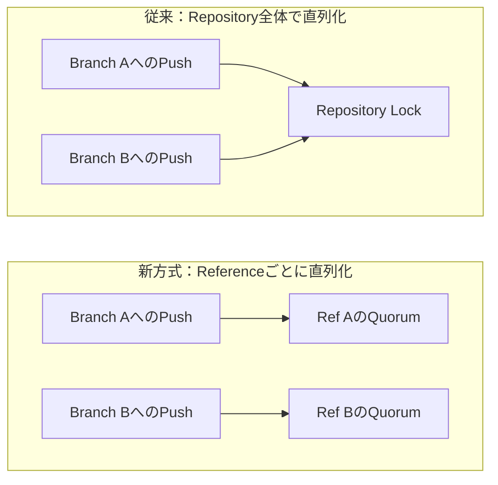
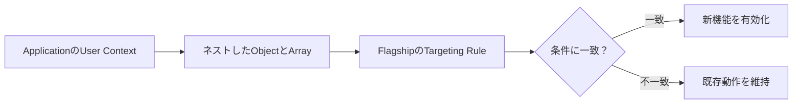

今日は**Unity 6000.6.7f1の安全性・Runtime修正、GitHubのAgent時代のGit基盤、GitHub AppsのEnterprise対応、Cloudflare Flagshipの構造化Feature Flag**を中心に、10本の技術ニュースを取り上げます。発表日の新しいものを優先し、実装・移行・運用で何を確認すべきかまで掘り下げました。

10月17〜22日の既存記事と重複しない話題を選定しました。GitHubの基盤設計など、10月21日の技術解説も見逃したくない一次資料として採用しています。製品の提供段階と公式の公称値は区別して読み解きます。

---

## 1. Unity 6000.6.7f1 — IL2CPP・WebGPU・Profilerの修正とFBX読み込みの安全性強化

**10月21日公開｜Unity 6.6の更新版**

[Unity公式リリースノート](https://unity.com/releases/editor/whats-new/6000.6.7f1)で、Unity 6000.6.7f1が公開されました。大型機能をまとめた新Major版ではなく、6.6系列の更新です。今回注目したいのは、FBXファイルを読むために同梱するAutodesk FBX SDKを2020.3.11へ更新し、FBX解析に関する二つのBuffer Overflow脆弱性へ対応した点です。外部から受け取る3Dモデルは単なる見た目の素材ではなく、Editorが解析する入力データでもあります。Asset Importの安全性が、制作工程のSupply Chain Securityに直結する例です。

Runtime側では、IL2CPPの `Thread.VolatileWrite(ref object, object)` におけるGC Write Barrierの欠落を修正しました。GC Write Barrierは、参照が更新されたことをGarbage Collectorへ正しく伝えるための仕組みです。描画面ではWebGPUの圧縮TextureのMipmapやASTC sRGB形式の対応を修正し、Uniform Buffer・Dynamic Vertex BufferのMemory利用も改善しています。WebGLの中間Color TextureをDevice Native Formatにする最適化も入っていますが、効果の大きさは対象GPUとScene構成に左右されます。

EditorとProfilerでは、Mesh関連のMemoryをより適切に分類し、従来「Unrooted」と表示されていたKernel・Plugin・File Systemの一部Native Allocationに名前付きのRootを与えています。測定の見え方が変わるため、前VersionとProfilerの分類を比較するときは、実際のMemory増減と分類の変更を混同しないことが重要です。uGUIではRectMask2DのSoftnessがゼロでもClip境界がぼける問題、UI ToolkitではEmoji途中でTextFieldのMax Lengthが切られる問題なども修正されました。

> [!WARNING]
> 既知の問題として、特定条件の `SceneManager.LoadSceneAsync` によるScene切り替えでPlayerが停止する問題や、High Polling Rate Mouseを動かしたときのWindows EditorのFrame Rate低下などが引き続き記載されています。すべての不具合が解消した版ではありません。

**開発者目線:** Upgrade判断では、**Asset ImportのSecurity、IL2CPPのGC正しさ、WebGPU描画、Profilerの計測値**を別々の検証項目にするのが有効です。既知問題に該当する操作がある場合は、最新版という理由だけで導入せず、再現Projectと自動Testを用意して差分を測りたい更新です。

---

## 2. GitHubのGit基盤刷新 — Repository単位の書き込みLockをReference単位へ

**10月21日公開｜分散Storage・Agent時代のGit**

[GitHub Engineeringの技術記事](https://github.blog/engineering/architecture-optimization/the-bridge-to-agent-scale-git-infrastructure/)は、急増するAgentによるGit操作を支えるため、Repository Storageを段階的に再設計していることを詳しく説明しました。GitHubはすでに**99.99999%のRepositoryのCopyをAzureに配置**し、Data CenterとCloudの二重配置を進めています。大半のRepositoryでは五つのReplicaを使い、そのうち二つをAzureに置く構成を経て、現在はGit Trafficのおよそ半分をAzureが処理しているとしています。

課題は、一つのRepositoryへの書き込みがRepository全体のLockで直列化されていたことです。複数RegionにReplicaがあると、遅いReplicaの応答待ちが書き込み全体のLatencyへ影響します。記事ではData CenterとAzure間の往復が約25msで、複数往復を要するWriteを順番に処理すると、非常にBusyなRepositoryではQueueが膨らむと説明しています。別々のBranchへ独立にPushするAgent同士が、同じRepositoryというだけで待たされるのは無駄が大きい構造です。

新方式は、**Reference（BranchやTagなど）ごとに書き込みを直列化**します。同じReferenceへの競合は順序を保ちつつ、異なるReferenceの更新を並行処理できます。GitHubの内部Testでは、異なるReferenceへの書き込みで**3〜4倍のThroughput**が確認されました。これは同社の特定条件での測定であり、すべてのRepositoryのPushが同じ倍率で速くなるという保証ではありません。

さらにAzure Blob Storageを永続化先とするVirtual Write ReplicaをQuorumに加え、Read ReplicaはObject StorageからCacheを温めて独立にScaleさせる方向です。ReadはWriteの100〜1,000倍発生するRepositoryもあるため、Read/WriteでCompute資源を分離する効果は大きいと考えられます。構造を簡略化すると次のようになります。

**開発者目線:** 分散Systemの性能問題はCPUの速さだけでなく、**どの範囲を一つのLockで守るか**に大きく左右されます。Gitのように独立した更新が多いWorkloadでは、整合性の単位を必要最小限へ絞る設計が有効です。大量のAgentがBranchを分けて作業するWorkflowを考えるうえでも参考になる実装事例です。

---

## 3. GitHub AppsのEnterprise直接InstallがGA — 管理自動化を短命Tokenへ移行しやすく

**10月23日公開｜GitHub API・権限管理**

[GitHub公式Changelog](https://github.blog/changelog/2026-10-23-enterprise-installations-for-github-apps-generally-available/)で、GitHub Appを**Enterpriseへ直接Installする機能が一般提供（GA）**となりました。従来、EnterpriseやOrganizationの設定をAutomationで操作するとき、Classic Personal Access Token（PAT）や人間のAccountに依存したCredentialが必要になる場面がありました。今回、Enterprise管理用APIとApp権限の対応が広がり、専用Appを中心に権限を設計しやすくなります。

追加された権限には、EnterpriseのRepository PolicyやRuleset、二要素認証の要求、IP Allowlist、Verified Domain、Enterprise Access Restrictionなどがあります。例えば全Organizationへ共通のRulesetを適用したり、Policyを監査したりするAutomationを、目的に必要な権限だけを付けたAppで実装できます。GraphQLの `EnterpriseOwnerInfo` や `RepositoryRuleset`、Enterprise Rules REST APIなど、対応範囲は具体的なAPI単位で示されています。

重要なのは「Appなら何でも安全」ではなく、**Permissionを必要最小限にすること**です。Enterprise設定のWrite権限は影響範囲が大きく、誤ったAutomationは複数Organizationに波及します。Installation単位のCredentialを使う設計と、実行前のDry Run、操作内容のAudit Log、失敗時のRollbackを組み合わせるべきでしょう。今回の更新はGitHub Enterprise Server 3.24にも提供予定と案内されており、Cloud版とSelf-hosted版で適用時期が異なります。

| 管理方式 | Credentialの管理 | 典型的な課題 |
| --- | --- | --- |
| 個人PAT中心 | 人のAccountやToken更新に依存 | 異動・退職・権限変更の影響 |
| GitHub App中心 | InstallationとPermissionを分離 | Appの権限設計・Auditが必要 |

**開発者目線:** CI/CDや管理ScriptのCredentialを**人間のAccountからService Identityへ切り離す**ことが、継続運用の基本です。移行時は「現在のPATがどのAPIを呼んでいるか」を棚卸しし、必要なApp Permissionへ写像できるか検証するのが最初の一歩になります。

---

## 4. Cloudflare Flagship — Feature Flag判定にネストしたJSONや配列を直接渡せる

**10月23日公開｜Feature Flag・OpenFeature**

[Cloudflare公式Changelog](https://developers.cloudflare.com/changelog/post/2026-10-23-structured-evaluation-context/)で、Flagshipの**Evaluation Contextが構造化Dataに対応**しました。これまではFeature FlagのTargeting条件を作るため、ProfileやTagを平坦なKey-Valueへ変換する必要がある場面がありました。新方式ではネストしたObject、Array、`null` をそのままContextとして渡せます。例えば `profile.plan` が `enterprise` かつ `tags` に `beta` が含まれるUserだけに新機能を公開できます。

条件式ではネストした属性をDot区切りで参照し、Arrayの所属判定には `has` と `not_has` を使います。Percentage Rolloutの安定した振り分けにも `profile.id` のようなネストした識別子を利用可能です。これは「10%のUserに有効」といった設定で、Requestごとに判定結果が揺れないようにするために重要です。Contextの形をApplicationのDomain Modelに近づけられる一方、どのFieldを識別子として使うかは設計が必要です。

対応する呼び出し経路はWorkers Binding、JSON Bodyを送るREST API、TypeScript・Python・Goの**OpenFeature SDK 0.6.0以降**です。SDKは構造化Contextを使う場合、HTTP評価を自動的にPOSTへ切り替えます。従来のGET前提でProxyやCache、Logを設計していたSystemでは、Transportの変化も検証対象になります。機能を試す際には、古いSDKとの互換性とContextのSerializationを確認してください。

**開発者目線:** Feature Flagは単なるON/OFFではなく、**対象者を安全に限定しながら段階的に配布する仕組み**です。平坦化用のGlue Codeが減ることは保守性に効きますが、個人情報を無制限にContextへ載せるべきではありません。必要な属性だけを送信し、ServerとClientで同じ条件が評価されるかTestしたい更新です。

---

## 5. Visual StudioのCopilot更新 — PR調査・独自Model・NuGet脆弱性修正をAgentへ

**10月22日発表｜Visual Studio 2026**

[GitHub公式の9月Updateまとめ](https://github.blog/changelog/2026-10-22-github-copilot-in-visual-studio-september-update-2/)で、Visual Studio 2026のCopilotに加わった機能が整理されました。発表記事の日付は10月22日ですが、内容は**9月に提供された機能のまとめ**です。主な柱はGit AgentによるPull Requestの調査、Bring Your Own Model（BYOM）のPreview、NuGet Auditで検出された脆弱なPackageの修正支援です。

Git Agentでは、Git Repository WindowからPull RequestをContextへ添付し、変更内容のSummaryを作らせられます。単にAIが要約するだけでなく、**元のCommentやFileへ移動できるLink**を示す点が重要です。動作にはGit ProviderのMCP Serverとの接続が必要で、GitHubとAzure DevOpsが対応しています。PRの変更量が大きいときでも、AIの説明を元Diffと照合するWorkflowを組み立てやすくなります。

BYOMはGitHub Copilot経由のModelや独自DeployのModelを利用するPreview機能で、Microsoft Foundry、OpenAI、Anthropic、Ollamaなどが挙げられています。ただし**旧Ask Mode・Agent ModeでのBYOMは非対応**になり、新しいCopilot SDKベースのAgent（Preview）が必要です。更新後にOllamaの設定を再登録する必要がある点もBreaking Changeです。Modelの自由度だけを見てUpgradeすると、既存の設定が動かなくなる可能性があります。

NuGet Auditの警告には、Error ListからAgentを起動し、NuGet MCP Server経由で依存更新を提案するFixerが追加されました。こちらはGitHub CopilotへのSign-inとNuGet MCP Serverの有効化が前提です。Model設定の自由度と、依存の脆弱性を直すAgent操作は別の条件で提供されるため、利用前に要件を分けて確認してください。

> [!WARNING]
> BYOMは**Preview**であり、旧Modeからの互換性変更があります。IDE更新時にはAgentの選択・Model接続・NuGet MCPの権限を事前に確認してください。

**開発者目線:** AgentにCode ReviewやPackage修正を任せるときは、**出典へ戻れることと、変更結果をTestできること**が重要です。PR要約はNavigation支援として使い、脆弱性FixはRestore・Build・Testと差分Reviewを通してから採用する運用が適しています。

---

## 6. Copilot Usage Metrics API — 社内Skill・Agent・MCP Serverを名前別に可視化

**10月22日公開｜AI Agentの運用分析**

[GitHub公式Changelog](https://github.blog/changelog/2026-10-22-custom-skills-agents-and-mcp-servers-in-usage-metrics-api/)で、Copilot Usage Metrics APIが組織独自のCustomizationを**設定名で集計できる**ようになりました。これまでは社内で作ったSkill、Custom Agent、MCP Server、Slash Command、Pluginの利用が `other` や `custom` にまとめられ、どのToolが実際に使われているのか見えにくい問題がありました。

今回、`totals_by_skill`、`totals_by_custom_agent`、`totals_by_mcp`、`totals_by_slash_cmd`、`totals_by_plugin` にConfigured Nameが表示されます。対象はEnterprise・Organizationの1日Report、28日Report、User別Reportなど。各配列で確認できるEntry数は**5から25へ拡大**し、残りは `other` に集約されます。既存の `interaction_count` や `distinct_*_use_count` の計算方法は変わりません。

ただし対象Clientには制約があります。Copilot CLI、Copilot App、Agent Client Protocol（ACP）連携、Copilot SDKなどからのTelemetryが中心で、SDKは**v1.0.21以降**が必要です。IDE内蔵ChatのTelemetryからはNameが報告されない場合があります。Configured Nameは最大128文字で、File Pathに見える名前は引き続き `other` にまとめられます。過去の集計も遡って再分類されるわけではなく、Release以降に処理された日付から反映されます。

GitHub自身が注意しているように、Client Telemetryは古いVersionやBlock設定により欠落するため、**正確な課金計算ではなく採用傾向を見るData**として扱うのが妥当です。AccessにはCopilot Metricsを閲覧できる権限と、Usage Metrics Policyの有効化が必要です。名前には内部事情が表れる可能性があるため、Reportの外部共有時には情報分類も確認したいところです。

**開発者目線:** 独自AgentやSkillを作った後、便利だという感想だけでなく、**実際にどれが使われているか**を観測できるようになります。利用回数と成功率・待ち時間・保守Costを別々に測り、利用が多いものへ改善を集中する、という運用の入口になります。

---

## 7. Cloudflare D1のUndelete API — 削除Databaseの復元受付を7日以内に制限

**10月23日公開｜Database運用・障害復旧**

[Cloudflare公式Changelog](https://developers.cloudflare.com/changelog/post/2026-10-23-undelete-seven-day-window/)によると、D1の**Database Undelete APIは削除から7日以内のRequestだけを受け付ける**ようになりました。削除から7日を超えたDatabaseのUndelete RequestはErrorになります。これは新しいBackup機能の追加ではなく、**復旧可能な期間に関する制約の明確化・変更**です。削除したDatabaseをいつでも戻せると想定していた運用には影響します。

D1はCloudflareのServerless SQL Databaseで、Workersから扱えます。ApplicationのDataはCodeと違い、GitのCommitへ戻せば復元できるわけではありません。Databaseを誤削除した場合にUndeleteという選択肢があっても、Requestを実行するまでに承認や調査で数日かかれば期限に近づきます。事故を検知してから復旧を試すまでの時間を、**運用上のSLO（Service Level Objective）**として扱う必要があります。

公式の案内は「誤って削除したらできるだけ早く、遅くとも7日以内にUndeleteを申請する」というものです。これは、7日以内のRequestがあらゆる条件で必ず成功する保証ではありません。削除の種類、Account権限、APIの応答、その他の復旧条件を[Undelete APIの仕様](https://developers.cloudflare.com/api/resources/d1/subresources/database/methods/undelete/)で確認し、Productionの手順書に記載しておくべきでしょう。

運用面では、削除操作の権限を絞り、削除EventをAlertへつなげ、Recovery Procedureを事前に検証することが重要です。特にInfrastructure as CodeでDatabase Resourceを管理している場合、誤った差分適用で削除が発生しないよう、Plan ReviewやDeletion Protection相当の仕組みも検討できます。Undeleteを唯一のBackup戦略と見なすのは危険です。

**開発者目線:** **復旧機能があることと、実際に復旧できる運用があることは別**です。削除の検知、担当者への通知、権限の確認、API実行、復旧後の整合性検査までを一連のRunbookにし、7日という期限に依存しすぎないBackup方針を持つのが安全です。

---

## 8. GitHub App for Teams刷新 — Issue通知からCopilotで修正PRを作成

**10月23日公開｜Collaboration・Coding Agent**

[GitHub公式Changelog](https://github.blog/changelog/2026-10-23-turn-notifications-into-code-with-github-copilot-in-teams/)で、Microsoft Teams向けGitHub Appが、通知機能とCopilotを統合した形へ更新されました。Channel、Group Chat、Private ChatでIssueなどの通知を受け取り、そのConversation内で `@GitHub` と呼びかけて、Issueの調査・修正・Pull Request作成へつなげられます。通知を見る場所とCoding Agentへ仕事を依頼する場所を分けなくてよい点が特徴です。

公式が示す典型的な流れは、Bug ReportがTeamsに通知され、`@GitHub` が問題を調査して修正PRを作り、最後にTeamがReview・Test・Mergeするというものです。重要なのは、Agentが自動的にMergeまで責任を持つという話ではなく、**PR作成後のReviewとTestを人間のWorkflowに残す**設計です。通知の文脈を使えることは便利ですが、Issueに含まれる再現手順や添付Dataが不十分なら、生成された修正も不確実になります。

移行時には二種類の旧Appを区別する必要があります。従来の**GitHub notifications**をInstall済みなら最新Versionへ更新すれば通知機能を維持できます。一方、Legacyの**GitHub App**は `GitHub (deprecated)` へ改名され、**11月16日にRetire予定**です。Legacy版を使っている組織は統合AppへのInstall切り替えが必要です。Connection後にGitHub AccountとRepositoryを選ぶ案内があり、Repositoryへのアクセス権限も前提になります。

10月15日に案内されたSlack・Teamsの複数Repository対応とは別の更新で、今回の焦点は**Teams Appの統合と通知から修正への導線**です。既存の通知設定を維持しながら移行できるか、組織のApp承認やBot権限に影響がないかを確認すると安全です。

**開発者目線:** Coding Agentの入口をChatに置くと、Issue TriageのLead Timeを短縮できます。ただし「通知が来たら必ずAgentに修正させる」より、**再現性のあるIssueだけを対象にし、PRのTest結果とReview担当者を明確にする**方が継続運用しやすいでしょう。

---

## 9. Cloudflare One Client Windows Beta — 小さいMTUへの追従と接続診断を改善

**10月22日公開｜Network・Endpoint管理**

[Cloudflare公式Release Notes](https://developers.cloudflare.com/changelog/post/2026-10-22-warp-windows-beta/)で、Cloudflare One Client for Windows **2026.9.1555.1 Beta**が公開されました。大きな変更は、Global Accelerationが有効な組織でEndpointを自動選択すること、Clientの無断変更・Uninstallに管理者発行Codeを要求できること、そしてNetworkの**Path MTU Discovery**に関する改善です。Betaなので本番の全Deviceへ一斉配布する前に検証が必要です。

MTUは一度に送信できるPacketの大きさの上限です。Tunnelを使うNetworkではHeaderの追加などで利用できるMTUが小さくなることがあります。以前のClientは**1147〜1199 Byte**という小さなMTUを検出しても適用せず、大きすぎるPacketが途中でDropする可能性がありました。今回の修正ではこの範囲を受け入れ、MTUが低下した際にはClient画面にBannerも表示します。「接続済みなのに特定の通信だけ止まる」という調査しにくい症状の切り分けに役立ちます。

Zero Trust環境ではTunnelが劣化・接続失敗した際に、Tunnel外側のNetwork PathのTracerouteを記録し、`warp-diag` にも含めるようになりました。MDM Fileの変更・消失に対するDebounce設定、Managed Networkの再検査回数も調整可能です。Proxy ModeではHTTP/HTTPSやSOCKS5のHostname解決をDeviceではなくCloudflare側で行うようになり、DNSの扱いも変わります。

> [!WARNING]
> 既知問題として、巨大なhosts Fileを持つWindows環境でDNS Performance低下やConnectivity Check失敗が起こり得ると案内されています。導入前に既存Network Policy・DNS・Split Tunnelを確認してください。

**開発者目線:** VPNやTunnelの不調をApplicationのBugと誤認しないために、**MTU・DNS・Network Pathを別々に観測できること**が重要です。Beta導入時はMobile Hotspot、社内Proxy、Wi-Fi切替などNetwork条件を変え、実際のHTTP Requestと接続回復をTestすると効果が分かりやすくなります。

---

## 10. CopilotのGlobal Default PolicyがGA — 未設定の機能に組織方針を適用

**10月22日公開｜AI利用Policy・Enterprise管理**

[GitHub公式Changelog](https://github.blog/changelog/2026-10-22-global-default-for-copilot-features-generally-available/)で、Copilot Business・Enterpriseの**新機能に対するGlobal Default Policy**の適用が始まりました。9月に予告されていた仕組みで、**10月22日から26日にかけて段階的にRollout**されます。Organizationによって反映日が異なるため、全利用者が同時に切り替わるわけではありません。

対象は「Features & clients」と「MCP servers in Copilot」にある適格なGA機能・Client機能です。管理者が個別に設定していない `Unconfigured` の項目に対し、Global Defaultの `Enabled`、`Disabled`、`Let organizations decide` が適用されます。一方、**個別に明示したEnabled/Disabledは維持**されます。これは既存のすべてのPolicyを一律上書きする機能ではありません。

特に注意したいのは、Default適用が**一度きりの変更**であることです。後からGlobal Defaultを変更しても、すでに個別設定済みになったFeature Policyが自動で追随するわけではありません。Preview機能は引き続きOpt-inで、Previewで選択した設定はGA後も尊重されます。設定場所は `AI Controls → Copilot → Default policy for new features` です。

| 設定の状態 | Rollout時の扱い | 管理上の注意 |
| --- | --- | --- |
| 未設定の対象GA機能 | Global Defaultに従う | どの機能が対象か確認 |
| 個別にEnabled/Disabled | 明示設定を維持 | Default変更でも追随しない |
| Preview機能 | Opt-inを維持 | GA移行時の扱いを確認 |

**開発者目線:** AI Toolの機能追加が速いほど、管理者が一つずつ承認する運用は難しくなります。Global Defaultは便利ですが、**MCP ServerやAgent機能の権限をどこまで許可するか**という判断を伴います。Rollout前後のPolicy Exportと差分確認を行い、利用者に変更点を知らせると予期しない動作を減らせます。

---

## 👀 今日ならこの3つ

### 🥇 Unity 6000.6.7f1 — 目立たない修正こそ重要

IL2CPPのGC Write BarrierやAsset Importの安全性、WebGPUのTexture修正など、Game Runtimeの正しさに関わる更新です。Upgrade前に再現TestとProfiler比較を行う価値があります。

### 🥈 GitHubのReference単位Quorum — Agent時代のConcurrency設計

Repository全体のLockからReference単位の直列化へ移すことで、整合性を守りつつThroughputを上げる実例です。分散Systemの責務分割と競合範囲の考え方を学べます。

### 🥉 Cloudflare Flagshipの構造化Context — Feature Flagを保守しやすく

Nested ObjectやArrayを直接評価でき、平坦化のGlue Codeを減らせます。Percentage Rolloutの安定性と個人情報を含むContextの扱いを同時に考えたい更新です。
