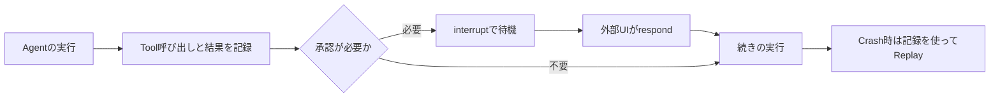
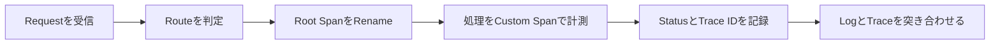
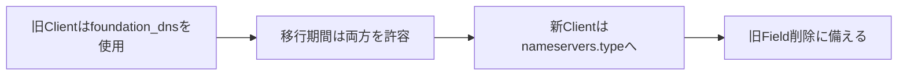

今日は**Cloudflare ComputerのDurable Execution、Claude Agent ACPのSession管理、osu!のAndroid CoreCLR採用**が特に面白いです。Agentを長時間・安全に動かすための仕組みと、ゲームやEditorの実装品質を上げる小さな改善が同時に進んでいます。

主に**10月25〜26日の一次情報**を採用し、最後に10月19日公開のMicrosoft Scopeを見逃し記事として補いました。直近の記事で扱ったBunの脆弱性は繰り返さず、10月25日に公開された**WAF側の新しい緩和策**を続報として紹介します。

---

## 1. Cloudflare Computer 0.7.0 — Agentの中断復旧と承認待ちを永続化

**10月26日｜Agent Runtime・Durable Execution**

[Cloudflareの公式Changelog](https://developers.cloudflare.com/changelog/post/2026-10-26-computer-durable-javascript/)によると、`@cloudflare/computer`のv0.7.0で、**JavaScriptを実行するAgent WorkspaceがDeployやCrashをまたいで処理を再開**できるようになりました。さらに外部の承認を待つために実行を一時停止し、承認・却下の結果を受け取って再開する仕組みも追加されています。Agentの実行を単なる長いHTTP Requestとして扱わず、途中状態を維持する方向への重要な変更です。

`WorkerJavaScriptBackend`に`onInterrupt: "replay"`を指定すると、再開時にJavaScriptは先頭から再実行されます。ただし、完了済みで記録された呼び出しの結果は再利用するため、同じToolを無条件にもう一度動かすわけではありません。一方、**外部操作が成功しても結果を記録する前にCrashした場合は再実行され得る**という境界があります。決済・Issueへの投稿・ファイルの破壊的更新などには`unsafeToRepeat()`やIdempotency Keyの設計が必要です。

人の承認はCustom Moduleから`ctx.interrupt()`を呼び出して待機します。別のUIやServiceが`workspace.runtime.pending()`で保留中のCallを列挙し、`respond()`で結果を返す流れです。待機時間はRunのTimeoutへ算入されず、Deploy後も待機状態が残ります。Trafficがない状態で中断処理を復旧させるには、Durable ObjectのAlarmから`workspace.runtime.recover()`を呼ぶ方法も示されています。

処理の大まかな構成は次の通りです。復旧可能であることと、外部への副作用が一度しか起きないことは別問題です。

> [!WARNING]
> **ReplayはExactly-once実行の保証ではありません。** 記録前に完了した外部操作は重複し得るため、再試行可能な処理とそうでない処理を分けて設計してください。

**開発者目線:** Agentを本番運用すると「モデルが賢いか」より、**長時間処理の中断・再実行・人間の承認・副作用の一意性**が難所になります。GitHubのIssue更新や社内申請のように外部状態を変更するWorkflowでは、承認画面とIdempotencyを先に設計してからAgentの判断部分を組み込むのが堅実です。

---

## 2. Claude Agent ACP 0.97.0 — Subagent可視化とSession制御を改善

**10月26日｜Agent Client Protocol・Coding Agent**

[claude-agent-acpの公式Release](https://github.com/agentclientprotocol/claude-agent-acp/releases/tag/v0.97.0)で、**v0.97.0**が公開されました。前段の[0.96.0](https://github.com/agentclientprotocol/claude-agent-acp/releases/tag/v0.96.0)も同日に公開されており、二つを合わせると、Subagentの活動をClient側へ伝える方法と、長時間Sessionでの状態整合性が改善されています。ACPはEditorなどのClientとCoding AgentをつなぐProtocolで、Claude Code本体のReleaseとは区別する必要があります。

0.96.0では`SendMessage`による委譲を**リンクされたSession Message**として報告し、Native Subagentが使用するModelもClientへ伝えるようになりました。複数のAgentが協力する作業では、最終的な回答だけを表示しても、どのAgentに何を任せたか、どのModelが実行したかを追跡しづらくなります。委譲と実行主体が見えることは、費用分析や不具合の再現にも役立ちます。0.96.0ではClaude Code 2.1.310への更新も含まれています。

0.97.0では`ultracode`のSession設定Optionを追加し、同じ表示名のModel Optionを区別する修正、Context Compaction後に届いたUsage Limit Errorを保持する修正などが入りました。また、Foreground Forkの報告をLaunch完了まで保持し、Advisor Toolの結果やLive Steeringの完了判定を整える変更もあります。いずれもAgentの能力を増やすというより、**Clientに見せる実行状態が実態とずれないようにする**改善です。

> [!NOTE]
> ACP AdapterのRelease Noteだけでは、個々のEditorが新しいSession設定や表示をすでに利用できるとは限りません。対応するClient側の実装・設定も確認する必要があります。

**開発者目線:** Coding AgentをIDEへ組み込むとき、Messageの順序・委譲先・Tool完了の境界が曖昧だと、UIが「完了」と表示した後で処理が続くような事故が起きます。**Agent Protocolは単なる文字列の入出力ではなく、非同期Taskの状態同期**として設計・テストする価値があります。

---

## 3. osu! tachyon 2026.1026.0 — AndroidでCoreCLR採用、Result画面も刷新

**10月26日｜音楽ゲーム・C# Runtime・UI**

[osu!公式RepositoryのPre-release](https://github.com/ppy/osu/releases/tag/2026.1026.0-tachyon)に、**AndroidでCoreCLR Runtimeを使用する変更**が入りました。osu!はC#を使うCross-platformの音楽ゲームであり、DesktopとMobileをまたぐRuntimeの選択は、単なる内部実装の置換にとどまりません。GCの挙動、JITやAOTの制約、Native Libraryとの連携、起動とFrame Timeの安定性など、実際の体験へ影響する可能性がある領域です。

今回のRelease Noteには`Use CoreCLR runtime on Android`という変更が明記されています。ただし、**この変更で具体的に何ms高速化したかなどの性能数値は公開されていません**。CoreCLRへ変更したことと、特定の端末で必ず高性能になることは別です。AndroidのOS Version、CPU Architecture、起動後のWarm-up、GC Pressureを揃えて比較する必要があります。今回は`tachyon`という**Pre-release Channel**の更新であり、全利用者向けのStable更新として紹介するのは不正確です。

UI面では新しい`argon`のResult画面にScore Rank表示が加わり、旧Result画面には背景Overlay、Ranking Panel、Score属性をSkinで表現するComponentが追加されました。Matchmaking LobbyのStatus ModelにはRankとSigmaを追加。さらに、特定の設定でSelectionをResizeしたときのCrash、Difficulty表示のちらつき、PlaylistのClose Buttonが不要な場面で表示される問題なども修正されています。

| 領域 | 今回の変更 | 確認したい点 |
| --- | --- | --- |
| Android Runtime | CoreCLRを使用 | 起動・GC・Frame Time |
| Result UI | Rankや背景・Skin表現 | 新旧画面の互換性 |
| Matchmaking | RankとSigmaをStatusへ追加 | UIとData Modelの整合 |
| 操作・表示 | Resize Crashやちらつきを修正 | 特定操作での回帰 |

**開発者目線:** **実際に遊ばれるゲームのRuntime切り替え**は、理論的なBenchmark以上に参考になります。描画の安定性が重要なApplicationでは、平均FPSだけでなくP95/P99 Frame Time、入力遅延、Scene遷移、Memory Usageを継続的に計測したいところです。

---

## 4. Positron 2026.10.2 — Electron・Node更新とAI操作型IDEの進展

**10月26日｜Data Science IDE・Security Update**

[Positronの公式Release](https://github.com/posit-dev/positron/releases/tag/2026.10.2-3)で、**2026.10.2 Patch**が公開されました。今回の直接的な変更はElectronとNode.jsのSecurity Fixで、漏洩したeMudhra中間証明書をDesktop ApplicationとRemote Sessionの双方で拒否する対応が含まれます。これは10月の機能追加をまとめた大型更新ではなく、既存の10月版に対するSecurity Patchです。Release Noteでは更新日を10月26日と明記しています。

PositronはR・Pythonの分析作業に特化したIDEです。10月版の機能として、**Posit AssistantがEditor自体を操作**し、Shiny Applicationの起動、Parquet FileのData Explorer表示、Python環境構築、Data Connectionの閲覧などを行うPreview機能があります。さらに実験的な組み込みMCP Serverを通じてClaude Code・Codex・Gemini CLIなどのCoding AgentがLive Sessionへ接続し、Code実行やPlot確認、IDE Commandの操作を行えます。

この二つは似ていますが役割が異なります。Posit AssistantのEditor操作は`assistant.previewFeatures`を有効にするPreviewで、MCP Serverは`ai.mcp.enabled`を有効にするExperimental機能です。MCP Serverから実行されたCodeはConsoleにAgent実行として表示されます。どちらも、**AgentがEditorの現在のInterpreterやData Connectionを参照できる**ことが、単なるFile編集より重要な価値です。

> [!WARNING]
> AIによるEditor操作・組み込みMCP Serverは正式提供のSecurity Patchとは**提供段階が異なります**。外部AgentにSession操作を許可する際は、実行権限とData Accessを確認してください。

**開発者目線:** IDE連携Agentが本当に役立つには、Source Codeだけでなく**実行中の状態と結果を確認できること**が大切です。例えばDataFrameを読み込み、Graphを確認してからCodeを修正するWorkflowは、Editor内部の状態をToolとして公開する設計の良い実例です。

---

## 5. Cloudflare Workers Tracing — SpanのID・Status・名前を直接操作

**10月26日｜Observability・OpenTelemetry**

[Cloudflareの公式Changelog](https://developers.cloudflare.com/changelog/post/2026-10-26-span-context-status-update-name/)で、WorkersのCustom Span APIに**`spanContext()`・`setStatus()`・`updateName()`**の三つが追加されました。いずれもOpenTelemetryのSpan APIに沿った機能で、Distributed Traceを実装から追跡するための基本要素です。Workers Observabilityや外部Exporterへ送るTraceと、Application LogやError Responseを結び付けやすくなります。

`spanContext()`は`traceId`・`spanId`・`traceFlags`を返します。例えばAPIがErrorを返す際にTrace IDをResponseへ含めれば、運用担当者が問い合わせを受けたとき、対象RequestのTraceへ素早く移動できます。`setStatus()`は`unset`・`ok`・`error`を設定し、Error時にはMessageも付与できます。ただし、**StatusはOpenTelemetryのExport先には含まれる一方、現時点でWorkers Observability Dashboardには表示されません**。

`updateName()`はSpan開始後に名前を変更するAPIです。Requestを受けた瞬間には具体的なRouteが確定していなくても、RouterがMatchした後に`GET /users/:id`のようなTemplate名へ変更できます。生のURLやUser IDをそのままSpan名にするとCardinalityが膨らみ、集計やCostの面で不利になるため、Pattern名でまとめる設計が向いています。InvocationのRoot Spanも`tracing.getActiveSpan()`から取得してRenameできます。

処理と調査の対応は、例えば次のようになります。

**開発者目線:** 「Errorが起きた」と分かっても、**どのRequestのどの段階で失敗したか**を探すのが運用上の負担です。Trace IDをError ReportやLogに付け、Span名を低Cardinalityで統一することで、ServerlessのようにProcessが短命な環境でも障害解析を進めやすくなります。

---

## 6. Cloudflare WAFがBrotli脆弱性向け緊急Ruleを追加 — 初期設定はLog

**10月25日｜Web Security・緊急緩和策**

[Cloudflareの緊急WAF更新](https://developers.cloudflare.com/changelog/post/2026-10-25-emergency-waf-release/)で、**CVE-2026-111497に関連する二つのManaged Rule**が追加されました。一つはBrotli圧縮されたRequest Bodyを示す`Content-Encoding: br`を検知するRule、もう一つはNext.jsの画像最適化Endpoint`/_next/image`へのRequestを検知するRuleです。10月25日のBun脆弱性に関する話題からの**新しい緩和策の続報**であり、脆弱性そのものの再紹介ではありません。

重要なのは、**両RuleのDefault ActionがBlockではなくLog**だという点です。Brotli Ruleは`Accept-Encoding: br`にはMatchせず、CloudflareがResponseをBrotli圧縮する設定にも影響しません。Request BodyをBrotli圧縮して送る正規のClientも検知対象になり得ます。Next.js Ruleも`/_next/image`への正常な画像Requestを含めて検知するため、安易にBlockへ変更するとImage Optimizationが壊れる恐れがあります。

| Rule | 検知対象 | Blockにした場合の注意 |
| --- | --- | --- |
| Brotli | `Content-Encoding: br`を持つRequest | 正規の圧縮Requestも遮断し得る |
| Next.js | `/_next/image`へのRequest | 画像最適化機能に影響し得る |

既存のRuleset全体に**Action OverrideでBlockを設定している環境**では、DefaultがLogの新RuleまでBlockされる可能性があります。CloudflareはRule単位のOverrideを確認し、必要ならまずLogでMatchの分布を評価するよう案内しています。WAFはRiskを減らす補助的な防御であり、Runtimeや依存PackageのPatchを不要にするものではありません。

> [!WARNING]
> このRuleは初期状態では**可視化のみ**です。Logが出たことを「攻撃を防御した」と解釈しないこと、Blockへ切り替える前にFalse Positiveを確認することが重要です。

**開発者目線:** Security Updateで緊急にWAFを有効化するときは、**検知精度とAvailabilityの両方**を評価する必要があります。特に既存のOverrideが新Ruleへ継承されるかどうかは、CIの設定差分だけでは見落としやすい運用上の落とし穴です。

---

## 7. Letta Code 0.34.24 — Agentの再開・承認・権限境界を修正

**10月25日｜Persistent Agent・CLI Reliability**

[Letta Codeの公式Release](https://github.com/letta-ai/letta-code/releases/tag/v0.34.24)は、**長時間動くAgentのListener・Recovery・Permissionに関する修正**が中心です。新しいModelを追加するような目立つ機能ではありませんが、AgentをCLI・Remote Channel・定期実行から運用するときの安定性に直結します。Release Noteには、HeartbeatのRegressionで起動が止まる問題、Connection ReadinessとGateway起動の結合、再登録時にRuntimeが失われる問題などが挙がっています。

Recoveryでは、古いTool CallをModelに無条件で再発行するよう促さない修正が入りました。Approvalについては、解決済みのCallを古い承認状態で再び拒否しないこと、承認待ちでTurnが止まった場合も`max_turns`を守ることが改善されています。定期実行では、再起動前のScheduler Leaseを誤って保持し続ける状況や、ListenerからPromptを配送した際のLogも見直されました。

Security上で注目したいのは、**許可Directoryの判定を文字列PrefixではなくPathの境界で検証**する修正です。例えば`/work/app`が許可されていても、`/work/application-secret`まで同じPrefixだから許可してしまう判定は危険です。Path Segmentを意識した判定が必要になります。またNode RuntimeのCVE-2026-111497対応、Discord AccountのPermission ModeをTurnへ適用する修正も含まれます。

> [!NOTE]
> Letta CodeのRelease Noteには、端末に固定されたScheduleはPCがOfflineなら失敗し、Cloudへ自動的にはFallbackしないことも明記されています。定期実行のReliabilityは配置場所の可用性に依存します。

**開発者目線:** Agentの実用化では、**中断後の復旧と権限の継承**がModelの性能と同じくらい重要です。Tool Callの重複、古いApprovalの再利用、許可PathのPrefix判定などをUnit TestやFault Injectionで検証する発想は、Agent以外のWorkflow Engineにも応用できます。

---

## 8. Tolaria 2026-10-26 — Markdown保存の忠実性とClaude Code Skillsを改善

**10月26日｜OSS・Note Editor・AI連携**

[OSS Note Editor「Tolaria」のStable Release](https://github.com/refactoringhq/tolaria/releases/tag/v2026-10-26)で、Markdownの編集体験とAI連携が更新されました。今回のReleaseでは**Claude CodeをAI Panelから使う際にSkillsを利用できる**ようになり、EditorのAppearanceをDark SidebarとLight Contentの組み合わせへ切り替えるOptionも追加されています。macOS（Apple SiliconとIntel）・Windows x64・Linux x64向けBuildが提供されています。

注目したいのは、Markdownを保存するときに**編集していない部分の表現を勝手に書き換えない**改善です。Inline Code、HTML Entity、Table AlignmentなどがSaveのたびに変わると、Gitで管理しているNoteに不要なDiffが発生します。今回の変更は、表示上は同じでもSource Textを保持することを重視しています。Table Cell内の改行をClose・Reopen後も維持する修正、Code Blockの言語SelectorをScroll時に追従させる修正も入りました。

日本語入力に関係する小さな修正として、**中国語・日本語・韓国語のIME変換中にTabやShift+TabでListが意図せずIndentされる問題**も扱われています。EditorはKeyboard Shortcutが多いため、IMEが文字変換中なのか通常のKey操作なのかを区別しないと、特定言語だけ操作が壊れます。非Latin文字を含むAttachment名のRename、Apple Siliconでの初回起動停止、ImageをClickした際のMemory問題なども修正対象です。

| 変更 | 利用者の利益 | 実装上の論点 |
| --- | --- | --- |
| Markdownの原文保持 | 無関係なGit Diffが減る | ParseとSerializeのRound-trip |
| IME中のTab修正 | 日本語入力が壊れにくい | Composition EventとShortcutの優先度 |
| Skills連携 | Agentの作業知識を利用 | Skillの権限と実行Context |

**開発者目線:** Editorの品質は新しいButtonより、**入力途中の状態・保存前後の等価性・言語差への配慮**で決まることがあります。Rich Textや譜面・設計Toolを作る際にも、Round-trip TestとIMEのE2E Testを優先したい事例です。

---

## 9. Cloudflare DNS API — Advanced Nameserversを型で表す段階移行

**10月26日｜API互換性・DNS設定**

[Cloudflareの公式Changelog](https://developers.cloudflare.com/changelog/post/2026-10-26-foundation-dns-nameserver-type/)によると、Advanced Nameserversの設定表現が、従来の`foundation_dns: true`から、**`nameservers.type: "cloudflare.advanced"`というEnum風の値**へ移行し始めました。段階的なRolloutは約7日間を見込んでいます。単なるJSON Field名の変更ですが、API ClientがResponseの値を固定的に解釈している場合は互換性に影響します。

Rolloutがまだ届いていないAccountでは、Advanced Nameserversを利用していても`nameservers.type`に`cloudflare.standard`が返る場合があります。一方、権限のあるAccountなら新しい`cloudflare.advanced`をPATCHで指定できます。旧`foundation_dns`はDeprecatedな互換Aliasとして読み書きでき、**両方の値を同時にPATCHした場合は一致していなければError**になります。将来のAPI変更では旧Fieldが削除される予定です。

ここでの移行は**DNS SubscriptionやZoneの機能を切り替える操作ではありません**。設定の表現を変えるだけで、Zone Migrationも不要とされています。むしろ問題になるのは、TypeScriptなどで`nameservers.type`を`"cloudflare.standard"`しか受け付けないClosed Unionとして生成していたClientです。未知の値が返った際にParse Errorになるか、Fallbackできるかを確認する必要があります。

段階移行の扱いは次のように整理できます。

**開発者目線:** APIの変更はBreaking Changeを避けたつもりでも、**Closed Enum・Generated SDK・キャッシュ済みSchema**で障害になり得ます。Fieldの追加・Deprecated化・削除を段階的に進める設計と、未知のEnum値を受け取るTestを両方備えると、長寿命のAPI Clientを安全に保てます。

---

## 10. Microsoft Scopeを見逃しチェック — Coding Agentの利用体験を評価するOSS

**10月19日公開・今週の見逃し記事｜Agent Evaluation**

[Microsoftの10月19日の公式発表](https://opensource.microsoft.com/blog/2026/10/19/introducing-scope-open-source-evaluation-for-ai-coding-agents/)で紹介された**Scope**は、AI Coding AgentがSDK・API・Documentationを使って実際の開発Taskを完了できるかを測るOSSです。今回のニュースは10月26日の新Releaseではなく、直近1週間で見逃した技術記事の補完として扱います。[公式Repository](https://github.com/microsoft/scope)はMIT Licenseで公開され、現時点では**Research Preview**と説明されています。

考え方の中心は、開発者体験（DevEx）だけでなく、**AgentがProductを使うときの体験（DevAx）**も測定することです。人間には読みやすいDocumentationでも、AgentはAPIの選択を誤ったり、重要な制約を見落としたりする可能性があります。ScopeはTask・Persona・評価基準を設定し、複数のCoding Agentに同じ課題を実行させ、結果をCriteriaの依存関係（DAG）に沿って評価します。PortalやCLIからRunのTraceと判定理由を確認できます。

MicrosoftのAzure Cosmos DB Teamは、**8つのEnd-to-end Scenario・5言語**でAgent Kitの効果を検証し、20件のKitの問題と27件のDocumentationの問題を修正したと報告しています。ある更新後、評価したScenarioでは階層型Partition Keyの採用率が47%から100%へ、誤った`OFFSET/LIMIT`使用が47%から0%へ変化したとしています。ただし、これは**特定の課題・環境での観測結果**であり、あらゆるAgentやDatabaseで同じ改善を保証するものではありません。

ScopeはKubernetesや複数Serviceを含む構成のため、気軽なSingle-command Benchmarkとは運用Costが異なります。またLLM Judgeには誤判定があり得るので、重要な基準はUnit Testや明確なArtifact検査で補う方が堅実です。成功率だけを競うのではなく、**どのDocumentationの曖昧さが失敗を生んだか**まで追う用途に向いています。

**開発者目線:** 自作SDK・CLI・MCP ServerをAgentに使わせるなら、Modelの一般Benchmarkより**自分のAPIを正しく使えるか**を継続的に測る方が改善に直結します。代表的なTaskを少数決め、Document変更前後で失敗理由を比較する方法は、Agent向けのDeveloper Experience改善に役立ちます。

---

## 👀 今日ならこの3つ

### 🥇 Cloudflare Computer 0.7.0

長時間動くAgentの中断復旧と人間の承認待ちをRuntimeとして扱えるのが重要です。便利なAPIだけでなく、Replay時の重複副作用を防ぐ設計まで学べます。

### 🥈 osu! tachyonのAndroid CoreCLR

実際のゲームでRuntimeを切り替える変更は、C#のCross-platform開発とFrame Timeの安定性を考える材料になります。性能値はまだ出ていないため、今後の測定にも注目です。

### 🥉 Claude Agent ACP 0.97.0

Subagentの委譲先やModel、Toolの完了状態をClientへ伝える改善です。複数Agentが同時に動くIDEで、状態を正しく可視化する難しさを具体的に示しています。
