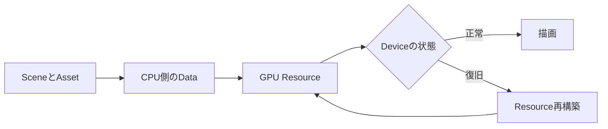
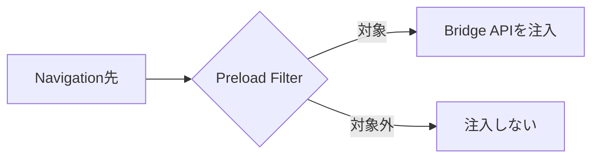

今日は**Codex CLIのSessionとMemory、OpenCodeの拡張API、NuxtのSecurity修正、Babylon.jsのGPU Resource管理**が特に面白いです。AI Agentの長期運用からPackageのSupply Chain、3D描画の復旧まで、実装後に効いてくる品質の話題を集めました。

**10月26〜27日の一次情報**を優先し、直近7日分で紹介したVersionの単なる再掲を避けています。Release Noteの事実と、開発者が検証すべき応用・注意点を区別して紹介します。

---

## 1. Codex CLI 0.165.0 — Vertex AI統合、Memory v2、Thread分岐

**10月27日公開｜Coding Agent・Model Provider**

[Codex CLI 0.165.0の公式Release](https://github.com/openai/codex/releases/tag/rust-v0.165.0)で、**Google Cloud Vertex AIを組み込みProviderとして利用する機能**が追加されました。設定は `model_provider = "gcp"` です。GPT-6.1 TerraもModel Catalogに加わりました。ただしCatalogへの登録は、あらゆる契約・Regionで直ちに使えることを保証しません。実際のModel提供状況、認証、請求、Dataの取り扱いは接続先で確認が必要です。

複数Repositoryを扱う人向けには、Session PickerのRepository FilterとAgent Command CenterのDirectory Groupingが追加されました。App Server APIでは、既存Threadと関連付けたForkを作るExperimental機能も登場。作業案を分岐させても元のSessionとの関係を残す設計です。さらに新規Profileでは**Memory v2が既定で有効**となり、外部AgentのMemory Importにも対応しました。対応Modelでは会話中のReasoning Effort変更も既定で有効です。

修正では、Localの待機が破棄されたMCP RequestをRemote側でもCancelする処理、InterruptやPlan Mode切替後にQueued Messageが勝手に再開しない制御、Model Not Foundで無駄なRetryを続けない処理が入っています。Marketplace URLの検証漏れも塞がれました。これはAgentが賢くなる更新というより、**複数Session・外部Tool・権限の境界を扱いやすくする更新**です。

> [!NOTE]
> Thread ForkはExperimentalです。MemoryやProviderの設定を本番運用へ反映する前に、独立したProfileで挙動を確認してください。

**開発者目線:** Agentを複数Worktreeへ並列に走らせる場合、どのSessionがどのRepositoryに作用したか、Interrupt後に処理が残っていないかを追跡できることが重要です。Memoryの取り込みは便利ですが、Project間で機密情報や古い前提が混ざらないよう、Import範囲と削除方法も検証すると安全です。

---

## 2. OpenCode 2.2.0 — Desktop PluginとSession指示の差分更新

**10月27日公開｜Agent拡張・Plugin SDK**

[OpenCode 2.2.0の公式Release](https://github.com/anomalyco/opencode/releases/tag/v2.2.0)では、**Desktop Pluginの作成・Install・共有**がExperimental機能として公開されました。Desktop UIの刷新に加え、PluginとSDKには画像生成・Decision生成の実験的APIも追加されています。Coding Agentの拡張ポイントがCLIのToolだけでなく、GUIやModel機能に広がりつつあります。

注目は `ctx.session.instructions.entry.put/list/remove` です。PluginがSessionへ**Key付きの指示を追加・更新・削除**でき、System Prompt全体を書き換える必要がありません。変更分は次のStepで反映され、CompactionやRevertをまたいで保持されます。Prompt Cacheを無駄に破棄せず、指示変更だけで余分なModel Turnを開始しない設計です。複数Pluginが動的にContextを変える場合、誰がどの指示を管理するかを明示しやすくなります。

一方で破壊的変更があります。`@opencode/ai` のRoot ExportはPromise APIへ移り、Effect APIは `@opencode/ai/effect`、従来の `@opencode/ai/promise` は削除されました。OpenCode GitHub Actionは配布終了、TUI PluginにはOpenTUI 0.7が必要です。Model別Prompt Cache TTL設定や画像ResizeのMain Process外への移動など、性能面の改善も含まれます。

| 対象 | 変更 | 確認すること |
| --- | --- | --- |
| AI Package | RootがPromise APIに | Import Path |
| Session指示 | Key付きEntryで管理 | Plugin間の衝突 |
| TUI Plugin | OpenTUI 0.7必須 | 依存Version |

> [!WARNING]
> 2.2.0は単純なPatchではありません。既存PluginやCI WorkflowはMigrationが必要です。

**開発者目線:** Agentの拡張APIを設計するとき、指示を巨大な文字列として扱うより、Keyと所有者を持つ構造化Entryにする方が保守しやすくなります。ただしPluginはToolやDataへアクセスするため、配布元の信頼性、権限、更新経路の確認が欠かせません。

---

## 3. Nuxt 4.6.3 — Dev Serverの情報露出など5件のSecurity Fix

**10月27日公開｜Web Framework・開発環境**

[Nuxt 4.6.3の公式Release](https://github.com/nuxt/nuxt/releases/tag/v4.6.3)では、**5件のSecurity Fix**が提供されました。ClientのError Reportが指定したFileをDev Serverが読まないようにする修正、Nitroの開発用出力や生成されたApp Secretを配信しない制御、Request PathのDot Segment処理、Page IslandへのRedirect Route Rule適用が含まれます。影響範囲と攻撃条件は個別のAdvisoryで確認する必要があります。

開発用Serverは安全と考えられがちですが、Remote IDE、Container、社内PreviewなどでLANやProxyへ公開することがあります。Client由来のPathを信用してServer内部のFileへアクセスしたり、Buildの生成物を無条件に配信したりすると、**開発環境だけに存在するSecretやSourceが露出する**可能性があります。今回の更新は、本番ServerだけでなくDev Serverにも明確なFile Access境界が必要なことを示しています。

Releaseには、ViteのFile System Allow判定の計算量改善、Build Cache、SSR、Cookie同期、Route Ruleの修正も含まれます。Security Updateと一緒にRoutingやRenderingの挙動が変わるため、更新後は既存Pageの回帰Testが必要です。一次資料として[File読み込みのAdvisory](https://github.com/nuxt/nuxt/security/advisories/GHSA-x287-wcfc-q46c)、[Nitro出力の保護](https://github.com/nuxt/nuxt/security/advisories/GHSA-648h-gw55-m2g7)、[生成Secretの保護](https://github.com/nuxt/nuxt/security/advisories/GHSA-3xf4-9g3c-4h4w)が公開されています。

> [!WARNING]
> Dev Serverを共有Networkへ公開する構成では、UpdateだけでなくBind Address、認証、Proxy設定、公開Portを点検してください。

**開発者目線:** Security TestはProduction Buildだけでなく、Previewと開発環境も対象にすると漏れを減らせます。通常のPage表示に加え、存在しないPath、Dot Segment付きURL、Redirect Rule、Error Reportの処理をE2E Testに含めると、今回のような境界の問題を検出しやすくなります。

---

## 4. pnpm 12.16.0/12.16.1 — env-fileと圧縮・署名処理の改善

**10月27日公開｜Package Manager・Supply Chain**

[pnpm 12.16.0の公式Release](https://github.com/pnpm/pnpm/releases/tag/v12.16.0)では、Global Optionの `--env-file <path>` が追加されました。dotenv形式のFileを実行前に読み込み、複数指定した場合は後のFileが先の値を上書きします。ただし既存のProcess Environmentは優先されます。値はUser側の `.npmrc` の展開やLifecycle Scriptからも参照されるため、CIの設定整理に便利な反面、Secretの受け渡し範囲には注意が必要です。

`pnpm-lock.yaml` をSymbolic Linkとして管理する構成では、`symlinkedLockfileTargetDirs` に許可先を指定するとLinkを保ったまま参照先を更新できます。`pnpm setup --no-modify-path` も追加され、Shell設定やWindows Registry、GitHub ActionsのEnvironment Fileを自動変更せずにInstallできます。環境構築Scriptが勝手にPATHを書き換えないようにできる点は、管理された開発端末で有用です。

Security面では**zstd圧縮Data処理のMemory ExposureとAllocationの問題**、署名演算のTimingからPrivate Keyが漏れ得る問題を修正しました。依存Packageを取得・展開する段階はApplicationのBuildより前に動くため、Package Manager本体の安全性はSupply Chain対策の一部です。続く[12.16.1](https://github.com/pnpm/pnpm/releases/tag/v12.16.1)では、Cargo Crateを含むWorkspaceのCold Store Installが停止する問題、`pnpm pack` のFiles除外規則などが修正されています。

また、StoreやNode Linkerの設定変更を再Install時に正しく反映し、不一致がある場合は明示的なErrorを返すようになりました。**Lockfileが同じでも配置方式や環境設定が違えば結果が変わる**という現実を扱う改善です。

**開発者目線:** CIの再現性を確認する際は、Lockfileに加えてpnpmのVersion、Store、Linker、Environment File、Lifecycle Scriptを記録すると原因を追いやすくなります。12系列のRepositoryでは12.16.1まで含めて検証し、他Majorからの移行は別途互換性Testを実施するのが堅実です。

---

## 5. Babylon.js 9.32.1 — WebGPU復旧とKTX2のMemory管理

**10月27日公開｜Web 3D・Rendering・Asset Pipeline**

[Babylon.js 9.32.1の公式Release](https://github.com/BabylonJS/Babylon.js/releases/tag/9.32.1)では、**WebGPU Engineの初期化が完了していなくても `dispose()` できる**ようになり、Bufferの復旧時にScene Geometryを再構築する修正が入りました。描画APIは正常な初期化だけでなく、Device Lostや画面遷移の途中で破棄される場合があります。中断された状態でも安全に後始末できることは、3D Applicationの安定性に直結します。

KTX2 Textureでは、読み込んだFileをWorkerへTransferし、GPUへのUpload後に不要なLevel Dataを解放する変更が入りました。Textureを読み込む瞬間は、元File、Decoderの一時Buffer、Upload用Dataが同時に存在することがあります。**最終的なGPU Memory使用量が小さくても、読み込み途中のPeak Memoryが大きい**とBrowserのTabが落ちる原因になります。WorkerへのTransferと適切な解放は、この重複を減らす工夫です。

描画面ではWGSLのCascaded Shadow Map用Uniform Buffer、IridescenceとArea Lightの併用、WebGLのParallel Shader Compilation通知を修正。Gaussian Splat Meshを破棄してもDataが残る問題、MirrorTextureのObserver Leak、FBXのBone Scaleを継承するRigでMemory不足になる問題も対象です。GUI EditorのAdaptive Scaling時の遅延とInspector LiteのFlow Graph Explorerも改善されました。

GPU ResourceのLifecycleは、次のようにScene側のDataとDevice側のResourceを分けて考えると理解しやすくなります。

**開発者目線:** Web GameではFrame Rateだけでなく、Asset読み込み中のPeak Memory、Device復旧、Scene破棄後のLeakを計測すべきです。大量のKTX2を読み込みながらSceneを切り替えるStress Testや、初期化失敗直後のDispose Testが有効です。

---

## 6. Claude Code 2.1.312 — 大きな指示Fileの誤上書き防止

**10月27日公開｜AgentのFile操作・Policy**

[Claude Code v2.1.312の公式Release](https://github.com/anthropics/claude-code/releases/tag/v2.1.312)で、**非常に大きい `CLAUDE.md` やRule Fileを冒頭だけ読んだAgentが、そのまま全体を上書きする問題**が修正されました。Write ToolはFile全体を読んでから書くか、既存内容を残す編集を選ぶよう促します。Contextに見えていない部分を消さないことは、Agentによる自動編集の基本的な安全条件です。

Bashで `cd` してRepository内の深いDirectoryへ移動した後、Directory単位や `paths:` 指定のSkillを見失う問題も修正されました。Agentの作業DirectoryとRuleの適用範囲がずれると、意図した制約が働かなくなる可能性があります。企業向けにはGatewayの `oidc.user_id_claim` が追加され、Microsoft Entra IDの `oid` など `sub` 以外のClaimで利用者を識別できます。VS CodeからのSign In後にManaged Settingsを取得できなくなる問題も修正対象です。

Hookの同時実行はSessionあたり原則24、Timeoutを超えて待機したHookは追加で最大12という制御になり、Subagentも同じ枠に含まれます。Reasoning EffortをTask途中で変更した際のSpinner・OpenTelemetry・Transcriptの表示も、実際に適用中のLevelへ合わせられました。Cloud Sessionの再送による二重実行や、Code Reviewが古いCommitを対象にする問題も修正されています。**UIの状態と実際の実行状態を一致させる**改善が多いReleaseです。

> [!WARNING]
> File編集の安全性が向上しても、重要な設定Fileの自動変更はDiff ReviewとVersion管理を前提にしてください。Hook並列数の変更は大量のHookを使う構成に影響し得ます。

**開発者目線:** Agentに大きなFileを編集させるときは「全体を読めたか」「差分編集できるか」「他の内容を消さないか」をTestに入れると事故を減らせます。RuleをDirectoryごとに分け、編集後のDiffと検証を必須にする運用が堅実です。

---

## 7. Electron 45.1.0 — Preload FilterとFile Access保護

**10月27日公開｜Desktop Runtime・Security**

[Electron 45.1.0の公式Release](https://github.com/electron/electron/releases/tag/v45.1.0)では、`session.registerPreloadScript` に `matches`、`excludeMatches`、`includeGlobs`、`excludeGlobs`、`matchOriginAsFallback` などのFilterが追加されました。Preload ScriptはWeb ContentとOS寄りの機能をつなぐため、**どのURLへBridge APIを注入するか**がSecurity上重要です。複数OriginやExtensionを扱うAppでは、対象を限定する選択肢が増えました。

Security関連では、File System AccessのBlocklistにおける `.git/hooks` やHypervisor UNC Shareの抜け穴、破損した `asar` ArchiveのSize情報、Main ProcessとChild ProcessのArchive Path解釈の不一致が修正されています。File Pathの正規化がProcess間でずれると、意図しないFileへ到達する危険があります。Application CodeだけでなくRuntime自体のFile Access境界を保つ更新です。

Extension周りでは、`chrome.webRequest` の `tabId` 誤報告、`declarativeNetRequest` のTab限定Rule、Service WorkerのEvent配信・再起動・Alarm永続化などを修正。LinuxのD-Bus切断時Crash、Blob UploadのHeader監視でのMain Process Crashも対象です。Chromiumは**156.0.8078.49**、Node.jsは**24.22.1**へ更新されています。

Preloadの適用範囲は、次のようにNavigation先ごとに判断する設計です。

**開発者目線:** Electron Appは通常のWeb AppよりLocal FileやOS機能に近いため、Preloadの最小権限、Origin確認、Context Isolation、File Path検証を組み合わせるべきです。Update時には通常のWindow表示だけでなく、Extension、Blob Upload、Archive読み込み、OS別の終了処理もRegression Testに含めると安全です。

---

## 8. Wrangler 4.154.0 — Miniflare v5のDev Registryを既定化

**10月27日公開｜Workers・Local Development**

[Wrangler 4.154.0の公式Release](https://github.com/cloudflare/workers-sdk/releases/tag/wrangler%404.154.0)では、**Miniflare v5 BetaのDevelopment Registryが既定で有効**となり、Registry Pathの解決方法が整理されました。MiniflareはCloudflare WorkersをLocalで動かす環境です。複数WorkerのService Bindingや共有Storageを扱うとき、Process同士が接続先を発見する仕組みとしてRegistryが役立ちます。

v5 Betaは `CLOUDFLARE_DEV_REGISTRY_PATH`、`unsafeDevRegistryPath`、設定Directory配下の `dev-registry/v5` の順にPathを解決します。旧 `MINIFLARE_REGISTRY_PATH` は読まなくなりました。Vite v2 Beta Pluginは新しい既定Pathを使いますが、現行Wranglerと `getPlatformProxy()` は互換性のため旧来の既定Pathを維持します。**Vite v2とWranglerを混在させる場合、両Processへ同じ環境変数を指定する必要**があります。

Registryは `enableDevRegistry: false` で無効化できます。ただし共有StorageはRegistryによるOwner選出が必要なため、`unsafeEnableSharedStorage: true` との併用は拒否されます。またRemote BindingやNode.js Binding ProxyのErrorで `code`、`numericCode`、Custom Error Nameが保持されるようになりました。以前はError文字列を解析しないと分岐できない場合がありましたが、Machine-readableなPropertyがあればRetry可否などをCodeで判断できます。

> [!NOTE]
> 既定化はMiniflare v5 Betaの挙動です。現行WranglerとVite v2 Betaの既定Pathが完全に統一されたわけではありません。

**開発者目線:** Local Emulatorの再現性は、単体Processが起動するだけでは不十分です。複数WorkerのDiscovery、Storage共有、Error Codeの伝播までTestし、CIでも同じRegistry Pathを指定すると、環境差による不具合を減らせます。

---

## 9. uv 0.13.6 — WorkspaceのMemory削減とGPU Wheel選択Preview

**10月26日付Release｜Python環境・Machine Learning**

[uv 0.13.6の公式Release](https://github.com/astral-sh/uv/releases/tag/0.13.6)は、**大規模Workspaceの依存解決時のPeak Memory削減**を中心にPerformance改善を多数含みます。LockやUpgrade、PyPI Metadata、Build Backend設定、Workspace ReferenceのParsingなどを見直しました。Package Managerの性能はDownload速度だけでなく、Dependency Graphの解決とMetadata解析にも左右されます。大きなMonorepoではPeak Memoryの削減がCI Runnerの安定性に直結します。

Previewの `wheel-variants` では、**NVIDIA GPUのCapabilityを検出して互換Wheel Variantを選択**する機能が追加されました。PythonのML環境では、同じLibraryでもGPU ArchitectureやRuntimeによって適切なBinaryが異なります。従来は環境ごとにInstall CommandやPackage Indexを切り替える場面がありました。Hardwareの情報をPackage互換性判定へ取り込む方向の変更です。非互換なWheelが要求する未対応Propertyも報告するようになりました。

CPython 3.11.18、3.12.16、3.13.18、3.14.10、3.15.2の取得に対応しています。Bug Fixでは `uv run --active --script` と `uv sync --active --script` がVirtual EnvironmentではないDirectoryを削除する問題を修正。Windows x86-64のPlatform MarkerやFree-threaded PythonのUpgradeも改善されました。Performance向上の幅はWorkspaceとCache状態によるため、一律の倍率は断言できません。

> [!WARNING]
> GPU Capabilityに応じたWheel選択はPreviewです。GPU Driverや配布元の対応を含めて検証してください。

**開発者目線:** Python CIでは実行時間に加えてPeak RSS、Lock生成時間、Cache Hit率を計測すると改善が見えます。ML用途ならGPUごとにInstall結果を比較し、CPU専用環境へ誤ったBinaryが入らないTestを用意すると運用が安定します。

---

## 10. ty 0.0.92 — Django型推論とSARIF出力を改善

**10月26日公開｜Python Type Checker・Static Analysis**

[ty 0.0.92の公式Release](https://github.com/astral-sh/ty/releases/tag/0.0.92)では、**Django ModelのPrimary KeyとForeign Keyの型推論**が改善されました。`django-types` と組み合わせて `pk` や自動生成される `id` の型を推論し、Foreign Keyの `<field>_id` も参照先Fieldの型から判断します。DjangoのORMはDatabase Schemaに基づき属性を動的に生やすため、通常の静的解析だけでは型を追いにくい領域です。

Choices付きFieldの `get_<field>_display()`、日付Fieldの `get_next_by_<field>()` と `get_previous_by_<field>()` も認識するようになりました。Frameworkが自動生成するMethodを理解できれば、存在するMethodを未定義と報告するFalse Positiveを減らせます。同時に型情報が具体化されることで、実際の不整合を見つけやすくなります。Generic Callbackの `ParamSpec` を使うOverload転送やPEP 613のType Alias検査も修正されました。

CLIには `ty check --output-format sarif` が追加され、**SARIF形式の解析Report**を出力できます。SARIFはStatic Analysis結果をTool横断で扱う形式で、CIやCode Scanningとの連携に役立ちます。Text出力を正規表現で解析するより、Location、Rule、Messageを構造化Dataとして処理できます。継承属性の重複処理を避けるなど、Type CheckingのPerformance改善も含まれます。

ただしVersionは**0.0.92**です。成熟した他のType Checkerと診断が完全互換であると考えるべきではなく、既存Projectで比較する必要があります。DjangoのModel定義やPlugin構成によっても推論結果は変わります。

**開発者目線:** 型Checker導入では検出件数より誤検知率と修正可能性が重要です。DjangoのPrimary Key、Relation、Choicesを含むFixtureで比較し、SARIFのLocationがCI上で正しく表示されるか確認すると、導入判断がしやすくなります。

---

## 👀 今日ならこの3つ

### 🥇 Nuxt 4.6.3のSecurity Fix

Dev ServerのFile公開境界は本番のSecurity対策だけでは見落としやすい問題です。Remote開発やPreview環境も含めた点検のきっかけになります。

### 🥈 Codex CLI 0.165.0のSession・Memory改善

Agentを複数Repositoryで運用すると、Model性能だけでなくSessionの識別・停止・Memoryの境界が重要になります。

### 🥉 Babylon.js 9.32.1のGPU Resource復旧

WebGPUの初期化失敗、TextureのPeak Memory、Scene破棄後のLeakを含め、RenderingのLifecycleを設計する価値が分かるReleaseです。
