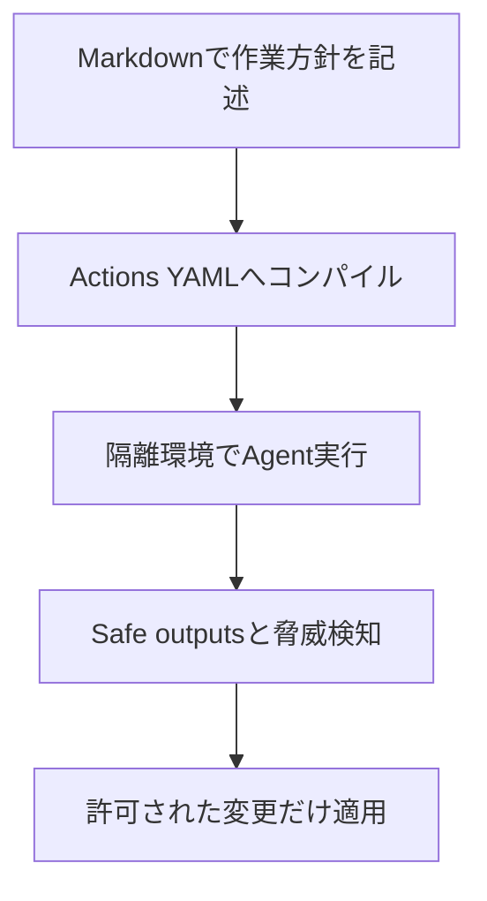
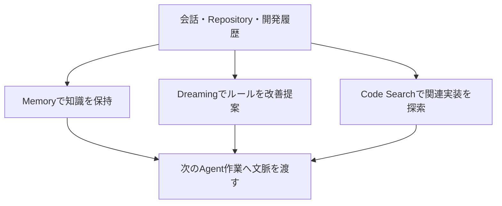

10月28日のGitHub Universeでは、複数モデルの自動編成、Agentの安全な実行、コードの文脈を引き継ぐ仕組みが相次いで発表されました。Cloudflareからは、開発中のWebアプリを公開せずにブラウザーで試す機能や、静的配信・ビルド履歴の改善が届いています。以下は10月28日付の公式発表を中心に、実装時の注意点まで掘り下げた10本です。

---

## 1. GitHub Copilot FusionがGA — Single・Cascade・Critiqueで複数モデルを自動編成

10月28日、GitHubはCopilot Fusionの一般提供（GA）を発表した。従来のモデル選択では、開発者が「速いモデルで十分か」「難問なので強いモデルを使うか」を事前に判断し、途中で切り替える必要があった。Fusionはモデル名ではなく実行方針を選ぶ入口で、Standard・High・Maxという作業強度を指定すると、タスクに応じて利用モデルと連携方法を決める。VS Code、Copilotアプリ、CLI、JetBrains IDEで提供される。[公式発表](https://github.blog/changelog/2026-10-28-route-and-orchestrate-models-with-github-copilot-fusion/)に詳細がある。

技術的に重要なのは、単なる「入力文を分類して一つのモデルに振り分ける」方式にとどまらない点だ。**Single**は一つのモデルがそのまま回答し、**Cascade**は軽量モデルの結果を品質判定して必要なときだけ強いモデルへエスカレーションする。**Critique**は一つのモデルが草案を作り、別モデルがレビューし、元のモデルが修正する。たとえば定型的な型修正ならSingle、仕様の曖昧な実装ならCascade、失敗しやすい設計判断ならCritiqueという使い分けが考えられる。ただし個々のタスクでどの経路が使われるかはFusion側が判断する。

GitHubはArtificial Analysis Coding Agent IndexにおいてFusion Maxが60点を記録し、比較対象に対してAPI平均コストがおよそ半分、トークン数がおよそ半分、処理時間が約40%短かったと報告している。これは**GitHubが提示した特定条件での比較**であり、すべての開発現場で同じ差が出るという意味ではない。請求は内部で使用した各モデルの通常料金を合算する方式で、有料Copilotプランには期間限定の30%割引が案内されている。企業管理者はFusionで使えるモデルをポリシーで制限できる。

**開発者目線:** 重要なのは「最強モデルを常用する」か「節約する」かの二択を減らせることだ。導入を評価するなら、同じIssueを単一モデルとFusionに実装させ、テスト成功率、レビューでの差し戻し、処理時間、総コストを並べて記録したい。複数モデルの合議は便利でも、誤った前提を全員が共有すると失敗する。難しい変更ほど自動レビューに任せ切らず、実テストと人の確認を残す設計が現実的だ。

---

## 2. GitHub Agentic WorkflowsがGA — Markdownから安全制御付きActionsを生成

GitHub Next発のオープンソースプロジェクト「GitHub Agentic Workflows」が10月28日に一般提供となった。Issueの分類、CI失敗の原因調査、ドキュメントの更新、テスト作成など、毎回同じ手順を固定スクリプトへ落とし込みにくい仕事をGitHub Actionsで実行できる。特徴は、ワークフローを自然言語のMarkdownで記述し、標準的なActions YAMLへコンパイルする点にある。既存のRunnerや組織ポリシーを使えるため、独立した常駐エージェント基盤を新たに運用する必要がない。[公式リリース](https://github.blog/changelog/2026-10-28-github-agentic-workflows-generally-available/)と[プロジェクトの説明](https://github.github.com/gh-aw/)を参照。

セキュリティは「AIに権限を全部渡して実行させる」とは異なる。GitHubコンテンツへのアクセスにはintegrity filterを適用し、エージェントの権限は読み取り専用が初期値。実行はFirewallで制限されたコンテナ内で行い、結果はsafe outputsを通して検証する。提案された変更を適用する前には専用の脅威検知ジョブも走る。これはIssue本文や外部ドキュメントに紛れた不正な指示を、そのままリポジトリ変更へつなげないための多層防御として理解できる。

GAまでの追加点には、Actions Runner ControllerとDocker-in-Dockerのサポート、モデルとプロバイダーの選択、モデルルーティング、`gh aw forecast`による予算見積もり、Cloud HypervisorやNVX micro-VMでの隔離などが含まれる。GitHub Free・Team・Enterpriseのgithub.comで利用可能だが、標準のCopilot CLIエンジンを使う場合はCopilotライセンスが必要。GitHubが紹介した導入企業の工数削減・品質改善の数値は個別事例であり、一般的な性能保証ではない。

**開発者目線:** 最初の用途には「失敗したCIログの要約」「古いドキュメントの差分提案」など、成果を人間が容易に検証できる仕事が向いている。自動コミットやデプロイをいきなり許可するより、読み取り→提案→承認の順に権限を増やす方が安全だ。従来のYAMLを完全に捨てる技術ではなく、推論が必要な部分だけを宣言的な自動化へ取り込む選択肢と捉えたい。

---

## 3. Dependabotの到達可能性解析がPreview — 脆弱な関数への呼び出し経路を表示

10月28日、GitHubはDependabotアラートに「reachability analysis（到達可能性解析）」を追加し、JavaScript・TypeScript向けのPublic Previewを始めた。依存ライブラリに脆弱性があっても、アプリケーションが問題のある関数を実際に呼び出しているとは限らない。従来の重大度だけでは修正順序を決めにくいという問題に、呼び出し経路の証拠を加える仕組みだ。[GitHubの発表](https://github.blog/changelog/2026-10-28-prioritize-dependabot-alerts-with-reachability-analysis/)は、重大度やEPSS、実運用の状況と併用するよう勧めている。

解析はGitHubが管理するActionsワークフローで動作し、対象パッケージの脆弱な関数を示す整理済みデータと、CodeQLが構築する呼び出しグラフを組み合わせる。判定は「Reachable」「Potentially reachable」「Unreachable」「Reachability unavailable」の四種類。重要なのは、解析できなかったケースと解析した結果到達しなかったケースを区別することだ。動的呼び出しや複雑な構成では確定できないことがあり、Potentially reachableは到達可能として扱うことが推奨される。

結果は既存のDependabotアラート画面とREST APIに現れ、フィルタリングや並べ替えに利用できる。一方で、到達不能と判定されてもアラートを自動で閉じたり無視したりはしない。Preview期間は無料で、GitHub Advanced Securityライセンスも解析用Actions分数の課金も不要。ただし対象はGitHub Enterprise Cloudのリポジトリで、npm・Yarn・pnpmのLockfileが必要。GitHubホストRunnerを使い、一部のモノレポや複数ディレクトリにManifestがある構成は対象外になり得る。初回解析後は未解決アラートがある間、日次で再解析される。

| 判定 | 意味 | 優先度の考え方 |
| --- | --- | --- |
| Reachable | 脆弱な関数への経路を確認 | 早期調査を優先 |
| Potentially reachable | 到達有無を確定できない | 到達可能として扱う |
| Unreachable | 解析上は経路が見つからない | 他の条件も見て判断 |
| Unavailable | 解析を実施できない | 従来どおり評価 |

**開発者目線:** アラート数の多いWebアプリでは、単なる件数管理から「どの入力がどの危険な処理へ届くか」の調査へ進める。もっとも、到達不能は安全性の証明ではない。反射的な全更新を避ける材料にはなるが、公開APIの変更、将来の機能追加、実行時の動的ロードを考慮し、依存更新そのものは継続する運用が望ましい。

---

## 4. GitHub DesignがReplicaをMIT公開 — 既存デザインシステムで対話型試作

GitHub Designは10月28日、AIを使ったプロトタイピングツール「Replica」をオープンソース化した。一般的な画面生成AIでは、見栄えの良いサンプルができても、実際の製品で使うコンポーネント、文言、操作パターンから外れがちだ。Replicaは既存のデザインシステムを材料に、製品チームの誰もが自然言語から触れる試作品を作り、早い段階で意見を集められることを狙う。[公式紹介](https://github.blog/changelog/2026-10-28-introducing-replica-an-open-source-ai-prototyping-tool/)ではMITライセンスでの公開を明記している。

仕組みの中心は、デザイナーが用意したコンポーネント、UIパターン、ドキュメントを生成時のガイダンスとして使うことだ。たとえば検索画面に新しい絞り込み操作を追加したい場合、汎用的なボタンや独自の配色を生成するのではなく、チームが普段使うUI部品に沿って試作できる。Copilotアプリ内で会話を続けながら操作可能な画面を修正でき、静止画像を見せるだけよりも、状態遷移や情報量を確かめやすい。

作成した試作品はローカルで扱えるほか、必要に応じてセルフホストのReplica Hubへ公開し、チーム内で閲覧・コメントを受け付けられる。GitHubはツール本体とガイダンスをチームのワークフローに合わせて変更できると説明する。ただし、デザインシステムを自動的に完全理解する、生成物が本番品質になる、といった保証は発表されていない。コンポーネントの入力品質と設計ルールの整備が成果に直結するタイプのツールだ。

**開発者目線:** 面白いのは「AIで画面を作る」より「実際に採用できる部品の範囲で案を試す」方向に進んだこと。エンジニアが実装する前に、デザイナーと企画担当者が既存部品の組み合わせで動作を確かめられれば、仕様確認の往復を減らせる。評価する際は、見た目の再現度だけでなく、アクセシビリティ、レスポンシブ対応、例外状態、データが空のときの表示まで試作品で表現できるかを見ると有用だ。

---

## 5. GitHub AI Scanがリポジトリ全体へ拡大 — CodeQLを補うAgent型脆弱性検査

GitHubは10月28日、AI Scan for repositoriesのPublic Previewを開始した。これまでのプルリクエスト変更範囲に対するAI検査に加え、既存リポジトリ全体を対象に脆弱性を探せる。CodeQLが未対応の言語やフレームワークも対象とし、ルールベースの解析だけでは見つけにくい問題の発見を目指す。検出結果は通常のCode scanningアラートに並ぶため、セキュリティ担当者が別の管理画面を監視する必要はない。[公式説明](https://github.blog/changelog/2026-10-28-ai-scan-for-repositories-in-public-preview/)に提供条件がまとまっている。

AI Scanは、最新のデフォルトブランチのコミットを対象に、Agent型のスキャナーが脆弱性のありそうなコードを探索する。解析時間には上限を設け、費用を予測しやすくしている。同じリポジトリをCodeQLも調べている場合、CodeQLがすでに報告した問題はAI Scan側で重複報告しない設計だ。再スキャン時に同じ問題が残っていれば既存アラートを維持し、新しい問題だけを追加する。修正PRをマージしただけではAI Scanアラートが自動で閉じないため、再スキャンして解消を確認する必要がある。

組織管理リポジトリでは公開リポジトリのほか、GitHub Code SecurityまたはAdvanced Securityを備えたPrivate・Internalリポジトリで利用可能。個人アカウント所有のPrivateリポジトリは対象外で、公開リポジトリのみ利用できる。Copilotライセンスは不要だが、**Code Security AI creditsを消費する**。組織では事前のポリシー許可が必要で、予算上限も設定できる。無料の静的解析と同じ料金体系だと誤解しないことが重要だ。

**開発者目線:** AI型スキャンは、認証の前提や複数ファイルをまたぐ処理のように、単一パターンでは表現しにくい危険箇所を調べる補助として期待できる。ただし検出結果には誤検知や見落としがあり得る。導入時はCodeQL・依存脆弱性検査・テストと役割を分け、AI Scanの指摘に再現手順や攻撃成立条件を添えてトリアージしたい。初回は重要リポジトリに絞って費用と有効な指摘の比率を測るのが堅実だ。

---

## 6. GitHub intelligence公開 — Memory GAとDreaming PreviewでAgentの文脈を維持

10月28日のGitHub Universeに合わせ、GitHubは「GitHub intelligence」というエージェント向けの文脈・学習レイヤーを紹介した。コードを読み込むだけでは、なぜ特定の例外処理が必要なのか、チームがどんなテストを重視するのかまでは分からない。そこで、過去の会話やリポジトリの慣習を記憶し、更新し、関連する別リポジトリまで検索する三つの機能をまとめている。[公式発表](https://github.blog/changelog/2026-10-28-github-intelligence-puts-your-code-context-and-history-to-work/)で、それぞれ提供段階が区別されている。

第一のCopilot Memoryは有料CopilotプランでGAとなり、個人の好みやリポジトリのルールをセッションとクライアントをまたいで引き継ぐ。第二のDreamingはPublic Previewで、過去の作業を振り返り、個人の記憶、リポジトリのSkill・指示ファイル、コードレビューで繰り返し受け入れられた指摘を改善する。チェックイン済みのSkillや指示への変更はPRとして提案され、人が確認できる。Dreamingはオプトインで、実行にAI creditsを消費する。

第三のCode Searchは、ローカルにCloneしていない関連リポジトリのコードや設定まで探せる機能だ。文字列や正規表現だけでなく、処理の意味から探すセマンティック検索も利用できる。たとえば複数サービスにまたがるリトライ処理を調べる際、`/research`から実装と呼び出し側を横断して確認する。これらの機能は利用条件や管理設定がそれぞれ異なり、「intelligenceを有効にすれば全機能が無条件で動く」わけではない。

**開発者目線:** エージェントの精度を上げる手段が「巨大なプロンプトを毎回渡す」から「必要な文脈を管理して再利用する」へ変わりつつある。ただし古い設計方針を記憶すると誤実装を繰り返す危険もある。個人設定とリポジトリ規約の責務を分け、Skillや指示の変更はレビュー可能なPRに残し、権限境界を明確にする運用が欠かせない。

---

## 7. Copilot Automationsがチーム共有に対応 — 個人依存しないRepository単位の自動化

10月28日、GitHubはCopilot Automationsの「Shared」機能を段階的に提供し始めた。Copilot Automationsはプロンプト、トリガー、許可したツールを組み合わせ、クラウドで作業を自律実行する仕組みだ。Issue作成直後のバグ再現、レビュー準備ができたPRのスクリーンショット収集、監視ツールの障害通知を受けた調査などが想定される。[GitHubの発表](https://github.blog/changelog/2026-10-28-build-shared-workflows-for-your-team-with-copilot-automations/)によれば、これまで個人に紐づいていた自動化を、チームが共同管理できるようにする変更である。

共有自動化はリポジトリに所属し、読み取り権限を持つメンバーは内容を閲覧でき、書き込み権限を持つメンバーは編集できる。実行時のGitHub上の操作は作成者個人ではなくCopilotに帰属し、AI creditsはリポジトリ所有者に請求される。作成者がチームを離れても自動化は継続し、プロンプトやトリガー、ツールの変更履歴を追える。個人の認証や費用枠に依存した運用から、リポジトリの管理責任へ移すのが主眼だ。

GitHub.com、Copilotアプリ、VS Codeから作成する際にTypeとしてSharedを選ぶ。作成後にPersonalとSharedを相互変換することはできない。組織所有リポジトリで実行するには、管理者が「Allow use of Copilot cloud agent billed to the organization」を許可する必要がある。Copilot Pro・Pro+・Max・Business・Enterprise向けにロールアウト中で、アカウントによってはまだ選択肢が見えない可能性がある。

**開発者目線:** 「退職した人の個人アカウントでしか動かない自動処理」を避けられる点は実務的に大きい。一方で共有されるほど誤操作の影響範囲も広がる。トリガーにIssue本文など外部入力を含める場合は、実行権限を最小化し、費用上限、実行ログ、変更レビューを組み合わせたい。定型的なファイル操作は従来のActionsで、曖昧な判断が必要な部分だけCopilot Automationsへ委ねる分担が考えられる。

---

## 8. Cloudflare Agents SDK 0.31.0 — 内部Hostnameで非公開Dev ServerをBrowser検証

Cloudflareは10月28日、Agents SDKのブラウザー機能に「internal hostnames」を追加した。AIエージェントがWebアプリを生成・修正するとき、実際のブラウザーで動作確認したい。しかし開発サーバーをインターネットへ公開するのは認証や機密情報の面で危険で、毎回トンネルを構成するのも面倒だ。新機能は`preview.internal`のような内部ホスト名をブラウザーに割り当て、公開URLを作らずにエージェントの開発サーバーを開ける。[公式Changelog](https://developers.cloudflare.com/changelog/)に10月28日付で掲載されている。

内部ホスト名に対するリクエストはインターネットではなく、Durable Object内の`fetch`関数へ渡る。そこからSandboxのポート、Workspaceのファイル、別のWorkerのService Bindingなどにルーティングできる。たとえば開発サーバーが5173番で動いているなら、`browser.assignHost({ host: "preview.internal", target: { port: 5173 } })`のように接続先を指定する。ターゲットはスキーマで検証され、会話ターンやブラウザー再起動、再デプロイをまたいで保持される。外部サイトへの通常のアクセスと内部プレビューを同じBrowser Runセッションで扱える。

利用にはAgents SDK v0.31.0以降が必要。Pi Durable向けのサンプルは`InternalHostRouter`と`fetchInternalHost()`を接続する構成だが、内部ホスト自体は特定のAgent harnessに依存しない。AI SDK、TanStack AI、独自harnessでもBrowserの公開APIを通して利用できる。同時に`browserTool`の実行方式も簡素化され、モデルのコードは専用Dynamic Workerで動き、従来の`CodemodeRuntime`エクスポートは不要になった。既存利用者は移行ノートを確認したい。

**開発者目線:** エージェントによるUI開発では、コード生成より「実ブラウザーで確認して直す」反復の方が品質を左右する。公開トンネルを不要にできれば、ローカル相当の開発環境でスクリーンショット、DOM、ネットワークの確認を回しやすい。ただし内部ホストへのルーティングが安全になるだけで、ブラウザーからの外部通信や認証情報の扱いまで自動で安全になるわけではない。到達可能なポートやホストを明示的に制限したい。

---

## 9. Cloudflare Workers Static Assetsがbase_pathに対応 — 配信URLとビルド構成を分離

Cloudflareは10月28日、Workers Static AssetsをURLの任意のパス接頭辞から配信できる`base_path`設定を追加した。たとえば生成物のディレクトリ構造を変えずに、サイトを`/blog/`配下へ置きたい場合がある。従来はビルドツールの出力先を調整したり、ルーティング処理を追加したりする必要があった。今回の機能では、配信パスをWorkers側の設定として独立させられる。[公式Changelog](https://developers.cloudflare.com/changelog/product-group/core-platform/)に具体的な設定例が示されている。

Wranglerでは`assets.directory`に生成物の場所を指定し、`assets.base_path`に`"/blog"`を設定する。新しいCloudflare CLIのTypeScript設定では`worker.assets.basePath`を使う。前者はWrangler 4.148.0以降、後者は`cf` 1.0.0-beta.13以降が必要とされる。ポイントは「ディスク上のどこにファイルがあるか」と「公開URLのどこから見せるか」を分けることだ。複数サイトの統合や段階的なURL移行で、ビルド成果物を移動せずに配信位置を変更しやすくなる。

たとえば`dist/index.html`と`dist/assets/app.js`がある場合、Workers側のパス接頭辞設定で公開位置を調整できる。ただし、HTML内の絶対URL、ルーターのベースパス、CSSやJavaScriptから参照するアセットURLまで自動で書き換える機能とは限らない。アプリケーション側が`/assets/app.js`を絶対参照していると、配信側だけ`/blog/`へ移しても整合しない可能性がある。公開前にルーティングとアセット参照の両方を検証する必要がある。

**開発者目線:** AstroやViteなどの静的出力を、単独ドメインだけでなく既存サービスのサブパスに組み込みたい場合に役立つ。導入時はトップページだけでなく、深いURLへの直接アクセス、更新時のキャッシュ、SPAのFallback、末尾スラッシュの扱いまで確認したい。特に複数環境でURL接頭辞が異なる場合、ビルド時設定と配信時設定の責任分界を明文化すると事故を減らせる。

---

## 10. Cloudflare Workers Buildsがログを90日保持 — 障害調査とロールバックの境界を明確化

Cloudflareは10月28日、Workers Buildsのビルド履歴とビルドログを完了後90日間保持するよう変更した。ビルド失敗の調査では、ソースコードやデプロイ履歴だけでなく、依存関係のインストール、コンパイル時の警告、環境設定の差分を確認するためのログが重要になる。保持期間が明示されたことで、どの時点までCloudflareの画面やAPIから調査資料を取り出せるか計画しやすくなった。[公式Changelog](https://developers.cloudflare.com/changelog/)の10月28日付「Workers Builds now retains builds and build logs for 90 days」を参照。

ビルド履歴はWorkerのDeploymentsタブにある「View build history」から確認でき、Workers Builds APIからも取得可能。90日が過ぎるとビルドとログは削除されるが、それらが作成した**VersionとDeploymentの履歴は残る**。したがって「古いデプロイへ戻せること」と「当時のビルドログを再確認できること」は別の話になる。より長期の証跡が必要な場合は、Get build logs APIを使って期限前に保存する必要がある。

この変更は監査や障害解析の運用にも影響する。たとえば一か月前に公開した変更が現在の障害の原因かもしれないとき、当時のログと現在のログを比べて依存解決やビルドコマンドの差を追える。一方、半年後に同じ調査を始めても、Cloudflare側のビルドログは残っていない。ソースコードのGit履歴だけでは、実行されたビルド環境やその場の警告まで復元できないことがある。ログを保存する場合はSecretやTokenが混入していないかも確認したい。

**開発者目線:** CIの観測可能性を「成功・失敗のランプ」だけで終わらせず、調査に必要な証跡の保存期限まで設計するきっかけになる。長期保存が必要なチームは、ビルドID、コミットSHA、依存Lockfile、成果物のVersion、ログを紐づけて保管したい。ただし全ログの無制限保存はコストと機密情報のリスクを増やす。保存対象とアクセス権を絞り、ロールバック可能性とは別に監査要件を定義するのが適切だ。

---

## 👀 今日ならこの3つ

### 🥇 GitHub Agentic WorkflowsのGA

自然言語で書いた作業方針を既存Actionsへ組み込み、安全な出力と権限境界まで設計されている点が実務的です。まずは読み取り中心のCI調査から試せます。

### 🥈 Copilot Fusionのモデル自動編成

単なるモデル自動選択を超え、CascadeやCritiqueという実行パターンを利用者が意識せず選べることが新しい。品質とコストの両方を測って評価したい発表です。

### 🥉 Cloudflare Agents SDKの内部Hostname

AIによるUI修正をブラウザー検証まで閉じた環境で繰り返せるため、Agent開発の安全性と作業速度を同時に改善する余地があります。
