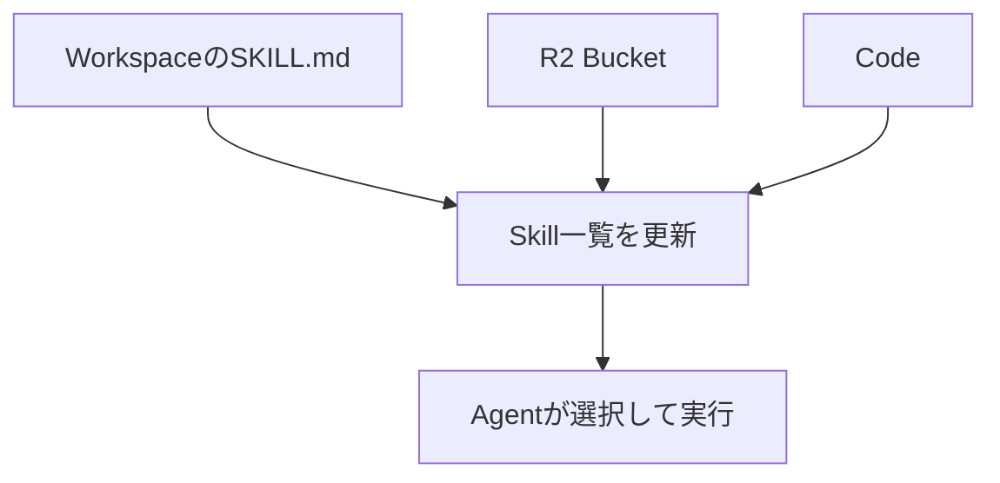
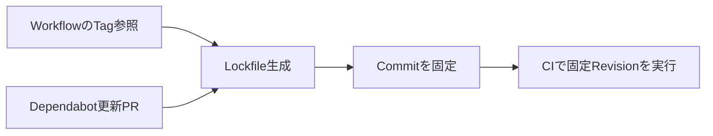

10月29日の公式Releaseと、10月28日の発表で前日までの記事に入らなかった重要な更新を中心に整理しました。今日は**Coding Agentの復旧性、Game Engineの安定化、Agent Skillsの動的運用、CIとAI Applicationの安全性**が主題です。提供段階を明示し、実装時の検証項目まで掘り下げます。

---

## 1. Codex CLI 0.166.0 — Queue再開・Network診断・承認状態の復元を強化

**10月29日公開｜Coding Agentの実行と復旧**

OpenAIは[Codex CLI 0.166.0](https://github.com/openai/codex/releases/tag/rust-v0.166.0)を公開した。今回の中心は新しい生成機能よりも、長い作業を扱う操作性と障害からの復旧だ。Transcriptをキーボードで単語・行・ページ単位に選択し、検索やShortcutで辿れるようになった。非同期の質問、選択肢、回答でもMarkdown表示が統一され、長いSessionで過去の判断理由を確認しやすくなる。

実行面では、MessageをQueueに積んだあとUnloadされたThreadを再開する `codex queue --resume` を追加。 `codex doctor --network-only` は設定、接続性、WebSocketの診断に対象を絞る。Modelの推論失敗とNetwork障害を混同しないためのToolだ。Safety Blockの理由も明確になり、より安全な代替Promptを選択できるようになった。

ResumeやFork後に承認済みPermissionを維持する修正、親ThreadをArchiveから戻したとき子Threadも復元する修正、Reasoning Tokenの計上を保持して想定外のCompactionを防ぐ修正も入った。App Serverの起動・終了競合とTUIの再接続も改善される。Model CatalogにはGPT-6.1 TerraがBundled・Vertex AI・Amazon Bedrock向けに追加されたが、利用可否は各Providerの提供条件にも左右される。

> [!NOTE]
> 修正は特定の不具合に対するもので、すべての接続環境で復旧が保証されるわけではない。

**開発者目線:** Coding Agentを継続運用するなら、正常な一回の実行だけでなく、切断・再開・Fork・権限維持を含む試験が必要だ。Network Errorの診断結果とSessionの状態を記録し、承認境界が意図せず広がらないか確認したい。Transcript操作の改善も、長い変更の根拠を検証する時間を減らす。

---

## 2. Godot 4.8 beta 2 — 約150件の回帰を調査し144修正を収録

**10月29日公開｜Game EngineのPreview**

Godotは[4.8 beta 2の公式Snapshot](https://godotengine.org/article/dev-snapshot-godot-4-8-beta-2/)を公開した。Beta 1から約2週間で約150件のRegression（以前は動いた機能が新Versionで壊れる問題）の検出・解決に取り組み、59人のContributorによる144件の修正を収録した。4.8はFeature Complete段階で、新機能の追加より安定化に重心が移っている。約150件すべてが修正済みという意味ではない点には注意したい。

AnimationではBezier TrackのBox Scalingが誤ったUndo Dataを生成する問題、EditorではStatic Function内でEvaluatorが動かない問題を修正。ImportではLightmap Unwrap Cacheの不具合、RenderingではCompatibility RendererのMultiply Blendingが暗くなる問題を直した。XR ViewportでCamera3Dを使った場合のError Messageも改善され、Particle AngleのDefault Curve Rangeも変更された。

C#利用者にはGodotSharpのDebug BuildでOptimizeが有効になる変更が重要だ。Debug構成の実行特性や測定値が変わる可能性がある。さらに.NET版の最低要件は.NET 8から**.NET 10以上**へ上がり、Build Systemの最低Pythonも3.9から3.10へ更新された。Editorだけ更新してCIのSDKを据え置くとBuildに失敗する可能性がある。

> [!WARNING]
> Beta版は製品向けStable版ではない。公式もBackupやVersion管理を推奨している。

**開発者目線:** Upgrade検証ではScene Import、Animation Undo/Redo、Particle、Blend、C# Debug Build、Exportを別々に確認したい。描画はScreenshot比較、ToolchainはClean Buildで差分を検出できる。Beta段階の修正一覧は、Stable版へ移行する前のRegression Test設計に役立つ。

---

## 3. Cloudflare Agents SDK 0.32.0 — Agent SkillsをWorkspace上のファイルとして扱う

**10月29日公開｜Skill管理方式の変更**

Cloudflareは[Agents SDKのChangelog](https://developers.cloudflare.com/changelog/post/2026-10-29-agent-skills-from-files/)で、Agent SkillsをFileとして管理する方式を発表した。Computer Workspaceの `/workspace/.agents/skills/` に `SKILL.md` を含むFolderを置けば、次のTurnからAgentが利用できる。更新のたびにBuild・Deployする必要がなく、Agent自身がSkillを書き換える構成も可能になる。Skillを実行中に読み替えられる手順書として扱う設計だ。

SourceはWorkspace、R2 Bucket、Codeの3種類。Thinkは各Turnの前にSkill一覧を再取得する。公開Agent Skills Specificationに従ってFormatを検査し、違反があってもWarning付きでLoadされるため、書き込む前に `parseSkill()` で検証することが推奨される。Skill内のScriptはWorkspace Fileとして配置し、Workspaceの `exec` Toolから実行する。Think、Pi Durable、AI SDKで共通の `activate_skill` と `read_skill_resource` を使える点も特徴だ。

**Breaking Change**もある。従来の `agents:skills` Vite Import、`agents/skills/compile`、`SkillRegistry`、Thinkの `skillWorkspace` が削除され、`runner()` の場所も変更された。公式はAgents SDK v0.32.0、Think v0.23.0以降を指定している。既存Codeで旧APIを使っていれば単純なVersion Updateでは動かない。

**開発者目線:** 動的Skillは柔軟だが、どのRevisionを読んで実行したかを記録しないと再現性が落ちる。変更履歴・検証・承認・Rollbackを設計し、Agentが生成したScriptを無条件に高権限で実行しない境界を用意したい。

---

## 4. GodotがXREAL AURAへ対応 — OpenXR Spatial Containersで空間アプリを制作

**10月28日発表｜Android XR**

Godot Foundationは[公式発表](https://godotengine.org/article/godot-xreal-aura-launch/)で、光学透過型のAndroid XR Glass「XREAL AURA」のLaunch LineupにGodotが加わると発表した。単にGodot製Appが動くのではなく、端末上でGodot EditorとCompanion Appを利用し、空間Workspace内で開発・Export・公開まで進められるという。Desktopでの制作工程を空間端末へ持ち込む試みとして興味深い。

技術的な中心は**OpenXR Spatial Containers**。これはOSが管理する3D Content用のVolumeで、DesktopのWindowに似た役割を持つ。Applicationが視界全体を占有するVRとは異なり、現実世界を見ながら机の上などに3D Objectを配置できる。Hand Trackingや空間Displayと組み合わせ、物理空間をUIの一部として扱う。

Godot Foundation、Blender Studio、W4 Gamesは、3D作品「DOGWALK」をXREAL AURA向けSpatial版へPort中だ。公式は年内公開に向けて仕上げを進めていると説明しており、現時点でSpatial版が公開済みという意味ではない。既存の3D Gameを移植する場合、Cameraの基準、Objectの実寸、操作距離、視野角、現実空間との遮蔽などを再設計する必要がある。

| 通常の3D画面 | Spatial Container |
| --- | --- |
| Cameraが画面全体を決める | 現実空間とOS管理Volumeが基準 |
| ControllerやTouch中心 | Hand Trackingなどを検討 |
| UIはScreen座標が基本 | 距離・角度・実寸が重要 |

**開発者目線:** XR移植はRenderできた時点で完成ではない。まずObjectのScaleとInteraction距離を検証し、実機でTracking精度、Latency、文字の読みやすさ、Performanceを測りたい。OpenXRの標準化された概念を使えばDevice依存を減らせる可能性があるが、個別端末の品質検証は欠かせない。

---

## 5. GitHub Actions Workflow LockfileがGA — Tag参照とCommit固定を両立

**10月28日公開｜CIのSupply Chain Security**

GitHubは[Workflow Dependency LockfileのGA](https://github.blog/changelog/2026-10-28-github-actions-workflow-lockfiles-are-generally-available/)を発表した。従来、Actionを `actions/checkout@v4` のようなTagで参照すると読みやすい一方、参照先が移動する可能性がある。Commit SHAへ固定すれば再現性は上がるが、YAMLの可読性と更新管理が難しくなる。新しいLockfileはWorkflowにTagやBranch参照を残し、実行時には固定済みのCommitを使う。

GitHub CLIの `gh actions-lock` Extensionで `.github/workflows/actions.lock` を生成し、直接・間接のAction Dependencyを固定できる。導入はWorkflow単位で段階的に進められるが、対応Workflowでは全DependencyをLockする必要がある。DependabotがActionのVersion Update PRを作ると、対応するLockfileも同じPRで更新する。変更をReviewする入口と実行するRevisionを一致させやすい。

Enterprise・Organization・Repositoryの管理者はLockfile必須Policyを設定でき、古いLockfileを変更せず検出するCheckもある。GitHub Enterprise Cloud（Data Residency版を含む）、Team、Freeで利用可能だ。ただし**固定されていることと安全であることは別**。悪意あるCommitをLockすれば、その悪意ある処理が再現性高く動く。公式も依存のReviewを推奨している。

**開発者目線:** CI結果が突然変わったとき、Application CodeだけでなくAction自体の更新が原因になり得る。Lockfile導入後はAction更新PRで権限・差分・Release Notesを確認し、特にSecretへアクセスする外部Actionを重点的にReviewしたい。

---

## 6. GitHub Copilot FusionがLocal Modelを選択 — Windows MLとBYO Runtimeを試験導入

**10月28日公開｜Experimental Preview**

GitHubは[Copilot FusionのLocal Model Routing](https://github.blog/changelog/2026-10-28-github-copilot-fusion-now-supports-selection-of-local-models/)をExperimental Previewとして公開した。前日紹介したFusionのModel編成に対して、今回は実行先の選択肢へDevice上のModelを加える新機能だ。Copilot CLI、Copilot App、VS Codeで対応Local ModelとCloud Modelを使い分けられる。軽いTaskを手元の計算資源へ振り分ける運用が考えられる。

Windowsの対応DeviceではWindows ML Provider経由でMAI Code 1.1 FlashをDownload・設定できる。CLIはExperimental Modeと `/model`、Copilot AppはModel ProviderとLocal Routing設定、VS Codeは `chat.copilot.localModel.enabled` が入口だ。CLIではmacOS・LinuxでもOpenAI互換Serverを手動設定し、MAI Code 1.1 FlashやQwen3.8 Flash NextをRouting対象にできる。ただし十分なMemoryとComputeが必要になる。

重要なのは**Local推論でも完全Offlineにはならない**こと。FusionのRouting判断はCloud側で行われると公式に明記されている。Copilot Appの自動Routingは現時点で管理されたWindows ML Modelに限定され、手動接続したLocal Modelを直接選べても自動Routingの対象とは限らない。CLIでもBYOK設定で見つかったModelが自動的にFusion対象になるわけではない。

> [!WARNING]
> Experimental PreviewのためClient・Model・Policyの対応は変わり得る。Local Modelを選べることと、外部通信しないことを混同しない。

**開発者目線:** LocalとCloudの混在を評価するなら、Cost・Latency・Task成功率だけでなく、どのDataがどこへ送られるかを記録したい。完全Offlineが要件なら、Fusionとは別のNetwork非依存経路を検証する必要がある。

---

## 7. GitHub Code ScanningがAI Applicationの脆弱性を検出 — Prompt Injection経路をPRで警告

**10月28日公開｜Public Preview**

GitHubは[AI Application向けCode Scanning](https://github.blog/changelog/2026-10-28-code-scanning-for-ai-applications-in-public-preview/)をPublic Previewで発表した。従来のStatic AnalysisがSQL Injectionなどを探すのに対し、LLM Agentでは外部文章に埋め込まれた命令がTool利用へ混入する危険がある。新しいScannerはIndirect Prompt Injection、Sensitive Information Disclosure、Excessive Agencyなどを対象として挙げている。

Indirect Prompt Injectionは、WebpageやIssue Comment、Fileに紛れた不正な指示が、Agentの行動を変える問題だ。ScanはPull Request作成時に既存のCodeQL Analysisと並んで走り、Untrusted ContentがTool・Data・Business Systemへアクセス可能なModelへ到達するCode Pathを検出する。単なる禁止語検索ではなく、**信頼できない入力と実行権限のつながり**に注目する。

結果はPR上にAlertと修正Guidanceとして表示される。たとえば外部DocumentをSystem Instruction相当の場所へ連結したり、Read TaskへWrite Toolを渡したりする構成を見直す手掛かりになる。ただしStatic Analysisで全ての攻撃を検出できるわけではない。Runtimeの権限制御、Tool Resultの検証、Human Approvalも必要だ。利用にはGitHub Advanced Security Licenseが必要で、github.comのPreviewのみ。Enterprise Serverは現時点で対象外となる。

**開発者目線:** Agentを組み込むServiceでは、User入力・検索結果・Tool応答・System Instructionを設計図で区別し、どこで権限を越えるかReviewしたい。Scannerは補助線として使い、特に外部文章を要約するだけのAgentへ不要な書き込み権限がないか確認する。

---

## 8. GitHub Push Protectionが未知形式のSecretをAIで検出 — Contextを見てCommitを遮断

**10月28日公開｜Public Preview・課金に注意**

GitHubは[AI検出を使うPush Protection](https://github.blog/changelog/2026-10-28-push-protection-beyond-predefined-secret-patterns/)をPublic Previewで発表した。従来はProvider固有のToken形式など定義済みPatternを中心に検出していたが、社内Serviceの独自API Keyは普通の文字列と区別しにくい。新しいClassifierは周囲のCodeでの使われ方を評価し、既知Patternに一致しないSecretもPush前にBlockする。

対象RepositoryでAI-detected SecretsとPush Protectionが有効なら追加設定で利用できる。新しいPushだけでなくGitHub UIでのCommitやFile Uploadにも適用され、検出時はSecretの位置を示して拒否する。GitHubは初期結果として、Secretを検出したPush数が従来の2倍超になったと報告している。ただし同社の初期観測であり、あらゆるRepositoryで同じ検出率になる保証はない。

Blockされた場合はPushに含まれる**全CommitからSecretを除去**して再試行する。最新Fileだけ直しても履歴に残れば解決しない。既存のBypass・Delegated Bypassは使えるが、Agentが承認なしに回避してよいわけではない。機能はDefaultで無効。GitHub Secret ProtectionまたはGitHub Advanced Security利用Organizationが対象で、Opt-inと有効化後はAI Creditの課金が始まる。Post-pushのAI Secret Alertとは課金条件が異なる。

**開発者目線:** 独自Credentialが多いRepositoryでは有益だが、導入前に誤検出時の承認担当、漏洩Tokenの失効手順、AI Credit予算を決めたい。短命Token、最小権限、SecretをCommitしない設計、履歴Scanと組み合わせて防御を重ねる必要がある。

---

## 9. Cloudflare MCP AnalyticsがStatus別集計に対応 — 既定値変更で時系列比較に注意

**10月28日公開｜Agent ToolのObservability**

Cloudflareは[MCP Tool-call Analytics更新](https://developers.cloudflare.com/changelog/post/2026-10-28-mcp-analytics-response-status/)を発表した。Account・Portal・Server単位のTimeseries Endpointに `response_status` Query Parameterが加わり、`success`、`error`、`cached`、`all` を指定できる。AgentがToolを何回呼んだかを、成功・失敗・Cache Hitへ分けて観測するための実務的な変更だ。

注意したいのは**Default値が `success` になった**こと。従来のCountは失敗やCacheされたCallも含んでいたが、更新後はParameterを省略すると成功のみを数える。Dashboardの数字が急に減っても、Traffic減少ではなく集計定義の変更かもしれない。以前と同じ全StatusのCountが必要なら `response_status=all` を明示する。応答にも選択したStatusが含まれ、不正値や空文字列はHTTP 400になる。

MCPはModelが外部Toolを使うProtocolだ。失敗には認証不足、Rate Limit、Timeout、Tool側Errorなど様々な原因がある。成功数だけでは利用者の体験もAgentの作業量も正しく評価できない。Cache Hitの増加はLatency改善につながる可能性がある一方、鮮度が必要なToolでは古い結果を返していないか検証が必要になる。

| 条件 | 主な用途 |
| --- | --- |
| `success` | 正常処理量 |
| `error` | 障害や権限問題 |
| `cached` | Cache利用傾向 |
| `all` | 以前の総Call数との比較 |

**開発者目線:** Observability APIのDefault変更は実質的な互換性変更だ。Queryへ集計条件を明記し、監視指標の定義と更新日を残したい。Agentの品質はCall数だけでなくTask成功率・Retry数・Latency・Tool別Error率を並べると原因を追いやすい。

---

## 10. GitHub ActionsがLinux RunnerをMulti-cloud化 — AWS追加でIP Allowlistに影響

**10月28日公開｜CI基盤の信頼性向上**

GitHubは[GitHub-hosted RunnerのMulti-cloud対応](https://github.blog/changelog/2026-10-28-github-actions-adds-multi-cloud-compute-to-improve-reliability/)を発表した。従来のAzureに加えて条件を満たすLinux JobをAWSでもScheduleし、Peak時のCapacity不足やQueue待ちを減らす狙いだ。Workflow YAMLやRunner Labelは変更不要で、GitHubがCompute Poolから実行先を選ぶ。開発者に見えない基盤変更だが、Network制御の厳しい環境では影響がある。

対象は標準の2-core・4-core Linux Runnerと、特殊構成のない互換Larger Runner。Windows RunnerやPrivate Networkingなどの特殊構成は対象外だ。GitHub Free・Pro・Teamでは対象Jobへ自動適用され、Enterprise Cloudでは設定からAWS ComputeをOpt-inできる。「全Jobが突然AWSへ移る」という話ではなく、PlanとRunner構成によって適用範囲が違う。

実務上の落とし穴は**Outbound IPの追加**だ。AzureやMicrosoft所有IPだけをAllowlistに登録した外部Database、社内API、Microsoft Entra Conditional AccessなどはAWSで動いたJobを拒否する恐れがある。GitHubは `GET https://api.github.com/meta` の `actions` 配列にあるIP Rangeへ追従するよう推奨する。特定Cloud ProviderのIPに依存する設定は今後の拡張にも弱い。

> [!WARNING]
> Allowlistを広げる場合も送信元IPだけを認証手段にせず、OIDC・短命Credential・最小権限を組み合わせる。

**開発者目線:** CIが時々だけ外部APIへ接続できない場合、CodeではなくRunnerの実行先変更が原因かもしれない。Network Error、Runner環境、Authentication Failureを分けて記録し、固定IPが必須ならSelf-hosted Runnerなど別方式も検討したい。

---

## 👀 今日ならこの3つ

### 🥇 Cloudflare Agents SDKのファイル型Skills

Build・Deployを挟まずSkillを更新できる設計は、Agentの運用と再現性を考えるうえで重要です。Breaking Changeもあるため移行点を確認したい話題です。

### 🥈 Godot 4.8 beta 2

回帰修正とToolchain要件の変更が具体的で、Engine Upgradeの検証項目を準備する材料になります。PreviewとStableを混同しないことが大切です。

### 🥉 GitHub Actions Workflow Lockfile

Tagの読みやすさとCommit固定を両立し、CIの再現性とSupply Chain対策に役立つ実務的な機能です。
