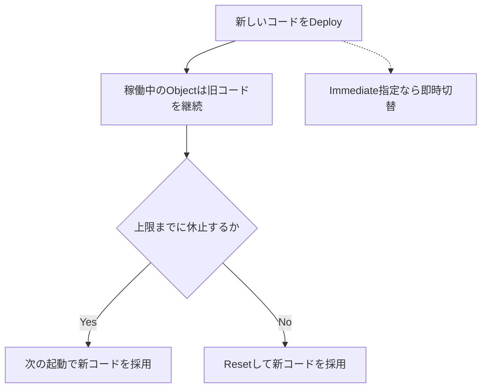
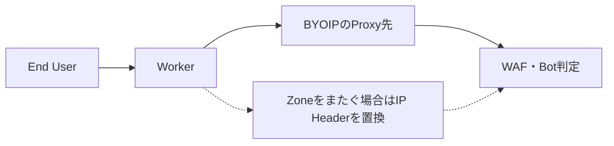

10月29〜30日に公開された一次情報を中心に、**Open-weight AIの実用化、Coding Agentの権限と復旧、Cloud Serviceの互換性・運用変更**を取り上げます。直近7日間の記事と重複しない更新を選び、発表日と適用日、公式の公称値と実運用上の検証事項を区別しました。

---

## 1. Mistral Large 4の重みを公開 — Coding Agentと防御的セキュリティを重視したLe Chonk

**10月29日発表｜Open-weight Modelの実公開**

Mistralは10月初めにAPIのPublic Previewを始めた大型モデル「Mistral Large 4（Le Chonk）」について、改良版の**モデル重みを実際に公開**した。[公式発表](https://mistral.ai/news/mistral-large-4-oss/)では、プレビュー期間中の追加強化学習でCoding Agentや防御的な脆弱性調査の能力を伸ばしたと説明している。今回の新情報は単なるAPIの提供開始ではない。利用者が重みを取得し、自分の推論環境に配置し、用途に合わせて調整できる段階へ移った点にある。モデルは総パラメータ約1兆規模のMixture-of-Experts（MoE）方式で、推論時には一部の専門ネットワークを選択して使う。

公表されたCoding Agent Indexのスコアは48%で、比較対象のGLM-5.3とほぼ同水準ながら、タスク当たりのToken使用量を平均47%削減したという。Terminal-Bench 4.0ではPreviewから13ポイント改善して41%。これらは**発表資料で紹介された評価条件での結果**であり、任意の開発リポジトリで同じ差が出る保証ではない。推論の深さはLow・Medium・Highの3段階で、Highが既定。単純な変換と難しいRepository改修を同じ推論設定で処理しない設計が可能になる。

防御的セキュリティでは、脆弱性の発見・再現・修正を測るCyber Indexで51%と報告された。一方、危険な依頼を拒否する能力も評価している。ここで重要なのは、ベンチマークでの拒否率と実運用での安全性は同義ではないことだ。利用規約も確認したい。重みは標準MITそのものではなく「Mistral Ecosystem Open-Weight license」で、Model-as-a-Serviceを商用提供する事業者には別途ライセンスが必要とされる。APIの新料金は入力100万Token当たり0.70ドル、出力2.10ドル、キャッシュ入力0.07ドルと案内されている。

> [!WARNING]
> Open-weightは無条件の再配布・再販売自由を意味しない。ライセンスとモデルカード、必要なGPU Memory、実際の推論費用を個別に確認する必要がある。

**開発者目線:** モデルを選ぶ際は一問一答の正答率だけでなく、**修正PRの採用率、Token消費、実行時間、失敗時の再試行回数**を一組で測りたい。公開重みなら社内コードを外部APIへ送らずに評価する構成も検討できるが、モデル自体が大規模なので、自己ホストが常に安価とは限らない。まず同一の実務タスクをAPIと自己ホスト候補で走らせ、品質と総コストを比較するのが現実的だ。

---

## 2. Claude Code 2.1.314 — 作業ディレクトリ外への書き込み制限とDesktopのIdle Compaction

**10月30日公開｜Agentの権限境界と長時間Session**

Anthropicの[Claude Code v2.1.314リリースノート](https://github.com/anthropics/claude-code/releases/tag/v2.1.314)では、生成品質そのものよりもAgentの実行境界、管理者ポリシー、Sessionの復旧性に重点が置かれた。新設定の `permissions.blockWritesOutsideWorkingDirectories` は、Write・Edit・NotebookEditが作業ディレクトリの外へ書き込む操作を、Permission Modeにかかわらず拒否する。通常の「確認すれば許可できる」運用と違い、明示的に書き込み対象の範囲を絞る仕組みだ。誤った絶対Pathや隣のProjectへの書き込みを防ぐ多層防御として使える。

VS CodeとClaude DesktopのCodeタブでは、20万Token以上の会話を長時間放置し、Prompt Cacheが期限切れになった場合に、次の発言に備えて要約するIdle Compactionが追加された。これは会話のすべてをそのまま保持する機能ではなく、古い内容を要約してContextを整理するもの。長い調査の途中で再開する使い方では、以前の判断条件が要約後も正しく残っているかが重要になる。大量の画像を含むBedrock SessionでCompactionに失敗する問題も修正された。

運用上は、管理者がModelの推論Effortを制限している場合の「Invalid effort level」連続失敗を回避し、利用可能な段階へ下げて再試行する変更が入った。また `claude -p` が起動失敗時に出力なしの終了コード0を返していた問題を修正し、エラーと終了コード1を返すようにした。CIでは終了コード0を成功として扱うため、これは小さく見えて重要な正しさの改善だ。PowerShell Hookの終了コード2が拒否として扱われない問題や、再開したWorktreeにSandbox保護が適用されない問題にも対処している。

| 更新領域 | 従来のリスク | 今回の改善 |
| --- | --- | --- |
| 書き込み先 | 誤った範囲へ編集 | 作業ディレクトリ外を拒否 |
| 長い会話 | Cache失効後の再開負担 | Idle時にContextを要約 |
| 非対話実行 | 起動失敗を成功扱い | 終了コードとエラーを修正 |

**開発者目線:** Agentの品質は「コードを書けるか」だけでは測れない。CIでの失敗検知、Workspace外への書き込み防止、再開後のSandbox継続を**自動テスト可能な契約**として扱いたい。特に `-p` をScriptから使う場合は、標準出力が空でも終了コードを検査し、必要なら成果物の存在や内容も別途検証する。Idle Compactionを使う長期作業では、必須要件をRepositoryの指示ファイルやテストに固定しておくと要約への依存を減らせる。

---

## 3. Cloudflare Durable Objects — Deploy時のコード更新を最大5分遅延する方式が既定に

**10月30日公開｜長時間接続と安全なDeploy**

Cloudflareは[Durable Objectsのコード更新戦略](https://developers.cloudflare.com/changelog/post/2026-10-30-durable-objects-deferred-code-updates/)を変更し、**新しいコードをDeployしても稼働中のObjectを直ちに入れ替えない**方式を既定にした。Durable Objectは特定IDの状態を持つ処理を一つの実体として動かせる仕組みで、WebSocketを使うチャット、共同編集、長時間動くAgentなどで利用される。従来はDeployによるコード更新が進行中の処理や接続を中断することがあり、更新のタイミング自体が可用性に影響していた。

新方式では、活動中のObjectが休止状態（Hibernate）へ移るのを待ち、既定で最大300秒まで旧コードを継続できる。Hibernation APIを使うWebSocketは、Objectが新しいコードへ切り替わる際も接続を維持できる場合がある。ただし「5分間必ず生き続ける」保証ではない。CloudflareのRuntime更新などで早くResetされる可能性がある。遅延の上限は `durable_objects.code_update_strategy` の `max_delay` で変更でき、0〜86400秒の範囲を指定できる。

コード更新の概念は次のようになる。新VersionのDeployと、その瞬間にすべてのObjectが同じVersionを実行し始めることは別の出来事になる。

運用で注意したいのは、**新旧Versionが同時に存在する時間帯**が生まれることだ。外部APIやDBのSchemaを新Version専用へ一度に変えると、旧コードのObjectが互換性を失う。緊急修正やDeploy直後の検証で新Versionを即時反映させたい場合は、WranglerのDeploy Optionで `immediate` を指定できる。段階的DeployやRollbackの設計と合わせて扱う必要がある。

**開発者目線:** 長寿命接続を持つサービスでは、Deployを「プロセスを入れ替える瞬間」ではなく**Versionが共存する移行期間**として設計するのが重要だ。Schema変更を追加→両Version対応→旧項目削除の順で進め、接続継続率、未完了Job、ObjectのVersion、Reset回数を観測したい。AgentがTool呼び出し中にDeployされるケースも再現し、再実行時の二重処理を防ぐIdempotency Keyを用意すると堅牢になる。

---

## 4. Cloudflare Browser RunがChrome 152へ更新 — UA・Crawl・Markdown抽出も変更

**10月30日公開｜Browser Automationの実行環境**

Cloudflareは[Browser Runの更新](https://developers.cloudflare.com/changelog/post/2026-10-30-chrome-152/)で、既定のブラウザエンジンを**Chrome 152**へ変更した。Browser RunはWebページを実際のブラウザで開き、操作・取得するためのサービスで、Coding Agentの画面確認やWebデータの抽出に利用できる。アプリ側のコード変更なしで新しいWeb Platform機能、描画修正、Security Patchが適用される一方、ブラウザVersionの変化はScreenshot比較やDOMの動作確認に影響する可能性がある。

今回は単なるChromeの更新にとどまらない。Quick Actionsの既定User-AgentがChrome 119から152へ変わり、一般的なChromeからのアクセスに近いRequestへ改善された。User-Agentを文字列で厳密に照合しているサイトや、Bot判定の例外ルールを持つ環境では、更新後に挙動が変わり得る。必要なら `userAgent` Parameterで独自の値を指定できるが、UAを固定するだけで互換性が保証されるわけではない。

抽出APIでは `/links` が相対URLではなく絶対URLを返すようになり、Links-only Crawlも相対Linkを辿れるようになった。 `/markdown` とCrawlのMarkdown出力では、コードブロックの言語指定が保持される。大量のResponse Headerを返すページの読み込みや、Timeout時のエラー表現も改善された。Root Certificate Storeから信頼を失った証明書が削除されているため、古い証明書チェーンに依存したサイトへの接続は変化する可能性がある。

> [!NOTE]
> 既定UAや抽出結果の形式変更は、サービスの「改善」であっても既存のParserには互換性変更になり得る。特に相対URLを前提に `new URL(path, base)` を組み立てている処理を確認したい。

**開発者目線:** Browser Agentの回帰テストでは、ページを開けるかだけでなく、**Linkの正規化、MarkdownのCode Fence、Screenshot、Timeout時のRetry判断**を分けて検証したい。ブラウザVersionを変えた前後で同じURLセットを走らせ、抽出件数・HTTP Status・最終URLを比較すると、静かに起きるデータ品質低下を見つけやすい。自動テストの失敗原因を「アプリの変更」と「実行ブラウザの変更」に切り分ける記録も有効だ。

---

## 5. Cloudflare D1 — 11月4日からSQLクエリ結果に50MBの上限

**10月30日告知｜11月4日施行予定の制限**

Cloudflareは[公式Changelog](https://developers.cloudflare.com/changelog/post/2026-10-30-query-result-size-limit/)で、D1の**1回のQuery結果を最大50MB**に制限すると告知した。適用開始は2026年11月4日（水）。制限を超える結果を返した場合は `D1 query result exceeded the maximum response size limit of 50 MB` というエラーになる。これはDatabase全体の容量や1行の最大サイズについての発表ではなく、SQL Queryが返す結果サイズの上限である点を区別したい。

Cloudflareによると、50MBの境界は既存Requestの99.999パーセンタイルをカバーするため、大半の利用者に影響はない見込みだ。ただし、運用バッチが `SELECT *` で大きなTableを一括取得するケース、監査用に多数のRowをまとめて読み出すケース、JSONなど大きな値を列として保持するケースでは、通常の画面操作では起きない失敗が発生し得る。制限を超えたQueryは部分的に成功するのではなく、エラーとして扱う設計が必要だ。

公式は必要なColumnだけを `SELECT` し、 `LIMIT` と `OFFSET` によるPaginationで結果を小さくすることを推奨している。大量のPageを順番に取得する処理では、同時更新により重複・欠落が起きる可能性があるため、Application側では安定したSort KeyやCursor方式も検討したい。なおD1のREST APIを使うImport・Exportは今回の50MB制限の対象外と明記されている。大量データ移行を通常のQueryで代用する必要はない。

| 操作 | 今回の制限 | 対応方針 |
| --- | --- | --- |
| 通常のSQL Query結果 | 50MB超でエラー | 列を絞る・分割する |
| 大量Rowのページ取得 | 各Queryの結果が対象 | 順序と再開位置を管理 |
| REST API Import/Export | 今回の対象外 | 専用APIを使う |

**開発者目線:** 本番で突然失敗する前に、**結果の大きいQueryをログや計測で洗い出す**のが先決だ。テストでは境界値に近いResultを作り、エラーがユーザーにそのまま露出せず、適切なRetryや分割へつながるか確認したい。大量のデータをAPIから返す設計そのものを見直し、Streamingや集計Queryで通信量を減らせるかも検討するとよい。

---

## 6. Nuxt Image・IPX向け緊急WAFルール — 部分的保護で既定は無効

**10月30日公開｜画像処理の攻撃面**

Cloudflareは[10月30日の緊急WAF更新](https://developers.cloudflare.com/changelog/post/2026-10-30-emergency-waf-release/)で、Nuxt ImageとIPXに関係する脆弱性向けの検出Ruleを追加した。Ruleの説明は「Explicit GIF or Animation Modifier Exposure」で、Managed Rulesetへ新しい検出条件が加わっている。ただし、**初期状態はDisabledで、保護範囲もPartial（部分的）**と明記されている。WAFの更新を確認しただけで、アプリケーションが修正済みと判断してはいけない。

Nuxt Imageは画像の変換や最適化を担うため、画像URLや変換Modifierが外部入力に近い形で処理されることがある。こうした経路は通常のHTMLフォームとは異なるため、画像を表示するだけの機能も入力検証の対象になる。今回のChangelogは具体的な攻撃手順、影響するPackage Version、修正版の番号までは記載していない。したがって、その情報を推測して断定するのは避け、Nuxt Image・IPXの公式AdvisoryとReleaseを確認する必要がある。

WAFはRequestの特徴から既知の攻撃を検出するが、Application内部の処理を完全に修正するものではない。特に今回のように「部分的な保護」と書かれている場合、Ruleが一致しない入力経路や、別の表現を使ったRequestまで守れると考えるのは危険だ。CloudflareはAdvisoryを参照し、最新の修正版へPatchすることを推奨している。Ruleを有効にする際も、正規のGIF画像変換が誤って遮断されないかLogで確認したい。

> [!WARNING]
> WAFルールは既定で無効。対象環境への適用可否と誤検知を確認したうえで、**依存Packageの修正を優先**する必要がある。公式発表にない影響VersionやCVE番号はここでは断定しない。

**開発者目線:** 画像最適化Endpointは見落とされやすい攻撃面だ。入力URL、Modifier、外部画像の取得先、変換時のMemory上限を棚卸しし、Security Testの対象に入れたい。緊急Ruleは防御の追加レイヤーとして評価しつつ、PackageのSBOM・Lockfile・Release Notesを照合して修正状況を追跡する。WAFの検知件数だけで安全性を判断せず、アプリ側のRegression Testを継続することが重要だ。

---

## 7. Cloudflare WorkersのBYOIP宛てSubrequest — 元のClient情報を維持して誤判定を削減

**10月30日公開｜Proxy間通信とSecurity Context**

Cloudflareは[Workers Subrequestの修正](https://developers.cloudflare.com/changelog/post/2026-10-30-byoip-workers-subrequest-context/)で、Bring Your Own IP（BYOIP）を使うCloudflare Proxy配下のHostnameにWorkerからアクセスしたとき、元のRequestのContextを維持するようにした。BYOIPは利用者が保有するIP AddressをCloudflareのNetworkで運用する仕組み。従来は一部のSubrequestが外部Internetからの通信と解釈され、元のClient Signalが失われることがあった。

この違いは、Bot ManagementやWAFの判定へ直接影響する。たとえばブラウザからWorkerへアクセスし、Workerが別ZoneのAPIを呼ぶ構成で、転送先がCloudflare内部の接続だけを見てしまうと、本来の利用者の特徴を使った評価ができない。場合によっては正当なRequestが誤って403になったという。今回、 `CF-Worker` Headerと `cf.worker.upstream_zone` Fieldが保持され、Bot Score、Verified Bot Status、JA3/JA4 Fingerprintも影響するBYOIP経路では元のEnd User接続を反映する。

ただしClient IPの扱いには例外がある。異なるZone間のSubrequestでは、Security上の理由から `CF-Connecting-IP` はCloudflareが定めるWorkers Client IP `2a06:98c0:3600::103` になる。一方、同じZone内のSubrequestでは元のClient IPが引き継がれる。つまり「Client情報を維持する」という更新は、すべてのHeaderがそのまま転送されるという意味ではない。Headerごとの意味と信頼境界を確認する必要がある。

**開発者目線:** CDNやReverse Proxyを重ねると、**誰の情報をどの層で信頼するか**が難しくなる。Security Ruleの条件に `CF-Connecting-IP` を直接使っている場合、Same-zoneとCross-zoneを分けたIntegration Testが必要だ。以前の誤403が解消したかを確認するだけでなく、Ruleの評価対象が意図せず広がらないか、Bot Scoreと監査ログを比較したい。

---

## 8. GitHub Webhookの送信元IP範囲が追加 — 静的Allowlistは更新が必要

**10月29日公開｜Webhook配信のNetwork設定**

GitHubは[公式Changelog](https://github.blog/changelog/2026-10-29-webhook-ip-ranges-added-to-the-meta-api/)で、github.comから送信するWebhookのIP Rangeを追加した。対象はFreeからEnterprise CloudまでのGitHub.com上のWebhook配信。新しいCIDR Prefixは `9.234.98.160/28`、 `9.234.98.176/28`、 `9.234.106.48/28` の3つで、Meta APIの `hooks` Fieldにも反映されている。Webhook受信ServerのFirewallやWAFで送信元IPを固定リスト管理している場合、追加分を許可しないと正規のイベントが届かなくなる可能性がある。

GitHubのWebhookはPush、Pull Request、Issueなどのイベントを外部サービスへ通知する仕組みだ。CI起動、Chat通知、Issue同期など、Event-drivenな自動化の入口に使われる。アプリケーションコードを変えていないのに通知だけ突然欠ける場合、GitHub側の配信障害と決めつける前に、NetworkのAllowlistが古くないかを確認したい。公式はMeta APIからIP Rangeを自動取得している環境では今回の追加に伴う変更は不要としている。

ここでIP制限とWebhookの真正性検証は役割が異なる。送信元IPのAllowlistはNetwork上の絞り込みだが、イベントPayloadが期待した送信元から改ざんされず届いたことの証明には、Webhook Secretを用いた署名検証が必要になる。IP Rangeは運用上変更されるため、固定値をコードへ埋め込むだけの設計は更新漏れを生みやすい。Meta APIの取得失敗時にも直近の有効なリストを保持するなど、更新処理の障害対策が要る。

| 確認対象 | 目的 | 注意点 |
| --- | --- | --- |
| Meta APIのhooks | 送信元IPの最新化 | 更新失敗時のFallback |
| Firewall Allowlist | 不要な通信を絞る | 追加Prefixを漏らさない |
| Webhook署名 | Payloadの真正性 | Secretの安全な管理 |
| 配信履歴 | 欠落や再送を調査 | Event IDで重複排除 |

**開発者目線:** Webhook受信を運用するなら、**配信履歴・HTTP応答・Firewall拒否ログを突き合わせられる状態**が重要だ。IP Rangeの定期同期を行い、更新前後の差分を監査できるようにしたい。再送で同じEventが届いても処理を二重実行しない設計と、署名の検証を組み合わせると、Network変更に強いAutomationになる。

---

## 9. Cloudflare Audit Logs v2にAccount Analytics — 失敗率と操作主体を可視化

**10月30日公開｜監査ログの分析UI**

Cloudflareは[Audit Logs v2のAccount Analytics](https://developers.cloudflare.com/changelog/post/2026-10-30-audit-logs-v2-account-analytics/)を公開した。従来、監査ログを読むには個々の操作履歴を検索し、誰が何を変更したかを追うことが中心だった。新しい画面では、選択した期間の操作を成功と失敗に分けた時系列Chartを表示し、Total Actions、Unique Actors、Products Impacted、Failure Rateの集計Cardから詳細を絞り込める。

Cardを選ぶと、操作Type、認証方式、実行したActor、影響したProduct、失敗したActionなどへ分析を掘り下げられる。値をFilterに含めることも除外することもでき、集計と下部のLog Tableが連動する。たとえばデプロイ直後に設定変更の失敗率が急増した場合、期間を絞ってどのActor・Productに集中しているかを調べられる。複数のサービスを管理する組織では、失敗件数の単純な増加と、全体の操作量が増えたことによる増加を区別しやすくなる。

一方、今回のAnalyticsは**Account-levelのAudit Logsに限定**され、Organization-levelの監査ログには提供されない。複数Accountをまとめた横断的な統計が、この画面だけで完成するわけではない。Audit Logは誰が設定を変更したかを示すが、その操作がアプリケーションの障害を直接引き起こしたことまで自動的に証明するものではない。障害調査ではDeploy履歴、Traffic Metric、Error Logとの時間的な照合が必要だ。

監査ログの見方を「不審な操作を検索する」から「通常時の変化を捉え、異常な分布を掘る」へ広げる点が興味深い。失敗率の上昇はCredential期限切れ、権限変更、誤ったAPI操作など複数の原因を示し得るため、集計は調査の出発点として使うのが適切だ。

**開発者目線:** IaCやCI/CDからCloudflareの設定を変更するなら、**実行主体を個人Credentialから分離し、操作の相関IDやDeploy時刻を残す**と分析の価値が上がる。導入後は普段の操作件数と失敗率をBaselineとして記録し、失敗が増えた時間帯に権限・API変更がないか確認したい。Analyticsは検出を助けるが、Rollbackや承認Workflowの代わりにはならない。

---

## 10. Cloudflare SCIM Population Viewer — IdPから同期されたUser・Groupを画面で調査

**10月30日公開｜Identity Provisioningの可観測性**

Cloudflareは[SCIM Population Viewer](https://developers.cloudflare.com/changelog/post/2026-10-30-scim-population-viewer/)を追加し、Identity Provider（IdP）からCloudflare OneへProvisioningされたUserとGroupをDashboardで調べられるようにした。SCIMはIdentity情報をサービス間で同期する標準で、入社・異動・退職に応じてAccountやGroup Membershipを管理する際に使われる。従来、Cloudflare側が何を受け取っているか確認するためにAPIを呼び出したり、Supportへ問い合わせたりする必要があった場面を減らす更新だ。

Zero TrustのIdentity Provider設定からSCIM Resourceの件数を選ぶと、UserはUsername・Email・Name・Resource ID、GroupはNameやIDで検索できる。Attributeを整形表示またはJSONで確認し、Group Memberも閲覧できる。Cloudflare側のResource IDとIdP側のIDをProvisioning Logと比較できるため、「IdPではGroupに入っているのにCloudflareのPolicyに反映されない」といった問題を段階的に切り分けられる。

重要な制限として、このViewerは**現在ProvisioningされているResourceの状態**を示すもので、同期Eventの履歴そのものではない。失敗したRequestや削除・再作成の経緯を追うには、別途SCIM Provisioning Logsを使う必要がある。Edit Permissionがある場合は個別ResourceをSCIM Populationから削除できるが、誤った削除はAccess Policyや利用者の認証に影響する可能性がある。既存のDeprovisioningやPolicyの挙動は変更されていない。

Identity同期は、最終的なLoginの可否だけを見ていても原因が見えにくい。IdPのGroup、SCIMの同期結果、CloudflareのAccess Policy、実際のSessionという複数段階があるためだ。新ViewerはこのうちSCIM同期結果を直接見られる観測点を増やす。

**開発者目線:** SSOやZero Trustの障害対応では、**IdP上の期待状態とサービス側の実状態を比較できること**が重要だ。同期トラブルのRunbookには、IdPのUser ID、SCIM Resource ID、Group Membership、Provisioning Log、最終的なAccess判定の順で確認する手順を用意したい。Viewerでの削除操作は閲覧とは権限を分け、必要なら変更承認と監査を組み合わせると安全に運用できる。

---

## 👀 今日ならこの3つ

### 🥇 Mistral Large 4の重み公開

APIのPreviewから実際のOpen-weight配布へ進んだ点が大きい。性能だけでなく、ライセンス・推論費用・自己ホストの現実性を比較できる新しい選択肢になった。

### 🥈 Durable Objectsの遅延コード更新

Deployの安全性に直結する変更。長時間動くAgentやWebSocketを運用する際、新旧Versionの共存をどう設計するか考える材料になる。

### 🥉 Claude Codeの書き込み境界とCI修正

Agentができることを増やすだけでなく、作業範囲を制限し、失敗を正しく検出する改善が重要。自動化の信頼性を見直す契機になる。
