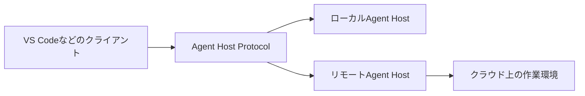

週末のため10月30〜31日の新情報を中心に、直近1週間の未紹介リリースも補いました。今回はAIエージェントの運用制御、開発ツールの安全性、Web・クラウドの実務的な修正が目立ちます。

---

## 1. Claude Code 2.1.316 — Subagentの推論強度と組織ポリシーを個別制御

10月31日に公開された [Claude Code 2.1.316の公式Release Notes](https://github.com/anthropics/claude-code/releases/tag/v2.1.316) では、エージェントを組織で運用する際の制御点が増えた。新しい環境変数 CLAUDE_CODE_SUBAGENT_EFFORT は、Subagentに明示的な指定がない場合の推論強度を設定する。従来のように親セッションの設定を引き継ぐだけでなく、役割に応じた既定値を設けられる。調査を軽量に、重要なレビューを高い強度で、という設計をしやすくなる。ただし個別Subagentに指定された設定を上書きする機能ではない。

Claude apps gatewayには、管理APIの pooled_budget によるグループ共有の月次予算が追加された。各メンバー固有の上限とは別に、チーム全体の利用枠を持たせられる。また managed.policy_mode: layered を選ぶと、開発者に一致する管理ポリシーを最初の一件だけでなく重ね合わせて適用する。部署共通の制限とプロジェクト固有の制限を分離できる反面、重ねる順序と最終的な権限を検証する必要がある。Bedrock向けの guardrail.input_tagging も追加され、プロンプト攻撃検知用の入力タグを付けられる。

運用上はモデルの移行期限にも注意したい。公式ノートによれば、Opus 4.8のfast modeは10月30日に非推奨となり、11月30日に削除予定。削除後は標準モードへ自動フォールバックせずエラーになるため、継続して高速化を利用する場合はOpus 5.5への移行を検討する必要がある。加えて、制限付きセッションで作業ディレクトリ外のファイルがアップロードされ得た問題なども修正された。

**開発者目線:** エージェントを増やすほど「誰がどのモデルをどの予算と権限で動かしたか」が重要になる。まず小さな検証環境で、親子Agentのeffort、ポリシーの優先順位、拒否時のエラー、予算超過時の挙動を組み合わせて確認したい。コスト最適化と情報保護を同じ設定ファイルの思い込みで済ませないことが実務的なポイントだ。

---

## 2. VS Code 1.144 — Agent Host Protocolとクラウド継続実行を正式に案内

10月28日公開の [Visual Studio Code 1.144公式更新情報](https://code.visualstudio.com/updates/v1_144) は、エディタのAIチャットを「開いているウィンドウの中の作業」から切り離す方向性を鮮明にした。Agent Hostはエージェントの実行をクライアントとは別のプロセスで管理し、Agent Host Protocol（AHP）v1.0はローカル・リモートのAgentセッションにクライアントが接続するための公開プロトコルだ。エディタを閉じても作業が続く仕組みや、異なる画面から同じセッションへ戻る体験を支える。

今回のRelease Notesでは、GitHub上の管理環境でタスクを動かすCloud Sessionsと、Agentsウィンドウから設定するCloud Automations（Preview）を説明している。クラウド実行では作業用ワークスペースが分離され、ローカルの未コミット変更が自動的に渡されるわけではない。利用には有料Copilotプランや組織ポリシーの条件もある。さらに、リスク評価に基づいて低リスクのツール呼び出しを自動承認するAssisted permissionsはGAとされ、Folder isolationが前提になる。

モデル比較機能では、同じ指示を複数のモデルやHarnessに与えた結果を並べられる。画像生成はPreview、デスクトップアプリを操作するComputer useはExperimentalと段階が異なる。機能一覧をすべて正式版とみなさず、権限・課金・隔離条件を確認する必要がある。

**開発者目線:** 重要なのはモデル名より、実行環境とUIを疎結合にできることだ。長時間のビルドやレビューをAgentに任せる場合、セッション再接続、承認待ち、未コミット差分の持ち込み、成果物の回収を一連の運用として試したい。AHPを使う独自クライアントの可能性もあるが、まず公式仕様の認証・接続・復元の境界を把握するのが先決だ。

---

## 3. pnpm 12.17.0 — Node・Cargo・Pythonの更新確認を一つの入口へ

10月30日の [pnpm 12.17.0リリース](https://github.com/pnpm/pnpm/releases/tag/v12.17.0) は、JavaScript依存関係だけを扱うパッケージマネージャーという枠を少し広げた。pnpm outdatedとpnpm updateが、packageManagerやdevEnginesに記されたパッケージマネージャー・ランタイムのバージョンも確認・更新するようになった。さらに cargo.enabled または python.enabled を使う構成では、Cargo.toml・Cargo.lockやpyproject.toml・pylock.tomlにある依存関係も対象に含める。混在リポジトリで更新状況を一か所から確認できる方向の改善だ。

依存関係の上書き指定にも変更がある。overridesのセレクターが :prod、:optional、:peer といった依存グループや、親・対象パッケージ名のワイルドカードを扱えるようになった。セキュリティ修正を全体に強制する場合と、開発時だけの依存関係に限定する場合を分けやすくなる。ただし広いワイルドカードは意図しないパッケージにも作用するため、Lockfile差分のレビューが欠かせない。

細かな修正にも運用上の価値がある。pnpmが生成するファイルの権限が通常のumaskに従うようになり、ビルドしたユーザーと実行ユーザーが異なるDockerイメージで読み取りに失敗する問題を解消。ローカル依存関係の変更を見逃して次回の --frozen-lockfile が失敗する問題や、グローバル仮想ストアの循環依存で古いコピーが残る問題にも手が入った。

**開発者目線:** モノレポの更新自動化では「一覧が出る」ことと「安全に一括更新できる」ことを区別したい。まずoutdatedで差分を可視化し、ランタイム更新・Cargo・Pythonの変更を別々にCIで検証する。Dockerの非root実行テストや二度目のfrozen installも加えると、今回修正された種類の回帰を見つけやすい。

---

## 4. Wrangler 4.156.0 — D1横断分析と静的ファイル誤公開の防止

10月29日に公開された [Wrangler 4.156.0のRelease Notes](https://github.com/cloudflare/workers-sdk/releases/tag/wrangler%404.156.0) には、運用観測とデプロイ安全性の両方に関わる更新がある。実験的な wrangler d1 insights は、データベース名を省略するとアカウント内のすべてのD1データベースを対象に上位クエリを取得できるようになった。結果にはdatabaseIdが付くため、同じようなクエリが複数のDBにある環境でも出所を特定できる。GraphQL Analytics APIがレート制限や権限不足を返した際、従来の空配列ではなく理由を説明するようになった点も重要だ。

より重大なのはゼロ設定デプロイ時の保護だ。静的ファイルがプロジェクトルートにある場合、生成されるべき .assetsignore が欠け、.envや.dev.vars、.git、node_modulesなどを公開アセットとしてアップロードし得た問題が修正された。ルートディレクトリと相対パス「.」の比較が正しくなかったことが原因で、今回の修正では除外パターンも拡充された。すでに公開済みのアセットが自動で削除されるとまでは公式ノートに書かれていないため、既存デプロイの点検は別途必要だ。

もう一つ、Pagesのfunctionsディレクトリとルートの静的ファイルが共存するプロジェクトを、非対話モードで誤って静的サイトとして扱う問題も修正。CIやCoding Agentによる自動設定では、Functionsが実行されないままデプロイされる代わりに、説明付きエラーで停止する。

> [!WARNING]
> 実験的なD1 insightsの利用には分析APIへのアクセス権限が必要。自動デプロイの挙動変更は既存CIの失敗として表面化する可能性がある。

**開発者目線:** 生成設定を信用する前に「何を公開アセットとして列挙するか」をCIで検査したい。秘密ファイルの名前を直接リクエストして404になることを確認するテスト、Functionsの疎通テスト、D1分析APIの権限エラーを区別する監視を組み合わせると効果的だ。

---

## 5. Biome 2.6.4 — Vue・Svelte・JavaScriptの新しいNurseryルール群

10月28日に公開された [Biome 2.6.4](https://github.com/biomejs/biome/releases/tag/%40biomejs/biome%402.6.4) は、パッチ版ながら多数の新しいNurseryルールを追加した。Nurseryは実験的なルール群であり、通常の安定した推奨ルールと同じ前提で一斉に有効化するものではない。JavaScript向けには、console.logの引数間に重複した空白が出る noConsoleSpaces、Array.prototype.flatの深さに説明のない数値を使う noMagicArrayFlatDepth、pushやunshiftの戻り値を誤用する noReturnArrayPush などが増えた。

Vue向けの追加は特に多い。computed内で状態を変更する noVueSideEffectsInComputed は、計算結果の取得と副作用を混ぜたコードを検出する。親から渡されたpropsを子が直接変更する noVueMutatingProps、Vue 3で廃止されたset/delete系APIを検出するルール、未使用のテンプレートrefを探すルールなども含まれる。Vueのcomputedは再評価のタイミングをフレームワークが管理するため、副作用があると再現性の低い不具合につながりやすい。

SvelteではcreateEventDispatcherにイベント型を付けるルール、YAMLでは真偽値をキーにする書き方を検出するルールが追加された。すべてのルールが同じ成熟度とは限らず、例えばVueの未使用ref検出はhtml.experimentalFullSupportEnabledの設定を必要とする。公式の個別ルールドキュメントも確認して導入を判断したい。

**開発者目線:** 大規模コードベースでは、まずNurseryの候補を選んで警告件数と誤検出を観察するのがよい。特にprops変更やcomputed内の副作用は、単なる書式ではなく状態管理の設計を見直すきっかけになる。一方、noNullのようにチームの設計方針によって評価が分かれる規則は、機械的に採用せずレビューで合意したい。

---

## 6. Electron 45.2.0 — Windowsメニュー配色と拡張機能ストレージを拡張

10月30日の [Electron 45.2.0公式リリース](https://github.com/electron/electron/releases/tag/v45.2.0) では、デスクトップアプリの見た目と拡張機能互換性を改善した。Windows向けにMenu.setHighlightColors()が追加され、メニューの選択状態に使う色を指定できる。アプリ独自のテーマとOSネイティブメニューの見た目が乖離する場面で、デザインの一貫性を高めるためのAPIだ。OSごとの適用範囲を確認し、macOSやLinuxで同じ表示になると決めつけないことが重要になる。

拡張機能ではchrome.storage.syncをサポート。ただし公式ノートは、これをChromeの同期容量制限に従う「二つ目のローカルストレージ領域」と説明しており、端末間同期は行わないと明記している。API名だけを見てクラウド同期を期待すると、設定が別端末に伝わらない設計ミスにつながる。拡張機能を移植する場合、保存APIの互換性と実際の同期機能を分けて検証したい。

修正面では、DevToolsのSaveが毎回保存先を尋ねる問題、window.openの小数のopacity値が切り捨てられる問題、webContents.adjustSelection()のend指定が無視される問題などを解消。本文のないnet.fetchリクエストとfile: URLへの繰り返しアクセスの性能も改善された。翌31日には45.2.1が公開され、Chromium更新と上流修正が入っているため、導入時は後続パッチの確認も有用だ。

**開発者目線:** ElectronはWeb技術でUIを作れても、OS固有の表示・保存ダイアログ・拡張APIは独立した互換性検証が必要だ。Windowsのメニュー配色、拡張設定の保存と再起動後復元、複数OSでのDevTools操作を小さなスモークテストにしておくと、パッチ更新の品質を評価しやすい。

---

## 7. Zed 1.26.2 — WebAssemblyのDWARFデバッグとPyreflyを追加

10月28日に公開された [Zed 1.26.2のリリースノート](https://github.com/zed-industries/zed/releases/tag/v1.26.2) では、エディタが扱う言語とデバッグ対象の幅が広がった。JavaScriptデバッガにDWARFを使ったWebAssemblyソースのデバッグが追加され、Wasmへコンパイルされたコードの調査がしやすくなった。DWARFはコンパイル後の機械語と元のソース位置・変数情報を対応付けるデバッグ情報の形式で、ブラウザ上のJavaScriptだけでは追いにくかった処理の内部を確認するために使われる。

Python向けにはPyreflyが任意の組み込みLanguage Serverとして追加された。Pythonのlanguage_servers設定で有効化する仕組みで、既存の言語サーバーが強制的に置き換わるわけではない。デバッガの変数ホバーには入れ子の値を展開できるツリー表示が加わり、深いオブジェクト構造の調査に役立つ。macOSではDisplay P3色空間への対応設定も追加されたが、表示結果はディスプレイやOS環境に依存する。

AI関連では、ACPエージェントの設定既定値が既存セッションを再開した際に意図せず変わらないよう改善。OpenCodeやGoogle系モデルとの互換性も調整された。Gitパネルで未ステージ変更を破棄するとステージ済みの変更まで消える不具合、Subagentを含むスレッド復元時のハングも修正されている。

**開発者目線:** Wasmデバッグは、RustやC/C++などで生成したモジュールの不具合調査を、ビルドログだけに頼らず進める足場になる。実際に試す際はDWARF付きのビルド成果物を用意し、ブレークポイント・変数表示・最適化の影響を確認したい。ACPでは新規セッションと再開セッションで設定が一致するかを比較すると、エージェント利用時の予期しない挙動を減らせる。

---

## 8. ty 0.0.93 — 既存の型エラーをBaseline化して段階導入

10月28日の [ty 0.0.93公式リリース](https://github.com/astral-sh/ty/releases/tag/0.0.93) は、既存Pythonプロジェクトへ新しい型チェッカーを導入する際の現実的な障壁を下げるPreview機能を追加した。診断Baselineを使うと、最初に存在する型エラーを記録し、その後のチェックでは一致する既存診断をCLIの通常出力から除外できる。新たに生じたエラーに注意を集中しつつ、既存コードの負債を段階的に減らせる仕組みだ。

設定例はpyproject.tomlの [tool.ty] に baseline = "ty-baseline.json" を置き、ty check --update-baseline で現在の診断を記録するというもの。Language ServerではBaselineに一致する診断をヒントとして表示する。公式はフォーマットがPreview期間中に変わる可能性を明記しているため、Baselineファイルの生成手順や更新ルールをCIに組み込む場合は、ツールのバージョンを固定したい。Baselineを更新するだけで新しい問題を隠せてしまうため、変更差分のレビューも必要だ。

型推論ではDjangoの抽象モデルに不要な主キーを合成しない修正、繰り返し登場するParamSpecの制約統合、LiteralString比較やmatch文での型絞り込みの修正が入った。長い論理式や大きなUnionを扱う処理の最適化、Linux x86-64配布物へのLLVM BOLT最適化も含まれる。後続の0.0.94、0.0.95では別の不具合修正が続いている。

> [!WARNING]
> 診断BaselineはPreview。記録したエラーが「解決した」わけではなく、日々の出力で目立たなくなるだけだ。

**開発者目線:** 既存コードに型検査を入れる際は、全件修正を要求するより「新規のエラーを増やさない」運用から始める方が継続しやすい。Baselineの更新を専用PRに限定し、差分件数・除外件数をCIで可視化する設計なら、導入直後のノイズと品質目標を両立できる。

---

## 9. Cloudflare Keyless SSL — ECDSA証明書でTLS 1.3を利用可能に

Cloudflareは10月30日、[Keyless SSLでECDSA証明書を使う場合にTLS 1.3へ対応した](https://developers.cloudflare.com/changelog/post/2026-10-30-keyless-ssl-tls13-ecdsa/) と発表した。Keyless SSLは、Webサイトの秘密鍵をCloudflareのエッジへ直接置かず、利用者側の鍵サーバーで保持したままTLS接続を提供する仕組みだ。秘密鍵の保管場所を管理する必要がある企業にとって、鍵の運用境界を維持しながらエッジでのTLSを利用できる点に価値がある。

今回の変更では、ゾーンでTLS 1.3が有効になっており、対象ホスト名がKeyless ECDSA証明書を使う場合、訪問者との接続でTLS 1.3をネゴシエートできる。ECDSAは楕円曲線暗号を利用した署名方式で、RSAと比べて鍵や署名が小さくなる構成を取りやすい。一方、Cloudflareの公式説明では、Keyless SSLでRSA証明書を使う接続は引き続きTLS 1.2までとなる。すべてのKeyless SSL利用者が自動的にTLS 1.3へ移行するわけではない。

ここで区別したいのは、ブラウザからCloudflareへの接続、Cloudflareからオリジンへの接続、Cloudflareと鍵サーバー間の通信が別の経路だという点だ。今回の告知は主に訪問者とのTLSバージョンに関するもので、オリジン側のTLS構成や鍵管理の要件まで変更されたと推測してはいけない。運用時には証明書の種類、ゾーンの最小TLSバージョン、クライアント互換性をそれぞれ確認する必要がある。

**開発者目線:** セキュリティ設定の移行は「TLS 1.3を有効化した」だけで完了しない。ECDSAとRSAのどちらの証明書で応答しているか、実際の接続で選ばれるTLSバージョン、古いクライアントの失敗率を観測することが重要だ。証明書の切り替え前後でTLSハンドシェイクを測定し、鍵の所在とネットワーク経路を図にしてレビューすると誤解を減らせる。

---

## 10. Cloudflare Vitest Plugin 1.4.11 — テスト終了を妨げる非同期ログを修正

10月29日に公開された [@cloudflare/vitest-plugin 1.4.11](https://github.com/cloudflare/workers-sdk/releases/tag/%40cloudflare/vitest-plugin%401.4.11) は、テスト自体は成功しているのにプロセスが終わらないという厄介な不具合を修正した。Workers環境では、SELF経由のハンドラ、Queue Consumer、waitUntil()コールバックなど、テスト実行側とは異なるI/Oコンテキストからconsole.logが呼ばれる。以前はそのログが次のRunnerメッセージまでバッファに残り、最後のログの後に次のメッセージがないと、Vitestが待っているRPC完了通知と互いに待ち合う状態が生じた。

今回の修正では、別のI/Oコンテキストからログがバッファへ入った時点で、Runner側のコンテキストからフラッシュするようになった。単にログ表示が遅れる問題ではなく、テスト終了条件に影響する同期の問題だった点が興味深い。ログを追加するとテストが固まる、逆にログを削除すると再現しなくなる、といった不可解な症状の説明にもなる。

同じリリースには、Durable Objectが自身のWorkerを明示的に参照するBindingをテストランナーで正しく解決する修正も含まれる。cloudflare.config.tsとWrangler設定の双方を対象とし、名前付き環境では実効的なWorker名を用いてローカルと外部Bindingを区別する。実環境で正しい構成が、テスト時だけ異なるWorkerへ解決される問題を減らす改善だ。

**開発者目線:** 非同期テストのハングは、タイムアウトを伸ばす前に未完了のRPC・ログ転送・waitUntil・Queue処理を切り分けたい。特に「アサーションは全部成功したのに終了しない」ケースでは、ログの送信経路も調査対象になる。今回の修正を取り込んだら、Queueの最終バッチやSELF呼び出しを含む再現テストを残し、正常終了までをCIの合格条件にするのがよい。

---

## 👀 今日ならこの3つ

### 🥇 Wrangler 4.156.0

自動設定による秘密ファイルの誤公開を防ぐ修正は、実際の運用事故を避ける観点から最優先。既存の公開アセットとCIの生成設定も点検したい。

### 🥈 Claude Code 2.1.316

Subagentの推論強度・グループ予算・ポリシーの重ね合わせは、エージェントを個人利用からチーム運用へ広げる際に直結する。

### 🥉 VS Code 1.144

Agent Host Protocolとクラウド継続実行は、エディタを閉じても進む開発作業をどう管理するかという設計の変化を示している。
