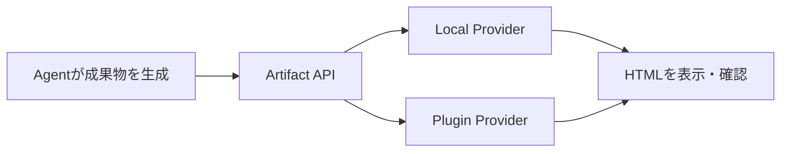

Wranglerの公開範囲・Middleware修正、Node.js 27 Alpha、OpenCodeのHTML Artifact、workerdのRust相互運用と暗号API、Babylon.jsやNext.jsの改善など、週末に確認できた一次情報を10本詳しく解説します。

---

## 1. Wrangler 4.156.1 — Pagesの意図しないファイル公開とMiddleware迂回を修正

11月1日（UTC）公開の [Wrangler 4.156.1](https://github.com/cloudflare/workers-sdk/releases/tag/wrangler%404.156.1) は、単なる型定義の更新ではなく、静的サイトの公開範囲とアクセス制御に関係する修正を複数含む。特に `wrangler pages deploy <directory>` をWorkersの静的アセットとして扱う経路で、指定ディレクトリが途中で失われ、ツール側が別のディレクトリを自動検出する問題が直された。プロジェクト直下に `index.html` があると、指定した `public` ではなくプロジェクト全体が候補となり、除外設定次第でソースや設定ファイルが公開アセットに混ざる可能性があった。

同じリリースでは、Pagesの開発用アセット検索が設定された出力ディレクトリの外へはみ出さないよう、解決済みパスを検証する修正も入った。さらに `//secure/one` のような連続スラッシュを含むURLでPages FunctionsのMiddleware探索が回避され得る問題を修正。Middlewareを探すときだけスラッシュを正規化し、元のリクエストURLや関数ルート照合は維持する。OAuthログインのコールバックでは、エラー時を含めて保留中のログインと一致するstateを要求するようになった。

Windows環境でCRLF改行の `worker-configuration.d.ts` を扱う際、`wrangler types --check` が常に古いと判定する不具合も修正された。実行環境のヘッダー末尾に残る `\r` が比較を失敗させていたもので、セキュリティ修正と同時に日常的な開発ノイズも減る。

**開発者目線:** 配信ディレクトリの誤認は「ビルドが成功したから安全」という前提を崩す。更新後はステージングで公開アセットの一覧を確認し、設定ファイルやソースがHTTPで取得できないことをテストしたい。Middlewareの保護対象パスには二重スラッシュの回帰テストを加え、`wrangler types --check` はWindowsのCRLFチェックアウトでもCIと同じ結果になるか確認するとよい。なおリリースノートは修正内容を示すが、個々の利用環境での露出の有無までは示していない。

---

## 2. Node.js 27 Alpha — V8 15.6とHeap制限の変更を先行公開

10月29日に [Node.js 27.0.0 Alpha](https://github.com/nodejs/node/releases/tag/v27.0.0-alpha.0.0.0) が公開された。これは本番運用向けの安定版ではなく、次期メジャーの互換性変更を早めに試すためのビルド。JavaScriptエンジンはNode.js 26のV8 14.6から15.6.75.13へ進み、`Math.sumPrecise()`、Iteratorの `join()`・`includes()`・`zip()`・`zipKeyed()` などが既定で利用可能になった。言語機能の増加だけでなく、ランタイムのメモリ管理やシリアライズ形式が変わる点が重要だ。

`--max-old-space-size` を明示しない場合、既定のHeap上限は物理メモリの半分を基準に256MB〜4GBへ制限される。また `Buffer` と `ArrayBuffer` の保持メモリも上限計算に含まれる。従来の設定に依存していた大きなビルドやデータ処理では、Node.jsだけ更新してメモリ不足になる可能性がある。Heap Snapshotは内部オブジェクトやスクリプト全文を含むようになり、取得時間とファイルサイズが約2倍になるとリリースノートに記載されている。

互換性面では `v8.serialize()`、`structuredClone()`、`postMessage()` のシリアライズ形式が変わり、古いNode.jsから読めない場合がある。OpenSSL 3以降を要求し、従来のFIPS Provider同梱ビルドや古いOpenSSL経路も整理される。HTTPのKeep-Alive既定値や `domain` の非推奨化など、アプリコードの外側に見える差分も多い。

> [!WARNING]
> Alphaは検証用。既存サービスの実行環境を置き換える前提ではなく、依存ライブラリやビルド処理の互換性を洗い出す段階と考えたい。

**開発者目線:** CIにNode.js 27 Alphaの任意実行ジョブを追加し、Heap使用量、シリアライズの永続化、HTTP接続維持、暗号ライブラリを重点的に比較する価値がある。特に異なるNode.jsバージョン間でバイナリデータを共有する仕組みは、単体テストだけでは見落としやすい。

---

## 3. OpenCode 2.2.4/2.2.5 — HTML成果物と永続TerminalをAgentの作業単位へ

10月30日の [OpenCode 2.2.4](https://github.com/anomalyco/opencode/releases/tag/v2.2.4) では、AgentがHTMLや静的ファイルを成果物として公開・更新できる実験的なArtifact機能が追加された。`opencode.json` で `"experimental": { "artifacts": true }` を有効化すると、`artifact_create`・`artifact_read`・`artifact_update`・`artifact_delete` を使える。標準のローカル静的ファイルProviderに加え、Plugin側で保存先を拡張でき、SDKにもArtifact操作が追加された。これは回答を文章だけで返すのではなく、ブラウザで検証できる小さな成果物として扱う方向の更新だ。

同時にDesktopのTerminalがセッションに属する永続PTYへ変更された。サーバー再起動後もスクロール履歴やTerminal名が残り、TUIや別ウィンドウとも同期する。以前はUIの画面単位でTerminalが途切れると、実行したコマンドの経緯を追い直す必要があった。Agentが長時間の開発作業を担当するほど、Shellの履歴と作業文脈が継続することの価値は大きい。実験的なスケジュール実行も `opencode serve` で動くようになり、複数サーバープロセス間で二重実行を抑える仕組みが加わった。

続く [2.2.5](https://github.com/anomalyco/opencode/releases/tag/v2.2.5) は、`"compaction": { "buffer": "20%" }` のようにContext Windowの空きを割合で確保する設定、Worktree選択ショートカット、MCPの10MiB超メッセージ処理改善を追加した。固定トークン数ではモデルのContext Windowごとに余白の比率が変わるため、割合指定はモデル切替の多い環境に向く。

以下はArtifact機能を使う際の概念的な流れ。公開先はローカルProviderまたはPluginであり、インターネット上へ自動公開されることを意味しない。

**開発者目線:** 設計レビューの比較表や操作可能な試作品を、Agentとの会話から直接作る用途が考えられる。一方でArtifactは実験的機能なので、公開範囲・ファイル保持期間・危険なHTMLの実行境界を確認し、実行可能なコードを信頼済みのレビューなしに配布しない運用が必要だ。

---

## 4. workerd 20261101 — RustとC++のJSG相互運用、Durable Object Facetsの基盤

11月1日（UTC）公開の [workerd v1.20261101.1](https://github.com/cloudflare/workerd/releases/tag/v1.20261101.1) には、Rust側のJSGリソースとC++側のJSGリソースをつなぐ `jsg-cpp` 相互運用、Durable Object FacetsのCluster実装、Trace送信処理の完了を呼び出し元へ通知する変更が入った。JSGはJavaScriptのオブジェクトとネイティブ実装を結び付ける層であり、WorkersのランタイムがJavaScript APIを提供する土台の一部を担っている。

RustとC++の境界を越えてリソースを扱えるようにすることは、既存のC++実装を一度に全面移植せず、機能ごとにRustへ移すための足場になる。ただし今回のRelease Notesが示すのは相互運用コードの追加であって、全APIのRust化や一般開発者向けの新API公開ではない。Durable Object Facetsも内部Clusterの変更として記載されており、アプリケーションがそのまま新しい公開APIを使えると読み替えるべきではない。

Trace処理では、`sendTraces()` の呼び出し元がHandlerの終了を把握できるようになった。観測データの送信を非同期で進める環境では、処理を投げたことと完了したことは別の事象だ。終了通知を扱えると、テストの終了判定やFlushの設計をより明確にできる。Web Platform TestsのHarnessの不足を埋める変更も含まれ、実装と仕様の整合性を継続的に確かめる姿勢が見える。

**開発者目線:** この更新は直ちにアプリコードを書き換えるニュースではなく、Edge Runtimeの内部構造を読む材料だ。Native Resourceの所有権、非同期処理の終了保証、互換性テストという三つの観点は、Plugin HostやゲームエンジンのScript Bindingを設計するときにも共通する。公開APIと内部実装の変更を分けて追うことが重要になる。

---

## 5. Babylon.js 9.33 — KTX2エンコードとGaussian SplattingのWebGPU改善

10月29日の [Babylon.js 9.33.0](https://github.com/BabylonJS/Babylon.js/releases/tag/9.33.0) と30日の [9.33.1](https://github.com/BabylonJS/Babylon.js/releases/tag/9.33.1) は、WebGPU描画とアセット処理の両面を更新した。9.33.1ではBasis Universalを使ったKTX2 EncoderがCoreへ追加された。KTX2はGPU向けテクスチャを効率的に扱うためのコンテナ形式で、画像をそのまま大きなRGBA配列として配る場合に比べ、配信サイズやGPU上の扱いを最適化する余地がある。Encoderの追加は読み込みだけでなく、アセット生成側の選択肢を広げる点が面白い。

9.33.0ではGaussian SplattingのWebGPU Texture Fetchの性能問題を修正し、GPU Depth Sortを任意で有効にする機能を追加。Gaussian Splattingは大量の半透明な楕円状の要素を重ねて空間を表現するため、描画順序が画質に影響しやすい。Depth SortをGPU側で行う選択肢はCPUとGPUの役割分担を調整するためのものだが、実際の高速化はScene規模やGPUに依存する。Release Notesには全環境での一律な速度向上率は示されていない。

さらにWebGPUのTimestamp Writeを使ったGPU Frame Time取得、Temporal View DataとしてCamera履歴とTAA JitterをScene Uniform Bufferへ載せる変更、glTFの `KHR_materials_scatter` Import/Export、Native Host向けRender Pass Command StreamのBatchingなども入った。描画時間を測る仕組みと描画自体を改善する仕組みが並行して進んでいる。

**開発者目線:** KTX2のEncoderを使うなら、画質・圧縮時間・配信サイズ・実GPUでのDecodeとMemoryをセットで評価したい。SplattingやTAAを導入する場合は、GPU Timingとフレームの安定性を併せて計測することが重要。画質改善のスクリーンショットだけでなく、異なる端末でのFrame Timeの分布まで記録すると判断しやすい。

---

## 6. Next.js 16.5 Canary — Cacheの例外処理とTurbopackのメモリ効率を調整

10月31日公開の [Next.js 16.5.0-canary.35](https://github.com/vercel/next.js/releases/tag/v16.5.0-canary.35) は、`'use cache'` 内で捕捉されたErrorを含むPrerender処理の修正、Response Cloneの後片付けで起きるCancellation Errorの処理、App RouterとPages Routerの国際化パス照合の調整を含む。CacheやPrerenderは、開発中に動いていてもBuild時や本番配信時に異なる実行経路を通る。例外を捕捉した結果をどのようにキャッシュへ反映するかは、単純な成功・失敗の二択では扱いにくい。

Turbopack側では、Tree Shakingで不要になったModuleのASTを破棄する変更や、Pages RouterのRouteが存在するときだけClient Entryを追加する修正が入った。ASTはソースコードを解析した木構造で、Module Graphが大きいプロジェクトでは保持コストが積み重なる。不要なASTを早く手放せればBuildのMemory圧力を下げる方向に働くが、実測値はRelease Notesに示されていない。続く [canary.36](https://github.com/vercel/next.js/releases/tag/v16.5.0-canary.36) では、Module Graph構築時のPer-module Data解決を一度にする最適化が加わった。

また、Cache Handlerの失敗後の再利用、並行Read時の検証、Turbopackが内部整合性エラーでPanicする代わりに報告する処理など、失敗経路のテストも強化されている。正常系の速度改善よりも、途中で処理が取り消されたときやCacheが部分的に壊れたときに何が起きるかがテーマになっている。

> [!WARNING]
> Canaryは先行検証版であり、安定版への取り込み時期や挙動の完全な互換性を保証するものではない。

**開発者目線:** Cache Componentsを使うプロジェクトでは、Build中の例外、Handlerの書き込み失敗、同時アクセス、再検証のケースをテストに入れたい。TurbopackのMemory改善を確認するなら、同じLockfileとNode.jsバージョンでPeak RSSとBuild時間を比較し、Canary特有の回帰も同時に探すのが現実的だ。

---

## 7. Gemini CLI Nightly — Symbolic LinkとExtension同時Installの境界を修正

10月31日公開の [Gemini CLI 0.67.0 Nightly](https://github.com/google-gemini/gemini-cli/releases/tag/v0.67.0-nightly.20261031.g6814e00d6) は、Agentのファイル探索、Extension導入、Streaming応答の信頼性を改善した。特に `GlobTool` がSymbolic Linkを経由するパスを正規化して扱う変更と、Shadow Repositoryで `.git/info/exclude` および `core.excludesFile` を尊重する修正は、ファイルがどこに存在するか・何を対象外とするかという基本動作に関わる。

GitのIgnore設定は `.gitignore` だけではない。ローカル専用のExcludeやユーザー共通のExcludeを利用している場合、通常のGit操作とAgentのShadow Repositoryで対象ファイルが異なると、差分の扱いが食い違う可能性がある。Symbolic Linkについても、見かけ上のパスと実体のパスが異なるため、探索結果の重複や範囲判定を考える必要がある。ただし今回のRelease NotesはCanonical Path解決の修正を述べており、すべてのPath Traversal問題を解消したと主張するものではない。

Extension InstallはExtensionごとのLockを使って同時実行を直列化するようになった。複数の処理が同じExtensionを同時に更新すると、途中状態を読み込む競合が生じ得る。CodeAssistServerのSSE StreamingではEOF時に残ったEvent BufferをFlushする修正、モデルの一時的なFallback・Cancel・Rewind後に選択モデルを維持する修正も含まれる。どれもAgentを長時間使うと表面化しやすい問題だ。

**開発者目線:** Agent CLIの品質はモデル性能だけでは測れない。Symbolic Link、Ignore Rule、Extensionの並列更新、Streamの途中切断といった境界条件で、どのファイルが読まれ、どの処理が完了したかを追跡できることが重要。Nightlyを試すなら本番設定とは分け、こうした回帰ケースを再現可能なFixtureにして比較するとよい。

---

## 8. pnpm 11.28.10 — Store Pruneの巻き込み削除とLocal依存の見落としを修正

10月30日公開の [pnpm 11.28.10](https://github.com/pnpm/pnpm/releases/tag/v11.28.10) は、安定運用で効く細かな修正をまとめたMaintenance Release。注目は `pnpm store prune` の削除範囲だ。`cacheDir` が複数Storeの親ディレクトリを指す構成で、対象外のStoreやGlobal Package Dataまで削除される問題を修正した。Cache整理は普段のBuildを速くするための補助処理だが、誤って他のStoreを消すと別プロジェクトのInstall時間や再現性に影響する。

Local DirectoryやTarballへの依存も改善された。OverrideやPackage Extensionを経由してRegistry PackageがLocal Directoryを参照する場合、そのディレクトリの `package.json` が変わっても再解決されない問題を修正。`pnpm install --frozen-lockfile` は古い依存情報を記録したLockfileを適切に失敗扱いする。Workspace内のLinkが消えていても「Already up to date」として放置する問題や、Local Tarballの変更を検知できない問題も修正された。再実行して成功と表示されたのに実体が古い、という最も気づきにくい種類の不整合に対応している。

DockerのMulti-stage Buildでコピーした `node_modules` に対する `pnpm prune --prod` の `ERR_PNPM_EXDEV`、途中で切れたNode.js Runtime ZIPのDownload Retry、Global InstallしたCommandのHoisted Dependency解決も修正された。なお11系の更新であり、前日に扱った12.17.0の新機能とは別のMaintenance Lineだ。

**開発者目線:** Lockfileが同じでも、Local PackageやGlobal Virtual Storeの状態によって実行結果が変わる可能性を再確認させる更新だ。CIではClean Installと差分Installを両方検証し、Local PackageのManifest変更後に必要な再解決が走るかを確かめたい。Storeの削除系コマンドは共有Cacheを持つRunnerで特に慎重に扱うべきだ。

---

## 9. Electron 44.10.1 — file: Fetchの反復性能とDevTools保存操作を改善

10月31日公開の [Electron 44.10.1](https://github.com/electron/electron/releases/tag/v44.10.1) は、Desktop Appの細かな体験を左右する修正を収録した。`net.fetch()` でRequest Bodyがない場合の処理性能を改善し、`file:` URLを繰り返しFetchするケースも最適化した。これらは44系だけでなく、43・45・46系にもそれぞれBackportされている。Electronではブラウザ由来のAPIとNode.js寄りのI/Oを組み合わせることが多く、Local Resourceの読み込みが細かく繰り返される画面では小さなOverheadが積み重なる。

DevToolsの「Save」で毎回保存先を尋ねてしまう問題、Save Asで古いFileを使ってしまう問題、LinuxでCancelした操作を保存済みとみなす問題も修正された。開発者ツールの保存操作はアプリの機能そのものではないが、CSSやSourceを調査・編集する作業では結果が信用できることが重要だ。保存できていないのに成功したように見える挙動は、デバッグ時間を無駄にする。

`webContents.adjustSelection()` が `end` Optionを無視する問題も修正された。これはText Selectionの境界をプログラムから調整するAPIで、選択範囲に対してCommandを実行するEditorや、Text Annotationを持つUIで影響し得る。加えてChromium・Dawn・Skia・V8からの修正が取り込まれているが、Release Notesだけで個々の上流修正の影響を断定することはできない。

**開発者目線:** Desktop Appでは「機能が正しい」だけでなく、Local Fileの読み込みやText Selectionが繰り返し使われたときの体感が大切。更新を評価するなら、同じFile群を連続して読み込むMicrobenchmark、Selection APIの端点テスト、DevToolsで保存をCancelしたときのUIを確認するとよい。性能改善の倍率は公式に提示されていないため、実際のWorkloadで測る必要がある。

---

## 10. workerd 20261030 — WebCryptoへSHA-3・ChaCha20-Poly1305・ML-KEM Hybridを追加

10月30日公開の [workerd v1.20261030.1](https://github.com/cloudflare/workerd/releases/tag/v1.20261030.1) には、WebCryptoにSHA-3のDigest、ChaCha20-Poly1305、MLKEM768-X25519を追加する変更が含まれる。SHA-3はSHA-2とは異なる構造のHash関数群で、ChaCha20-Poly1305は暗号化と改ざん検出を組み合わせるAEAD方式。ML-KEMは耐量子計算機を意識した鍵カプセル化方式で、X25519とのHybrid構成は従来の楕円曲線方式と組み合わせて鍵交換の移行を進める考え方だ。

ただし、ここで確認できるのはworkerdの実装変更であり、Cloudflareの全てのProduction Workerに同時に展開済み、あるいは全ブラウザの標準WebCrypto APIとして利用可能になったという意味ではない。アルゴリズムの公開名、利用条件、互換性日付、鍵のImport/Export仕様は、実際に使うRuntimeのAPI Documentとテストで確認する必要がある。暗号機能は「名前がある」だけで相互運用性が確保されるわけではない。

同じリリースには、Rust JSG側の `IoContext` 受け渡し、TypeScript Streams PipeのEndpoint解放、Fetch仕様に沿った `statusText` の扱い、Python SnapshotのZstandard Compatibility Flagなども入った。暗号APIの拡充とともに、Native BindingやStream処理の土台も更新されている。暗号を利用するアプリではAlgorithmの選択だけでなく、Key LifecycleとRuntimeのバージョン管理が不可欠だ。

**開発者目線:** Edge上で暗号処理を行うなら、既存のSHA-2・AES-GCMベースの実装を即座に置き換えるより、対象Runtimeでの対応確認と既存Clientとの相互運用試験から始めたい。Hybrid KEMは特にProtocol設計の影響が大きい。Feature Detection、テストベクトル、失敗時のFallbackを明示し、鍵素材をLogへ出さない設計を優先すべきだ。

---

## 👀 今日ならこの3つ

### 🥇 Wrangler 4.156.1

公開対象のDirectory指定やMiddlewareの照合という、見落とすと事故につながる境界を修正。静的サイトを運用する開発者は優先して確認したい。

### 🥈 OpenCode 2.2.4/2.2.5

Agentの出力をHTML Artifactとして検証する流れと、Terminalの作業文脈を継続する設計が興味深い。Agent UIの次の形を考える材料になる。

### 🥉 Node.js 27 Alpha

Heap制限やSerialize形式の変更は、言語機能の追加以上に実行環境へ影響する。今のうちに互換性テストを作る価値がある。
